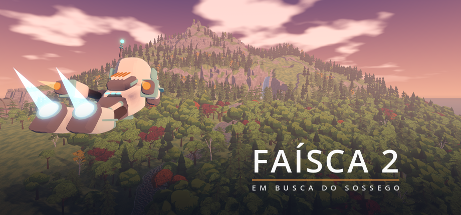
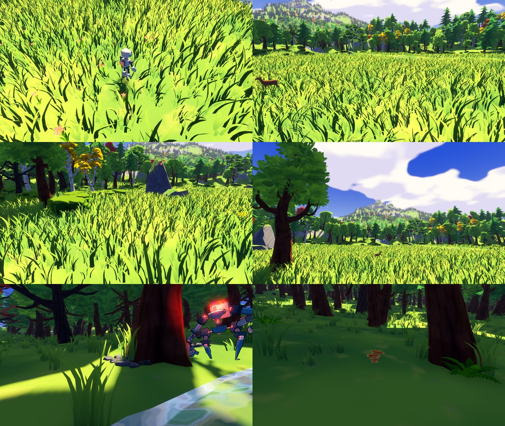
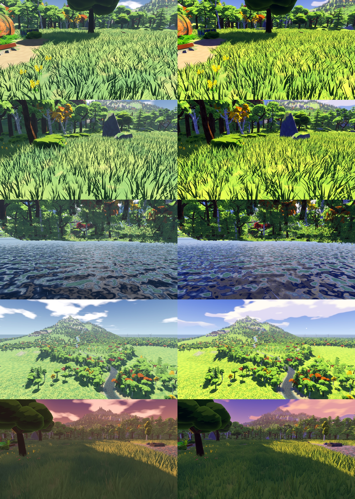

# Fagulha: Em Busca do Sossego



Um robô pequeno que anda, corre, nada e voa numa ilha sossegada de 3 km. Não há lista de objetivos: o jogo é passear, olhar, achar o que os antigos moradores deixaram e, às vezes, desligar uma máquina velha.

O nome vem da história: o Faísca, o robô que cuidou da ilha por muitos anos, passou o que sabia para um corpo novo, como a fagulha que salta de um fogo e acende outro. (Até 2026-11-21 o jogo se chamava *Faísca 2*.)

É um projeto de hobby, feito na Godot 4.7 com GDScript. Quase tudo no mundo é montado por código: relevo, mata, capim, água, ciclo do dia, construções e bichos.

## O que tem na ilha

- **Movimento:** andar, correr, pular, pairar, voar acelerado com manobras, nadar e mergulhar. O motor esquenta no voo e esfria na água, na cachoeira e na chuva.
- **Lugares:** a clareira e a base do robô, o rio em curvas, os paredões, três ruínas, a Fundição, a Represa Rachada, o Farol Apagado, o Sono dos Gigantes, o Cais Submerso, a Ilha do Relé, as Torres do Vento, o Observatório, o Casco Encalhado e a Fenda Escura.
- **Vida:** cervos, raposas, lobos, coelhos e pássaros na mata; cardumes no mar, nos rios e nas lagoas.
- **Máquinas antigas:** algumas ainda vigiam. Ninguém é destruído: elas desligam.
- **Peças e memórias:** dez peças espalhadas melhoram o robô (o drone colega instala), e doze cristais guardam memórias de quem viveu ali. Com todas lidas, o farol acende de novo.
- **História e simulação:** um jogo novo começa com um prólogo curto na ilha. Depois o robô acorda numa simulação vazia e sem fim, onde o Faísca ensina os comandos com a imagem de cada botão, e então desperta na base. Dá para voltar à simulação pela pausa e rever o prólogo na tela de abertura.
- **Dia, noite e chuva:** o ciclo muda a luz, os sons e os bichos; de noite há vaga-lumes.

## O visual

Luz em faixas, sombra colorida, névoa azul ao longe e céu pintado. A mata usa os modelos do *Stylized Nature MegaKit*: capim em tufos (com manchas de capim alto), árvores de folha larga, pinheiros, árvores secas e de tronco torto, pétalas no ar. O capim deita em volta do robô.





## Baixar

A versão pronta para jogar fica nas [releases](https://github.com/welingtonfidelis/fagulha/releases): Linux (`.tar.gz`), Windows (`.zip`) e Mac (`.zip`, universal), cada uma com o LEIA-ME, as licenças e os créditos.

## Rodar

Precisa da [Godot 4.7](https://godotengine.org) (o comando `godot` no terminal).

```bash
godot --path .
```

Joga-se com controle (feito para o DualSense) ou teclado e mouse. Os controles estão em [docs/JOGO-VOO.md](docs/JOGO-VOO.md), seções 5.2 e 33.

As builds de Linux, de Windows e de Mac saem com:

```bash
godot --headless --path . --export-release "Linux" build/linux/Fagulha.x86_64
```

```bash
godot --headless --path . --export-release "Windows" build/windows/Fagulha.exe
```

```bash
godot --headless --path . --export-release "macOS" build/mac/Fagulha.app
```

A de Mac é universal (Intel e Apple Silicon), com assinatura ad-hoc e sem notarização: na primeira vez, o macOS só abre pelo botão direito → Abrir.

O `CREDITOS.md` vai junto da build (os sons CC-BY pedem o crédito ao lado do jogo):

```bash
cp CREDITOS.md build/linux/
```

Os pacotes das releases levam também o `LICENSE`, um `LEIA-ME.txt` e o `LICENCAS-GODOT.txt`, com a licença da Godot e dos componentes dela (sai de `Engine.get_license_text()`, `get_copyright_info()` e `get_license_info()`). O de Linux vai em `.tar.gz` para o executável não perder a permissão de rodar.

## Testes e fotos

As duas baterias rodam sem janela. A do vale leva de 5 a 9 minutos.

```bash
godot --headless --path . -- --teste
```

```bash
godot --headless --path . -- --teste-vale
```

A simulação (o tutorial) tem a sua bateria, rápida; com janela ela também tira fotos:

```bash
godot --headless --path . -s tools/teste_simulacao.gd -- --teste-vale --basico
```

As fotos de conferência precisam de janela e vão para `tools/capturas/`:

```bash
godot --path . -- --vale-captura --largo --visual --hora 15 --pasta minha_pasta
```

Chaves para comparar: `--visual-antigo` (luz e cor de antes), `--sem-pacotes` (só as árvores feitas por código), `--sem-cache` (remonta o mundo do zero).

## Pastas

| Pasta | O que tem |
|---|---|
| `scripts/` | o jogo: `main.gd`, a armadura, a câmera, a interface |
| `scripts/vale/` | a ilha: relevo, mata, capim, água, lugares, bichos, máquinas |
| `scripts/shaders/` | os shaders do vale (chão, capim, folhas, céu, água) |
| `assets/` | modelos, texturas, sons e o mapa de alturas |
| `tools/` | geradores (mapa, sons, conversão de pacotes no Blender) e as capturas |
| `docs/` | o documento do projeto e as imagens |

## Documentação

Tudo o que foi decidido, feito, medido e deixado para depois está em [docs/JOGO-VOO.md](docs/JOGO-VOO.md), em ordem de data.

## Créditos

Sons, modelos e texturas de terceiros estão listados em [CREDITOS.md](CREDITOS.md), com autor e licença.

## Licença

O que é do próprio projeto (código, robôs, gigantes, músicas e textos) está sob a licença MIT: veja [LICENSE](LICENSE). O material de terceiros segue as licenças dele (CC0, CC-BY e MIT).
