# Fagulha: Em Busca do Sossego

Chamou-se "Jogo de voo" (nome provisório) e depois "Faísca 2: Em Busca do Sossego"; o nome atual é de 2026-11-21 (§135). As seções abaixo guardam o nome de cada época.

Plano aprovado pelo usuário em 2026-11-14. É a base da implementação. Nenhum código do jogo foi escrito ainda.


## 1. Ideia

Um jogo adulto em que o jogador anda, corre, voa e plana com uma armadura num mundo procedural de mata, lagos, vales e morros. A inspiração é a sensação de movimento e voo do Anthem. Personagens, nomes e visual do Anthem não entram.

O jogo é para o usuário jogar no PC com Bazzite (RTX 3060 Ti, Ryzen 5 5500, 16 GB, DualSense por Bluetooth, Steam no modo jogo).

## 2. Decisões

| Assunto | Decisão |
|---|---|
| Motor | Godot 4.7.2 com GDScript. Terreno e mata pesados vão para shaders e threads. |
| Mundo | **Feito à mão, não procedural** (decisão do usuário em 2026-11-14, para facilitar um mundo rico e vasto). Ilha com o mar como borda; tamanho e regiões saem da maquete do mapa (§13) |
| Relevo | **Vertical, o mais perto possível do vídeo de referência** (§12.1): cânions, pilares de pedra, penhascos, cachoeiras, cavernas, árvores colossais e ruínas gigantes. Substitui o relevo A (decisão de 2026-11-14) |
| Personagem | Armadura de ~2,6 m, ágil |
| Estilo | Estilizado com atmosfera: formas simples, luz, névoa e céu fazendo o trabalho, paleta sóbria |
| Calor do motor | Fica a regra da água: rasante, cachoeira e chuva esfriam o motor (essa regra vem do Anthem) |
| Pontos de interesse | Fora da primeira versão (ver §10) |
| Rumo do jogo | Exploração, movimento e jogabilidade até ficarem finos; inimigos, armas, saque, oficina e base ficam para o futuro (decisão de 2026-11-14). Mirar no ar e no chão entra já, sem arma |
| Pulo | X pula; X no ar dá o pulo duplo; segurar X decola ou liga o voo (aprovado em 2026-11-14) |

## 3. Motor: por que a Godot

| Opção | A favor | Contra |
|---|---|---|
| **Godot 4.7 + GDScript** (escolhida) | Já instalada. O caminho até a Steam do Bazzite já funciona desde a Ilha Cafuné. Cenas em texto, então dá para editar, testar e tirar fotos sem o editor. Tem névoa volumétrica, céu e sombras boas. | Não tem mundo aberto pronto: terreno grande, detalhe por distância e mata por blocos são feitos por nós. GDScript é lento em conta pesada. O teto visual é mais baixo que o da Unreal. |
| Godot com C# | Bem mais rápido em conta pesada | Outra build da Godot e o SDK do .NET; só compensa se o shader não resolver |
| Unreal 5 | Melhor visual, terreno, água e mata procedural prontos | Pesada no Mac de 16 GB; Blueprints binários; build para Linux saindo do Mac é complicada |
| Unity 6 | C# e terreno pronto | Editor obrigatório, conta Unity, nada instalado |
| Web (Three.js) | Roda no iPhone | Navegador no modo jogo do Bazzite é ruim; mundo grande com mata densa pesa no JavaScript; sem gatilho adaptativo |

## 4. Terreno procedural (abandonado em 2026-11-14)

O mundo passou a ser feito à mão (§13). Esta seção fica como registro e como fonte de técnicas (erosão, lagos pelo transbordo, biomas), que ainda servem de ferramenta para montar o relevo à mão.


### 4.1 Geração (uma vez por semente, guardada em disco)

1. **Forma:** ruído com distorção de domínio (fBm), cristas para as serras e uma máscara de baixa frequência que decide onde há morros. Uma queda radial com ruído faz a ilha e o mar em volta.
2. **Erosão:** lei do fluxo implícita (a água cava conforme a área que drena para cada ponto) mais difusão das encostas, por umas 20 rodadas. Isso cava os vales e faz os rios descerem até o mar.
3. **Água:**
   - Lagos: bacias cavadas no fundo dos vales; o nível sai do transbordo (priority-flood), então a água é sempre plana.
   - Rios: onde a área de drenagem passa de ~1,6 km².
   - Mar: abaixo do nível 0.
4. **Biomas:**
   - Mata densa onde é úmido (perto de rios e lagos, fundo de vale), com folhosas embaixo e pinheiros acima de ~520 m.
   - Campo e clareiras onde é seco.
   - Rocha onde a inclinação passa de ~40°.
   - Areia na beira do mar.

Parâmetros do relevo A na prévia (`tools/previa/gerar_mapa.py`, variante `colinas`): semente 11, base 140 m, colinas 150 m, serras 1100 m, viés de serra −0,25, erosão kdt 0,0035 em 20 rodadas, 11 lagos, linha das árvores 1000 m.

Na Godot, a geração vira compute shader (erosão e mapas) com o FastNoiseLite para o ruído. Resolução alvo do mapa assado: um ponto a cada 2 a 4 m (a prévia usa 16 m). O detalhe fino, como ondulações de ~0,5 m e pedrinhas, é somado perto do jogador.

### 4.2 Carregamento em volta do jogador

- **Relevo:** uma malha só, em anéis de detalhe (fino perto, grosso longe), deformada pela placa a partir da textura de alturas. A ilha inteira fica sempre visível.
- **Colisão:** HeightMapShape3D em blocos de 64 m, só num raio de ~250 m, gerada em thread.
- **Mata:** em células de 64 m, com posições fixas pela semente, desenhada por MultiMesh e com três distâncias:
  - completa até ~150 m, com colisão nos troncos;
  - simplificada até ~600 m;
  - figuras planas (impostores) até ~3 km.

  Depois disso, só a cor do chão.
- **Grama:** só até ~50 m, com vento. O propulsor achata a grama na decolagem e em voo baixo.
- **Água:** um plano por lago no seu nível, uma malha por rio e o mar.
- **Threads:** tudo carrega pelo WorkerThreadPool, sem travar a tela.
- **Precisão:** 8 km cabem na precisão normal (float) sem tremedeira, com a origem no centro da ilha.

## 5. Movimento

### 5.1 Estados e números (para afinar na etapa 1)

| Estado | Velocidade | Calor do motor |
|---|---|---|
| Andar / correr | 3 / 9 m/s | esfria rápido |
| Decolar (segurar X no chão) | sobe ~15 m em 1 s | +15% de uma vez |
| Voar reto | 30 m/s (108 km/h) | enche em ~20 s |
| Subir | perde velocidade | 2× mais rápido |
| Arrancada (L3 no voo) | 45 m/s | 3× mais rápido |
| Planar (motor desligado; fora do jogo desde a §32, o estado segue no código) | desce devagar e ganha velocidade | esfria |
| Mergulhar | até 70 m/s | esfria mais |
| Rasante na água, cachoeira, chuva | — | esfria quase na hora |
| Superaquecido (100%) | o motor apaga ~3 s, com alarme; o robô cai ou plana | volta a 40% |

- O voo segue a câmera: o analógico direito (ou o mouse) aponta e o robô vai para lá.
- O teto de voo é proposto em ~1.500 m de altitude: acima dele o motor perde força. Calibrar na etapa 1.

### 5.2 Controles

| Ação | DualSense | Teclado e mouse |
|---|---|---|
| Andar / correr | analógico esquerdo; L3 corre | WASD; Shift |
| Abaixar / sentar | R3 no chão: toque abaixa, segurar 0,6 s senta | Ctrl |
| Pular | X; segurar sobe mais | Espaço |
| Pulo duplo | X no ar (uma vez) | Espaço no ar |
| Ligar e desligar o voo | L3 no ar | Shift no ar |
| Mergulho com impacto | triângulo no ar | V |
| Esquiva | O no chão, no ar (uma vez) ou pairando | C |
| Mirar / pairar | L2 ou R3 (no voo, freia e paira) | botão direito |
| Marcar um ponto | R2 mirando (mirar o céu apaga) | botão esquerdo mirando |
| Acelerador do voo (arrancada no talo) | analógico esquerdo | W / S |
| Frear e desligar o voo | O no voo | C no voo |
| Direção e câmera | analógico direito | mouse |
| Pausa | Options | Esc |

Desde 2026-11-14, L2 mira (no ar, paira) e R2 marca um ponto; quando houver armas, o R2 atira. Toda função nova precisa funcionar no controle.

### 5.3 Sensação

- Na decolagem, o robô agacha 0,2 s, a câmera fica para trás e depois alcança, a grama achata e sobe poeira.
- Nas curvas, o robô inclina.
- Pouso rápido faz tremor, nuvem de poeira e marca no chão. Pouso em ângulo raso vira corrida.
- Raspar numa árvore desvia o robô e tira velocidade. Bater de frente derruba (sem dano por enquanto).
- O som do vento cresce com a velocidade, e ele faz metade da sensação de voo.

### 5.4 Física

O robô usa CharacterBody3D com movimento próprio, no estilo arcade, e o Jolt cuida das colisões. Nada de corpo rígido.

## 6. Câmera

- Terceira pessoa por cima do ombro: perto no chão (3,5 m), mais longe no voo (6–7 m).
- O campo de visão abre com a velocidade, de 70° a 95°.
- O amortecimento é crítico, com leve inclinação nas curvas.
- Tremor fino em alta velocidade. No superaquecimento, chacoalhão e vinheta vermelha.
- A câmera colide com o chão e com os troncos. Folhas perto dela ficam transparentes.
- Opções: inverter Y e sensibilidade.

## 7. Escala e desempenho

- **Escala:** armadura de 2,6 m numa ilha de 8 × 8 km = 64 km², uns 5 min de voo reto de ponta a ponta. O calor obriga a planar e mergulhar, e isso dá ritmo ao voo.
- **Alvo:** 60 fps estáveis em 1440p na 3060 Ti, com o FSR 2 da Godot se precisar (se a tela for TV 4K, ajustar).
- **Orçamento inicial:**
  - ~3–5 milhões de triângulos na tela;
  - poucas chamadas de desenho, graças ao MultiMesh;
  - sombra do sol até ~500 m;
  - névoa cobrindo o longe.
- **Medição:** um voo de teste gravado roda no Bazzite pelo SSH e devolve a média e o pior 1% do tempo de quadro. Uma etapa só fecha se passar. Na tela, F3 mostra fps, tempo de quadro e os blocos carregados.

## 8. Arte e som

- **Modelos:** árvores, pedras e a armadura originais, feitos por script no Blender 5.3 (já instalado), com LOD e impostores.
- **Chão:** texturas geradas no shader, ou baixadas do ambientCG ou do Poly Haven (CC0). Download só com permissão, dizendo nome, origem e tamanho.
- **KayKit:** o Combat Mech é chibi e a floresta é fofa, então não combinam com o tom. Aproveitar só o KayKit Character Animations (Rig_Medium/Rig_Large: andar, correr, pular) como base da armadura. As poses de voo saem do código.
- **Efeitos:** o Kenney Particle Pack (local) dá fumaça, faísca e fogo para os propulsores, a poeira e o pouso. O pixelfx também está disponível.
- **Som:** sintetizado por script, como na Ilha Cafuné: motor por propulsor, vento, alarme de calor e pouso.
- **DualSense:**
  - vibração separada para cada propulsor;
  - barra de luz com a cor do calor (verde → laranja → vermelho);
  - R2 endurecendo com o calor.

  A barra de luz e o gatilho exigem escrever direto no controle (hidraw no Linux), com os bytes já conferidos no teste-dualsense. Cuidado com o Steam Input, que costuma tomar o controle.

## 9. Etapas

### Etapa 0: maquete da armadura (antes de qualquer código)

Decisão do usuário (2026-11-14): uma silhueta só. Outras armaduras, com jeitos diferentes de jogar, entram depois (§10). O estilo visual segue as prévias (`docs/previas/`), sem testes de estilo à parte.

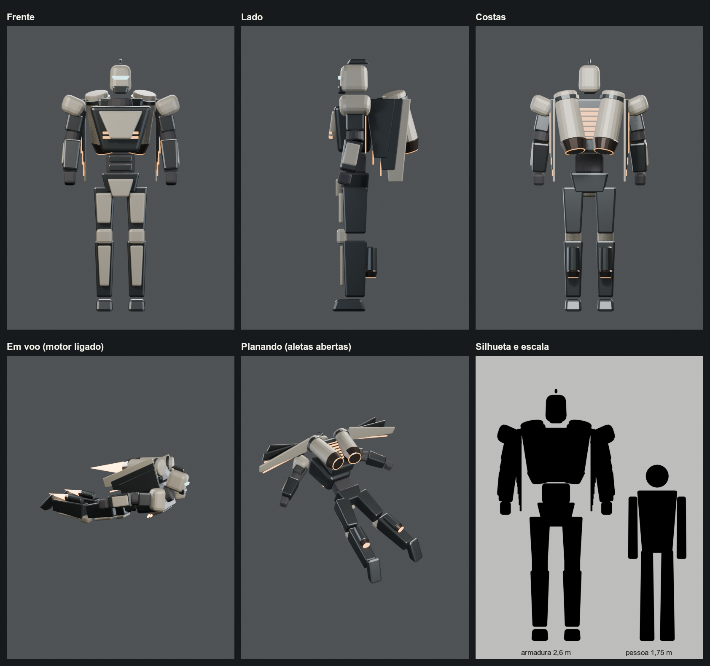

Armadura v1 (`docs/maquetes/armadura_v1.png`, gerada por `tools/maquete/armadura.py`):
- **Corpo:** 2,6 m, com ombros largos e cintura fina (forma em V) e capacete com viseira fina.
- **Propulsores:** dois grandes nas costas, inclinados com o bocal para baixo e para trás, e dois pequenos nas panturrilhas.
- **Aletas-radiador:** três de cada lado, dobradas ao lado da mochila. Abrem como asas ao planar, então de longe dá para ver se a armadura está planando ou com o motor ligado.
- **Calor visível:** as bordas das aletas, os respiros do peito, o radiador das costas e os bocais brilham em laranja, mais forte quanto mais quente.
- **Cores:** grafite e areia escura; a viseira é azul-esverdeada.
- **O que é provisório:** as peças são blocos chanfrados, sem detalhe fino.

Para regerar a folha:

```bash
/Applications/Blender.app/Contents/MacOS/Blender -b --factory-startup -P tools/maquete/armadura.py -- "$PWD/docs/maquetes/armadura_v1.png" 1.0
```

- **Pronto quando:** o usuário aprova a silhueta.

### Etapa 1: primeiro voo (pequena e jogável)

- Projeto Godot nesta pasta, com tudo montado por código, como na Ilha Cafuné.
- Ilha de teste de 2 × 2 km com ruído simples, sem erosão, e um lago.
- Terreno com detalhe por distância e colisão em volta.
- Árvores de bloco (cilindro + cone) por MultiMesh, para dar referência de velocidade.
- Boneco de blocos de 2,6 m com andar, correr, pular, decolar, voar, arrancada, planar, mergulhar, soltar e pousar.
- Calor do motor com barra perto da mira, superaquecimento e água que esfria.
- Câmera da §6.
- Controle DualSense e teclado e mouse.
- Medidor F3.
- Build Linux instalada no Bazzite e adicionada na Steam.
- Testes automáticos (headless) dos estados e do calor, e capturas de tela.
- **Pronto quando:** o usuário voa 5 minutos no PC e acha gostoso, e os números da §5.1 estão afinados com ele.

**Estado (2026-11-14):** feita e instalada no PC Bazzite. Falta o usuário jogar e afinar os números.


O que tem:
- **Ilha de teste** (`scripts/ilha.gd`, semente 7):
  - 2 × 2 km, um ponto a cada 4 m, com colinas e um morro de ~400 m a sudeste;
  - um lago de 150 m de raio, com margem suave até 2,4 raios e nível tirado da borda da bacia, para a água não vazar;
  - mar em volta e ~18 mil árvores de bloco (cones e copas redondas) em MultiMesh, por bloco de 256 m.

  Com 2 km, o relevo inteiro cabe na placa de vídeo sem níveis de detalhe; os anéis de detalhe ficam para a etapa 2. A colisão do chão é um HeightMapShape3D com escala uniforme 4. A das árvores liga só num raio de 70 m (tronco e copa).
- **Armadura** (`scripts/armadura.gd`): a v1 exportada do Blender (`EXPORTAR=... tools/maquete/armadura.py` → `assets/armadura/armadura_v1.glb`), animada por código (`scripts/armadura_visual.gd`). As juntas giram para a pose de cada estado, o corpo segue o nariz no voo e inclina nas curvas, as aletas abrem ao planar, as chamas aparecem com o motor e o brilho laranja acompanha o calor.
- **Voo:** física de planador com motor.
  - A gravidade age sempre e a velocidade gira para o nariz (sustentação, fraca devagar).
  - O motor empurra até 30 m/s (45 na arrancada), e acima de ~45° de subida a velocidade cai.
  - O arrasto deixa o mergulho chegar perto de 70 m/s.
  - Planando devagar demais, o nariz cai.
  - Bater de frente a mais de 22 m/s derruba do voo; raspar tira velocidade.
  - Acima de 900 m o motor perde força.
  - Os números ficam em `scripts/ajustes.gd`.
- **Câmera** (`scripts/camera_voo.gd`): a da §6, com 5,2 m no voo e campo de visão até 90°.
- **Tela** (`scripts/hud.gd`, `scripts/pausa.gd`): mira com arco de calor, aviso de superaquecimento e de "esfriando na água", velocidade e altura, medidor (F3 ou Create) e pausa com a lista de comandos.
- **Ainda não tem:** som, partículas, DualSense além dos botões (vibração, luz e gatilho ficam para a etapa 5) e o que fazer no mundo.

Rodar (da pasta `jogo-voo`):

```bash
godot --path .
```

Testes (44 pontos: chão, pulo, decolagem, voo, arrancada e L3, planar, mergulho, água, superaquecimento, teto, pouso, soltar, batida numa árvore e os botões do controle; ~45 s; termina com "VOO OK"):

```bash
perl -e 'alarm 300; exec @ARGV' godot --headless --path . -- --teste
```

Fotos (10, em `tools/capturas/`, fora da build):

```bash
godot --path . -- --captura
```

Build e PC:
- O comando é `godot --headless --path . --export-release "Linux" build/linux/JogoVoo.x86_64` (~74 MB).
- No Bazzite, o jogo fica em `~/Games/JogoVoo/`, com `jogo-voo.desktop` e `icone.png`.
- Entrou na Steam como "Jogo de voo (teste)" pelo `steamos-add-to-steam`, com `DISPLAY=:0 WAYLAND_DISPLAY=wayland-0 XDG_RUNTIME_DIR=/run/user/1000`.
- O PC mudou de IP (estava em 192.168.0.25 em 2026-11-14); use `bazzite.local`.
- Para atualizar, copie o executável novo por cima com o jogo fechado.

### Etapa 2: mundo de verdade

- O gerador da §4.1 passado para a Godot, com compute shader e semente.
- A ilha de 8 × 8 km com o relevo A, lagos e rios no nível certo, e o mar.
- O carregamento da §4.2: relevo até o horizonte, colisão e mata por células.
- Voo de teste automático no Bazzite medindo o desempenho.
- **Pronto quando:** dá para voar a ilha inteira a 60 fps sem travadas.

### Etapa 3: vida e atmosfera

- Mata, pedras e grama originais do Blender, com LOD e impostores.
- Água com shader (cor por profundidade, espuma na beira, reflexo).
- Céu, nuvens, névoa, dia e noite e chuva (a chuva esfria o motor).

### Etapa 4: a armadura

- Modelo original, animações (base do KayKit mais poses de voo em código), propulsores com partículas, sons, poeira no pouso e grama soprada.

### Etapa 5: controle fino

- DualSense completo (vibração, barra de luz, gatilho), opções, menu, pausa e salvar.

### Depois

- Pontos de interesse (§10).
- O que fazer no mundo: exploração, desafios de voo ou combate.

## 10. Ideias guardadas para depois

### Outras armaduras

Armaduras novas, cada uma com um jeito diferente de jogar (por exemplo, mais pesada e resistente, ou mais leve e rápida no voo). Pedido do usuário em 2026-11-14, para depois da primeira versão. Cada uma ganha a sua maquete antes de entrar.

### Pontos de interesse com marcos de longe


- **Exemplos:** torre em ruínas, árvore colossal, coluna de fumaça e sinal de luz.
- **Regra:** de qualquer ponto da ilha, ver pelo menos 2 marcos. O gerador confere isso pela linha de visão no mapa de alturas.
- **Lugares:** picos, cristas, ilhas de lago e fins de vale. O terreno esconde e revela: subir uma crista mostra o vale seguinte.
- **Silhueta:** cada tipo tem um contorno que se reconhece de longe. Os detalhes e a recompensa só aparecem de perto.
- **Godot:**
  - os marcos ficam fora do corte por distância e usam uma versão simples de longe;
  - a névoa deles é limitada, para nunca virarem só céu;
  - brilham à noite;
  - a fumaça de longe é desenhada por shader.
- **Quantidade:** uns 20 a 40 na ilha.
- **Em aberto:** o tema (ruínas, natureza, máquinas caídas ou mistura).

## 11. Prévias

Ficam em `docs/previas/`. Os scripts estão em `tools/previa/`, são rascunho de planejamento e rodam com o Python do Blender, que tem numpy:

```bash
/Applications/Blender.app/Contents/Resources/5.3/python/bin/python3.13 -I tools/previa/gerar_mapa.py saida 512
```

```bash
/Applications/Blender.app/Contents/MacOS/Blender -b --factory-startup -P tools/previa/vista_aerea.py -- saida/colinas.npz "$PWD/vista.png" 1600 900 430 225 260 220 265 120
```

- `vista_aerea.py` recebe a linha e a coluna da câmera no mapa de 512, a altura dela sobre o chão, e a linha, a coluna e a altitude do alvo.
- Com `MARCOS=1`, ele lê o `marcos_bloco.py` e põe os marcos.
- O OpenImageIO do Blender não tem FreeType, então os textos nas imagens são escritos com `blf` (`rotulos.py`).

## 12. Estrutura do jogo (proposta em discussão, 2026-11-14)

O usuário testou a etapa 1 ("está legal") e pediu uma análise de um vídeo de jogo livre do Anthem (8 min 35 s, sem narração), para montar a estrutura do nosso jogo. Vale a regra de sempre: levar a mecânica e a sensação, nunca nomes, personagens ou visual.

### 12.1 O que o vídeo mostra

- **Movimento:** a maior parte do tempo é no ar.
  - Voo baixo por cânions, entre pilares de pedra, por baixo de arcos e por dentro de túneis e anéis gigantes.
  - Pairar parado no ar para olhar e mirar.
  - Planar e mergulhar de braços abertos entre penhascos, na chuva.
  - No chão, corrida rápida pela mata.
  - Um aviso de esquiva aparece quando um tiro vem.
  - O motor fica esfriado quase o tempo todo, porque chove e há cachoeiras.
  - Nas bordas do mapa, uma tempestade empurra a armadura de volta.
- **Mundo:** muito vertical.
  - Penhascos de centenas de metros, pilares, cachoeiras por toda parte, cavernas escuras com fogo aceso e árvores colossais em forma de guarda-chuva.
  - Ruínas de uma tecnologia antiga engolidas pela mata: um arco gigante sobre o vale, um anel de pedra e um tubo com nervuras.
  - Névoa, raios de sol, chuva e fim de tarde.
- **Exploração:**
  - tarefas pequenas no mundo livre (achar 3 peças espalhadas e levar à base);
  - nome do lugar aparecendo ao chegar;
  - itens no chão;
  - plantas que se colhem segurando um botão (material de fabricação);
  - reputação com um grupo subindo.
- **Combate** (pouco, no vídeo):
  - bichos pequenos e rápidos em bando;
  - uma torre de vigia com laser vermelho num posto de ferro enferrujado;
  - números de dano e marcador de acerto.
- **Interface:** duas barras (escudo e blindagem), bússola no alto com marcas, tarefa no canto, munição de 2 armas e uma barra com 4 ou 5 habilidades com recarga.
- **Multiplayer:** outros jogadores aparecem no mesmo mundo, porque o jogo é cooperativo.

### 12.2 Proposta para o nosso jogo

Pilares:
1. Mover-se é o prazer.
2. O mundo é feito para voar e esconder coisas.
3. O que se coleta vira equipamento.
4. A luta pede movimento.

| Tema | Proposta |
|---|---|
| Pulo e pulo duplo | X pula; X no ar dá um segundo pulo com os propulsores (uma vez, +3% de calor); segurar X, no chão ou no ar, decola ou liga o voo |
| Esquiva | O no chão ou pairando dá um tranco curto para o lado do analógico (+5% de calor); no voo, O solta |
| Pairar e mirar | L2 no ar fica parado e mira (esquenta devagar); L2 no chão mira por cima do ombro |
| Mundo | Somar cânions, pilares de pedra, cachoeiras e cavernas ao relevo; ruínas antigas gigantes (arcos, anéis, tubos) como pontos de interesse; tempestade sobre o mar como borda |
| Coleta | Plantas (fibra e resina), veios de minério (metal), destroços antigos (componentes), núcleos de energia (de inimigos e ruínas) e baús raros nas ruínas; segurar Triângulo 1 s para colher |
| Tarefas no mundo | Juntar peças, caçar uma fera, desligar uma torre, limpar um posto; bússola e mapa com marcas |
| Vida | Escudo, que recarrega sozinho, mais blindagem, que só volta com kit ou na base |
| Armas | Duas por vez: fuzil, escopeta, precisão, lança-granadas e metralhadora pesada (esta só na armadura pesada). R2 atira, Triângulo troca |
| Habilidades | Duas de ataque (granada, míssil), uma de suporte (escudo de área) e uma especial que carrega lutando. R1, L1 e R1+L1 |
| Inimigos | Fauna (bando de caçadores rápidos, voadores que perseguem no ar, uma fera grande por região) e um grupo hostil com postos, torres de laser, soldados, drones e um gigante blindado; golpe com aviso vermelho para esquivar |
| Oficina | Na base: gastar materiais para fabricar e melhorar armas, habilidades e peças da armadura (radiador = mais tempo de voo, propulsor = velocidade, casco = blindagem, gerador = escudo) |
| Armaduras | Novas armaduras com jogabilidade própria (§10), fabricadas com material raro |
| Raridade | Comum, incomum, rara e épica, por cor |
| Abrir caminho | Melhorias que abrem lugares: radiador para zonas quentes, vedação para mergulhar nos lagos, propulsor para os picos altos |
| Fica de fora | Multiplayer, saque com dezenas de números aleatórios, reputação de grupos (talvez depois) e base com conversas |

Ciclo: explorar → coletar e lutar → oficina → equipar → voltar mais forte para áreas novas e mais difíceis.

### 12.3 Ordem das próximas etapas (aprovada em 2026-11-14)

O usuário mudou a ordem: exploração, movimento e jogabilidade até ficarem finos antes de inimigos e armas.

1. **Movimento completo** na ilha de teste: pulo duplo, esquiva, pairar e mirar no ar e no chão, sem arma.
2. **Maquete do mapa feito à mão** (§13), para aprovação.
3. **Primeira região construída:** vertical, com cânions, pilares, cachoeiras e cavernas, e o carregamento por distância.
4. **Exploração:** lugares com nome ao chegar, mapa, bússola e marcador, segredos e caminhos que pedem bom voo.
5. **Atmosfera e som:** névoa, chuva, cachoeiras, dia e noite, vento e motor; a armadura final; o DualSense completo.
6. **Futuro:** inimigos, armas, coleta, oficina, base e armaduras novas (§12.2 fica como proposta guardada).

**Passo 1 feito (2026-11-14):** movimento completo na ilha de teste.


- **Pulo duplo:** X no ar dá 9,5 m/s para cima, uma vez por pulo, com +3% de calor; o pulo simples sobe 1,7 m e com o duplo chega a ~3,7 m. Segurar X depois do pulo duplo liga o voo. A conta de pulo duplo e esquiva no ar zera ao pousar, ao ligar o voo e ao pairar.
- **Esquiva:**
  - O no chão, no ar (uma vez) ou pairando.
  - 18 m/s por 0,28 s, ~4 m, para o lado do analógico (sem direção, para trás).
  - +5% de calor e 0,55 s de recarga. No voo, O continua soltando.
- **Pairar:** apertar o L2 no voo freia e para no ar, e segurar o L2 depois de um pulo também paira. Pairando, a armadura:
  - segura a altura e desliza a 5 m/s com o analógico;
  - esquenta 4%/s;
  - liga o voo com X e cai ao soltar o L2.

  Superaquecer pairando apaga o motor e plana.
- **Mirar sem arma:**
  - L2 no chão aproxima a câmera por cima do ombro (2,4 m, 56°), deixa a armadura andando a 3 m/s virada para a mira e aponta o braço direito para onde a câmera olha.
  - A mira mostra a distância até onde aponta.
  - R2 mirando marca um ponto: um losango com a distância aparece na tela, e ele some ao chegar a 6 m.
- **Tela corrigida:** desde a etapa 1, a tela e a pausa eram desenhadas encolhidas no canto de cima (faltava `set_anchors_and_offsets_preset`); agora a barra de calor fica junto da mira e a velocidade no canto de baixo.
- **Testes:** 69 pontos ("VOO OK"); fotos `c11` a `c14`.

## 13. Mundo feito à mão (método proposto, 2026-11-14)

- **Maquete primeiro:** um mapa 2D com regiões, rotas de voo e pontos altos, para aprovar antes de construir.
- **Relevo:**
  - Um mapa de alturas desenhado por nós, por formas posicionadas à mão: cânions ao longo de curvas, platôs, vales, morros.
  - A erosão é feita uma vez nas ferramentas e o resultado fica salvo no projeto (EXR ou PNG de 16 bits). O jogo só lê; nada é sorteado ao jogar.
  - Mudar o mundo = mudar os dados e assar de novo.
- **O que o mapa de alturas não faz:** pilares, arcos, saliências e cavernas viram peças de rocha modeladas por script no Blender e postas à mão (lista de posições no projeto).
- **Ruínas gigantes:** peças modulares do Blender (arcos, anéis, tubos, pontes) montadas à mão.
- **Água:** rios e cachoeiras como malhas ao longo de curvas, e os lagos.
- **Mata:** mapas de densidade desenhados mais regras de inclinação e altura, com árvores especiais postas à mão.
- **Tamanho:** construir por região. A primeira tem ~2 × 2 km, densa e vertical; as outras crescem em volta.
- **Relevo grande:** com o mundo crescendo, o plugin Terrain3D (níveis de detalhe, colisão, pintura de textura) volta a ser candidato. Ele é baixado só com permissão.

## 14. Teste de qualidade visual na Godot (2026-11-14)

O usuário perguntou se valia trocar para a Unity para chegar à qualidade do vídeo. A resposta foi não:
- o visual realista da Unity vem do HDRP, que entrou em modo de manutenção em 2026;
- o que muda o teto de verdade é a Unreal 5, com custo alto no nosso fluxo;
- a maior diferença está na arte.

Ele pediu o teste na Godot.


- **Arte baixada** (permitida pelo usuário): 19 arquivos CC0 do Poly Haven (174,5 MB) em `vendor/polyhaven/` (fora da Godot, com `.gdignore`).
  - Rochas: coastal_cliff_01, rock_face_01 e 02, mountainside, rock_moss_set_01 e 02, boulder_01.
  - Plantas: island_tree_02, pachira, anthurium, calathea, fern_02, shrub_02, root_cluster_01.
  - Texturas 2k: cliff_side, forest_ground_04, aerial_grass_rock.
  - Céu: kloofendal_misty_morning_puresky.
- **Preparação:** `tools/teste_visual/preparar.py` (Blender) reduz os triângulos e exporta GLB para `assets/teste_visual/` (a árvore vai de 1 milhão para 117 mil triângulos; a versão leve de 29 mil perdeu as folhas e saiu de uso). Exportar com `export_image_format="AUTO"`: com `"JPEG"` a Godot não lia uma das imagens.
- **Cânion** (`scripts/teste_visual/canion.gd`, classe `Canion` que herda a `Ilha`):
  - 640 × 640 m, um ponto por metro.
  - Paredões de 114 m com rochas do Poly Haven encaixadas e colisão por malha.
  - Um vale largo com três pilares de 60 a 96 m e uma ponte de rocha natural (coastal_cliff_01).
  - Cachoeira de ~110 m num poço, com névoa local (FogVolume) e borrifo de partículas.
  - Córrego no platô, rio no fundo, 825 árvores (cada uma com redução automática pela distância, `lod_bias` 0,3), sub-bosque e grama com vento em MultiMesh.
- **Luz:** céu do HDRI, névoa volumétrica, SDFGI, SSR, SSAO, brilho e antisserrilhado temporal (`Main._ambiente_canion`).
- **Shader do chão** (`scripts/shaders/terreno_canion.gdshader`): rocha triplanar puxada para cinza esverdeado, musgo nas paredes, grama e chão de mata pela inclinação, molhado perto da água.
- **Rodar:**
  - `godot --path . -- --canion` abre o cânion.
  - `godot --path . -- --canion-captura` tira 7 fotos em `tools/capturas/canion/` com o fps de cada uma.
  - No jogo, a pausa troca entre a ilha e o cânion. A cachoeira também esfria o motor.
- **Desempenho no Mac (M4, 1600 × 900):** 13 a 29 fps, com 9 a 22 milhões de triângulos e ~550 a 850 chamadas de desenho. Falta medir na 3060 Ti; está no PC desde 2026-11-14 (pausa → "Ir para o cânion", F3 para o medidor).
- **Leitura do resultado:**
  - Rochas, paredões e ponte ficaram no nível realista.
  - A mata é o ponto fraco, pela arte: as árvores do Poly Haven parecem oliveiras secas, e faltam árvores de selva com copa densa.
  - O céu enevoado deixa a luz chapada.
  - A água do rio ainda é simples.

## 15. Direção e equipe (2026-11-14)

O usuário definiu o jogo como hobby, sem fins lucrativos, fortemente inspirado no Anthem (referência: o vídeo da §12.1). O Claude é o líder técnico e o artista. Agentes Haiku fazem código e tarefas paralelas, cada um com arquivos próprios, sem tocar no `main.gd`, e o líder revisa e integra.

**Estilo em avaliação:** o usuário aceitou o realista da §14, mas ofereceu um estilo pintado como o do Breath of the Wild, com tom sério, adulto e escuro. Recomendação do líder: **pintado e sério**.
- Toda a arte sai dos nossos scripts e combina entre si.
- Roda 3× mais leve.
- Não depende de arte fotografada, que não temos para a selva.

O usuário decide comparando os dois cânions no PC.


- **Cânion pintado** (`scripts/teste_visual/canion_estilo.gd`, classe `CanionEstilo`, herda `Canion`):
  - Formas do Blender em `tools/estilo/gerar.py` → `assets/estilo/`: 3 árvores de copa larga, árvore colossal, moita, 4 rochas talhadas e o arco.
  - Cor nos shaders `terreno_estilo` (rocha em estratos, musgo, capim escuro) e `folha_estilo`.
  - Luz em `Main._ambiente_estilo`, sem SDFGI, porque ele deixava preta a sombra debaixo das copas.
  - 3.231 árvores em MultiMesh; no Mac dá 56 a 75 fps (o realista dá 13 a 29).
  - Abrir com `-- --canion-b`; fotos com `-- --canion-b-captura`.
  - Falta: as sombras ainda estão escuras demais no chão, e a armadura precisa de material no mesmo estilo.
- **Som** (agente Haiku): `tools/gerar_sons.py` gera 13 WAVs em `assets/sons/`; `scripts/sons.gd` (classe `Sons`) toca vento e motor pela velocidade, os toques pelos estados e a cachoeira em 3D. Ninguém ouviu ainda.
- **Rio** (agente Haiku): `scripts/shaders/rio.gdshader`, com correnteza, refração e espuma na beira; as riscas de espuma ainda parecem pontilhado.
- **Testes do cânion** (agente Haiku): `-- --teste-canion` (9 pontos, "CANION OK"; somar `--canion-b` testa o pintado). A bateria achou pedras de parede invadindo o vale e travando o voo; agora elas ficam enterradas no paredão.
- **Batida:** de través também derruba (impacto > 14 m/s com velocidade > 28 m/s).
- **Pausa:** o botão "Próximo mapa" roda ilha → cânion pintado → cânion realista.

**Estilo escolhido (2026-11-14): pintado e sério.** O jogo abre no cânion pintado (`--ilha` e `--canion` abrem os outros mapas; `--teste` e `--captura` seguem na ilha). Mudanças do dia:
- Sombras clareadas (luz ambiente 3,0, opacidade da sombra do sol 0,86).
- A armadura de teste ganhou material fosco com borda acesa.
- Bússola no topo da tela (agente Haiku, `Hud._desenhar_bussola`): N, L, S, O, marcas a cada 15° e o losango do marcador.
- Armadura nova: o usuário vai procurar um modelo no Tripo AI e salvar em `vendor/tripo/`. O pedido é GLB em pose A ou T, sem arma, com desenho original. O líder corta nas juntas no Blender e prende na animação atual.

**Armadura v2 (2026-11-14):** o Tripo não deu um modelo bom, e o usuário mandou como referência a folha do Ranger do Anthem. Não copiamos esse modelo; a v2 é original (`tools/maquete/armadura_v2.py` → `assets/armadura/armadura_v2.glb`, folha em `docs/maquetes/armadura_v2.png`). Ela tem placas em camadas sobre traje escuro, ombreira dupla, reator no peito, pernas com pistões e capacete com crista, em osso, grafite e azul-petróleo. Usa as mesmas juntas da v1, então a animação do jogo vale igual. Avaliação do líder: melhor que a v1, mas ainda com cara de robô de brinquedo (clara demais, peças soltas, formas de caixa). Modelagem só por script tem teto; ver as opções na conversa.

**Armadura provisória do usuário (2026-11-14):** `vendor/robot-test-v1.glb` (Tripo com esqueleto Mixamo, pose em T, 6 mil triângulos, textura 2k), copiado para `assets/armadura/robo_teste_v1.glb`. Fica até acharmos a definitiva.


- `ArmaduraVisual` detecta o `Skeleton3D` e manda as mesmas poses para os ossos (`OSSOS`, `_aplicar_ossos`): a rotação de cada junta é acumulada de pai para filho no referencial do modelo e convertida para a pose local do osso; os braços descem 78° do T antes da pose.
- O modelo é escalado para 2,6 m.
- Tem duas chamas simples presas à espinha.
- Não tem aletas nem o brilho do calor no corpo.
- Qualquer modelo com esqueleto Mixamo entra trocando só a constante `MODELO`.

## 16. Maquete do mapa (2026-11-14, esperando aprovação)


Ilha de 4 × 4 km feita à mão (`tools/mapa/mapa.py`: contorno, cânions por linhas, lago, terras altas e pilares postos à mão; o script grava também `docs/mapa/mapa_alturas.npy`, um ponto a cada 4 m, que vira a base do relevo no jogo).

| # | Lugar | O que é |
|---|---|---|
| 1 | Platô da Chegada | Começo do jogo, na borda oeste da Garganta |
| 2 | A Garganta | Cânion principal, do lago até o mar; o cânion de teste atual é um trecho dele |
| 3 | Vale dos Pilares | Alargamento da Garganta com 5 pilares de 64 a 110 m |
| 4 | Lago Suspenso | Lago a 62 m de altitude, onde três cursos d'água se encontram |
| 5 | Queda do Véu | Cachoeira da Fenda do Oeste caindo no lago |
| 6 | Terras Altas | Morro de ~360 m a nordeste, nascente do rio alto |
| 7 | Bosque Colossal | Morro a oeste com as árvores gigantes |
| 8 | Braço Leste | Cânion lateral que encontra a Garganta |
| 9 | Costa dos Paredões | Foz da Garganta no mar, entre paredões |

Ruínas antigas (pontos de interesse, estilo a definir): Arco sobre a Garganta, Anel junto ao lago, Tubo no Braço Leste, Farol antigo a oeste e Ponte caída no rio alto.

Ordem de construção proposta: 1 → 2 → 3 (o que já existe no teste), depois 4 e 5, e o resto em volta.

**Exploração, primeiro passo (2026-11-14):**
- `scripts/locais.gd` (classe `Locais`, agente Haiku): lugares com nome, raio e "já visto"; o sinal `chegou` faz a tela mostrar o nome grande e "lugar descoberto · N de M".
- No cânion já existem Platô da Chegada, Queda do Véu, Vale dos Pilares e Ponte de Pedra.
- A bússola ganhou fundo escuro, e o losango do marcador fica abaixo das letras.
- Rio (`rio.gdshader`): cor por profundidade em faixas e beira limpa. O brilho por face de onda virava um pontilhado branco e foi tirado na revisão.
- Ninguém viu ainda o aviso de lugar na tela com o jogo aberto.

## 17. O mundo no jogo, primeira versão (2026-11-14)

O usuário mandou seguir depois da maquete, e a ilha de 4 km virou o mapa de entrada do jogo.


- **Dados:** `JOGO=assets/mundo blender ... tools/mapa/mapa.py` grava `alturas.bin` e `agua.bin` (1025 × 1025, 4 m por ponto, linha 0 = norte) e `dados.json` (lugares, lago, quedas, pilares, bosque, ruínas). A maquete mudou um pouco: lago a 40 m, platô a ~126 m, cânions com curvas, e os dois rios altos caem ~55 m no lago.
- **Jogo** (`scripts/mundo.gd`, classe `Mundo`, herda `Ilha`):
  - relevo em 256 blocos com o shader pintado, e colisão por mapa de alturas;
  - água lida do `agua.bin` (um quadrado por célula molhada) com o shader do rio, mais o mar e duas cachoeiras com névoa;
  - 650 pedras talhadas enterradas nos paredões, com colisão;
  - ~50 mil árvores em blocos de 256 m (modelo completo até 420 m, modelo leve de 170 triângulos depois);
  - 16 árvores colossais no Bosque e o Arco sobre a Garganta;
  - os 9 lugares com nome.
- **Desempenho no Mac:** 43 a 75 fps, com 0,5 a 2,3 milhões de triângulos.
- **Rodar:** `godot --path .` abre o mundo; `-- --mundo-captura` tira 8 fotos; `--canion-b`, `--canion` e `--ilha` abrem os mapas antigos. A build inclui `*.bin` e `*.json` (`include_filter`).
- **Falta:**
  - testes automáticos do mundo;
  - grama e moitas;
  - as outras quatro ruínas;
  - a parede dos cânions é lisa (4 m por ponto) e pede mais pedras e saliências;
  - a névoa de longe ainda apaga a ilha vista do alto;
  - ninguém voou nele de verdade ainda.

**Mundo v2: passada de composição (2026-11-14).** O usuário achou o mundo distante do vídeo de referência. Diagnóstico do líder: faltavam verticalidade, água por todo lado, selva variada e névoa nos vales.


- **Relevo** (`tools/mapa/mapa.py`): platô em andares de 55 m (de ~90 a ~230 m), terras altas até ~500 m, cânions com parede de 6,5:1 e largura variada, bacia do lago com paredão de ~200 m, 10 pilares de até 185 m, costa mais alta.
- **Água** (`Mundo._agua_mundo`, `_queda`): além das duas quedas no lago (~95 m), 22 cachoeiras finas escorrem dos paredões para os rios. O jogo acha os lugares andando do rio até um paredão 85 m mais alto.
- **Selva:**
  - 2.200 cortinas de cipó e musgo nos paredões (`_cipos`, shader `cipo_estilo`);
  - manchas largas de cor na mata, pelo shader (oliva e azul-petróleo);
  - clareiras;
  - árvores maiores no platô, e menores e mais raras no fundo dos cânions;
  - 1.300 pedras talhadas.
- **Ar:** névoa deitada no fundo dos vales (FogVolume a cada ~170 m de rio), nuvens pintadas no céu, sol mais baixo.
- **Chão vivo** (agente Haiku, `scripts/chao_vivo.gd`): grama, samambaias e flores só em células de 32 m num raio de ~100 m do jogador.
- **Erro corrigido:** paletas por bloco deixavam quadrados amarelos de 256 m na mata; a variação passou para o shader.
- **Ainda longe da referência:** as árvores são todas do mesmo tipo (copa larga), falta arquitetura antiga gigante, e as paredes têm pouca saliência grande (arcos, saliências, cavernas).
- Testes do mundo (agente Haiku): `-- --teste-mundo`, 10 pontos, "MUNDO OK" (lugares, lago, mar, todas as cachoeiras esfriando, voo alto, quedas sem atravessar o chão).

## 18. Novo rumo (2026-11-14, em discussão; nada implementado)

O usuário avaliou que superestimamos a capacidade de construção e que perseguir a escala e o visual do Anthem não estava dando certo. As seções 12 a 17 ficam como registro. O que ele quer:

- **Jogo:** para se entreter sem objetivos — voar, caminhar, correr, observar. "Cozy, mas adulto."
- **Mundo:** pequeno e caprichado (um vale de ~800 m a 1 km feito à mão, crescendo um canto por vez). Floresta temperada com campos.
- **Tempo:** dia e noite passando sozinhos, com chuva às vezes.
- **Vida:** bichos naturais pacíficos. O combate é um tempero, contra máquinas agressivas.
- **Personagem:** um robô pequeno (~1,2 m) no jeito do Faísca da Ilha Cafuné, em tom sério (metal gasto, visor de uma luz só, movimentos contidos).
- **Propulsores:** jatos nos pés e nas mãos. No voo, os dos pés são os fortes (empurram) e os das mãos são mais fracos (equilibram e guiam). Os das mãos também são a arma. Atirar esquenta o mesmo motor do voo.
- **Estilo:** técnica do Breath of the Wild (luz em faixas, borda clara, muito capim ao vento, cores limpas, distância azulada, céu pintado), sem copiar arte nem personagens.
- **Primeiro passo proposto:** um quadro só, uma clareira de ~100 m com capim, árvores, pedras, riacho, o robô novo e um bicho pastando, até o visual ser aprovado.
- **Reaproveita:** movimento, câmera, calor, chão vivo, lugares com nome, sons, testes e o caminho de build.

## 19. Primeiro quadro do novo rumo: a clareira (2026-11-14)


- **Mapa** (`scripts/vale/clareira.gd`, classe `Clareira`, herda `Ilha`): 320 × 320 m feitos à mão, um ponto por metro. Campo de capim, trilha de terra, riacho até uma lagoa, pedra-mirante, carvalhos e bétulas postos à mão, e ~1.500 árvores fechando o quadro nas colinas. É o mapa de entrada do jogo; a pausa troca para os antigos.
- **Estilo** (`scripts/shaders/vale_*.gdshader` e `vale_comum.gdshaderinc`): luz em duas faixas (`luz_faixas`), borda clara, copas em três tons, e o capim com a mesma cor do chão (`cor_capim`), com rajadas de vento atravessando o campo. São 140 mil touceiras em blocos de 32 m. Ambiente em `Main._ambiente_vale`: céu azul com nuvens, sombra azulada, sem luz global.
- **Robô v1** (`tools/vale/robo.py` → `assets/vale/robo_v1.glb`, folha em `docs/vale/robo_v1.png`): 1,2 m, cabeça grande com visor de um olho só, botas e antebraços largos com as brasas dos jatos (pés fortes, mãos fracas). Usa as mesmas juntas da armadura, então a animação é a mesma. `Armadura.porte = 0.48` encolhe a cápsula e aproxima a câmera.
- **Natureza** (`tools/vale/natureza.py` → `assets/vale/`): dois carvalhos, bétula e pinheiro (cada um com versão leve de longe), arbusto, três pedras e o cervo em peças.
- **Cervo** (agente Haiku, `scripts/vale/cervo.gd`): pasta, anda, fica alerta e foge. Chegando devagar, ele se acalma. Há três na clareira. O teste do agente cobriu os estados e o chão; ninguém viu a animação de perto ainda, e o focinho não chega ao chão ao pastar.
- **Desempenho no Mac:** 47 a 100 fps.
- **Rodar:** `godot --path .`; fotos com `-- --vale-captura`.
- **Falta neste quadro:** tiro pelas mãos, dia e noite, chuva, som do lugar, testes automáticos da clareira e a pose de voo com as mãos guiando.

**Retorno do usuário sobre o quadro (2026-11-14):** "ficou muito lindo o ambiente".
- **Feito:** a decolagem (segurar X) sobe ~24 m (`DECOLAGEM_IMPULSO` 21, `DECOLAGEM_TEMPO` 0,85). Por 1,6 s depois de decolar, o nariz não aponta abaixo do horizonte (`DECOLAGEM_GRACA`), para o voo não bater no chão com a câmera olhando para baixo. Teste novo na bateria (70 pontos).
- **Lista de implementação** (pedidos do usuário):
  - física da água melhor (ondas e respingo ao tocar, rastro no rasante, entrar e sair d'água);
  - partículas ao atravessar a copa das árvores (folhas soltando).
- **Ainda da lista do quadro:** tiro pelas mãos, dia e noite, chuva, som do lugar, testes da clareira, pose de voo com as mãos guiando, tom mais sóbrio, cervo visto de perto.

**Decisões e pedidos de 2026-11-14 (noite):**
- **Tom:** o dia tem momentos com tons diferentes — amanhecer, manhã, tardezinha e noite — e chuva às vezes. Os estudos estão em `docs/vale/tons.png` (`-- --clima tarde` e `-- --clima nublado`); o fim de tarde precisa de sombra menos escura.
- **Jogabilidade, para fazer:**
  - Superaquecer no voo: o robô cai (hoje ele plana). Se o jogador não recuperar o voo antes do chão, pousa "estilo herói" (impacto forte, agachado, poeira).
  - Desligar o voo perto do chão: cai com estilo também, mas mais leve, porque a altura era pequena.
  - A força do pouso segue a altura da queda.
- **Lista de implementação:** física da água; partículas ao atravessar as copas; tiro pelas mãos; ciclo do dia com os tons; chuva; som do lugar; testes da clareira; pose de voo com as mãos guiando; cervo visto de perto.


## 20. A clareira ganha vida (2026-11-14, noite)


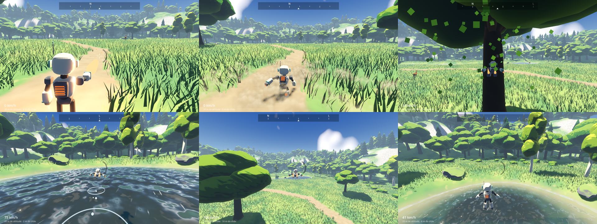

Tudo da lista de implementação da §19 foi feito, menos o cervo visto de perto.

- **Calor (pedido do usuário):** 25 s de voo até superaquecer (`CALOR_VOO` 4,0). Superaquecido, esfria em 12 s no ar (`ESFRIA_SUPER_AR`) e em 5 s no chão (`ESFRIA_SUPER_CHAO`); água e chuva (`ESFRIA_CHUVA`) ajudam. Religa quando o calor chega a `RELIGA_EM`.
- **Queda e pouso:** superaquecer no voo derruba o robô (estado AR, sem pulo duplo). Queda acima de `QUEDA_HEROI` (12 m) dá o pouso de herói (`pouso_forca` 1,0: um joelho, punho no chão, 0,95 s); acima de `QUEDA_LEVE` (3 m), o pouso leve (0,5). `queda_altura` guarda os metros.
- **Ciclo do dia** (`scripts/vale/ciclo.gd`, `CicloDia`): um dia leva 60 minutos (pedido: nada de ciclo rápido). Tabela `CHAVES` com os tons por hora: noite azul com lua, amanhecer rosado, manhã com névoa, dia limpo, tardezinha dourada, pôr do sol. Chuva a cada 7–16 min, por 2,5–5 min, com céu fechado e gotas em volta da câmera. Outros sistemas leem `CicloDia.atual.hora` e `.chuva`. O medidor mostra o momento e a hora. Para fotos: `-- --hora N`, `-- --chuva`, `-- --dia-rapido`.
- **Tiro pelas mãos** (agente Haiku, `scripts/vale/tiro.gd`, `Tiro`): mirando (L2) e segurando R2, um disparo a cada 0,28 s, 3,5 de calor por tiro, projétil de luz da mão direita, estrela e faísca no impacto. Os bichos do grupo `bichos` fogem do disparo e do impacto (`Cervo.assustar`). No chão o motor esfria mais rápido do que os tiros esquentam; o calor do tiro só pesa pairando.
- **Folhas e poeira** (agente Haiku, `scripts/vale/efeitos_mato.gd`, `EfeitosMato`): folhas ao entrar numa copa e enquanto passa por dentro; anel de poeira no pouso (tamanho conforme `pouso_forca`), sopro na decolagem e risco na esquiva.
- **Água** (agente Haiku, `scripts/vale/efeitos_agua.gd`, `EfeitosAgua`): respingo e anel ao cair na água, anéis ao andar no raso, rastro de borrifo e anéis no rasante, anéis lentos ao pairar baixo.
- **Som do lugar** (agente Haiku, `scripts/vale/som_ambiente.gd`, `SomAmbiente`; WAVs novos em `tools/gerar_sons.py`): mata de dia (brisa e pássaros), mata de noite (grilos e coruja), riacho em quatro pontos, chuva e trovão. Segue a hora e a chuva do ciclo. **Ninguém ouviu ainda.**
- **Pose de voo:** braços abertos como lemes; na curva um fecha e o outro abre. Os jatos das mãos brilham 40% dos pés e acendem no tiro.
- **Partículas:** fumaça e estrela do Kenney Particle Pack (CC0, cópia local em `Projects/others/kenney-particle-pack`), em `assets/fx/kenney/`.
- **Testes:** `-- --teste-vale` (agente Haiku, `scripts/vale/testes_vale.gd`): "VALE OK (11 pontos)". A bateria antiga segue em "VOO OK (75 pontos)".
- **Fotos:** `-- --vale-captura --curta --hora N --pasta nome` (três fotos por hora) e `-- --vale-captura --efeitos` (tiro, pouso, copa, voo, água).
- **Não verificado:** o som (só volumes calculados); o respingo do mergulho em foto (o rasante foi visto); o jogo no PC com o DualSense.
- **Depois:** máquinas agressivas, crescer o vale, cervo de perto, estrelas no céu da noite, luzes do robô acesas à noite.

**Pedido do usuário (2026-11-14, noite): sem estradas.** Não faz sentido ter estradas abertas, como se alguém passasse sempre ali. Clareiras naturais em alguns pontos fazem sentido; estradas, não. A trilha de terra da clareira (`Clareira.TRILHA`) deve sair, e o vale novo não ganha caminhos batidos. Ainda não feito.

## 21. Sem trilha, noite viva e cervo de perto (2026-11-14, madrugada)


- **Sem estradas (feito):** a trilha de terra saiu. No lugar há quatro claros naturais de terra e capim ralo, de borda torta (`Clareira.CLAROS`, função `_claro`).
- **Noite** (`scripts/vale/noite.gd`, classe `Noite`): 1.500 estrelas que somem com a chuva, vaga-lumes sobre o capim do anoitecer à madrugada, e a luz do próprio robô (as barras do peito e o visor acendem mais, e ele ilumina uns 5 m em volta como uma lanterna).
- **Cervo v2** (`tools/vale/natureza.py`): corpo mais liso, coxas e ombros, barriga e garupa claras, olhos, nariz, canelas escuras, cor menos laranja. Fotos de perto com `-- --vale-captura --cervo` (o cervo tem `pose_foto` para ficar parado num estado).
- **Não verificado:** a animação do cervo em movimento (só poses paradas em foto).

## 22. Mais bichos e maquetes das máquinas (2026-11-15)

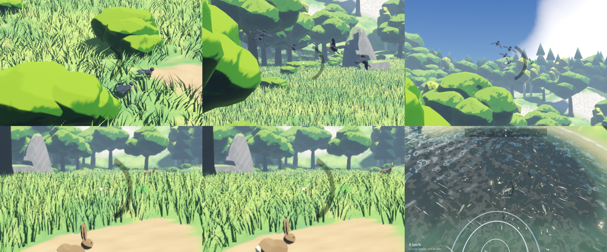
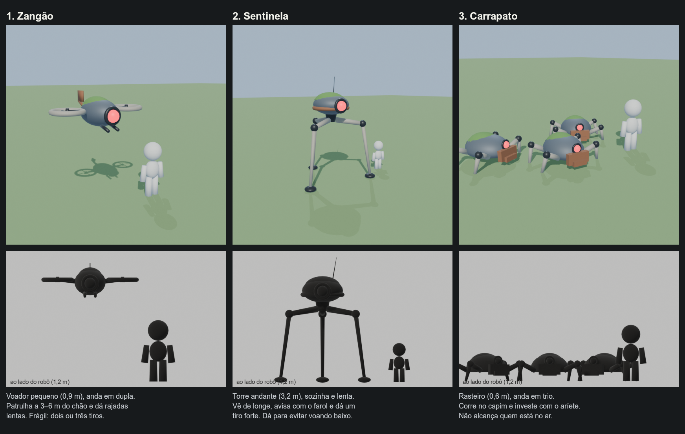

- **Pássaros** (agente Haiku, `scripts/vale/passaros.gd`, `Passaros`): três bandos de 5 a 7. Ciscam no chão de asas fechadas, levantam voo juntos quando o robô chega perto (9 m, ou 16 m se ele vem rápido) ou com um tiro, dão voltas a 12–20 m e pousam em outro lugar.
- **Coelhos** (agente Haiku, `scripts/vale/coelho.gd`, `Coelho`): cinco, perto dos claros. Sentam, comem, andam em pulinhos e fogem em ziguezague.
- **Peixes** (agente Haiku, `scripts/vale/peixes.gd`, `Peixes`): cardume de nove na lagoa. Nadam rasos (a água é pouco transparente), fogem de respingos e do robô, e um salta de vez em quando, com anéis na água.
- **Modelos** em `tools/vale/natureza.py` (`passaro`, `coelho`, `peixe`). No jogo ficam maiores que o real (1,7×, 1,55× e 1,5×), senão somem no capim.
- Todos estão no grupo `bichos` e reagem a `assustar(ponto)` (o tiro chama).
- **Máquinas agressivas (só maquete, esperando a escolha do usuário):** `tools/vale/maquinas.py` → `docs/vale/maquinas_v1.png`. Três conceitos de metal gasto com musgo e lente vermelha: **Zangão** (voador de 0,9 m, em dupla, rajadas lentas), **Sentinela** (torre andante de 3,2 m, lenta, tiro forte com aviso) e **Carrapato** (rasteiro de 0,6 m, em trio, investe com aríete).
- **Fotos:** `-- --vale-captura --bichos`.
- **Não verificado:** os bichos em movimento contínuo (só fotos); o salto do peixe; o bater de asas no ritmo certo (9 Hz pode ser rápido demais).

## 23. Sentinela e a pane (2026-11-15)


**Regra do usuário:** ninguém é destruído. Nosso robô e as máquinas desligam por excesso de calor e voltam a funcionar depois.

- **Pane do nosso robô** (`Armadura.levar_golpe`, `scripts/vale/pane.gd`): cada acerto de máquina empurra e soma `GOLPE_CALOR` (35). Com `PANE_GOLPES` (3) acertos acumulados ele entra em pane: ajoelha apagado, a tela escurece, o dia avança `PANE_HORAS` (3 h) e ele religa no mesmo lugar, frio, depois de `PANE_TEMPO` (5 s reais). Um acerto sara a cada `AVARIA_SARA` (25 s) sem levar golpe. Por `PANE_GRACA` (12 s) depois de religar as máquinas não o enxergam.
- **Sentinela** (agente Haiku, `scripts/vale/sentinela.gd`; modelo em peças por `tools/vale/sentinela.py`): torre de três pernas com IK, pés plantados e um passo por vez (~0,8 m/s). Patrulha em volta da casa (rio acima, a ~130 m do começo). Vê o robô a 55 m com linha de visão; avisa 1,6 s com a lente piscando e um feixe vermelho que trava a mira nos últimos 0,35 s; dispara um projétil lento (38 m/s) que dá para desviar; recarrega 3,2 s.
- **Calor do Sentinela:** cada tiro nosso na cabeça soma 17; esfria 5 por segundo depois de 2,5 s sem levar tiro. Com 100 ele desliga: arria no lugar com a lente apagada. Religa ali mesmo depois de 3.600 s reais (um dia inteiro do jogo; pedido do usuário, para haver paz depois da batalha vencida). A pane do jogador desconta 3 h desse tempo (`avancar_tempo`).
- **Ganchos:** o tiro do robô chama `levar_tiro(ponto)` no grupo `maquinas`; a cabeça tem colisão na camada 2.
- **Testes:** `-- --teste-vale` agora tem 13 pontos (pane e Sentinela entraram). Fotos: `-- --vale-captura --sentinela`.
- **Não verificado:** o Sentinela andando em movimento contínuo (só fotos), o som dele (não tem), e o combate jogado de verdade com o controle.
- **Faltam das maquetes:** Zangão e Carrapato.

**Decisão do usuário (2026-11-15):** Zangão e Carrapato ficam para depois da expansão do mapa; a clareira atual só tem o Sentinela. Ele vai testar o tempo de paz de 60 minutos da máquina desligada e dar retorno.

## 24. Peso no movimento (2026-11-15, retorno do teste no PC)

O usuário achou que: ao desligar os propulsores no voo o robô continuava planando; faltava atirar sem mirar; andar e correr deslizavam, sem peso; e a esquiva não parecia física.

- **Desligar o voo (O no voo):** sobra 60% da velocidade de lado (`SOLTAR_CORTE`), o ar tira o resto (`ARRASTO_QUEDA`) e a gravidade vale 1,3× (`QUEDA_PESADA`) até pousar ou religar. O mesmo quando o motor trava por calor. Medido: de 28 m/s de lado para 6 em 1 s, caindo a 33 m/s.
- **Tiro sem mirar:** R2 atira no chão, caindo, pairando ou voando, para onde a câmera aponta. No chão o robô vira para a câmera e ergue o braço (`Armadura.atirando`).
- **Andar e correr:** o robô pequeno anda a 2,1 m/s e corre a 6,3 m/s (`Armadura.vel_chao` 0,7; antes 3 e 9, rápido demais para pernas de 0,45 m). A passada da animação segue a distância andada (ciclo de 2,0 a 4,0 × porte), para o pé não escorregar. Ganhar velocidade leva um instante (`ACEL_CHAO` 20) e parar é mais firme (`FREIO_CHAO` 34).
- **Esquiva → arranque de jato:** um empurrão só, com um salto curto (`ESQUIVA_SALTO`), que o chão e o ar vão freando; acabou a velocidade forçada por 0,28 s.
- **Testes:** `-- --teste-vale` com 15 pontos (queda pesada e tiro sem mirar entraram).
- **Não verificado:** a sensação com o controle; a animação da passada em movimento.

**Mais retorno do usuário (2026-11-15):**
- **Pouso sempre animado:** toda chegada de voo, de voo parado ou de queda acima de `QUEDA_TOQUE` (2,2 m) passa pelo estado POUSO, em três graus: toque (`pouso_forca` 0,25; 0,24 s), médio (0,5; acima de 3 m) e herói (1,0; acima de 12 m). Chegando perto do chão (`Armadura.chegando_ao_chao`), o robô já arma as pernas e abre os braços.
- **Voo parado:** L2 no ar liga e ele continua parado mesmo soltando o L2. X volta a voar para a frente; O desliga o propulsor e ele cai pesado. A esquiva no voo parado saiu (o O agora desliga).
- Testes: `--teste` com 76 pontos, `--teste-vale` com 15. Fotos da chegada: `-- --vale-captura --pouso`.

**Passada refeita (2026-11-15, pedido: "robô muito avançado, a movimentação deve ser fluida"):** 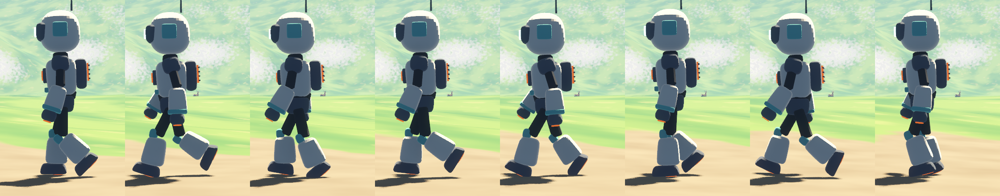
- Defeitos achados: o joelho dobrava na fase errada (com a perna indo para trás) e a suavização das juntas (12/s) comia quase metade do movimento na corrida.
- Agora (`ArmaduraVisual`, bloco do chão): cada perna vai à frente dobrando o joelho, estica para pisar, cede com o peso e empurra com o pé (`_pulso`); a bacia gira com as pernas e o tronco e os braços ao contrário; a cabeça fica firme; o corpo sobe e desce em curva suave; o tronco inclina ao arrancar e ao frear (`_acel`) e o corpo deita para dentro da curva. Parar e andar se misturam sem estalo (`w`). Andando, as juntas seguem a 34/s.
- Fotos quadro a quadro: `-- --vale-captura --passada` (esconde o capim).
- **Não verificado:** a corrida quadro a quadro (a câmera da foto perdeu o robô) e tudo em movimento.
- **Correção (2026-11-15):** o tiro acendia todos os jatos (usava `impulso`); agora usa `Armadura.clarao_tiro` e só o jato da mão direita acende. O tiro ainda não tem som próprio.
- **Regra do tiro (2026-11-15):** no chão atira mirando ou não; no ar, só no voo parado (voando ou caindo, não). Som do tiro fica para depois.
- **Andar atirando ou mirando (2026-11-15):** as pernas viram para onde o robô anda (até 65° da mira) e o tronco torce para a mira (`_torcao`); indo para trás ele recua de costas, com a passada ao contrário (`_re`). Fotos: `-- --vale-captura --mirando`.

## 25. O vale maior (maquete, 2026-11-15, esperando aprovação)


O usuário aprovou seguir para a expansão ("a ambientação tá linda, jogar com ele está divertido") e pediu: uma parte alta com vista da paisagem, um campo de flores em platô perto da praia, uma mata fechada com cachoeira e ruínas antigas tomadas pelo mato.

- **Maquete** (`tools/vale/mapa_vale.py` → `docs/vale/mapa_v1.png`): 1 km × 1 km, a clareira atual no meio. Serra do Mirante a noroeste (~170 m); o riacho nasce nela, cai na cachoeira dentro da mata fechada ao norte, cruza a clareira e deságua na praia ao sul; platô das flores a leste, acima do mar; ruínas a oeste, na mata. Sem estradas.
- **Plano:** aprovar a maquete, depois construir um canto por vez.
- **Antes de construir:** criar o repositório git local (o projeto não tem controle de versão) e escolher o nome do jogo; o usuário pediu para pensarmos num nome.
- **Para depois:** som do tiro e do Sentinela; Zangão e Carrapato no mapa grande.

**Maquete v2 (2026-11-15):** o usuário achou 1 km pouco (a clareira de 320 m já não parece grande e seria um terço do total). Nova maquete com **2 km × 2 km** em `docs/vale/mapa_v2.png` (`E = 2.0` m por pixel em `tools/vale/mapa_vale.py`): mesmos lugares em escala dobrada, mais os Campos do sul (capim aberto até o mar). A clareira fica no meio, do tamanho que tem. Esperando aprovação e o nome do jogo.

## 26. Nome, repositório e plano da expansão (2026-11-15)

- **Nome do jogo:** "Faísca 2: Em Busca do Sossego" (escolha do usuário; já em `project.godot`). **Repositório:** `faisca-2`, git local criado em 2026-11-15 com o estado aprovado da clareira (a pasta continua `jogo-voo`; nada foi enviado para a internet). Fora do git: `.godot/`, `build/`, `tools/capturas/`, `vendor/polyhaven/`.
- **Maquete v2 aprovada** (2 km × 2 km, `docs/vale/mapa_v2.png`).
- **Pedido para o fim das tarefas importantes:** se o jogador tentar cruzar o mar, depois de certa distância o robô entra em pane e volta para a praia.
- **Ordem de construção proposta** (um canto por vez, cada um no capricho da clareira):
  1. **Base do vale inteiro:** terreno de 2 km em blocos, mar, e a clareira atual encaixada no meio sem mudar. Tudo fora da clareira ainda simples (relevo, cor do chão, mata de longe), mas já dá para voar por cima de tudo.
  2. **Campos do sul e praia:** capim até o mar, areia, ondas; e a pane ao cruzar o mar.
  3. **Platô das flores.**
  4. **Mata fechada e cachoeira.**
  5. **Serra do Mirante.**
  6. **Ruínas**, com o Zangão e o Carrapato.
- **Pendências menores:** som do tiro e do Sentinela.

## 27. A base do vale de 2 km (2026-11-15)


- **Classe `Vale`** (`scripts/vale/vale.gd`, herda `Clareira`): é o mapa de entrada agora (`-- --so-clareira` abre só a clareira antiga). O relevo e a cobertura de fora vêm da maquete (`tools/vale/mapa_vale.py -- <png> assets/vale/mapa` grava `alturas.bin` e `cobertura.bin`, 501 × 501, um ponto a cada 4 m).
- **Emenda:** de 108 a 156 m do centro o chão da clareira se mistura ao de fora (`_alt`); na linha dos 160 m os dois são iguais (degrau medido: 1,3 cm). A malha de fora tem um furo no quadrado da clareira. Na colisão, o relevo de fora fica 1 m abaixo do chão da clareira dentro dela (senão virava um teto invisível: foi o defeito achado pelos testes).
- **Fora da clareira, por enquanto só a base:** chão com a cor do capim, areia nas praias (`COLOR.b` no `vale_chao`), mar (plano de 40 km no nível 0, fundo a no máximo 14 m) e 12.600 árvores pela cobertura do mapa (completas até 170 m, leves até 1.300 m), com colisão e folhas como as da clareira. Sem capim, sem flores, sem riacho fora da clareira, sem ruínas ainda.
- **Clareira:** as árvores ficaram onde estavam; só os cantos do quadrado da mata saíram (`_arvore_cabe`), para o quadrado não aparecer do alto.
- **Névoa:** no vale grande é por distância (`CicloDia.nevoa_longe`): embaça perto como antes, deixa ver longe, e pesa menos do alto.
- **Desempenho no Mac:** 95 a 150 fps nas fotos.
- **Testes:** `--teste-vale` com 17 pontos (o novo confere a emenda, pisar fora e o mar); `--teste` com 76. Fotos: `-- --vale-captura --largo`.
- **Não verificado:** jogar de verdade pelo vale (voar de ponta a ponta), a névoa nas outras horas do dia e na chuva, e o que acontece andando para dentro do mar (o fundo vai até 14 m).
- **Próximo:** Campos do sul e praia (capim, ondas, o riacho até o mar) e a pane ao cruzar o mar.

## 28. Campos do sul, rio até o mar, platô das flores e o limite do mar (2026-11-15, madrugada, sem o usuário)


O usuário foi dormir e autorizou seguir sozinho. Nada foi commitado.

- **Capim fora da clareira** (agente Haiku, `scripts/vale/capim_vivo.gd`, `CapimVivo`): nasce em blocos de 32 m em volta do robô (raio 104 m, um bloco por quadro, no máximo 60), com a mesma touceira e o mesmo material da clareira (`Clareira.capim_malha`). Densidade pela cobertura do mapa: campo e flores 100%, mata 35%, mata fechada 12%, areia nada. A mais de 70 m do chão não cria blocos novos. Tempo médio por bloco no teste do agente: 10,9 ms.
- **Flores do platô** (mesmo arquivo + `scripts/shaders/vale_flor.gdshader`): flores de 0,6 m com cinco pétalas em taça, em rosa, amarelo, lilás e branco, em manchas; balançam com o capim. De longe e do alto, o chão do platô tem manchas pintadas (`1 - COLOR.a` no `vale_chao`).
- **Rio da lagoa até o mar** (`Vale.RIO`, `_cavar_rio`, `_fita_rio`, `nivel_rio`): a lagoa ganhou saída. Dentro da clareira a água é a lâmina dela; da borda em diante uma fita desce de 19,4 m até o mar em ~1 km. Como os campos do sul são mais altos que a lagoa, o rio corre num vale largo de encostas suaves (rampa de 1 para 4), não num cânion. Isso abriu um vão na borda sudeste da clareira (mudança visível de dentro dela).
- **Limite do mar** (`scripts/vale/limite_mar.gd`, `Vale.distancia_da_costa`, `Vale.praia_perto`, `Armadura.pane_forcada`): a 150 m da costa aparece o aviso "sinal fraco"; a 260 m o robô entra em pane, a tela escurece, o dia avança e ele reaparece em terra firme na praia mais perto.
- **Testes:** `--teste-vale` com 18 pontos (o novo confere o rio e a pane no mar); `--teste` com 76.
- **Desempenho no Mac:** 56 a 71 fps na clareira; 32 a 53 fps nos campos com capim (2 a 3 milhões de triângulos).
- **Não verificado:** jogar de verdade (a sensação de atravessar o vale, o capim nascendo em volta ao correr e ao pousar), as flores em outras horas do dia, o aviso de sinal fraco na tela, peixes e respingos no rio novo, e o desempenho no PC.
- **Defeitos conhecidos:** do alto (mais de 70 m) os campos ficam sem capim, só com a cor do chão; no mar aparece uma linha reta fraca na borda do mapa (a 1 km do centro); a pedra das encostas sai clara demais, parecendo neve.
- **Próximo:** mata fechada com a cachoeira e a nascente na serra.

## 29. Mata fechada, cachoeira e nomes dos lugares (2026-11-15, madrugada, sem o usuário)

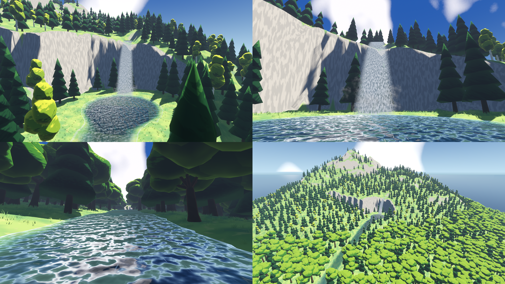

- **Cursos d'água** (`Vale.Curso`): os rios viraram uma classe só (linha com o nível da água em cada ponto, leito, vale suave em volta e fita d'água). Há dois: o do sul (lagoa → mar) e o do norte (poço da cachoeira → riacho da clareira, 108 m → 19,4 m em ~500 m, por dentro da mata fechada).
- **Cachoeira:** a água brota numa nascente pequena no alto do paredão (`Vale.NASCENTE`) e cai ~28 m num poço (`Vale.POCO`, nível 108 m), dentro de um anfiteatro de pedra cavado no relevo. Cortina d'água com o shader `cachoeira.gdshader`, névoa de respingo no pé e o som de cachoeira que já existia (`Sons.cachoeira_em`). A ideia de um rio descendo a serra foi descartada: numa encosta de 30% a fita parecia uma rampa.
- **Árvores** não nascem mais dentro d'água nem na beira dos rios e do poço (`_perto_dagua`).
- **Rocha:** a pedra das encostas ficou cinza (era clara demais e parecia neve). Isso muda também as manchas claras dos morros da clareira.
- **Nomes dos lugares** (`Locais`, na tela ao chegar): Clareira, Cachoeira, Mata Fechada, Serra do Mirante, Platô das Flores, Campos do Sul e Foz do Riacho. As ruínas entram quando existirem.
- **Testes:** `--teste-vale` 18 pontos, `--teste` 76. Fotos: `-- --vale-captura --largo --norte`.
- **Não verificado:** tudo jogando (a queda vista do chão andando, o som da cachoeira, pousar no poço, os nomes aparecendo na tela), a mata fechada em outras horas do dia, e o desempenho no PC.
- **Defeitos conhecidos:** o riacho do norte é íngreme (18%) e a fita d'água chata parece uma rampa vista de baixo, na entrada da clareira; o paredão tem riscos verticais (a grade do relevo é de 4 m).
- **O que falta da maquete:** a Serra do Mirante só tem relevo e pinheiros (falta um ponto de vista marcante no cume); as Ruínas não existem ainda (pedem desenho e escolha do usuário); Zangão e Carrapato.

## 30. Cume da serra, maquete das ruínas e resumo da madrugada (2026-11-15)

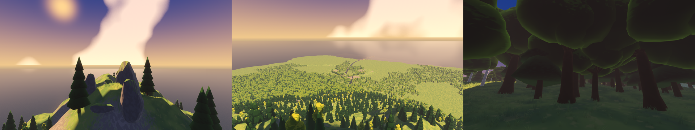


- **Cume** (`Vale._cume`, `Vale.cume`): marco de cinco pedras em pé no ponto mais alto do vale; o nome "Serra do Mirante" aparece ali. Do cume se vê a clareira, o rio e o mar.
- **Ruínas (só maquete, esperando a escolha do usuário):** `tools/vale/ruinas.py` → `docs/vale/ruinas_v1.png`. Três ideias: **Os Arcos** (aqueduto partido), **A Torre Caída** (meia torre com um núcleo de máquina apagado) e **O Pátio das Máquinas** (muros, colunas e o berço de onde as máquinas saem).

**O que foi feito sem o usuário nesta madrugada (§28 a §30):** capim e flores fora da clareira; rio da lagoa até o mar; pane ao cruzar o mar; riacho do norte com cachoeira e poço; árvores fora d'água; rocha cinza; nomes dos lugares na tela; marco no cume; maquete das ruínas. Baterias: `--teste-vale` 18 pontos, `--teste` 76. Build exportada no Mac (`build/linux/JogoVoo.x86_64`), não enviada (PC desligado). **Nada commitado.**

**Para o usuário decidir de manhã:**
1. Commit do que foi feito (base do vale e a madrugada).
2. Qual ruína construir (ou as três, espalhadas).
3. Se a rocha cinza e o vão que o rio abriu na borda sudeste da clareira estão aprovados (mudaram um pouco a clareira).

## 31. Rio com curvas, paredões de pedra e as três ruínas (2026-11-15)


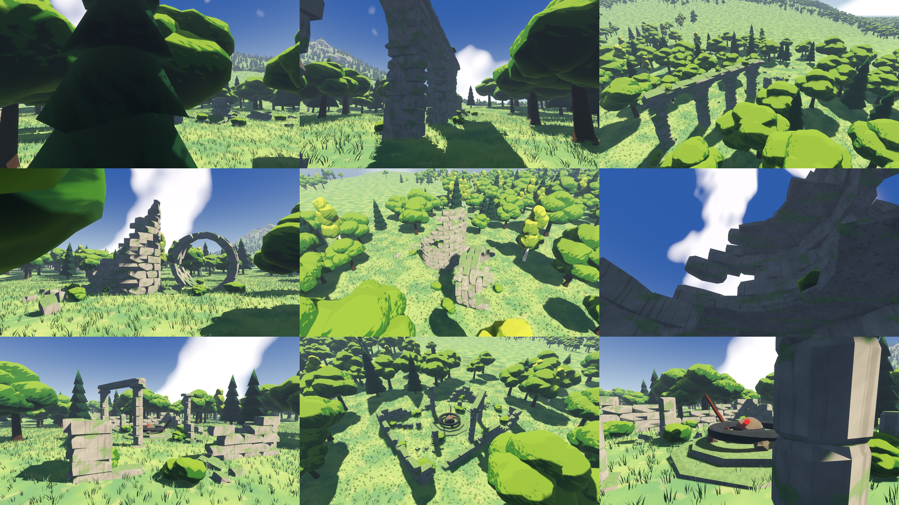

Retorno do usuário sobre a madrugada: commit liberado (feito, `284dd29`); construir as **três ruínas espalhadas**; **o rio precisa de curvas**, em estilo natural; **os paredões perto da cachoeira, e qualquer lugar com ângulo perto de 90°, estavam artificiais**: faltavam imperfeições na parede e rochas.

- **Rio com curvas** (`Vale._linha_curva`): os pontos de `RIO` e `RIO_BAIXO` viraram só o rumo. A linha passa por eles em curva suave (Catmull-Rom) e serpenteia para os lados com três voltas de tamanhos que não casam (46 m de saída e voltas de 280 m no rio do sul; 16 m e 150 m no riacho do norte). Nas pontas a linha fica presa (na lagoa, no poço e na entrada da clareira). O rio do sul anda 1,17 vez a reta. `Curso.perto` ficou mais rápido (passada larga e depois a vizinhança), porque a linha agora tem um ponto a cada 8 m.
- **Foz:** o leito se desfaz no fundo do mar (`Curso.cava_ate`). Antes as margens seguiam mar adentro como dois diques.
- **Paredões** (`scripts/vale/paredoes.gd`, `Paredoes.montar`): o relevo é uma grade de 4 m, então parede em pé saía lisa. Agora cada ponto íngreme (normal.y < 0,66) ganha de um a cinco blocos de pedra encaixados (pedregulhos de faces chatas feitos por código, `Paredoes.rocha`), pedras caídas no pé e arbustos na beira. Uns 1.560 blocos e 250 pedras no vale; os maiores têm colisão. Vale para a cachoeira, a serra e qualquer encosta.
- **Pedra com camadas** (`cor_rocha` em `vale_comum.gdshaderinc`, usada pelo chão e pelas rochas): faixas deitadas e tortas, frestas, escorridos, líquen, e um tom por face para o volume aparecer na sombra. As rochas soltas (`vale_rocha.gdshader`) ganham mato nas faces de cima.
- **Anfiteatro da cachoeira:** o contorno deixou de ser um círculo de compasso: a parede avança e recua, e o poço também ficou irregular.
- **Ruínas** (`scripts/vale/ruinas.gd`, `Ruinas.montar`): montadas pedra por pedra por código, cada bloco com colisão própria (481 formas). Cada uma fica num claro pequeno da mata (`Ruinas.livre` tira as árvores de perto), a uns 270 m uma da outra:
  - **Os Arcos** (−730, 30): aqueduto de seis pilares; três arcos inteiros com o leito por cima (dá para pousar a 15 m do chão), um arco partido e dois pilares em toco, com as lajes caídas.
  - **A Torre Caída** (−640, 440): meia torre de 18 m com porta, janelas e restos de dois pisos; o topo tombado é um tubo deitado que dá para atravessar voando; no meio, o núcleo apagado de uma máquina.
  - **O Pátio das Máquinas** (−680, 170): muro baixo em volta, seis colunas (duas ainda seguram a viga, uma tombou), o estrado de pedra e o berço de metal com a lente vermelha fraca.
  - A pedra (`vale_ruina.gdshader`) é mais clara e quente que a dos paredões, com musgo em cima e em manchas.
- **Nomes na tela:** Os Arcos, A Torre Caída, O Pátio das Máquinas.
- **Fotos:** `--vale-captura --largo` com `--rio`, `--paredes` ou `--ruinas`.
- **Testes:** `--teste-vale` 19 pontos (o 17º confere as curvas do rio, as rochas, as ruínas e o pouso no aqueduto); `--teste` 76.

**Não verificado / defeitos conhecidos:** nada disso foi jogado; o musgo das ruínas sai em manchas meio riscadas; a torre vista de lado parece fina (só metade da parede está de pé); o riacho do norte continua íngreme na entrada da clareira; não há máquinas no Pátio (os inimigos novos ficaram para depois).

### 31.1 Paredões no jeito da referência (2026-11-15)

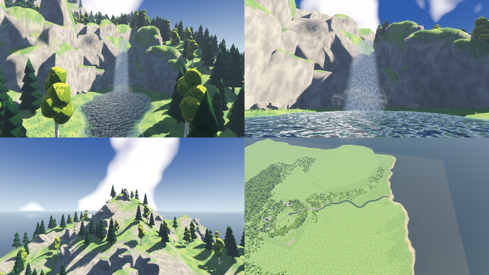

O usuário mandou uma foto de referência para paredões e montanhas (só a técnica; nada de copiar arte): rocha em **massas grandes e lisas**, cinza claro **pintado em manchas macias**, fendas escuras entre uma massa e outra e **capim no topo** com a beira marcada. A primeira versão (blocos pequenos de faces chatas) parecia entulho.

- `Paredoes.rocha`: agora uma forma entre a bola e o cubo (lados quase em pé, topo quase chato), com calombos largos, poucas faces aparadas e normais suaves. 432 triângulos cada.
- Posição: poucas e grandes (uns 450 no vale, de 4 a 12 m de largura e até o dobro de altura), de pé, encostadas na parede; todas com colisão.
- `cor_rocha`: pinceladas compridas de cima para baixo e manchas redondas, sem linha dura; as faces viradas para baixo escurecem. Saiu o tom por face (com normais suaves virava faixa).
- `vale_rocha.gdshader`: capim só no topo chato (normal.y > 0,9).
- Árvore colada em paredão não nasce mais (sumia dentro da rocha). Isso mudou o sorteio: a mata de fora ficou com as árvores em outros lugares.
- Baterias: `--teste-vale` 19, `--teste` 76.

## 32. X no voo, freada e abaixar/sentar (2026-11-15)

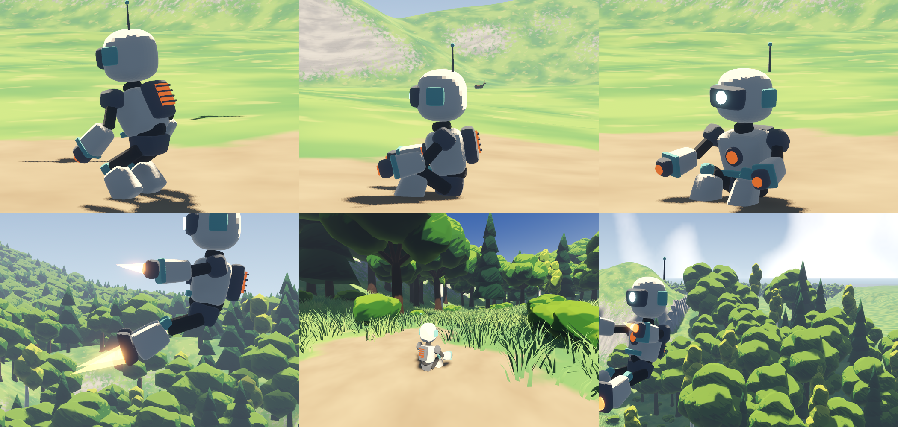

Pedido do usuário: o X no voo desligava os propulsores e o robô parecia planar; ao desligar os jatos faltava uma freada; e faltava abaixar (L3), sentando ao segurar, para descansar olhando a paisagem.

- **X no voo:** não faz mais nada, o robô segue voando. O estado `PLANAR` continua no código (fotos e testes chegam nele por `teleportar`), mas nenhum botão leva a ele. Para esfriar no ar sobram o mergulho, a água e a chuva.
- **Freada** (`Estado.FREAR`, `Armadura._frear`): o O no voo joga o corpo para trás, com pernas e braços esticados à frente e os jatos dos pés e das mãos acesos. Dura de 0,25 s (devagar) a 0,5 s (a 30 m/s ou mais) e tira ~75% do embalo; depois o motor desliga e ele cai pesado, como antes. O X durante a freada volta a voar. Números em `Ajustes.FREAR_*`.
- **Abaixar e sentar** (`Armadura.postura`: 0 de pé, 1 abaixado, 2 sentado; ação `abaixar` = L3 ou Ctrl): um toque com o robô parado abaixa; outro toque levanta; segurar 0,6 s senta. Abaixado ele anda a 1,6 m/s. Sentado fica até mexer o analógico, apertar o X ou o L3. Correr, pular, esquivar e sair do chão levantam. O L3 com o robô andando continua sendo correr, e no voo, arrancada. A câmera desce junto.
- **Fotos:** `--vale-captura --posturas`.
- **Testes:** `--teste` 84 pontos (X no voo, freada, abaixar, sentar, L3 andando); `--teste-vale` 19 (o 14º mede a queda depois da freada).

**Não verificado:** nada disso foi jogado no controle; abaixar não muda a colisão nem o que o Sentinela enxerga; sentado em ladeira o robô não acompanha a inclinação do chão.

### 32.1 Sentado, chuva no voo e a bolinha na pausa (2026-11-15)


Retorno do usuário: sentado, as pernas entravam no chão; voando na chuva, a chuva sumia e só voltava parando no ar; sair da pausa com a bolinha desligava o voo.

- **Sentado:** a pose passou a ser de pernas esticadas à frente e mãos nas coxas (o robô tem coxa curta e bota comprida; de joelhos para cima a bota afundava). Além disso `ArmaduraVisual` mede a peça mais baixa do corpo a cada quadro e sobe a bacia até ela encostar no chão (`_levanta`).
- **Chuva no voo** (`CicloDia`): as gotas nascem 9 m acima da câmera e levam meio segundo para chegar à altura do olho; a 30 m/s o robô saía de baixo do bloco. Agora o bloco nasce adiantado meio segundo na direção em que a câmera anda, é um pouco maior (40 × 40 m) e tem 3.400 gotas (eram 2.600).
- **Pausa:** fechar o menu esconde a tela, mas o jogo só volta quando os botões do menu (bolinha, X) forem soltos. Antes o mesmo aperto fechava a pausa e chegava ao robô como "desligar o voo" (ou pulo, no X do Continuar).
- **Testes:** `--teste` 85 pontos (sair da pausa com a bolinha segue voando); `--teste-vale` 19.

**Não verificado:** nada jogado no controle; a chuva em mergulho rápido (70 m/s) só foi conferida em voo reto e arrancada.

### 32.2 Voo bem mais longo (2026-11-15)

Pedido do usuário: como há pouco o que fazer no chão, aumentar bastante o tempo de voo; atividades no ar vêm depois.

| | antes | agora |
|---|---|---|
| Voo reto até superaquecer | ~25 s (4 %/s) | ~90 s (1,1 %/s) |
| Arrancada | ~8 s | ~30 s |
| Parado no ar | 25 s (4 %/s) | ~66 s (1,5 %/s) |
| Decolagem | +15% | +6% |

Subir segue custando até 3× e a chuva (−6 %/s) agora esfria mais do que o voo reto esquenta: na chuva dá para voar sem parar. Testes: `--teste` 85, `--teste-vale` 19.

O usuário também trouxe a descrição da movimentação de um jogo de armadura voadora como referência (só a mecânica). O que já temos igual: voo guiado pela câmera, pairar com o L2, calor com mergulho/água/chuva, superaquecer e cair, esquiva no chão e no ar, pouso já correndo. O que é diferente e fica para ele escolher: ligar o voo com o L3 no ar (hoje é segurar o X), acelerador no analógico esquerdo, pulo mais alto segurando o botão, impulsos de jato na corrida, mergulho com impacto no chão, e nadar com os jatos.

### 32.3 Acelerador e inclinação no analógico esquerdo (2026-11-15)

Primeiro item adotado da referência de movimentação (só a mecânica). No voo, o analógico esquerdo passou a ser:

- **Frente:** acelera do cruzeiro (30 m/s) até 38 m/s e esquenta até 1,6×. A arrancada (L3, 45 m/s) continua acima disso.
- **Trás:** segura até 18 m/s, agora com freio de jato de 10 m/s² (antes só cortava o motor e esperava o arrasto).
- **Lado:** além do deslize de antes, o corpo e a câmera inclinam, e inclinar para o lado em que a câmera está virando fecha a curva até 1,7× mais rápido.

Números em `Ajustes` (`VOO_RAPIDO`, `FREIO_AR`, `CALOR_ACELERADOR`, `CURVA_INCLINADA`). Testes: `--teste` 88, `--teste-vale` 19. Não jogado no controle.

## 33. Controles no jeito da referência e voo mais lento (2026-11-15)

O usuário mandou a descrição da movimentação de um jogo de armadura voadora (inclusive as cinco formas de parar o voo) e pediu para adaptar os nossos controles a ela. Só a mecânica; nomes, personagens e arte não entram. Depois pediu velocidade de voo menor, porque o vale é pequeno.

**Controles**

- **Sem decolagem do chão.** Segurar o X só estende o pulo (os jatos empurram por até 0,32 s; o pulo vai de ~1,7 m para ~4 m). O estado `DECOLAGEM` ficou no código sem botão.
- **Ligar o voo: L3 no ar** (ação `voar`, Shift no teclado), depois do pulo ou do pulo duplo. Há uma pausa de ignição de 0,16 s, o robô deita e leva um empurrão para onde a câmera aponta; apontar para cima sobe. Ligar custa 4% de calor. Perto do chão, o nariz não desce abaixo do horizonte por 1,6 s.
- **Desligar: L3 de novo** corta os jatos na hora; ele fica de pé e cai com a gravidade comum, levando o embalo e com controle leve, e o L3 religa a qualquer momento. **O** continua sendo a freada com os jatos à frente (§32).
- **X no voo não faz nada.** Na referência o pulo também desliga os jatos; ficou de fora porque o usuário pediu nesta mesma data que o X no voo não desligasse.
- **Acelerador único no analógico esquerdo:** neutro é o cruzeiro, todo para a frente é a arrancada (3× o calor), para trás segura. A arrancada saiu do L3.
- **Parar no ar: L2 ou R3** (ação `pairar`, F no teclado). R3 de novo cancela e ele cai.
- **Mergulho com impacto: triângulo** (ação `golpe`, V) no voo, parado no ar ou caindo, acima de 2,5 m: corta os jatos, desce reto a 42 m/s e bate em pouso de herói, com tremor e o sinal `Armadura.golpe_chao`. Ainda não afeta nada em volta (o Sentinela não reage).
- **Superaquecer:** cai e não religa nem paira até tocar o chão, mesmo que esfrie no ar (`caido`); no chão leva 1,4 s para se recompor.
- **Pouso:** já era como na referência (raso e rápido emenda na corrida; devagar, planta os pés).

**Não adotado:** impulsos de jato na corrida e nadar com os jatos.

**Velocidade** (o vale tem 2 km)

| | antes | agora |
|---|---|---|
| Cruzeiro | 30 m/s (108 km/h) | 18 m/s (65 km/h) |
| Arrancada | 45 m/s (162 km/h) | 28 m/s (100 km/h) |
| Segurando | 18 m/s | 10 m/s |
| Mergulho | ~70 m/s | ~47 m/s |
| Atravessar o vale no cruzeiro | ~65 s | ~110 s |

A câmera (campo de visão, distância, tremor), o giro, a sustentação e os limites de batida e de pouso forte passaram a seguir esses números.

**Testes:** `--teste` 92 pontos, `--teste-vale` 19. **Não verificado:** nada jogado no controle; a pose do mergulho não ficou enquadrada nas fotos (só o impacto com a poeira); os outros mapas (ilha de 8 km, cânion) usam os mesmos números e ficaram mais lentos também.

## 34. A base (2026-11-15)


Primeiro item da lista do que falta (base, mais vida, mais inimigos, cavernas, sons; a diversão no ar fica para o fim, a pedido do usuário).

- **Onde:** no ponto de nascimento da clareira (`Ruinas.BASE`, montada por `Ruinas._base` com as mesmas peças das ruínas). Um claro de chão batido novo em `Clareira.CLAROS` tira o capim dali.
- **O que tem:** estrado baixo de pedra com dois aros de metal, o berço de recarga atrás (dois pilares, a viga e uma lâmpada verde-água que ilumina o estrado à noite), um resto de muro em meia-lua, a antena e duas caixas.
- **Curto:** depois da pane (por golpes ou por ir longe no mar) o robô reaparece na base, com a tela já escura, olhando o campo (`Armadura.base`). Antes ele religava onde tinha caído. O aviso na tela virou "curto no motor · voltando à base".
  - **Mudou em 2026-11-21 (pedido do usuário):** o drone não leva mais para a base. Ele deixa o robô a uns 100 m
    de onde caiu, num chão seguro (`LugarSeguro`, `scripts/vale/lugar_seguro.gd`): terra firme fora d'água,
    chão plano (normal acima de 0,95 e degraus de no máximo 0,6 m em volta), sem tronco, pedra, paredão, ruína
    ou marco perto, fora das cavernas, do Sumidouro e do galpão da Fundição, e com o raio de cima batendo no
    chão. Procura em anéis (70 a 130 m, depois 40 a 200 m, depois 20 a 320 m) e prefere o lugar mais longe das
    máquinas acordadas. Pane no mar procura perto da praia mais perto. Sem nenhum lugar bom, volta à base como
    antes. O aviso virou "curto no motor · o drone leva a um lugar seguro". Quando o robô religa longe da
    base, o drone sobe e some na direção dela, em vez de atravessar a ilha num risco.
- **Depois:** aqui entram a troca de robô e as melhorias.
- **Fotos:** `--vale-captura --base`. **Testes:** `--teste-vale` 19 (o 13º confere o reaparecimento na base; o 17º conta quatro obras), `--teste` 95.

Também nesta data: o toque no L3 para abaixar ganhou folga, porque clicar o analógico costuma empurrá-lo e o toque virava "correr" (o usuário relatou que abaixar não funcionava no PC). **Não verificado:** a base não foi jogada; o topo do estrado saiu todo coberto de musgo; a borda do estrado pode ficar até uns 20 cm acima do chão do lado mais baixo.

**Correção (2026-11-15):** o usuário tinha dito L3 por engano; abaixar e sentar são no **R3** (no chão; no ar o R3 continua sendo parar no ar). O L3 no chão voltou a ser só correr, e a folga do clique saiu. O que as seções 32 e 33 dizem sobre "L3 parado" vale para o R3.

## 35. Vida espalhada pelo vale (2026-11-15)

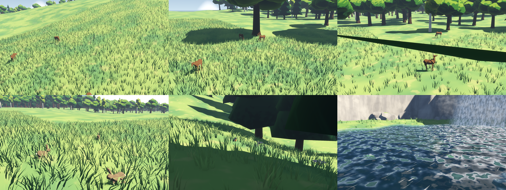

Segundo item da lista. Até aqui os bichos só existiam na clareira.

- **Gerente** (`scripts/vale/vida.gd`, `VidaVale`): sorteia uma vez, sempre igual, os lugares fora da clareira: **14 manadas** de 2 a 4 cervos, **34 tocas** de 1 a 3 coelhos, **18 bandos** de 4 a 8 pássaros e o **cardume do poço** da cachoeira. São os mesmos bichos da clareira (`Cervo`, `Coelho`, `Passaros`, `Peixes`), com o mesmo comportamento.
- **Onde:** só em chão firme e pouco inclinado, fora d'água, acima do mar, longe de beira de paredão e das ruínas (`VidaVale.chao_bom`), com distância mínima entre lugares do mesmo tipo (110, 60 e 85 m).
- **Desempenho:** os bichos de um lugar só existem com o robô a menos de 240 m e somem a mais de 320 m; o gerente olha seis lugares a cada décimo de segundo e cria no máximo um por vez.
- **Fotos:** `--vale-captura --vida`. **Testes:** `--teste-vale` 20 pontos (o 18º confere o chão dos lugares, os quatro quadrantes e o nascer e sumir de uma manada); `--teste` 95.

**Não verificado:** nada jogado; o cardume do poço não apareceu na foto (pode estar fundo demais ou tapado pela espuma); os bichos atravessam troncos de árvore, como já faziam na clareira; não há bicho novo, só os quatro que já existiam.

## 36. Zangão, Carrapato e mais Sentinelas (2026-11-15)


Terceiro item da lista. Até aqui só havia um Sentinela, na clareira.

- **Base comum** (`scripts/vale/maquina_pequena.gd`, `MaquinaPequena`): corpo montado por código com os materiais de metal do vale, lente vermelha, calor que sobe a cada tiro do robô, fumaça de desligada e 15 minutos reais até religar no mesmo lugar. Ninguém é destruído.
- **Zangão** (`zangao.gd`): voador de 0,9 m, em dupla. Ronda a 15 m do chão, acima das copas. Vê o robô a 45 m, rodeia a uns 15 m e solta um tiro lento por vez (15 m/s, com 0,7 s de lente acesa antes), que dá para desviar. Voa a 12 m/s, menos que o cruzeiro do robô (18), então dá para fugir; desiste a 80 m. Dois tiros do robô desligam: cai e fica no chão.
- **Carrapato** (`carrapato.gd`): rasteiro de 0,6 m, em trio, com um rolo de ferro na frente. Vê o robô a 30 m se ele estiver a menos de 7 m do chão; para, treme 0,75 s e investe em linha reta a 11 m/s por até 2 s. Sair de lado escapa; depois ele fica 2,6 s cansado, parado. Não entra na água nem sobe barranco. Dois tiros desligam.
- **Mergulho com impacto:** agora serve para alguma coisa. Zangão e Carrapato a menos de 8 m desligam na hora; o Sentinela a menos de 9 m ganha 60 de calor (dois impactos desligam).
- **Onde** (`inimigos.gd`, `InimigosVale`): 6 duplas de Zangões e 6 trios de Carrapatos (nas três ruínas e em pontos espalhados) e mais 3 Sentinelas; 33 máquinas fora da clareira, que continua só com o Sentinela dela. Ficam sempre criadas, para guardar quem está desligado, mas só pensam com o robô a menos de 230 m.
- **Fotos:** `--vale-captura --inimigos`. **Testes:** `--teste-vale` 21 pontos (o 19º confere a investida, o golpe, o mergulho que desliga, o religar, a caça e o tiro do Zangão e a queda dele); `--teste` 95.

**Não verificado:** nada jogado, e o equilíbrio (dano, distância, quantidade) é chute; três golpes de qualquer máquina ainda dão o curto, então um trio de Carrapatos pode derrubar o robô numa passada; as máquinas não têm som; o Zangão atravessa troncos e copas quando desce para caçar; as posições foram escolhidas no mapa sem olhar uma a uma.

## 37. Cavernas (2026-11-15)

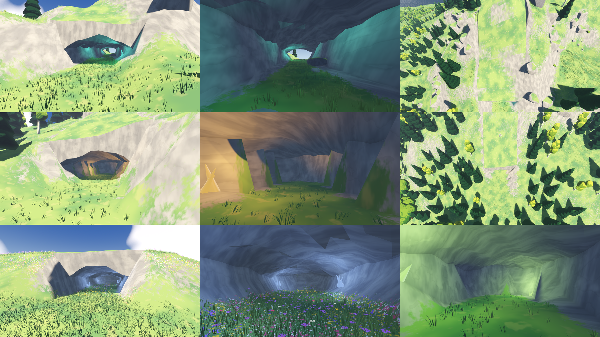

Quarto item da lista. O relevo é uma grade de alturas e não aceita teto, então cada caverna é um **rasgo cavado na grade** (o chão e as paredes) coberto por um **teto feito à parte**: o arco de rocha por baixo e o chão de antes refeito por cima, com capim (`scripts/vale/cavernas.gd`, `Cavernas`; `vale_teto.gdshader`).

- **Lugares achados no próprio relevo** (`Cavernas.cavar`, antes de o chão ser montado): linhas sorteadas, sempre as mesmas, longe da clareira, da água e das ruínas.
  - **Túnel:** 70 a 150 m com as duas pontas baixas e um morro de pelo menos 11,5 m no meio. O relevo é suave e só um lugar serviu: a **Passagem da Serra** (126 m, a 232 m de altitude, com 40 m de morro por cima).
  - **Gruta sem saída:** 45 a 80 m entrando numa encosta, de chão plano. São cinco: Gruta do Eco, Gruta dos Cristais, Toca Funda, Gruta da Lua e Boca Verde.
- **Medidas:** chão de 14 m de largura, parede subindo em 5 m, arco de 7,5 m de altura.
- **Teto** (`Cavernas.montar`): só onde o morro passa pelo menos 3 m acima do arco; nas pontas fica o rasgo aberto, que faz a boca. Tem colisão dos dois lados e faz sombra.
- **Cristais:** grupos de prismas acesos ao pé das paredes, alternando os lados, com uma luz cada. Cada caverna tem uma cor.
- **Vizinhança:** não nasce árvore, rocha de paredão nem bicho dentro do rasgo. As seis têm nome na tela.
- **Fotos:** `--vale-captura --cavernas`. **Testes:** `--teste-vale` 22 pontos (o 20º confere o chão cavado, o teto com colisão e um voo de uma boca à outra do túnel); `--teste` 95.

**Não verificado:** nada jogado; visto de cima o teto aparece como um retângulo de capim onde a serra em volta é pedra; a parede sobe quase a pique e é só o chão esticado, sem rochas; as grutas não têm nada dentro além dos cristais; não conferi as seis por dentro (só quatro nas fotos).

**Reparo de passagem:** com o cruzeiro a 18 m/s o voo só fica nivelado com o nariz uns 12° acima do horizonte (a 30 m/s eram 7°). Não mexi; fica para o usuário dizer se incomoda.

## 38. Sons de gravação (2026-11-15)

Quinto item da lista: o usuário pediu sons melhores, "não apenas sintetizadores simples". Até aqui os 18 sons saíam de `tools/gerar_sons.py` (síntese). Agora quase tudo vem de **gravações livres** do OpenGameArt, 17 pacotes aprovados por ele (35 MB; 12 CC0 e 5 CC-BY). Autores e licenças em [CREDITOS.md](../CREDITOS.md).

- **Caminho:** os downloads ficam em `tools/sons_brutos/` (fora do git); `tools/decodificar_sons.gd` abre ogg, mp3 e wav pelo Godot e grava WAV (os .flac vão com `afconvert`); `tools/montar_sons.py` (com `tools/audio_util.py`, só biblioteca padrão) corta, mistura, nivela pelo volume médio e fecha os laços com crossfade. Saída: 45 WAV em `assets/sons/` (56 MB no git, 11 MB na build, porque o Godot importa em QOA).
- **Vale:** pássaros gravados (29 s) sobre um fundo de floresta (43 s) que toca dia e noite; os dois laços têm durações diferentes e a soma demora a se repetir. Grilos à noite, chuva de 43 s, dois trovões (um de 15 s), riacho, cachoeira, e o **rio do vale** com um som a cada 110 m (`Vale.pontos_do_rio`, `SomAmbiente.rio_em`), que antes era mudo.
- **Cavernas:** debaixo do teto entra um laço de vento grave e goteira, e a mata e a chuva caem 14 dB (`SomAmbiente._peso_caverna`).
- **Armadura:** motor e arrancada misturam um foguete gravado com propulsores do Kenney; vento de verdade (47 s); decolagem com turbina de jato; pousos de metal no capim. **Novos:** pisadas (uma a cada 0,75 m andando, 1,25 m correndo, mais baixas abaixado), tiro da mão (3 variações), golpe no chão do mergulho e folhagem ao atravessar copas.
- **Máquinas** (`scripts/som.gd`, classe `Som`, toques e laços 3D): Zangão, Carrapato e Sentinela têm ronco próprio, som de tiro, de lataria ao serem acertados e de desligar; o Sentinela tem pisada.
- **Continuam sintetizados:** alarme de calor, marcador e religar (`python3 tools/gerar_sons.py`; com `--tudo` ele volta a gerar a versão sintetizada inteira e cobre as gravações).
- **Testes:** `--teste-vale` 23 pontos (o 21º confere os arquivos, as pisadas, o tiro e o eco dentro do túnel); `--teste` 95.

**Não verificado:** ninguém ouviu nada. Os sons foram escolhidos pela descrição e por medidas (duração, volume médio, pico), então timbre, emenda dos laços e equilíbrio de volumes são chute até o usuário jogar. Bichos (cervo, coelho, pássaros de perto) e o respingo na água seguem sem som: não achei gravação livre.

## 39. Limpeza e teste do Faísca (2026-11-15)

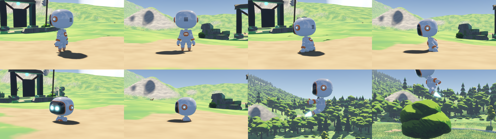

**Limpeza:** saíram os modelos `armadura_v1.glb` e `armadura_v2.glb` (sem uso), três funções e três constantes órfãs, e o carregamento de som duplicado (`Sons` e `SomAmbiente` agora usam a classe `Som`). **Mapas antigos apagados (a pedido):** a ilha de 4 km (`Mundo`), o cânion realista (`Canion`, 195 MB em `assets/teste_visual`) e o cânion pintado (`CanionEstilo`), com as fotos, testes, shaders, modelos e geradores só deles (`tools/mapa`, `previa`, `estilo`, `teste_visual`, `maquete`) e o botão "Próximo mapa" da pausa. Tudo volta pelo git (commit 4e3d5f0). Ficam o vale, que é o jogo, e a ilha pequena, onde roda a bateria do voo. As seções antigas desta doc que falam deles são registro. No disco, fora do git, continuam `vendor/` (downloads do Poly Haven) e `tools/capturas/`.

**Faísca (só teste):** o corpo do Faísca da Ilha Cafuné no lugar do robô, com as cores de lá.
- Na Ilha ele não é um arquivo: é montado por código (`scripts/faisca/robo.gd`) sobre o esqueleto Rig_Medium do KayKit. `tools/faisca/exportar_faisca.gd` roda dentro do projeto da Ilha (`godot --headless --path ../ilha-cafune -s "$PWD/tools/faisca/exportar_faisca.gd" -- <saida.scn>`), monta o boneco e grava uma cena do Godot com tudo embutido: `assets/faisca/faisca.scn` (7,4 MB). Em .glb os ossos viravam nós soltos, sem esqueleto.
- `ArmaduraVisual` já levava as poses do jogo para um esqueleto Mixamo; ganhou os nomes dos ossos do KayKit, a altura medida pelas peças (o capacete passa muito do osso da cabeça) e a escala pelo porte do mapa. As poses são as mesmas do robô: andar, abaixar, sentar, voo, freada, mergulho.
- A tela do rosto recebe de volta o shader dos olhos de LED (cópia em `scripts/shaders/faisca_rosto.gdshader`); ele pisca, fecha os olhos na pane e faz cara de dor superaquecido. Os jatos dele acendem como as chamas do voo.
- **Pausa:** botão "Trocar de robô", que troca o corpo na hora, sem sair do lugar (`Armadura.trocar_visual`). `-- --faisca` já abre com ele.
- **Ficou de fora:** o contorno de luz azulada da Ilha, as expressões além de piscar e dor, os dedos e as animações próprias dele (giro, soco, espera).
- **Testes:** `--teste-vale` 24 pontos (o 22º troca, anda e destroca); `--teste` 95.

**Não verificado:** nada jogado; as fotos mostram as poses paradas, não o movimento; ele é branco e a luz do vale o deixa azulado.

## 40. O Sumidouro, a caverna vertical (2026-11-15)


O usuário pediu uma caverna "mais trabalhada e verticalizada". A grade de alturas do vale só guarda um chão por ponto (por isso as seis cavernas da §37 são corredores de um andar), então esta é uma **peça própria**, a única assim no mapa.

- **Onde:** num morro da Mata Fechada, ao lado da cachoeira; eixo em (-312, -600), 50 m de fundura. `Sumidouro._achar_lugar` procura sempre o mesmo morro (alto largo e uma encosta que desce 46 m em até 130 m).
- **O desenho** (`scripts/vale/sumidouro.gd`, `Sumidouro.vazio`): um poço de 9 m de raio aberto no alto do morro desce até um salão de 56 × 42 m e 24 m de altura, com uma lagoa rasa debaixo do poço e dois pilares; do salão sai um túnel de 11 m de largura até a encosta, perto do poço da cachoeira; a 30 m do piso há uma galeria em anel com três janelas para o poço, uma ponte de pedra que cruza o poço e uma varanda que fura o morro para fora; ao lado do salão, uma câmara menor com cristais âmbar.
- **Como é feita:** a rocha é descrita por distâncias (o morro de antes, menos os vazios, mais a ponte e os pilares), com ruído nas paredes e piso quase chato. `Sumidouro.assar` transforma isso em malha por *surface nets* (células de 1,6 m, 61 mil triângulos) e grava em `assets/vale/sumidouro.res`; leva uns 6 s, por isso só roda a pedido (`-- --assar-sumidouro`, depois de mudar o desenho). No jogo a malha é carregada e ganha colisão dos dois lados.
- **Encaixe no vale:** debaixo da peça a grade é rebaixada até 3,5 m abaixo do piso mais fundo (`_rebaixar`), para a câmera e a altura do chão não acharem que ali ainda é o alto do morro; a peça refaz a superfície do morro por cima, com capim (`vale_gruta.gdshader`: a cor do vértice diz o que é capim e o que é fundo). Não nasce árvore, rocha de paredão, capim nem bicho na área.
- **Luz e som:** o sol entra pelo poço; lá dentro a luz do céu quase não chega (o shader corta) e sobram dez grupos de cristais com luz e uma luz fria fraca no salão. Estalactites e estalagmites em MultiMesh. O eco de caverna do som ambiente vale aqui também. Tem nome na tela.
- **Fotos:** `--vale-captura --sumidouro`. **Testes:** `--teste-vale` 25 pontos (o 23º confere o poço aberto até o piso, a ponte, o túnel livre e o robô caindo pelo poço e pousando no salão); `--teste` 95.

**Não verificado:** nada jogado, e o principal é o voo lá dentro (largura do poço, câmera perto das paredes, entrar pelas janelas). A grade rebaixada some debaixo da peça, mas a emenda na boca do túnel e na varanda só foi vista de longe. Os inimigos e os bichos não entram. A lagoa é só uma lâmina, sem física de água. Sem caminho a pé até a galeria: é para chegar voando.

**Nuvens (mesmo dia):** o usuário reparou que as nuvens se juntavam num ponto. A textura delas era enrolada no céu como um mapa-múndi e fechava no zênite. O céu do vale agora é `vale_ceu.gdshader`: o mesmo degradê e o mesmo sol, com as nuvens num teto plano que anda devagar com o vento; `CicloDia` passa as cores e a cobertura por parâmetros.

## 41. Lista do que falta (2026-11-15)

Feitos da lista do usuário: base, vida espalhada, mais inimigos, cavernas, sons de gravação. O que sobra, sem ordem fechada:

1. **Vibração no controle** (pedido em 2026-11-15): feita na §42; falta o usuário sentir e ajustar as forças. Candidatas: decolagem, arrancada, pouso (forte no pesado), golpe no chão do mergulho, levar tiro ou investida, tiro da mão, superaquecer e a pane. A ideia antiga de vibrar cada propulsor de um lado fica como extra.
2. **Diversão no ar:** atividades de voo. O usuário pediu para deixar por último, com o resto terminado.
3. **A base:** troca de robô, melhorias e incrementos (o teste do Faísca saiu do jogo em 2026-11-16).
4. **Sons que faltam:** bichos e respingo na água (sem gravação livre achada); trocar o que ele não gostar ao ouvir.
5. **Pendências pequenas já anotadas:** o Zangão atravessa troncos e copas ao descer; o equilíbrio dos inimigos é chute; o cardume do poço não apareceu em foto; o teto das seis grutas simples aparece como retângulo de capim visto de cima; o voo nivelado pede o nariz 12° acima do horizonte.
6. **Sumidouro:** lagoa sem física de água; inimigos e bichos não entram; conferir a emenda das bocas de perto.
7. **Esperando o usuário jogar:** tudo desde os inimigos (§36 a §40) e os sons.

## 42. Vibração, Zangão sobre as copas, grutas refeitas e vida no Sumidouro (2026-11-15)


Itens 1 a 4 combinados com o usuário enquanto ele não podia testar.

- **Vibração do controle** (`scripts/vibra.gd`, classe `Vibra`): um tranco próprio para decolagem, pulo duplo, esquiva, pouso leve e pesado, golpe no chão, levar golpe (sinal novo `Armadura.levou_golpe`), tiro, superaquecer, pane e religar; zumbido contínuo do motor leve na arrancada e na freada. As forças estão na tabela `Vibra.AJUSTE` ([motor leve, motor pesado, segundos]). A pausa tem o botão "Vibração do controle" e cala o controle enquanto está aberta. É a vibração comum do Godot (dois motores); os efeitos finos do DualSense ficam para depois.
- **Zangão não atravessa mais árvore:** `MaquinaPequena.topo_copas` dá o topo da copa mais alta em volta; perto de árvore ele voa acima dela (inclusive caçando), e segura o avanço para subir antes de uma copa mais alta. Desligado, continua caindo por entre os galhos.
- **Grutas refeitas:** o gerador do Sumidouro virou `scripts/vale/rocha_malha.gd` (`RochaMalha`: rebaixar a grade, malha por *surface nets*, colisão, material, cristais e pingentes) e as seis grutas da §37 passaram a usá-lo (`Cavernas.vazio_de`). Os lugares são os mesmos. Agora o corredor serpenteia, muda de largura e de altura, tem parede e boca de pedra; onde o morro é fino ele vira rasgo aberto; e as cinco sem saída terminam num salão redondo com claraboia. Saíram o retângulo de capim visto de cima e as paredes de chão esticado. Malhas em `assets/vale/gruta_0.res` a `gruta_5.res` (10 a 18 mil triângulos, menos de 1 s cada para gerar). **`-- --assar-rochas`** gera as sete de novo (substitui o `--assar-sumidouro`).
- **Grade debaixo das peças:** fica 2,2 m abaixo do piso, e cada nó desce até o mais fundo dos vizinhos (na beira dos salões a grade aparecia por dentro). Capim, árvores, rochas de paredão e bichos não nascem onde a grade foi rebaixada (`RochaMalha.dentro`).
- **Sumidouro com vida:** 16 morcegos (`scripts/vale/morcegos.gd`) em círculos no poço, abaixo e acima da ponte, que se agitam com o robô por perto; vaga-lumes no salão e na câmara; e a lagoa passou a ser água de verdade para o jogo (`Sumidouro.agua`, consultada por `Vale.agua`): respinga e esfria como o resto da água.
- **Testes:** `--teste-vale` 26 pontos (o 24º confere os trancos, o Zangão posto dentro de uma copa, o nível da lagoa e os morcegos); `--teste` 95.

**Não verificado:** nada jogado. A força de cada vibração é chute até o usuário sentir no controle, e não sei como o Godot entrega os dois motores no DualSense pelo Steam no Bazzite. Os morcegos são formas simples e não aparecem nas fotos. Inimigos continuam sem entrar nas cavernas (andam e voam pela altura da grade).


## 43. Primeiro teste do usuário: seis ajustes (2026-11-16)


O usuário jogou (no Mac, em modo debug) e apontou seis coisas.

- **Trancos no voo:** não era mapa carregando. A física anda a 60 passos por segundo e a tela em outro ritmo (o monitor dele é de 75 Hz), então o robô andava em degraus e a câmera, que segue macio, mostrava ele indo e voltando. Agora `Armadura.pos_suave()` dá a posição entre os dois últimos passos da física; o corpo (`visual.position`) e a câmera usam ela. Teleporte corta a suavização (`_corte`).
- **Buraco que mostrava o Sumidouro por fora:** a caixa da peça parava 14 m acima do morro no eixo do poço (176 m), mas a oeste, sobre a câmara, o morro passa disso. Ali a grade tinha sido rebaixada e a peça não tinha tampa: 313 pontos abertos. A caixa agora cobre o ponto mais alto do morro (`RochaMalha.alto_da_caixa`), nas grutas também (a Passagem da Serra tinha 2 pontos). `RochaMalha.furos` procura esses furos (raio do céu até a grade) e entra no teste 22; `-- --vale-captura --furos` fotografa. Malhas assadas de novo.
- **Faísca removido:** saíram `assets/faisca/`, `tools/faisca/`, o shader do rosto, o botão da pausa, `--faisca` e `Armadura.trocar_visual`. A §39 fica como registro.
- **Abaixado, os pés entravam no chão:** a bacia descia mais do que as pernas dobravam. A medida da peça mais baixa (que já existia para o sentado) agora vale abaixado e levantando, e usa pontos reais de cada peça (os mais salientes em 60 direções) em vez da caixa em volta, que exagerava com a perna dobrada.
- **Levantar de sentado:** antes esticava tudo de uma vez e parecia saltar sem impulso. Agora são três tempos em 0,95 s (`ArmaduraVisual.ERGUER`, `Ajustes.ERGUER_TEMPO`): encolhe as pernas e apoia as mãos, sobe agachado com o peso à frente, estica. Nesse tempo ele não anda nem pula (`Armadura.erguendo`).
- **Jogo mudo:** não era o modo debug. Um dos sons do rio caía num ponto sem água no eixo, `agua()` devolvia -INF e o tocador 3D ia para uma posição infinita, o que zera a mistura inteira (27 sons tocando, pico de -200 dB). A build do PC estava muda pelo mesmo motivo. Corrigido em `Vale.pontos_do_rio`, com guarda em `Som.toque3d` e `SomAmbiente.rio_em`; o teste 21 conta tocadores em posição inválida. `-- --vale-captura --sonda-som` mede o pico da saída (depois da correção: -11 dB andando).
- **Decolagem segurando o pulo:** segurar o X por 0,4 s (no pulo do chão ou no pulo duplo) decola: de pé, sobe reto 10 m a 13 m/s (ou até bater num teto) e então deita e sai voando para onde a câmera aponta (`Ajustes.DECOLAR_SEGURAR`, `DECOLAGEM_SUBIDA`, `DECOLAGEM_VEL`). Toque curto continua sendo só pulo. O L3 no ar segue ligando o voo direto.
- **Testes:** `--teste-vale` 26 pontos (o 22º agora é decolagem, levantar e furos); `--teste` 95.

**Não verificado:** a suavização só se confirma jogando (não dá para medir tranco sem tela); o levantar e a decolagem foram vistos em fotos paradas; o som foi medido, não ouvido.


## 44. Mira com trava, águas fundas e nado (2026-11-16)

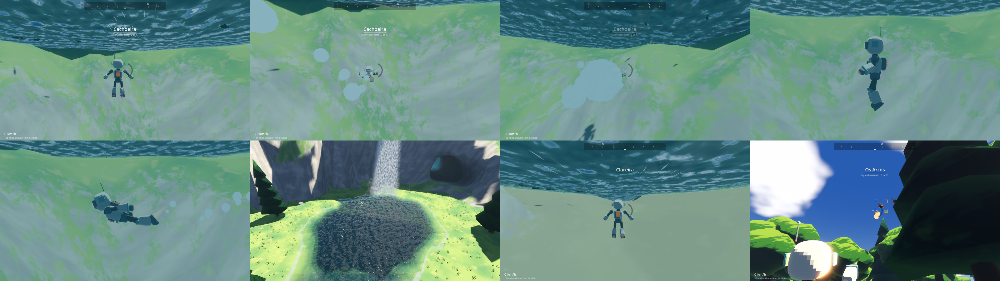

Pedidos depois do segundo teste (o usuário achou o Zangão difícil demais de acertar).

- **Mira com trava (`Tiro`):** mirando (L2), a máquina ligada mais perto do centro da mira fica travada se estiver a menos de 6,5° dele (`TRAVA_ANGULO`; de perto o cone abre), até 130 m e com a vista livre. A travada só solta a 1,6× o ângulo, para não ficar trocando. O tiro travado é guiado: o destino acompanha a máquina até chegar (`ponto_de_trava()` em `MaquinaPequena` e na `Sentinela`, que trava na cabeça). A tela desenha quatro cantos laranja no alvo. Sem mirar não há trava.
- **Águas fundas:** o mar já tinha 14 m. O poço da cachoeira ganhou uma bacia de 11 m no meio (`Vale.POCO_FUNDO`) e a lagoa da clareira, 5 m (`Clareira.LAGOA_FUNDO`). Os rios continuam rasos.
- **Nado (`Armadura.Estado.NADO`):** em água mais funda que 1,5 altura do robô, com o corpo já debaixo da lâmina, ele passa a nadar (andando para o fundo, caindo ou mergulhando do voo). O analógico esquerdo leva para onde a câmera aponta (olhando para baixo, desce), X sobe, O desce, L3 abre os jatos (6,5 → 13 m/s). Parado, boia no lugar. Na tona, X pula para fora (segurando, decola); chegando de baixo a mais de 7 m/s, rompe a lâmina e sai voando. No raso volta a andar. A água tira 30 de calor por segundo. Não atira nem mira nadando.
- **Visual:** pose deitada com pernas batendo (boiando, de pé), véu azulado na tela quando a câmera está debaixo d'água e bolhas dos jatos (`EfeitosAgua`). A lâmina já era desenhada dos dois lados.
- **Testes:** `--teste-vale` 27 pontos (o 25º: trava a 3°, não trava a 16°, tiro travado acerta; no poço nada, desce, esfria, para na tona, pula para fora e sai voando); `--teste` 95. Fotos: `-- --vale-captura --nado`.

**Não verificado:** nada disso foi jogado. O tamanho do cone da trava, as velocidades do nado e a força do véu são chute. Faltam som abafado debaixo d'água, peixes no poço e inimigos reagindo ao robô na água.

**Stylized Nature MegaKit (Quaternius, CC0), só análise:** 68 modelos em `others/Stylized Nature MegaKit[Standard]` (versão grátis de 116): 5 árvores comuns, 5 pinheiros, 5 retorcidas, 5 mortas, arbustos, samambaia, capins, flores, cogumelos, pedras e seixos. glTF com texturas (folhas em recorte, casca com mapa de relevo), de 100 a 10 mil triângulos (média 2,2 mil). Serve para enriquecer o chão (samambaia, flores, cogumelos, pedras, árvores mortas e retorcidas). As árvores são mais pesadas que as do vale (4 a 10 mil triângulos contra as nossas, feitas para 12 mil cópias) e usam folha em cartão com textura, outro jeito de desenhar: precisariam do nosso shader de faixas e de versão de longe. As "RockPath" são pedras de caminho e ficam de fora (o vale não tem estrada). Nada foi importado.


## 45. Correnteza dos rios e avaliação de pacotes do Quaternius (2026-11-16)

- **Correnteza:** o shader do rio empurrava a espuma sempre para o mesmo lado do mapa (`fluxo` fixo), então no trecho que sai da cachoeira a água parecia subir. Nas fitas dos cursos o desenho agora anda pelo UV da fita (`pela_fita`): de margem a margem e ao longo do curso, rio abaixo. As ondas, que andavam ao contrário das riscas, foram acertadas. O teste 25 confere que o nível só desce no sentido da correnteza. O mar, o poço e o riacho da clareira seguem com o sentido fixo.
- **Pacotes avaliados (todos CC0, pastas em `others/`, nada importado):**
  - *Textured Stylized Trees (2020):* 45 árvores em FBX/OBJ/Blend (sem glTF): 10 comuns, 10 bétulas, 5 pinheiros, 10 mortas, 10 bétulas mortas, com variações de cor (verde, amarela, vinho). 450 a 2.500 triângulos: leves, do porte das nossas. Folha em cartão com textura.
  - *Ultimate Animated Animals (2021):* 12 bichos em glTF com esqueleto e 12 a 13 animações (andar, galope, comer, parado, susto): cervo, veado de galhada, raposa, lobo, cavalo (2), burro, vaca, touro, alpaca, husky, shiba. Cerca de 2 mil triângulos cada.
  - *Easy Animated Enemy Pack (2019):* aranha, rato, vespa, cobra (2) e sapo, só FBX/OBJ/Blend, 1,6 a 4,9 mil triângulos.
  - *Animated Mech Pack (2021):* 4 robôs (George, Leela, Mike, Stan) em glTF, versão com textura (ferrugem) e de cor lisa, 2,4 a 7,9 mil triângulos, 17 a 20 animações (andar, correr, atirar, levar golpe, desligar, soco, chute). Nenhum voa.


## 46. Árvores e plantas dos pacotes do Quaternius (2026-11-16)

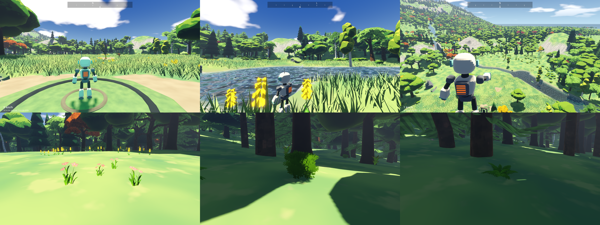

- **Conversão (`tools/vale/pacotes.py`, Blender):** 13 árvores do *Textured Stylized Trees* (4 comuns, 3 bétulas, 3 pinheiros, 3 mortas), postas na altura das nossas (8,5 a 14,5 m), cada uma com versão de longe (22% dos triângulos), e 18 peças do *MegaKit* (samambaia, plantas, flores, cogumelo, moitas, trevo, pedras, seixos). Saem em `assets/vale/q/*.glb` sem textura; as 14 texturas ficam na mesma pasta (as do MegaKit reduzidas a 1024). Tudo: 9 MB.
- **Visual (`vale_tex.gdshader`):** a cor vem da textura do modelo (folha em recorte por `discard`), puxada para a paleta do vale por uma tinta, com a mesma luz em faixas, o vento das copas e a borda clara. Materiais `q_*` em `Clareira._materiais`.
- **Mata:** as posições não mudaram. `Clareira.tipo_variado` troca cerca de 60% das árvores pelas dos pacotes conforme o lugar (`sorte_do_lugar`, sem gastar o sorteio da mata): pinheiros e bétulas novos, bétulas amarelas, 3% de árvores vinho, 3% laranja e 4% de mortas (`Q_CORES` são a mesma malha com outra folhagem). As postas à mão na clareira ficaram.
- **De longe:** as dos pacotes de folha verde usam os vultos de longe do vale (`longe_de`); só as coloridas e as mortas têm o delas. Sem isso o custo era o dobro.
- **Chão (`Vale._plantas_do_chao`):** 41 mil peças pelo mapa todo, visíveis até 120 m (pedras e moitas até 260 m): flores em canteiros nos campos (manchas por ruído, uma espécie por mancha), samambaias, cogumelos e moitas debaixo da mata, seixos e 433 pedras soltas com colisão.
- **Custo no Mac (1600×900):** de 45/55/44 quadros por segundo para 40/49/38 nas três fotos de sempre (cerca de 10%). `-- --sem-pacotes` desliga tudo para comparar.
- **Ficou de fora:** as "RockPath" (o vale não tem estrada), as árvores do MegaKit (pesadas), capins do kit (o vale tem o dele) e o cogumelo de tronco.

**Não verificado:** visto só em fotos; o salto entre a árvore de folha recortada e o vulto de longe (aos 170 m) não foi visto em movimento; o custo no PC não foi medido.


## 47. Máquinas com os robôs do Animated Mech Pack (2026-11-16)

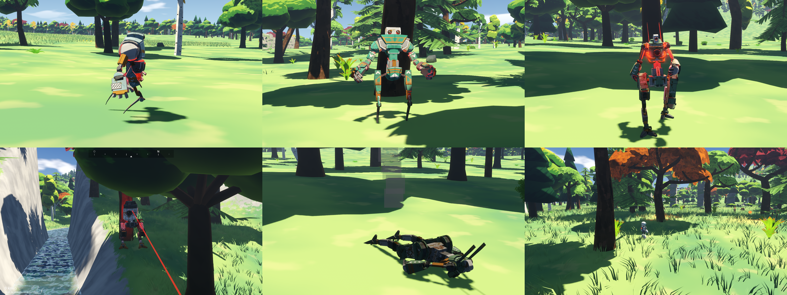

As máquinas inimigas trocaram de corpo pelos quatro robôs do pacote (CC0), com as animações deles, e **todas andam no chão** (pedido do usuário: nenhum robô voador; a Leela é a Sentinela, escolha dele).

| Máquina | Modelo | Altura | O que faz | Tiros para desligar |
|---|---|---|---|---|
| Sentinela | Leela (casulo de uma lente, duas pernas) | 3,1 m | a mesma torre lenta: vê de longe, avisa com o feixe e dá um tiro forte | 6 na cabeça |
| Carrapato | Mike (atarracado, braços grandes) | 0,9 m | o mesmo: arma e investe correndo | 2 |
| Batedor (novo, no lugar do Zangão) | Stan (magro e alto) | 1,5 m | em dupla; corre em volta do robô a 14 m, para, avisa e atira | 2 |
| Vigia (novo) | George (de antenas) | 1,7 m | ronda a pé; vendo o robô chega a 16 m, fica de frente e atira; perto demais, recua | 3 |

- **`MechVisual`** (`scripts/vale/mech_visual.gd`): carrega `assets/vale/mech/<nome>.gltf` (cópia do pacote, 17 MB os quatro), põe na altura pedida, troca o material pelo `vale_tex` (a textura do robô com a luz em faixas) e dá `tocar(animação)`, `olho` (luz vermelha na cabeça: o aviso de ataque), `clarao` (pisca ao levar tiro) e `apagar` (escurece desligado). Desligar toca `Death`; religar volta ao `Idle`.
- **`Vigia`** é a máquina de chão que atira; **`Batedor`** herda dela e muda os números e o modelo. O tiro lento laranja saiu do Zangão para `MaquinaPequena.atirar_em` / `atualizar_tiros`.
- **Sentinela:** a lógica é a mesma (as pernas de três pontos seguem só na conta, escondidas); o corpo novo vira para onde a cabeça olhava, anda, atira e cai conforme o estado. A lente e o feixe saem da altura da cabeça antiga.
- **Zangão:** `zangao.gd` apagado. No vale: 12 batedores (6 duplas), 18 carrapatos, 6 vigias, 3 sentinelas mais a da clareira.
- **Testes:** `--teste-vale` 27 pontos (o 19º agora é batedor e carrapato; a parte do voador por cima das copas saiu do 24º); `--teste` 95.

**Não verificado:** nada jogado. As animações de andar não foram casadas com a velocidade (o pé pode escorregar); o equilíbrio do Vigia e do Batedor é chute; a Sentinela não inclina a cabeça para mirar para cima (só o corpo gira); o som do Batedor ainda é o laço do Zangão.


## 48. Sentinela que anda, e os bichos do Ultimate Animated Animals (2026-11-16)

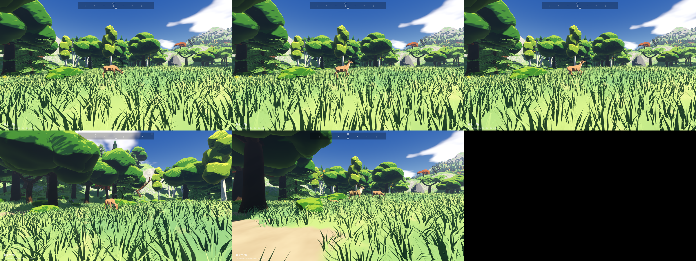

- **Sentinela presa no lugar:** ela só andava quando as três pernas antigas (agora escondidas) estavam perto do repouso, então o corpo novo dava um passo e parava. Agora anda sem parar (22 m em 25 s de patrulha, medido). **Caída, entrava no chão:** `MechVisual` mede o osso mais baixo durante a animação `Death` e ergue o corpo até `margem_caido` × altura (os ossos "Pole" são alvos de apoio e ficam fora da conta). Vale para as quatro máquinas.
- **Bichos (`BichoVisual`, `scripts/vale/bicho_visual.gd`):** os modelos animados do pacote (CC0) em `assets/vale/bichos/` (13 MB os quatro), com as cores do modelo no `vale_solido` e as animações `Eating`, `Idle`, `Idle_2`, `Walk` e `Gallop`.
  - **Cervo:** o jeito de ser é o mesmo (`cervo.gd`: pasta, anda, alerta, foge); as peças antigas ficam escondidas só para a conta e quem aparece é a cerva (1,3 m) ou, um em cada três, o veado de galhada (1,55 m).
  - **Raposa (`Raposa`) e lobo (`Lobo`):** herdam o cervo e trocam o corpo (0,55 m e 0,85 m). São ariscos: farejam, ficam alerta e fogem; nenhum bicho ataca. No vale: 12 raposas sozinhas e 5 alcateias de 2 ou 3, em `VidaVale`.
- **Fora:** cavalo, burro, vaca, touro, alpaca e os cachorros (bichos de fazenda) e o pacote de inimigos pequenos (aranha, vespa, rato, cobra, sapo).
- **Testes:** `--teste-vale` 27 pontos; `--teste` 95.

**Não verificado:** a raposa e o lobo só foram vistos de longe, no meio do capim; o passo das animações não foi casado com a velocidade; coelhos, pássaros e peixes continuam os de antes.


## 49. Sentinela que avança, mais tempo de voo e corpos de mech para o jogador (2026-11-16)

- **Sentinela "se mexe mas não anda":** ela só andava na patrulha; com o robô à vista ficava plantada, alternando alerta, aviso, tiro e recarga (era o desenho da torre de três pernas). Agora, no alerta e na recarga, ela anda na direção do robô a 2,2 m/s até ficar a 22 m (`Sentinela._avancar`); para só para avisar e atirar.
- **Tempo de voo:** `CALOR_VOO` de 1,1 para 0,55 por segundo (uns 3 minutos de voo reto, eram 90 s) e `CALOR_PAIRAR` de 1,5 para 0,8. A arrancada e a subida seguem multiplicando.
- **Corpos para testar (pausa, botão "Corpo do robô"):** o robô do vale, George, Mike e Stan (`ArmaduraVisual.CORPOS`; `-- --corpo=george` já abre com ele). A física, o tamanho da colisão e os comandos são os mesmos; só o corpo muda. Com mech, `ArmaduraVisual._atualizar_mech` escolhe a animação do pacote pelo estado: parado, andar, correr, pulo no ar, tiro, caído na pane. O pacote não tem animação de voo, de abaixar nem de sentar: no voo e no nado o corpo deita na direção do nariz (gira pelo meio do corpo), e abaixado ou sentado ele só desce. O tiro sai da cabeça.
- **Testes:** `--teste` 95 (quatro medidas de calor acompanharam os números novos); `--teste-vale` 27.

**Não verificado:** nada jogado. Os mechs no jogador não têm chamas de jato nem as poses próprias do robô (freada, mergulho, pouso de herói).


**2026-11-16, depois:** o usuário testou os três mechs como corpo do jogador e não gostou; a opção saiu do jogo (botão da pausa, `ArmaduraVisual.CORPOS`, `_atualizar_mech`, `Armadura.trocar_visual`, `--corpo=`). O robô do vale continua sendo o único corpo do jogador; os mechs ficam só nas máquinas.

**waterfall_tu (só análise, nada copiado):** projeto de tutorial do Godot 3 em `others/waterfall_tu`, sem arquivo de licença. Uma fita curva de 27 faces com um shader de cachoeira em desenho: ruído que desce pela fita cortado em 4 degraus entre duas cores (azul e branco), um mapa que entorta o ruído, a fita balançando por seno e o recorte pelo alfa de uma textura de riscas; mais uma névoa de 32 partículas no pé. A técnica dos degraus casa com a luz em faixas do vale e cabe no `cachoeira.gdshader` escrita de novo, com o ruído do próprio jogo. Os arquivos dele (texturas e malha) não dão para copiar sem saber a licença, e nem precisam.


## 50. Cachoeira em degraus (2026-11-16)

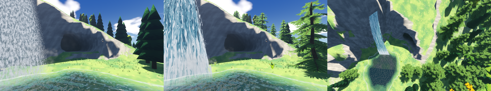

`cachoeira.gdshader` reescrito com a técnica vista no tutorial `waterfall_tu` (só a ideia; nenhum arquivo de lá): riscas compridas de ruído descendo pela fita, cortadas em 4 degraus de cor (azul fundo, azul claro, espuma), um ruído largo entortando as riscas, bordas recortadas em dentes (sem degradê), espuma cheia no pé e a fita ondulando para fora da pedra. Usa o mesmo ruído que já era gerado em `Vale._cachoeira`; a malha e a névoa do pé não mudaram. Parâmetros: `velocidade`, `degraus`, `fundo`, `meio`, `espuma`.

**Não verificado:** visto em fotos paradas; o movimento (velocidade das riscas e a ondulação) só jogando.

- **Depois do teste dele ("de frente bonita, de lado parece folha de papel"):** a fita chata virou um meio-cano: em cada altura a seção é um arco de 10 colunas que sai da pedra (0,9 m de fundura no topo, 2,1 m no pé), com as normais para fora. De lado a queda tem corpo. As riscas foram afinadas para a largura nova.

**2026-11-16, robô v2 (tentativa desfeita):** o usuário mandou a imagem de um robô de poucas faces e pediu para construir. Foi modelado por código no Blender com as juntas do v1 e posto no jogo, mas ele não gostou e pediu para voltar: o modelo, o gerador e a foto foram apagados e o robô do vale continua sendo o `robo_v1.glb`.

**Mech_00 (jimmys7777, itch.io), só análise, nada importado (2026-11-16):** em `~/Downloads/Mech_00` (30 MB), `Mech_00(A)` (expansão) e `Mech_00 2` (pacote do Unity, não serve aqui). Um mech modular com um esqueleto só (87 ossos) e 27 animações (parado, andar, correr, agachar, pulo em três partes, três ataques por mão, tiro por mão, tiro de ombro, levar golpe, cair). Corpo em 8 lugares trocáveis (braço, antebraço E/D, perna, coxa, pelve, ombro, tronco) com 3 conjuntos na base (S, M, L) e mais 3 na expansão, braço-canhão no lugar da mão, e peças comuns (cabeça, juntas, pés, mãos). Extras presos em ossos de encaixe (costas, ombro, cotovelo, antebraço, mão): espada, martelo, 3 armas de mão, 1 ou 2 canhões de costas, 2 lança-mísseis, mochila a jato, 3 placas de armadura, 3 módulos. Cor por uma textura de paleta (47 paletas). Um mech montado fica em 4 a 5 mil triângulos. **Licença:** uso livre em jogos, inclusive comercial; proibido redistribuir os arquivos como pacote. O repositório do jogo é público: os arquivos crus não podem ir para ele.


## 52. Mechas sorteados (Mech_00) (2026-11-16)


Pedido do usuário: usar o Mech_00 com um sorteio de armas e equipamentos para nascerem robôs inimigos pelo vale, poucos (ele planeja muitos em outro lugar, mais adiante). **O repositório do GitHub passou a privado** (decisão dele), porque a licença do pacote proíbe redistribuir os arquivos.

- **Arquivos:** os FBX do pacote entram direto em `assets/vale/mech00/` (a Godot importa): `mech00_corpo.fbx`, `mech00_corpo_a.fbx` (expansão), `mech00_anim.fbx` (25 MB), `extras/*.fbx` (17) e `paletas/` (47 texturas de 80 px). Cada FBX guarda o esqueleto numa orientação diferente e só o das animações bate com elas; por isso ele é a base, e as peças dos outros dois são penduradas no esqueleto dele (as peças se prendem aos ossos pelo nome). Passar o corpo pelo Blender deixava os robôs deitados.
- **`Mech00Visual.montar(semente, altura, ruido)`** (herda `MechVisual`): sorteia um conjunto (S, M, L da base ou da expansão) para cada um dos 8 lugares do corpo, 30% de chance de braço-canhão, uma paleta, a arma (35% espada ou martelo na mão; senão uma das 3 armas no antebraço), 55% de equipamento nas costas (canhão simples ou duplo, dois lança-mísseis, mochila a jato), placas de armadura nos ombros e módulos nas coxas. Os extras vão no osso de encaixe do tamanho da peça onde ficam. A mesma semente dá sempre o mesmo robô. O resultado fica em `ficha`.
- **`Mecha`** (herda `Vigia`): o jeito de lutar sai da ficha. Espada ou martelo: chega junto e bate (`Vigia.corpo_a_corpo`). Arma de mão ou canhão: atirador a 15 m. Equipamento de tiro nas costas: atira de 24 m, mais devagar. Cada placa de armadura faz aguentar um tiro a mais (3, 4 ou 5 tiros) e corpo grande anda mais devagar. Desliga e religa como as outras máquinas.
- **No vale:** 8 mechas, um por lugar (`InimigosVale.MECHAS`), ao lado das máquinas que já existiam (47 ao todo).
- **Testes:** `--teste-vale` 27 pontos (o 19º conta os 8, confere as fichas e põe um de espada ou martelo para acertar o robô). Fotos: `-- --vale-captura --mechas`.

**Não verificado:** nada jogado. Algumas paletas são bem vivas (rosa, azul claro) e podem destoar; a mochila a jato é só enfeite; o passo não foi casado com a velocidade; a mistura de peças de conjuntos diferentes pode deixar frestas em alguma combinação.


## 53. Só mechas, e projéteis por tipo de arma (2026-11-16)

- **Máquinas antigas fora (pedido do usuário, que não achava os 8 mechas):** Carrapato, Batedor, Vigia de pacote e Sentinela saíram do jogo com o código, os modelos do Animated Mech Pack e o `sentinela.glb`. Todos os lugares de máquina agora têm mecha: 35 no vale (duplas nos 6 lugares dos antigos Zangões, um nos demais, e 3 **grandes** de 3 m nos lugares das Sentinelas: `Mecha.chefe`, aguentam o dobro) e um na clareira, rio acima do começo. Ficam `MaquinaPequena` (base: calor, desligar, religar, projéteis), `Vigia` (a máquina de chão que ronda, caça e ataca), `MechVisual` (base do corpo animado), `Mech00Visual` e `Mecha`.
- **Projéteis por tipo de arma (`MaquinaPequena.TIROS`):** o tiro lento laranja de 15 m/s saiu.
  - **bala** (fuzil e metralha de mão): 95 m/s, risco claro; cada uma vale um terço de acerto.
  - **pesado** (arma grossa, braço-canhão, canhões das costas): 62 m/s, caroço laranja; vale dois terços.
  - **míssil** (lança-mísseis das costas): 27 m/s, sai para cima, vira para o robô aos poucos (1,5 rad/s) e estoura num raio de 3,2 m; vale um acerto inteiro. Dá para escapar correndo de lado ou voando.
  - A arte é simples de propósito (passam depressa). O projétil rápido conta o ponto mais perto do trecho andado no quadro, para não atravessar o robô.
- **Armas dos mechas:** fuzil (um tiro certeiro a cada 1,6 s), metralha (rajada de 3), arma grossa e braço-canhão (um pesado), canhão simples ou duplo nas costas (1 ou 2 pesados), lança-mísseis (1 ou 2 mísseis a cada 5 s). Cada arma tem o erro de mira dela (`Vigia.espalha`), e o aviso vermelho antes de atirar continua.
- **Equilíbrio do jogador:** `Armadura.levar_golpe` ganhou `dano` (fração de acerto); três acertos inteiros ainda desligam o robô. O tiro do robô passou de 85 para 130 m/s.
- **Testes:** `--teste-vale` 28 pontos (o 19º virou dois: mechas e projéteis); `--teste` 95.

**Não verificado:** nada jogado; o equilíbrio (dano das balas, erro de mira, míssil) é chute; os projéteis não foram vistos em foto.


## 54. Ataque no braço certo, queda no lugar e menos mechas (2026-11-16)

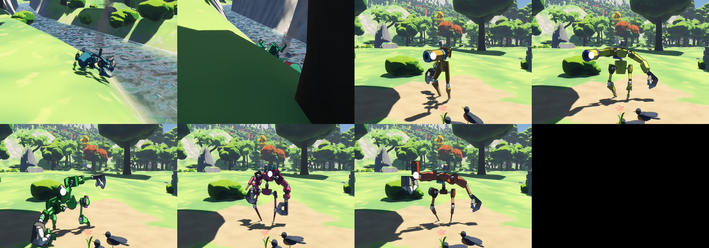

Do teste do usuário: um mecha atirava "do peito" esticando o braço sem arma, um caído ficou flutuando sobre o rio e outro não assentou no terreno; e 35 era demais.

- **Braço e origem do tiro:** o tiro saía da cabeça e a animação era sempre a do braço direito, mesmo com o braço-canhão no esquerdo. Agora `Mech00Visual` guarda o braço que ataca (`ficha.lado`) e a boca da arma (`boca`: a arma do antebraço, a mão do braço-canhão ou o equipamento das costas); `ponto_tiro()` é de onde o projétil sai. Animações: `Mech_Shoot_L/R` pelo braço, `Mech_ShoulderShoot1` para as costas e um de três golpes (`Mech_Attack1..3_R`) para espada e martelo.
- **Tempo:** a animação começa dentro do aviso, para o projétil sair com o braço estendido (`tempo_do_tiro()`: 0,45 s no tiro de mão, 0,4 no de ombro, 0,58 no golpe; medido nas animações).
- **Queda:** a animação `Mech_Die` arrastava o corpo uns 4,5 m para trás pelo osso de trajeto (`c_traj`); a trilha foi tirada e ele cai onde está. Caído, `MechVisual` mede cada osso contra o terreno debaixo dele (`chao`) e sobe ou desce o corpo até encostar, e `Vigia._deitar_no_terreno` inclina o corpo com a ladeira.
- **Quantos:** de 35 para 12 no vale (duas duplas, seis sozinhos, dois grandes), mais o da clareira. `InimigosVale.LUGARES`. O vale é para ter muita paz e uma briga de vez em quando; a ação em quantidade fica para o outro lugar que o usuário planeja.
- **Testes:** `--teste-vale` 28; `--teste` 95. Fotos: `-- --vale-captura --mechas-tiro`.

**Não verificado:** visto em fotos paradas; o encaixe do tiro com o braço em movimento e a queda em terreno muito inclinado só jogando.


## 55. Efeitos dos tiros com o Kenney Particle Pack (2026-11-16)


O usuário perguntou se o pixelfx ajudava nos tiros e lembrou do pacote de partículas que o projeto já usa; ficou o do Kenney (CC0), que não é pixel art e casa melhor com o vale. Mais dez imagens foram para `assets/fx/kenney/` (reduzidas a 256 px).

- **`EfeitosTiro`** (`scripts/vale/efeitos_tiro.gd`): `clarao` (língua de fogo na boca da arma e um brilho de 0,09 s), `cruzado` (dois quadros cruzados para rastro e chama, vistos de qualquer lado), `impacto` (estalo, nove faíscas que caem e um fio de fumaça), `explosao` (clarão, bola de fogo em duas imagens, faíscas, anel de calor e fumaça escura subindo) e `rastro_fumaca` (atrás do míssil).
- **Onde entra:** todo tiro de mecha acende o clarão na arma; a bala e o tiro pesado ganharam rastro; bala no chão ou no robô faz o impacto; o míssil solta fumaça e estoura com a explosão. O tiro do robô do jogador ganhou o clarão na mão.
- **Duas lições:** a posição da leva de partículas tem de ser dada antes de entrar na cena (posta depois, nasciam no centro do mapa); e fogo somado à luz quase some de dia sobre o capim claro, então fogo e clarões cobrem (mistura normal) e só as faíscas somam.
- **Testes:** `--teste-vale` 28; `--teste` 95. Fotos: `-- --vale-captura --efeitos-tiro`.

**Não verificado:** visto em fotos paradas, de dia; de noite e em movimento, só jogando. O rastro da bala não apareceu em nenhuma foto (ela passa em dois quadros).


## 56. Saem as seis grutas pequenas (2026-11-16)

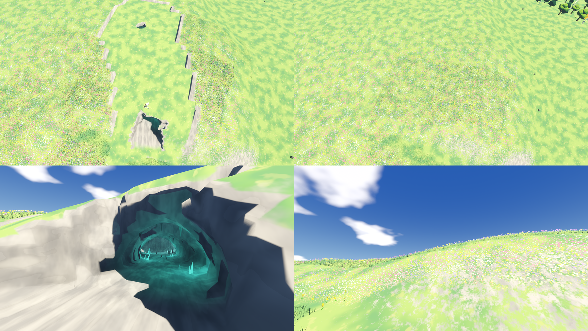

O usuário achou mais um defeito de parede numa caverna, perto do Platô das Flores, e propôs tirar as cavernas ou achar um jeito melhor. Era a Gruta da Lua, sorteada no meio do platô: de cima aparecia um retângulo de chão refeito sem flores, com lajes de pedra na beira, e a boca era um buraco no campo.

- **Decisão:** as seis grutas sorteadas (§37 e §42) saíram. Cavar debaixo de uma grade de alturas pede rebaixar a grade e refazer o morro por cima como peça, e cada emenda entre as duas é um lugar para defeito; em seis lugares escolhidos por sorteio ninguém conferia todos. **Fica o Sumidouro** (§40), que é um lugar só, desenhado e conferido.
- **Código:** `Cavernas` ficou só com o chão original (`chao_antes`, `dentro`, `cavar`); saíram o gerador, `gruta_0..5.res`, os nomes na tela e o eco das grutas. O Sumidouro desviava das grutas ao escolher o morro: a lista dos lugares antigos ficou em `Sumidouro.ANTIGAS` só para ele não mudar de lugar.
- **Testes:** `--teste-vale` 28 (o 20º agora confere que nada fora do Sumidouro foi cavado e que o platô é o chão original; o eco do 21º é medido no Sumidouro); `--teste` 95. Fotos: `-- --vale-captura --cavernas` mostra os seis lugares antigos.
- **Se voltarem:** como rocha posta em cima do chão (um afloramento com o vão dentro, sem mexer na grade), de preferência com modelo de pacote.

**Não verificado:** nada jogado. Numa foto de cima do Sumidouro há uma faixa clara na encosta ao lado da boca que pode ser a mesma laje de beira de peça; não conferi de perto.


## 57. Troca das árvores por distância, árvore a árvore (2026-11-16)


O usuário via árvores piscando e aparecendo. A mata era desenhada em blocos de 160 m, e o bloco inteiro trocava o modelo completo pelo vulto de uma vez quando o centro dele passava de 170 m: uma árvore na beira do bloco trocava a menos de 60 m do jogador. As plantas de chão sumiam do mesmo jeito (bloco a 120 m).

- **Por peça:** cada árvore, planta e pedra carrega as distâncias dela no MultiMesh (`INSTANCE_CUSTOM`: some até x, surge a partir de y) e o shader mede a distância da peça até a câmera do jogo (`presenca` em `vale_comum.gdshaderinc`, usada por `vale_solido`, `vale_folha` e `vale_tex`). Fora da faixa a peça vira um ponto no vértice e não custa pixel.
- **Transição:** nos últimos 34 m o modelo de perto some em pontilhado e o de longe aparece com a trama do avesso, no mesmo lugar. A sombra acompanha (usa a câmera do jogo também na passada de sombra).
- **Distâncias:** árvore completa até 190 m (`Clareira.TROCA_ARVORE`), plantas pequenas até 140 m, moitas e pedras até 280 m. Os blocos de perto da mata passaram a 100 m; o bloco só some quando nenhuma peça dele pode aparecer (`Clareira._multi`).
- **Custo no Mac, três pontos da mata:** de 14,8 / 16,6 / 16,3 ms para 15,6 / 17,1 / 17,0 ms por quadro (uns 13% a mais de triângulos).
- **Lição:** parâmetro de shader por instância (`instance uniform`) estoura o limite do Godot com milhares de blocos; o dado por peça do MultiMesh não tem limite.
- **Testes:** `--teste-vale` 28; `--teste` 95. Fotos: `-- --vale-captura --troca`.

**Não verificado:** visto em fotos paradas; o pontilhado em movimento e o custo no PC só jogando. As rochas dos paredões (520 m) e o fim dos vultos (1.300 m) continuam trocando por bloco.


## 58. Falésia na borda do mapa (2026-11-16)

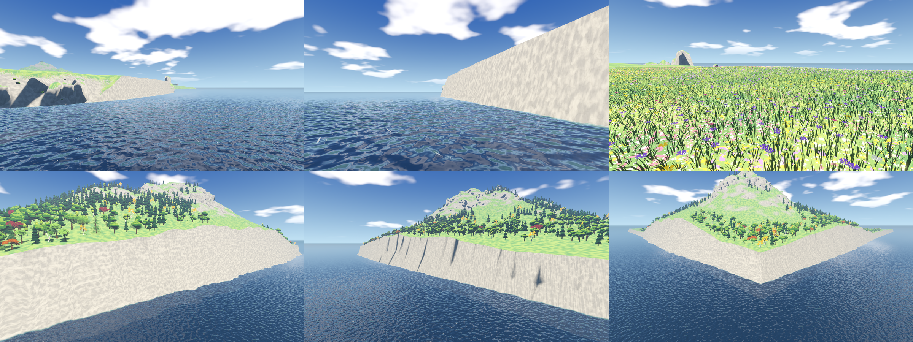

O usuário saiu voando pelo Platô das Flores, olhou para trás e viu o chão por baixo, sem parede. A grade do vale acaba em x e z = ±1.000 m, e em três lados a terra chega lá acima do mar: o norte inteiro (até 88 m), o oeste inteiro (até 69 m) e 250 m do leste, no platô (25 m). Ali o chão terminava no ar.

- **`Vale._falesia_da_borda`:** de cada nó da borda desce uma parede de pedra até o fundo do mar (-15 m), em dois lances, com o pé de 3 a uns 50 m para fora conforme a altura e um ruído; nos cantos os dois lados saem na diagonal e se encontram. Material dos paredões (`vale_rocha`), sombreamento por face, colisão dos dois lados.
- **Testes:** `--teste-vale` 28. Fotos: `-- --vale-captura --largo --borda`.

**Não verificado:** nada jogado. A falésia é reta como a borda do mapa e clara ao sol, sem rochas soltas nem musgo; de longe lê como um corte. O `--teste` de voo não foi rodado depois desta mudança (ela só mexe no vale).

**Enfeite da falésia (mesmo dia, a pedido):**


`Paredoes.montar` ganhou uma passada pela borda do mapa: 746 rochas das mesmas quatro variantes dos paredões. Colunas encostadas na parede (42% dos nós com mais de 5 m, alturas de 45% a 80% da falésia, capim no topo de cada uma) quebram a linha reta e fazem fendas de sombra; no pé, pedras de 1,5 a 4,5 m meio dentro d'água. Todas com colisão. `--teste-vale` 28. Não verificado: nada jogado; o custo das 746 colisões a mais não foi medido.


## 59. A base nova: hangar em ruínas, cilindro, Faísca caído e o drone colega (2026-11-16)


O usuário mandou duas imagens de ideia (um robô grande caído e tomado pelo mato num galpão em ruínas; um cilindro enferrujado de porta redonda com um drone ao lado) e apontou dois kits do Quaternius que ele baixou: **Sci-Fi Essentials Kit** e **Modular SciFi MegaKit** (CC0). Pediu o Faísca caído, sem funcionar, coberto de mato; o drone como colega do robô, parado junto do cilindro onde o robô vai receber melhorias (futuro); e o drone vindo buscar o robô caído em combate.

- **`BaseVale`** (`scripts/vale/base_vale.gd`, chamado por `Ruinas._base`): laje, piso de chapas (13 de 4 m), estrado redondo do nascimento, três panos de parede (um quebrado, um com janela), colunas, viga e duas vigas caídas, cabos pendurados, lâmpada verde-água, caixas, tambores, armário, prateleira e a antena parabólica. 40 peças dos kits em `assets/vale/base/` (os `.gltf` copiados sem as texturas embutidas; 12 texturas de cor à parte, 14 MB).
- **`vale_base.gdshader`:** a cor da textura do kit com a luz em faixas do vale, mais **ferrugem** (placas largas por ruído, lidas no plano da face para não riscar) e **musgo** (faces viradas para cima). Cada peça escolhe quanto de cada.
- **Cilindro de melhorias:** feito por código (tubo de 4,6 m de diâmetro por 6,4 m, aros, porta redonda aberta com raios, berços, estrado, dois braços e um painel por dentro, luz acesa). Dá para entrar andando. Ainda não faz nada.
- **Faísca caído:** `assets/faisca/faisca.scn` voltou do histórico do git (o modelo da Ilha Cafuné). Sentado no chão contra uma caixa, na frente do estrado à direita, no **tamanho original** (1,5 m; o usuário pediu no meio do trabalho, eu tinha feito o dobro). Sem luz no rosto, pintura desbotada, ferrugem e musgo, uma flor na cabeça. Pose por ossos (`_dobrar`, giros nos eixos do esqueleto).
- **`DroneColega`** (`scripts/vale/drone_colega.gd`, modelo `Enemy_EyeDrone`, 0,72 m): paira no posto ao lado da boca do cilindro e vira para o robô quando ele chega a menos de 22 m. Na pane (`entrou_pane`) aparece no alto, desce em 2 s até 2,3 m sobre o robô e acende um facho; com a tela escura os dois reaparecem na base (`voltou_base`, sinal novo do `Armadura`); quando o robô religa, ele volta ao posto.
- **Tempos da pane:** a tela começa a escurecer aos 2,6 s (era 0,5), a volta à base é aos 4,4 s (era 2,3) e a pane dura 7,2 s (era 5), para dar tempo de ver o drone chegar (`Ajustes.PANE_ESCURECE`, `PANE_VOLTA`, `PANE_TEMPO`).
- **Testes:** `--teste-vale` 28 (o 16º confere o drone chegar e voltar ao posto, as peças, o Faísca e o cilindro; o 2º anda para o campo, porque atrás agora há parede); `--teste` 95. Fotos: `-- --vale-captura --base` e `--resgate`.

**Não verificado:** nada jogado. O drone não tem som. A frente do modelo do drone foi suposta em +Z (ele pode estar olhando de costas). A colisão das peças é uma caixa por peça. O capim do chão some num raio de 12,5 m em volta da base.


## 60. Conferência da física: copas, degraus e tiros (2026-11-16)

O usuário pediu uma passada geral: colisão com a copa das árvores, desníveis baixos que o robô deveria subir levantando a perna, e tiros atravessando árvores e outras coisas sólidas. Achei e corrigi quatro coisas.

- **Colisão das árvores pelo modelo de cada uma.** Todas usavam a mesma medida (a das árvores antigas): tronco de 5 m e uma copa sólida de 3 m de raio centrada a 6,8 m, vezes a escala. Com os 18 modelos de hoje isso errava para os dois lados: na `q_arvore_b` a folhagem começa a 6 m e havia "copa" sólida invisível desde 3,7 m; no `carvalho_b` e no pinheiro o topo (até 14 m) atravessava; os pinheiros novos têm galhos ralos desde o chão. Agora `Clareira.forma_da_arvore` mede cada modelo uma vez (raio em 24 faixas de altura) e `Ilha._medidas_colisao` usa isso: tronco fino até a folhagem, copa sólida só no miolo (55% do raio médio nas folhosas, 30% nos pinheiros, onde ela começa acima de 2,6 m), do começo da folhagem até 40 cm do topo. As pontas dos galhos continuam atravessáveis, e por baixo da copa passa-se livre. `arv_nome` guarda o modelo de cada árvore.
- **Degraus.** O robô parava em qualquer quina acima de uns 9 cm (a beira do estrado da base, de 19 cm, já barrava). `Armadura._subir_degrau`: andando no chão contra um desnível de até 48 cm (`Ajustes.DEGRAU`), ele sobe sozinho, se couber por cima e houver piso firme lá; o corpo desenhado e a câmera alcançam o degrau aos poucos (`_degrau_y` em `pos_suave`). Parede, tronco e rampa íngreme continuam barrando.
- **Projéteis dos mechas.** Só paravam no terreno e no robô: atravessavam troncos, copas, rochas, ruínas e a base. Agora cada trecho andado é conferido por raio e o projétil para (com impacto, ou explosão no caso do míssil) no que encontrar; o robô atrás do obstáculo não é atingido.
- **Vista dos mechas.** `alvo_visivel` só olhava o terreno. Rocha, ruína e parede no caminho agora tapam a vista (as árvores não: o mecha atira, e o tronco é que segura o tiro).
- **Tiro do robô.** O tiro travado ia até a máquina mesmo com algo no meio. Agora, travado ou não, se há tronco, copa, rocha ou parede entre a mão e o ponto, o tiro para ali.
- **Testes:** `--teste-vale` 29 (o ponto novo sobe um degrau de 36 cm, barra num de 95 cm, confere a colisão de uma árvore isolada contra o modelo, e põe uma parede entre um mecha e o robô); os pontos de projétil e de mira travada passaram a medir sem árvores no caminho. `--teste` 95.

**Não verificado / fica como está:** nada jogado. Só as árvores a até 70 m do robô têm colisão (limite antigo): um tiro de mecha longe do robô ainda atravessa árvores. Os mechas e os bichos continuam andando pela altura do terreno, sem colidir com árvores, rochas ou a base. As folhas que voam ao cruzar a copa (`EfeitosMato`) e a altura das copas para os inimigos ainda usam a medida genérica. A câmera não foi conferida contra as peças novas da base.


## 61. Mechas e bichos desviam dos obstáculos (2026-11-16)

Pendência da §60: mechas e bichos andam pela altura do terreno, sem física, e atravessavam troncos, pedras, ruínas e a base. O usuário pediu que colidam e sejam espertos para desviar ou destravar.

- **`Obstaculos`** (`scripts/vale/obstaculos.gd`): um mapa de círculos no chão, numa grade de 8 m. Quem cria colisão registra a forma (`registrar_forma`): pedras soltas, blocos dos paredões, peças das ruínas e da base. Só entra o que fica de pé na altura do corpo: laje até 0,5 m (dá para pisar) e viga acima de 3,2 m (passa-se por baixo) ficam de fora. Caixas compridas viram uma fila de círculos. Os troncos saem da grade de árvores, com o raio do modelo. 4.807 obstáculos registrados, fora as 12 mil árvores.
- **Não depende da física:** vale no mapa todo, não só perto do robô.
- **Mechas** (`Vigia`): antes de cada passo procuram o rumo livre mais perto do que queriam (`Obstaculos.rumo_livre`): o direto, depois de 30 em 30 graus por um lado só, e só então pelo outro. Guardam o lado em que começaram a volta, para contornar sem ir e voltar, e largam a volta assim que o rumo direto abre. Na caça continuam de frente para o robô, andando de lado se for preciso. **Destravar:** se querem andar e não saem de meio metro em 1,2 s, trocam o lado da volta; em ronda escolhem outro destino. Os pontos de ronda não caem mais dentro de obstáculo.
- **Cervos, raposas e lobos** (`Cervo._passo`): a mesma regra de um lado só e o mesmo destravar; não escolhem ponto de pasto dentro de obstáculo. **Coelhos:** o pulo confere o caminho.
- **Quem nasceu dentro de um obstáculo** pode sair (o caminho só é barrado para quem está fora).
- **Testes:** `--teste-vale` 30 (o novo põe uma fila de pedras entre um mecha em ronda e o destino, e um cervo fugindo contra ela: os dois dão a volta sem atravessar; cercado por um anel, o mecha nota que travou). `--teste` 95.

**Não verificado:** nada jogado. Mechas e bichos não desviam uns dos outros nem do robô. O Sumidouro e a falésia da borda não estão no mapa de obstáculos (lá vale a regra antiga de inclinação e água). Em bolsão fechado de três lados o bicho pode demorar uns segundos para achar a saída.


## 62. Do teste no Mac: Faísca, drone amigo, passos e pausa (2026-11-17)


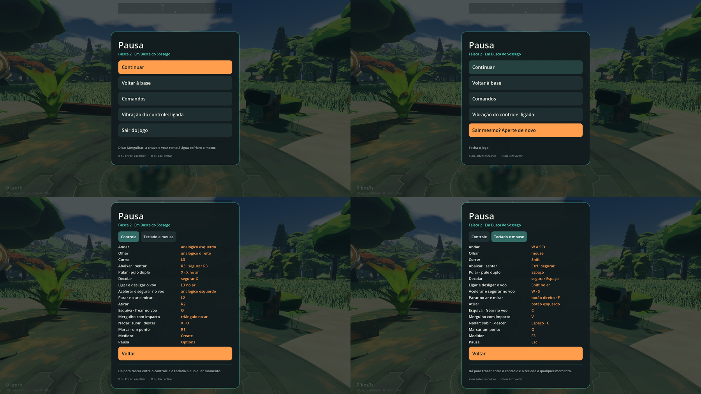

O usuário jogou no Mac e mandou cinco pontos.

- **Faísca:** estava grande e flutuando. Agora tem o tamanho do robô do jogador (1,2 m de pé; `ESCALA_FAISCA` 0,8) e está caído de verdade: o corpo inteiro reclinado 50° para trás, pés no chão e costas na caixa, braços soltos e a cabeça caída. A pose por ossos das pernas saiu (elas ficavam penduradas e a mão virava o ponto mais baixo). No quadro seguinte à montagem o ponto mais baixo das peças é medido de verdade e encostado no chão.
- **Não atirar no colega:** com o drone na linha da mira, antes de qualquer obstáculo, o tiro não sai e a tela avisa "colega na mira" (`Tiro._amigo_na_mira`, grupo `amigos`).
- **Fala do drone:** seis frases de bipes e assobios feitas por síntese (`tools/sons_sinteticos.py`, `drone_1..6.wav`). Fala quando o robô chega a menos de 7,5 m, de novo a cada 8 a 16 s enquanto ele fica por ali, e ao chegar no resgate.
- **Passos:** as pisadas gravadas de metal soavam como salto alto (estalo agudo e seco). As seis novas são de síntese: o zumbido curto do motor da junta, um baque grave que cai de tom, um toque de metal abafado e um chiado de capim, tudo cortado acima de 3,2 kHz.
- **Pausa:** refeita (`scripts/pausa.gd`). Cartão no meio com cinco botões grandes (Continuar, Voltar à base, Comandos, Vibração, Sair), o escolhido aceso em laranja e uma linha embaixo dizendo o que ele faz; uma dica diferente a cada abertura; sair pede um segundo toque; os comandos viraram uma página em tabela, com aba para o controle e para o teclado.
- **Testes:** `--teste-vale` 31 (o novo confere a fala do drone, o tiro que não sai e os arquivos de som); `--teste` 95. Fotos: `--vale-captura --base` e `--pausa`.

**Não verificado:** os sons novos não foram ouvidos por ninguém (são de síntese, eu só confiro que existem e tocam). A pausa não foi testada com o controle na mão.


**Faísca, terceira versão (2026-11-17):** o usuário achou a pose reclinada estranha e o tamanho ainda grande.


Agora ele está sentado: tronco quase de pé (10° para trás, costas na caixa), as duas pernas esticadas para a frente, os braços caídos ao lado do corpo e a cabeça baixa. Voltou a pose por ossos (`_dobrar`), que funciona; o que falhava antes era assentar pela conta dos ossos, e isso já é medido nas peças. Escala 0,66 (perto de 1 m de pé, uns 18% menor que o robô do jogador). A caixa de encosto ficou em 80%. Onze plantas pequenas (trevos, flores, um cogumelo, de 12 a 16% do tamanho normal) em volta e entre as pernas, e a flor da cabeça menor.


## 63. Análise de desempenho e o primeiro pacote de melhorias (2026-11-17)

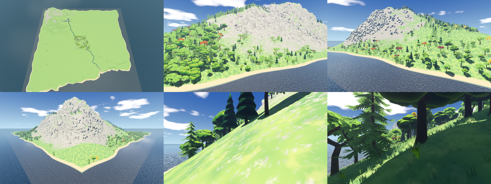


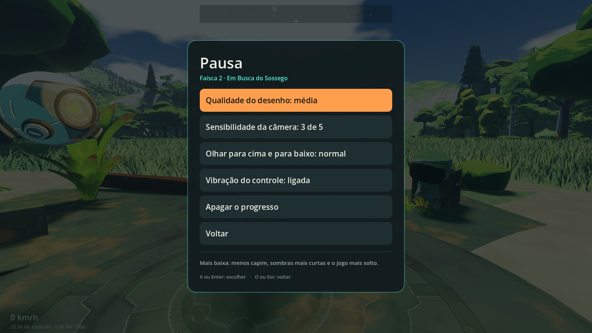

O usuário pediu uma análise de jogo ("como um designer/dev sênior") e, das propostas, mandou fazer: o capim em duas densidades e a opção de qualidade; salvamento; marcas de dano na mira; ajustes básicos; todas as do mapa; o vulto da própria árvore "se não pesar muito"; e o drone com mais vida. As melhorias do robô ficaram para escolher (lista no fim).

**Medição** (`-- --vale-captura --perf`, sem limite de quadros, Mac, 1600×900): o pior ponto era onde o jogador nasce.

| Ponto | Antes | Alta | Média | Baixa |
|---|---|---|---|---|
| Base, olhando o campo | 27 | 34 | 45 | 65 |
| Campos do sul | 35 | 52 | 65 | 103 |
| Mata fechada, no chão | 55 | 54 | 65 | 91 |
| Do cume | 66 | 64 | | |
| No alto, mapa inteiro | 69 | 62 | | |

(quadros por segundo). Desligando uma coisa de cada vez: o capim era o maior custo (na base, 27 → 59 sem o capim fixo; nos campos, 35 → 128 sem o capim em volta do robô), depois a suavização 4x sobre ele e as sombras (um terço do quadro na mata). Bichos, mechas e as peças da base não aparecem na conta. Baixar a resolução quase não ajuda.

- **Capim em duas densidades** (`Qualidade`, `vale_capim.gdshader`): 30% das touceiras, 45% maiores, vão até 95 m; as outras só existem perto do robô e encolhem até sumir entre 70% e 100% de `perto_ate` (por touceira, no vértice). Vale para o capim fixo da clareira e para o que nasce em volta do robô.
- **Qualidade do desenho** (baixa, média, alta; ajuste da pausa): capim cheio até 16 / 34 / 60 m, suavização desligada com FXAA / 2x / 4x, sombras em 2 faixas até 130 m / 4 até 220 m / 4 até 380 m, e as distâncias de troca de árvores, plantas e pedras em 60% / 80% / 100% (`troca_fator`, parâmetro global de shader). O padrão é a média. Nas fotos e nos testes vale a alta.
- **Vulto da própria árvore:** de 190 a 450 m cada árvore é a versão leve dela mesma (já existia no pacote, 176 a 550 triângulos); além de 450 m, o vulto genérico barato. Levar a versão própria até o horizonte custava uns 20% nas vistas altas (cume 66 → 53), por isso o meio-termo.
- **Salvamento** (`Guardado`, `user://faisca2.json`): ajustes e progresso (lugares visitados, hora do dia; peças e melhorias já têm lugar). Grava ao achar um lugar, de minuto em minuto e ao sair. Testes e fotos não leem nem gravam.
- **Ajustes na pausa:** qualidade, sensibilidade da câmera (5 passos, de 0,5 a 1,8), eixo vertical invertido, vibração, e apagar o progresso (pede segundo toque).
- **Marcas de dano:** três traços à esquerda da mira (`Hud`). Cada acerto de máquina deixa um laranja; a bala enche aos poucos; no último ele pisca. Só aparecem com dano.
- **Drone com mais vida:** sozinho, olha em volta de tempos em tempos; com o robô a menos de 10 m, chega até 2,4 m para o lado dele; leva um susto e reclama quando vira alvo; dá uma cambalhota quando o robô religa depois do resgate.
- **Ilha** (`Vale._borda_ilha`): perto das quatro bordas a terra desce até o fundo do mar por uma faixa de 105 a 345 m (mais comprida onde a terra é alta), com a largura ondulando ao longo da costa; o que fica perto do nível do mar vira areia. A falésia da §58 não acha mais nada para fechar (0 rochas). As árvores de fora caíram de 12.211 para 10.786 e os blocos de paredão subiram de 405 para 1.492 (as encostas novas).
- **Marcos altos** (`Marcos`): a **Árvore-Mãe** (70 m, no Platô das Flores, com pedras em roda), **O Anel** (62 m de diâmetro, de pé, meio enterrado, dá para voar por dentro; Campos do Sul) e **As Colunas** (três de 65 m num morro do nordeste). Os três têm nome na tela, colisão e entram no mapa de obstáculos. São 13 lugares com nome mais o Sumidouro.
- **Testes:** `--teste-vale` 31; `--teste` 95.

**Não verificado:** nada jogado. O salvamento não tem teste automático (os testes o desligam). A qualidade baixa e a média só foram medidas, não olhadas com calma. A ilha continua quadrada vista do alto. Interiores novos (cavernas de rocha sobre o chão) não foram feitos.

**Propostas de melhorias do robô** (aguardando escolha do usuário; nenhuma mexe em arma):

| Peça | Efeito no jogo | O que muda no robô |
|---|---|---|
| Radiador de aletas | voa mais tempo antes de aquecer (60 s → 100 → 160 s) | aletas nas costas que abrem no voo e ficam rubras com o calor |
| Bocais largos | mais velocidade de cruzeiro e de arrancada | bocais maiores nos pés, chama mais comprida e azulada |
| Asas de planar | plana mais longe e fecha mais a curva | duas asas curtas que abrem ao planar |
| Barbatanas | nada mais rápido e esfria mais na água | barbatanas nas canelas |
| Amortecedores | cai de alto sem tranco, pulo mais alto | pistões nas pernas |
| Ombreiras | aguenta um acerto a mais (até dois) | placas nos ombros |
| Antena de busca | a bússola aponta peças e lugares não visitados | antena maior com luz piscando |
| Farol de peito | luz forte à noite e no Sumidouro | farol no peito |
| Células de reserva | esfria mais depressa no chão | células acesas na mochila |


## 64. Melhorias do robô: peças pela ilha (2026-11-17)

O robô começa básico e ganha cada melhoria achando uma peça na ilha e levando ao cilindro da base. Nenhuma
mexe em arma (o usuário tem outra ideia para isso). As ombreiras (vida) ficaram para a etapa de combate.

**Como funciona.** Cada peça é uma caixinha que flutua, com um facho de luz verde-água (`PecasMundo`,
`scripts/vale/pecas_mundo.gd`). Chegando a 2,4 m o robô pega (sem botão); a peça só vale quando ele entra
na boca do cilindro, que instala tudo o que ele carrega (aro de luz subindo, aviso na tela, o drone
comemora). O estado fica em `Melhorias` (`scripts/melhorias.gd`): `achadas`, `instaladas`, e as funções
com os números. No arquivo de progresso são as chaves `pecas` e `melhorias`. Nos testes e nas fotos o robô
tem tudo (`Melhorias.tudo`); `--basico` mostra o do começo.

| Peça | Onde fica | Básico | Com a peça |
|---|---|---|---|
| Antena de busca | na Clareira, perto da base | bússola só com norte e marcador | triângulo verde: peça mais perto, depois lugar novo; carregando peça, a base |
| Radiador de aletas | Campos do Sul | voo aquece em ~60 s (1,65 %/s), pairar 2,4 %/s | ~3 min (0,55 %/s), pairar 0,8 %/s |
| Bocais largos | O Anel | arrancada 22 m/s | arrancada 28 m/s, cruzeiro +1,5 m/s |
| Asas de planar | Serra do Mirante | planar como antes | arrasto ×0,45 planando, estol 8 m/s, giro ×1,35 |
| Barbatanas | Cachoeira | só o nado normal | nado rápido |
| Molas | As Colunas | pulo e pouso como antes | pulo ×1,118 (25% mais alto), pouso forte ou leve dura metade |
| Luz do peito | boca do Sumidouro | sem luz | farol ligado por seta para cima / L |
| Células de reserva | Árvore-Mãe | esfria 15 %/s no chão | 30 %/s |
| Scanner | (a fazer) | | visão de câmera com zoom e ficha do bicho ou inimigo |

**Visual** (`MelhoriasVisual`, `scripts/melhorias_visual.gd`): versão minimalista aprovada pelo usuário
depois de quatro rodadas na vitrine (`tools/vitrine_melhorias.gd`, folhas em `docs/vale/melhorias_*`).
O robô básico tem a mochila lisa (o painel laranja e as grades do modelo ficam escondidos); o radiador são
só quatro aletas verticais cujo fio segue o calor; os bocais ficam embaixo dos pés no lugar da brasa, com
chama azulada; as asas são grandes e saem da mochila só planando (motor desligado e sem cair a pique);
as molas ficam atrás das coxas; as barbatanas, nos antebraços e por fora das botas; a luz é um aro com
grade sobre o núcleo do peito. As peças são postas em relação à pose de descanso guardada na criação do
robô (`preparar`), então podem ser vestidas com ele em qualquer pose. `--cheio` na vitrine mostra a
versão maior, que ficou de registro.

**Falta:** o scanner (aparelho modelado, visão não desenhada; rascunho da tela antes), animação de entrar
no cilindro, lista das melhorias na pausa, e afinar os números com o usuário jogando.


## 65. Bússola, oficina e scanner (2026-11-17)

Três pedidos do usuário depois de ver a §64 funcionando.

**Bússola.** A base aparece sempre, como uma casinha (some a menos de 14 m). A antena de busca não aponta
mais a peça mais perto de qualquer distância: só capta peças a menos de 300 m (`PecasMundo.RADAR`, sai do
radar a 345 m), um triângulo verde por peça, sem distância escrita. Quando uma peça entra no alcance toca
um bipe e aparece "Sinal captado". A base nunca vira objetivo: instalar é no tempo do jogador.

**Oficina** (`scripts/vale/oficina.gd`). A instalação automática ao passar na boca do cilindro saiu. Perto
da boca aparece o convite (quadrado / E, ação `agir`); o robô é travado (`Armadura.travado`), entra
andando, três braços de dois segmentos descem do teto (cotovelo pela conta dos dois comprimentos) e abre a
tela: câmera própria na boca, o robô à esquerda e o cartão à direita com a energia da base e as nove peças
(instalada, pronta para instalar, ou "peça ainda não encontrada"). A peça em foco aparece no corpo como
prévia (`vestir_melhorias(extra)`, `previa` abre as asas e acende a luz) e o robô vira para o lado em que
ela se vê. Instalar (X / Enter) leva 1,9 s com os braços trabalhando; O / Esc sai.
**Energia da base:** 0 a 100, cada instalação gasta a carga inteira (`Melhorias.CUSTO`) e a base recarrega
em 5 min de jogo (`RECARGA`), a pedido do usuário. Começa cheia: a primeira peça sai na hora, as outras
esperam 5 min cada. O robô fica em cima do estrado do cilindro, e uma rampa na boca sobe do chão até ele. Quando volta a dar para instalar e o robô carrega peça, aviso "Base recarregada" e um toque. Fica no
progresso como `energia_base`.

**Scanner** (`scripts/vale/scanner.gd`, nona peça, na Torre Caída). Seta para a direita / T, só no chão: a
câmera vai para os olhos do robô (`CameraVoo.primeira`), com moldura de visor e um círculo no meio; R2 aproxima
e L2 afasta, até 4,9×, e o zoom fica onde foi solto (a mira anda mais devagar com zoom); o círculo tem 110 px. Com o círculo em cima de um alvo a até 170 m, sem morro
na frente, a leitura enche em 1,7 s e sai a ficha: bichos (jeito deles), o drone, o Faísca caído, e nas
mechas o equipamento, o ataque, a distância e com quantos tiros desligam, lidos do que ela carrega. O que
já foi lido fica em `escaneados`. Escaneando não atira; pular, voar ou pane fecham o scanner.

Fotos: `--vale-captura --oficina --basico` e `--vale-captura --scanner`. Testes: pontos 32 (melhorias e
oficina) e 33 (scanner), 42 no total.

**Falta:** o usuário jogar; lista do que já foi escaneado (um caderno); som próprio para o radar e para a
oficina (hoje reaproveitam toques existentes); morcegos e a Sentinela não entram no scanner.

**Ajustes do mesmo dia (pedidos do usuário):** o robô fica em cima do estrado do cilindro (antes afundava no
fundo curvo) e uma rampa na boca sobe do chão até ele; a luz do peito apontava para as costas e foi virada;
no scanner R2 aproxima, L2 afasta e o zoom fica onde foi solto. **Muro na saída da clareira:** o vale do
riacho de baixo parava de uma vez no fim da linha do curso e cortava o morro da clareira num muro reto de
10 m, atravessado no riacho, perto de (-80, -78). Em `_cavar_rio` só o começo da linha deixa de abrir o vale
(para proteger o paredão da cachoeira); depois do fim ele se abre em volta da ponta, em encosta.
`--vale-captura --muro` fotografa o lugar e `--ingreme` imprime o mapa do que é íngreme em volta da clareira.
**Luz do robô à noite:** a lanterna de `Noite` (0,9 de força, 5,5 m) iluminava o caminho e, presa à posição
da física dentro do corpo, piscava por baixo da cabeça no voo. Virou só o brilho dos leds: 0,22 de força,
2,4 m, um palmo à frente do peito, seguindo a posição suavizada. Iluminar o caminho é da luz do peito
(melhoria). `--vale-captura --luzes --hora 23` fotografa.

**Planar pelo botão (mesmo dia):** nenhum comando levava ao estado de planar (o `PLANAR` só era alcançado por
teleporte nos testes), então as asas não tinham como ser usadas. Regra pedida pelo usuário, igual para
L3 / Shift e para o X: no voo, **um toque corta tudo e o robô cai**, esteja com o jato ou planando;
**segurar** 0,35 s (`Ajustes.PLANAR_SEGURAR`) troca um pelo outro: do jato para o planador (asas abertas,
motor desligado) e do planador de volta para o jato. Com as asas, o corte do toque acontece ao soltar o
botão (é quando dá para saber que não era uma segurada); sem as asas, corta ao apertar. O X no voo não fazia
nada antes. O / C freia e cai, como sempre.
**Peças (mesmo dia):** a da luz do peito ficava enterrada: no Sumidouro a grade de alturas guarda o fundo da
caverna, e `_assentar` pôs a caixa a 109 m, dentro da rocha. Agora, com teto a menos de 9 m, `_assentar`
usa o chão de verdade achado por um raio vindo de cima; e a peça da luz, a pedido do usuário, fica no piso
do salão do Sumidouro (`_no_salao`, fora da lagoa do meio e com vão livre por cima). Pegar passou a
exigir encostar na caixa (1,15 m do meio do robô ao meio dela): o facho de luz é só sinal.

## 66. A Fundição: arena de ondas, experiência e materiais (2026-11-17)

Ideia do usuário para quem quer desafio e batalha constantes, sem tirar a paz do resto da ilha: um lugar
onde os robôs nascem e atacam em ondas que crescem, com um minichefe de tempos em tempos; vencer dá
experiência e materiais, que na base viram armas, escudo, armadura e vida. Plano em cinco etapas (rascunhos
em `docs/arena/`): 1) arena e ondas; 2) modos de tiro e roda de armas no L1 (R1 joga granada; marcar ponto
vai para a seta para baixo); 3) arsenal na oficina; 4) minichefes com modelos novos; 5) acabamento.

**Etapa 1, feita.** `scripts/vale/fundicao.gd`, ao lado do Pátio das Máquinas, em (-690, 300): `cavar`
aplaina uma cratera de 66 m de raio a 27 m de altura (antes de o chão ser montado) e `montar` põe o piso de
metal, quatro portões de montagem, o portão grande do minichefe, oito blocos de cobertura, duas plataformas
altas e o painel de partida. Não nasce mata ali (`Ruinas.livre`). O nó `Fundicao` cuida das ondas:
quadrado / E no painel liga; 5 s de contagem; os robôs (as `Mecha` de sempre, sorteadas) saem dos portões,
no máximo 7 ligados por vez; 15 s de respiro e a onda seguinte vem sozinha; a onda N tem 2 + N robôs (até
14) com `resistencia` 1 + 0,1 por onda; de 5 em 5, um `chefe` com escolta menor, e vencê-lo salva o ponto
de volta. Saindo a mais de 88 m do centro a rodada para e a onda não vencida fica para a volta. Vencido, o
robô desliga, afunda no chão e some; solta cubinhos de luz que voam para o jogador. Se o jogador desliga
na rodada, perde metade dos materiais dela (a experiência fica); ele pode sair voando com tudo.
`Arsenal` (`scripts/arsenal.gd`): experiência (nível pede 100 a mais a cada um), sucata, núcleos, chips de
chefe, ponto de volta e recorde, no progresso como `arsenal`. O placar fica no canto de baixo à esquerda.
**Pistola:** a arma de fábrica dispara uma vez por aperto (segurar não repete; um aperto dado até 0,14 s
antes de a arma estar pronta ainda vale), com 0,2 s no mínimo entre tiros.
Fotos: `--vale-captura --fundicao`. Teste: ponto 34 (50 no total).

**O galpão (mesmo dia).** O usuário mandou um desenho do que imaginava: um lugar fechado, estragado por
anos de abandono, com uma única porta grande de onde os robôs vêm, escombros e paredes quebradas de
proteção, ferrugem e mato, robôs velhos caídos, fios pendurados e a forja ainda funcionando. A arena
circular de blocos saiu; `montar` agora ergue um galpão de 100 por 76 m e 18 m de altura: paredes em painéis
com o alto quebrado e mato pendurado, um rombo na parede sul por onde o jogador entra, telhado quase inteiro
com um rombo e feixes de luz, treliças, a porta ao norte (pórtico, duas folhas entreabertas e um túnel
escuro com luz vermelha, de onde saem todos os robôs, inclusive o minichefe), cinco forjas acesas (boca de
fogo, chaminé com fumaça, esteira com peças em brasa e um braço articulado que ainda se mexe), sete pedaços
de parede e nove montes de escombros com colisão, uma viga caída, duas engrenagens, seis mechas velhas
caídas com mato por cima e dezesseis fios. Materiais com ferrugem e musgo de `vale_base.gdshader`.

**Falta nesta etapa:** o galpão é feito de caixas (sem modelos de pacote), a ferrugem e o piso pedem
acabamento, e por dentro não foi jogado;

as mechas ainda desligam com 3 ou 4 tiros da pistola e o robô com 3 acertos, sem equilíbrio para ondas
altas. **Modelos de minichefe:** o usuário autorizou baixar os dois do itch.io (RetroStyle, FBX 16 MB; e
TryoutIndie, GLB 19 MB), mas o download direto foi recusado ("invalid key"); destino combinado:
`Projects/others/mechs-itch/`. Nenhuma das páginas traz licença escrita; creditar os dois.

**Peças de pacote no galpão (mesmo dia).** O usuário pediu para trocar as caixas por modelos prontos. Do
**Factory Kit do Kenney** (CC0, baixado com autorização para `Projects/others/kenney-fabrica/`; 53 dos 143
modelos copiados para `assets/vale/fundicao/`): máquinas, funis e chaminés de tubo das forjas, esteiras,
braços de robô (giram devagar), pistões, engrenagens, guindastes de chão e ganchos pendurados, tubos pelo
alto das paredes, telas, avisos, cones e o painel de partida (mesa de tela, alavanca e botão de chão). Do
**MegaKit** que já estava na base: colunas de aço, barris, caixas e cabos pendurados. Do vale: samambaias,
moitas, plantas e árvores secas (`v._por`). `_kit` veste as peças do Kenney com `vale_base.gdshader` sobre
o `colormap.png` (ferrugem pela metade, senão escurecem demais); 155 peças de pacote ao todo. As paredes,
o telhado, a porta e os escombros continuam de caixas. O Conveyor Kit do Kenney não existe mais à parte
(foi incorporado ao Factory Kit). Candidato local a minichefe, sem download: `CombatMech` do KayKit
Mystery Monthly 5 (com metralhadora e machado).

**Ajustes e mudança para a serra (mesmo dia, pedidos do usuário).**
- **Mira assistida:** travar a mira virou melhoria (`mira`, décima peça, perto do Pátio das Máquinas; no corpo
  é um aro com ponto vermelho no punho direito). Sem ela o tiro vai para onde a mira aponta.
- **Caveira na bússola:** aponta a Fundição (some dentro dela).
- **Galpão:** o piso fica 3,5 cm acima do chão (os pés afundavam nas lajes); os tetos de cabos do MegaKit
  saíram (ficavam boiando acima do telhado); peças pequenas ganharam colisão (`_colisao_de`: barris, caixas,
  engrenagens deitadas, blocos de escombro, postes, braços, guindastes, painel); os feixes de luz falsos
  deram lugar a dez lâmpadas penduradas (luz fraca, duas piscam, duas queimadas).
- **Porta:** duas folhas só um pouco abertas (0,66 rad, fresta de 3,4 m), breu por dentro (material sem
  luz), e uma colisão invisível fecha o vão para o jogador. A parede quebrada que ficava em frente saiu:
  os robôs paravam ali. Eles nascem em fila no escuro e andam reto até 9 m para dentro do galpão
  (`Vigia.guiado`), e só então caçam.
- **Lugar novo e forma nova:** o usuário mandou dois desenhos de um galpão em arco com os fundos dentro de
  uma montanha, de onde o minério sai. A Fundição foi para a encosta sul da Serra do Mirante, em
  (-580, -270), piso a 86 m: `cavar` corta um nicho retangular (o morro sobe quase a pique atrás e dos
  lados) com um corredor para o túnel, coberto por um bloco de concreto. O telhado virou um arco de
  elipse do chão ao chão (51,5 m de meia largura, 24 m de altura; `teto(x)`), em 16 painéis por vão entre
  nervuras de aço por dentro e por fora, com um rombo no alto. A frente (sul) é aberta, com restos de
  parede nos cantos e a placa da engrenagem; a parede dos fundos tem a porta dos robôs; duas chaminés
  soltam fumaça do lado de fora. As forjas vieram 8 m para dentro por causa do arco.

**Equilíbrio e fabricáveis (mesmo dia, pedidos do usuário).**
- **Ondas graduadas:** `receita` agora diz a arma de cada robô (`Mecha.arma_forcada`, que passa por
  `Mech00Visual.forcar`). Ondas 1 a 3 só de ataque de perto (espada e martelo); da 4ª entram os fuzis de um
  tiro, da 7ª os braços-canhão, da 10ª os mísseis (um por vez), sempre em minoria; os de perto saem
  primeiro. O minichefe da 5ª é de perto, o da 10ª de fuzil, depois de canhão.
- **Arsenal fabricável:** a Mira assistida deixou de ser peça da ilha e virou fabricável na oficina, junto
  com o Escudo de energia (engole um acerto, recarrega em 20 s, arco verde-água à direita da mira) e a Vida
  extra (um acerto a mais antes de desligar). Receitas em `Arsenal.RECEITAS`: mira nível 2 e 15 de sucata;
  escudo nível 3, 30 de sucata e 2 núcleos; vida nível 4, 40 de sucata e 3 núcleos. A oficina lista os
  fabricáveis embaixo das peças, com nível e materiais; fabricar usa os braços da máquina como a instalação
  e não gasta a energia da base.
- **Fundos dentro do morro:** `_morro` devolve, como uma peça de rocha com colisão, a encosta que existia
  antes do corte, por cima dos 24 m dos fundos do galpão (`COBRE`), fechando os lados e os fundos; na frente
  desce em talude até o telhado. Debaixo dela não falta painel no arco.

**Paredão de rocha e fim da energia da base (mesmo dia, pedidos do usuário).**
- **O galpão entra na rocha.** A capa curva de terra que acompanhava o telhado foi rejeitada ("parece uma
  cobertura curva da mesma textura da montanha"); o usuário mandou um desenho do galpão construído na forma
  dele e enfiado em parte num paredão. `_morro` agora é uma parede de rocha quase a pique, de linha torta e
  com calombos, que nasce em cima do telhado a 24 m dos fundos (`COBRE`), sobe a 33 m (`PAREDAO`) e emenda
  atrás e dos lados na encosta; o telhado segue inteiro e à vista até sumir na pedra. Na frente entrou a
  moldura de vigas enferrujadas (montantes inclinados, travessa e escoras em X), e do flanco leste sai um
  duto grande com boca de ventilação e cinco cabos até o paredão.
- **Energia da base:** saiu. As peças achadas pela ilha são instaladas na oficina quando o jogador quiser,
  uma atrás da outra (`Melhorias.instalar` não confere nem gasta energia; a barra sumiu da tela).
- **Acabamento da rocha e colisões (mesmo dia).** O alto do paredão deixou de ser uma laje ondulada: é
  liso e sobe devagar para trás até a encosta; a cara ganhou saliências em pé; para os lados (de 40 a 68 m
  do meio) o alto baixa até a altura da encosta e a linha recua, então o paredão some no morro em vez de
  virar dois muros. Treze pedras soltas (`Paredoes.rocha`) ao pé, nas pontas e na beira de cima, com
  colisão. Colisão completada: ganchos e ímãs pendurados, tubos das paredes, colunas, telas, cones,
  chaminés, duto, moldura e placa da frente, funis e chaminés das forjas, calhas das lâmpadas, robôs velhos
  caídos (caixa baixa) e troncos das árvores secas. Sem colisão de propósito: fios, mato e chamas.

## 67. Etapa 2 da Fundição: modos de tiro, granadas e a roda de armas (2026-11-17)

- **Modos de tiro** (`Arsenal.MODOS`, disparados por `Tiro`): Pistola (de fábrica, um tiro por aperto);
  Rajada (segurando repete a cada 0,085 s, um terço do dano, espalha um pouco); Canhão (segura até 1,1 s
  para carregar e solta: até 3,6 de dano, estoura num raio de 5 m; a carga aparece como um anel na mira);
  Precisão (zoom de 20° ao mirar, 3,2 de dano, 1,15 s entre tiros); Tiro duplo (os dois punhos, dois tiros
  por aperto, o dobro de calor); Mísseis (sai das costas, lento, segue a máquina travada, 3 de dano e
  estouro de 4,5 m, 2,4 s de espera). O dano é em "tiros de pistola": `MaquinaPequena.levar_tiro(ponto,
  dano, area)`, com o dano caindo para a borda do estouro.
- **Granadas** (R1 / G): saem em arco para onde a câmera aponta, quicam uma vez e estouram (2,6 de dano,
  7 m). Três no cinto, que é fabricável; repõem ao entrar na oficina e uma a cada onda vencida.
- **Roda de armas** (`scripts/vale/roda_armas.gd`): segurando L1 (ou R) o jogo vai a 20% da velocidade e a
  câmera trava; o analógico direito (ou o mouse) aponta o gomo e soltar troca. Teclas 1 a 6 trocam direto.
  Só entra o que foi fabricado. A arma em uso e as granadas aparecem embaixo à direita.
- **Marcar um ponto** foi do R1 para a seta para baixo (Q no teclado continua).
- **Fabricação** (na oficina, `Arsenal.RECEITAS`): Rajada nível 1 e 10 de sucata; Cinto de granadas nível 2
  e 20; Canhão nível 2, 25 e 1 núcleo; Precisão nível 3, 30 e 1; Tiro duplo nível 4, 45 e 2; Lança-mísseis
  nível 5, 60, 2 núcleos e 1 chip.
- Fotos: `--vale-captura --armas`. Teste: ponto 35 (vale 57 pontos; voo 98).

**Falta:** as armas não aparecem no corpo do robô nem têm som próprio; o míssil usa o projétil comum
(maior e mais lento); equilíbrio por jogar. Próximas etapas: minichefes com modelos novos e acabamento.

## 68. Armas no corpo, lançadores, munição e caixas das forjas (2026-11-17)

Depois do primeiro teste do usuário com todas as armas:
- **Tiro duplo:** cada gatilho, um braço. R2 atira com o direito e L2 com o esquerdo, um tiro por aperto
  (como a pistola); os dois juntos atiram ao mesmo tempo. O L2 continua mirando.
- **Lança-granadas** (ombro direito): segurando R1 aparece o arco no mundo (24 bolinhas e um anel de 7 m onde
  cai, `Tiro.arco_granada`, a mesma conta do voo); soltando, a granada sai do ombro.
- **Lança-mísseis** (ombro esquerdo): no modo Mísseis, segurando o gatilho as máquinas à frente (cone de 32°,
  130 m, vista livre) são travadas uma a cada 0,3 s, até quatro ou até acabarem os mísseis; soltando sai um
  míssil para cada, em sequência, seguindo o alvo. Sem trava, um míssil reto. Oito mísseis no lançador. Não
  depende da Mira assistida. A tela marca cada trava com um losango numerado.
- **Peça no braço por arma** (`MelhoriasVisual`: `arma_rajada` três canos, `arma_canhao` cano grosso com boca
  acesa, `arma_precisao` cano fino comprido com luneta, `arma_duplo` um cano em cada braço); os lançadores
  aparecem nos ombros quando fabricados. Trocar na roda revestе o robô. A pistola não põe nada.
- **Caixas das forjas** (`Fundicao.soltar_caixa`): saem pela esteira de uma forja, caem no chão e são pegas
  encostando. A de munição (laranja) enche granadas e mísseis; a de conserto (verde, com cruz) apaga os
  acertos levados. No respiro vem o que estiver faltando; no meio da onda, uma a cada 38 s se houver
  falta. Somem em 90 s ou quando a rodada para. A oficina também enche os lançadores.
- Fotos: `--vale-captura --armas` e `tools/vitrine_melhorias.gd -- --armas`. Vale 59 pontos, voo 98.

**Modelos de minichefe, baixados pelo usuário** (em `Projects/others`): `Mech/` (RetroStyle: `SK_ISO_Mech.fbx`
com esqueleto, 7 animações em FBX separados — parado, andar para a frente, para trás e de lado, pouso,
queda —, 5 texturas) e `Mech Type 3.glb` (TryoutIndie: 175 mil triângulos, 53 malhas, esqueleto de 61
ossos, animações Idle e Walk, 4 materiais sem textura). Nenhum tem animação de ataque. Ainda não integrados.

**Segunda rodada das armas (mesmo dia, depois do teste do usuário).**
- **Tiro duplo:** nesse modo o L2 não mira; ele levanta o braço esquerdo e atira, como o R2 faz com o direito
  (`Armadura.atirando_e`, pose do `ombroE`).
- **Base:** chegando a menos de 16 m da oficina, no chão, munição e vida são recarregadas (`Oficina.recargas`).
- **Lançamento a 70°** (`Arsenal.ANGULO_LANCE`): a granada sai do ombro quase a pique e cai onde a mira
  aponta, até 55 m (`_lance_granada` acha a velocidade); não é mais preciso olhar para cima. Segurando o
  R1 a câmera sobe e recua (`CameraVoo.afasta`) para o arco e o anel aparecerem. O míssil (`_missil`) sobe do
  ombro, vira numa curva de três pontos e desce no alvo, acompanhando a máquina travada.
- **Projéteis próprios:** o míssil tem corpo claro, nariz e aletas vermelhos, chama e luz; a granada é uma
  bola escura com cinta e uma luz vermelha que pisca cada vez mais depressa.
- **Minichefes:** os dois modelos do itch.io foram abandonados pelo usuário (pesados). Candidatos locais,
  leves e com animação: `CombatMech` (KayKit Mystery Monthly 5, com metralhadora e machado), os mechas do
  Animated Mech Pack do Quaternius (Leela, Mike, Stan; o George já é o Vigia) e os inimigos do Sci-Fi
  Essentials Kit (EyeDrone, QuadShell, Trilobite).

**Terceira rodada das armas (mesmo dia).**
- **Lançadores:** os dois ficam para fora dos ombros (a 0,2 da altura do robô do meio), na ponta de uma barra
  que sai das costas, apontando na mesma direção (20° para a frente da vertical), para o que sai deles
  passar longe da cabeça. O dos mísseis virou uma caixa em pé com quatro bocas em cima.
- **Projéteis menores:** míssil a 50% e granada a 55%, do tamanho das bocas. O míssil ganhou rastro de fumaça.
- **Estouro** (`EfeitosTiro.estouro`, com mais oito partículas do Kenney Particle Pack em `assets/fx/kenney`):
  clarão em estrela, bola de fogo em duas camadas somando luz, riscos de faísca, torrões de terra, anel de
  choque no chão, fumaça e marca de queimado que some em segundos.
- **Candidatos a minichefe** (folha em `docs/arena/minichefes_candidatos.png`, feita por
  `tools/vitrine_modelos.gd`, que abre modelos de fora do projeto): CombatMech do KayKit (2,3 m, sem
  animação embutida, lembra um robô de anime conhecido), Leela, Mike e Stan do Quaternius (18 animações,
  com tiro, soco e espada), EyeDrone, QuadShell e Trilobite do Quaternius (6 a 9 animações, com ataque).

## 69. Laser novo, minichefes e um inimigo novo (2026-11-17)

- **Projéteis:** míssil e granada a um terço do tamanho original (o usuário ainda os achou grandes a 50%).
- **Laser:** cada tiro é um raio em duas camadas (miolo claro dentro de um halo na cor da arma, `trace_01` e
  `light_02`), deixa um risco de luz da boca ao alvo que some em 0,16 s (`EfeitosTiro.risco`), tem clarão
  de boca próprio e um impacto na cor do tiro (anel, brilho, faíscas: `impacto_laser`). Cores em
  `Arsenal.MODOS`: pistola laranja, rajada amarela e fina, canhão vermelho e grosso, precisão azul e
  comprida, tiro duplo verde-água.
- **Máquinas de pacote** (`MechPacote` para o corpo, `MaquinaPacote extends Vigia` para o jeito de lutar;
  modelos em `assets/vale/inimigos/`, só com a textura de cor): **Stan** (minichefe das ondas 5, 15, 25...;
  4,2 m, dois tiros pesados de longe), **Trilobite** (minichefe das ondas 10, 20...; 2,7 m, corre e bate
  forte) e **QuadShell** (comum, 1,3 m, rodeia o robô atirando de dois em dois; da 4ª onda em diante é
  metade dos atiradores de fuzil). As animações respondem pelos nomes comuns (no Sci-Fi Essentials,
  Shoot é Attack e Death é TurnOff). `chefe` subiu da `Mecha` para o `Vigia`.
- **EyeDrone ficou de fora:** é o mesmo modelo do drone colega da base; como inimigo confundiria.
- Os dois modelos do itch.io foram abandonados pelo usuário (pesados). Fotos: `--vale-captura --chefes`.
- **Aura de nível** (`EfeitosTiro.aura_nivel`): ao subir de nível na Fundição, por 2,5 s o robô fica dentro de
  uma coluna de luz verde-água, com três anéis dourados subindo dos pés à cabeça, um círculo girando no
  chão, estrelinhas em espiral, um clarão e um toque. Foto: `--vale-captura --aura`.
- **Ideia em aberto:** uma arma de curto alcance (espada de laser). O R3 no chão hoje é abaixar e sentar;
  falta o usuário escolher o botão.
- **Colisão do telhado da forja:** o robô entrava no telhado em alguns pontos. Os painéis tinham colisão do
  tamanho da chapa (0,6 m) e as nervuras, por dentro e por fora, não tinham nenhuma. Agora cada painel tem
  uma colisão de 2 m de espessura (para dentro) que passa um pouco dos vizinhos, as nervuras e as cintas
  têm colisão, e o bloco de concreto do túnel também. Teste: seis pousos em cima e um voo a 40 m/s contra
  a lateral do arco.

## 70. Sentar na seta, sem agachar, e a espada de laser (2026-11-17)

- **Sentar** foi para a seta para a esquerda (Ctrl): um toque senta, parado; outro toque, andar ou pular
  levanta. **Agachar saiu** do jogo (não tinha uso); a postura 1 ficou sem comando.
- **Espada de laser** (`Tiro._espada`, `Arsenal.ESPADA`): R3 no chão (X no teclado; no ar o R3 continua
  parando o voo). Um golpe em arco que alterna de lado a cada vez, pega as máquinas a até 3,6 m num leque de
  160° à frente, vale dois tiros de pistola, dá um passo à frente e não esquenta o motor. Disponível desde
  o começo. A lâmina é um objeto de verdade preso à mão direita, que acompanha o braço (o ombro varre de
  -85° a +85° em 0,2 s (0,3 s entre golpes; era 0,3 e 0,42) e o tronco torce junto); o rastro é um leque de luz fraco e parado que só acende e
  apaga (girando, parecia uma segunda espada ao usuário).
- O usuário escreveu "L3" para a espada; como o L3 no chão é correr e a conversa era sobre liberar o R3,
  ficou no R3. Confirmar com ele.
- Fotos: `--vale-captura --espada`. Vale 63 pontos; voo 95 (saíram os três testes de agachar).
- **Luz do tiro (mesmo dia):** o usuário viu luz saindo de partes erradas do corpo ao atirar. O raio era
  criado inteiro, com a cauda de até 2 m para trás da origem, atravessando o braço e o tronco; e a origem
  era o punho, não a ponta da arma. Agora o tiro nasce um palmo adiante do punho, o raio começa encolhido e
  estica conforme se afasta, o clarão ilumina à frente da boca, as luzes ficaram mais curtas, e o jato da
  mão direita só acende quando é ela que atira.
- **Saída dos robôs:** depois da fresta da porta cada um vai para um ponto diferente da largura do galpão
  (cinco faixas de 11 m, com sorteio), em vez de todos em fila reta.

## 71. Acabamento da Fundição: sons próprios e a entrada do minichefe (2026-11-17)

- **Sons por síntese** (`tools/sons_arena.py`, 26 arquivos em `assets/sons/`): um laser por arma
  (`laser_pistola`, `laser_rajada`, `laser_precisao`, `laser_duplo`, `canhao_tiro` e o `canhao_carga` que
  sobe enquanto carrega), `missil_sai`, `granada_sai`, `explosao_1/2`, `espada_1/2` (um por lado), `trava`
  dos mísseis, `sem_municao`, `roda_abre` e `roda_troca`, `caixa_sai` e `caixa_pega`, `nivel`, `fabricou`,
  `onda_comeca`, `onda_vencida`, `chefe_aviso`, `porta_abre`, `chefe_cai` e `perdeu`. O som do tiro sai de
  `Arsenal.MODOS[...]["som"]` em `Sons.ao_atirar`; os outros por `Som.toque3d` ou `Sons._toque`.
- **Entrada do minichefe:** na onda dele há 2,6 s de aviso (`T_AVISO_CHEFE`): buzina de três toques, som de
  porta pesada, a luz vermelha da fresta pulsando e o chão tremendo; só depois ele sai. Em campo, uma barra
  de vida com o nome aparece no alto da tela (`Hud.chefe_nome`, `chefe_vida`), e ao cair toca `chefe_cai`.
- Vale 65 pontos, voo 95. Os sons não foram ouvidos por quem os fez: falta o usuário avaliar.
- **Fim de rodada:** ao sair do galpão ou ser desligado, um cartão fica 9 s no meio da tela sem parar o jogo
  (`Hud.mostrar_resumo`): ondas vencidas, recorde (em dourado quando é novo), robôs desligados, experiência,
  materiais levados (com a metade perdida na derrota) e a onda em que recomeça. O convite do painel mostra
  o recorde.
- **Escudo e vida extra no corpo:** a vida extra são duas ombreiras baixas; o escudo é um disco emissor por
  fora do antebraço esquerdo, aceso quando está pronto e apagado enquanto recarrega, e uma bolha pisca em
  volta do robô quando ele engole um acerto (`MelhoriasVisual.bolha_escudo`). Vale 67 pontos.
- **Paredes e rampas do galpão:** a rocha do morro (`_morro`) agora tem duas superfícies: o que é deitado (o
  alto do paredão e as rampas dos lados, menos de uns 40°) leva o chão de capim do vale, com 150 plantas
  espalhadas; o que é em pé leva a rocha. As rampas deixaram de ser duas faixas cinza. A parede dos fundos
  ganhou painéis do MegaKit na frente do concreto (8 por 6 m, em quatro fiadas até o arco: inteiros e com
  janelas embaixo, quebrados e com falhas em cima), e os restos de parede da frente também, dos dois lados.
  Mais quatro paredes copiadas para `assets/vale/base/` (sem as texturas embutidas, como as outras).
- **Ferrugem com textura:** a ferrugem de `vale_base.gdshader` era só um ruído que alaranjava em manchas
  largas (os painéis pareciam queimados). Agora vem de duas texturas do Poly Haven (CC0), em
  `assets/vale/ferrugem/`, ligadas como variáveis globais de shader (`fer_chapa`, `fer_grossa` em
  `project.godot`), projetadas pelo mundo: a grossa dá a cor e o grão, a de chapa pintada dá as pintas que
  esfarelam a borda das manchas e salpicam o resto; o ruído só decide onde enferruja mais. Vale para tudo
  que usa esse material: a base, o cilindro, a Fundição e as peças do Kenney e do MegaKit.

## 72. Tela limpa (2026-11-17)

Revisão das telas a pedido do usuário. A primeira proposta (figuras cheias, corações, cores por arma) foi
rejeitada como infantil e visual demais; a segunda, sóbria, ficou em `docs/telas/proposta_v2_*.png`. Para o
HUD ele deu uma referência de tela limpa (um jogo de voo em armadura): quase nada na tela, mira só com a
arma, calor numa barra embaixo. Feito em `Hud._draw`:
- **Mira:** só aparece com a arma em uso (mirando, atirando, pairando, carregando o canhão, travando mísseis
  ou mirando a granada) e some 0,6 s depois. Andando e voando, o meio da tela fica vazio.
- **Calor:** saiu o arco em volta da mira. É uma barra curta embaixo, no centro, entre duas marcas vermelhas,
  que enche do meio para as pontas; surge acima de 6% e some ao esfriar. Sem porcentagem.
- **Vida:** um traço por acerto que o robô aguenta, por cima da barra de calor, só com dano. **Escudo:** uma
  linha fina por baixo, só enquanto recarrega.
- **Arma e munição:** sem caixa, à direita embaixo, só com a arma em uso ou por 3 s depois de trocar.
- **Velocidade e altura:** só voando, menores.
Fotos: `--vale-captura --hud`. Menus (roda de armas, oficina, pausa) ainda por refazer na linha sóbria.
- **Menus na linha sóbria (mesmo dia):** ícones de traço fino compartilhados (`scripts/icones.gd`, linhas numa
  caixa de 32, desenhadas na cor pedida). **Roda de armas:** gomos escuros com ícone e nome, a escolha em
  contorno laranja, o não fabricado apagado com cadeado. **Toque no L1** passa para a próxima arma fabricada
  e mostra uma faixa discreta embaixo por 2 s; **segurar** 0,22 s abre a roda. **Oficina:** três abas (Peças
  da ilha, Armas, Defesa; L1 / R1 trocam), linhas com ícone, nome, custo e estado em colunas, foco em
  contorno laranja, materiais numa linha no alto. **Pausa:** mesmo conteúdo, com o foco em contorno, a
  explicação à direita na linha e os comandos agrupados (no chão, no ar, combate, outros).
  Fotos: `--vale-captura --menus --basico`.
- **Ajustes do HUD depois do teste do usuário:** o calor virou um arco (raio 300, 30° de abertura) embaixo, no
  centro; a vida são pedaços de arco por cima dele e o escudo um arco fino por baixo, os três com o mesmo
  centro. Saiu o texto "MOTOR SUPERAQUECIDO". **Vida que não sumia:** o pedaço de dano das balas
  (`_dano_frac`) nunca sarava; agora some junto com os acertos. **Inimigos brancos ao cair:** o clarão de
  "levou tiro" ficava aceso quando o tiro que desligava era o último; é zerado enquanto a máquina está
  desligada. **Munição:** bolinhas (granadas, à direita) e tracinhos (mísseis, à esquerda) ao lado do arco,
  só quando o jogador tenta usar e por 2,5 s. **Onda:** sem caixa, no alto à esquerda, com um tracinho por
  robô que falta; os materiais só no respiro. **Resumo de rodada:** painel de canto reto, rótulo à esquerda
  e valor à direita. **Ícones:** tiro duplo são duas pistolas; precisão é um retículo de luneta.

## 73. Capim que vai até longe (2026-11-17)

O capim de verdade acabava a uns 95 m num quadrado (o bloco de 32 m aparecia e sumia inteiro) e dali em
diante o chão era liso. Três coisas baratas, juntas (antes e depois em `docs/capim/antes_depois.png`):

- **A borda encolhe em roda.** Toda touceira encolhe até o chão entre 70 e 88 m da câmera e toma a cor do
  chão (`some_ate` no `vale_capim.gdshader`, `Qualidade.CAPIM_ATE`). Os blocos existem até 118 m
  (`CapimVivo.RAIO`) e ficam à vista até a última touceira sumir; o quadrado não aparece mais.
- **Tufos de longe.** De 62 a 220 m, tufos largos de 6 triângulos, um a cada 1,8 m, em blocos de 64 m
  (`CapimVivo._criar_longe`, `_fazer_tufo`). Crescem onde o capim de verdade vai acabando (`nasce_de`,
  `nasce_ate`) e encolhem no fim. São eles que dão o pontilhado escuro e o contorno do campo ao longe.
- **Chão pintado.** A partir de 38 m o chão troca para `capim_de_longe` (em `vale_comum.gdshaderinc`): as
  cores do capim em grão miúdo, um pouco mais escuras, com a rajada de vento passando por cima.

Custo medido no Mac (`--vale-captura --perf`): igual ou melhor que antes (campos do sul 52 → 62 qps, base
olhando o campo 32 → 38), porque os blocos de capim cheio deixaram de ser desenhados além de 113 m.
Acima de 70 m do chão não nasce capim nem tufo novo, como antes. Fotos: `--vale-captura --capim`.

### Fila (pedido do usuário em 2026-11-17)

1. Ampliação da ilha para 3 km (para onde crescer e os lugares novos: decisão do usuário).

## 74. Abertura mais rápida e tela de carregamento (2026-11-17)

- **Cache da montagem (`Cache`, `scripts/cache.gd`).** Os passos mais demorados guardam o resultado em
  `user://cache/*.bin` e da segunda abertura em diante só leem: o sorteio das rochas dos paredões
  (`paredoes`, 1,6 s → 0,7 s; o que sobra é criar as 1.650 formas de colisão), as plantas do chão
  (`plantas_chao`, 0,62 → 0,07 s), o rebaixo do terreno debaixo do Sumidouro (`rebaixo_*`, 0,64 → 0,01 s) e
  a grade da clareira (`clareira_grade`, 0,72 → 0 s). Medido no Mac: do começo do processo ao mundo pronto,
  6,1 s → 3,2 s. A primeira abertura depois de uma build nova continua levando o tempo inteiro.
- **Quando o guardado vale.** Cada arquivo leva a identidade do jogo: no projeto, as datas de todos os
  arquivos de `scripts/` e de `assets/vale/mapa/`; na build, a data do executável. Mudou, é refeito.
  `--sem-cache` não lê nem grava. Passo novo que queira entrar: `Cache.ler(nome)` devolve null ou o dado,
  `Cache.gravar(nome, dado)` guarda (o dado tem de ser só números, vetores, textos, listas e dicionários).
- **Onde o tempo vai (`--tempos`).** `Tempos.marca` imprime quanto cada passo da montagem levou.
- **Tela de carregamento (`Carregando`).** O vale ao amanhecer, desenhado por código: o céu clareia e o sol
  sobe por trás dos morros conforme a montagem anda; embaixo, uma linha fina laranja e o passo ("Plantando
  a mata", "Erguendo os paredões"...). A montagem avisa entre os passos por `Ilha.aviso` (`_avisar`), e cada
  aviso desenha um quadro. Só no jogo de verdade (nos testes e nas fotos a montagem segue de uma vez;
  `--carregando` força). A tela de abertura do motor ficou escura e sem logotipo, para emendar.
  Na ponta da linha voa o vulto do robô (`_robo`): sobe, desce e inclina conforme o progresso, com o
  jato aceso; ele só muda de pose a cada aviso (uns 10 quadros por carga).
  Fotos: `godot --path . -s tools/foto_carregando.gd`; folha em `docs/telas/carregando.png`.

## 75. Arte e nome na Steam do PC (2026-11-18)

- O atalho do PC (appid 2572398341) passou a se chamar "Faísca 2: Em Busca do Sossego" e ganhou capa em pé, capa deitada, fundo, logo e ícone.
- As peças ficam em `docs/steam/`. As fotos de base saem de `godot --path . --resolution 2560x1440 -- --vale-captura --capa --hora 6.5` (o robô voando rumo à serra ao amanhecer; com `--pairando`, ele parado no ar de frente para a câmera, usado na capa em pé porque de costas ele não se reconhecia) e vão para `docs/steam/fotos/`.
- `godot --path . -s tools/arte_steam.gd` recorta as fotos e escreve o título, no estilo da tela de carregamento.
- No PC, nome e arte entram com a Steam aberta, pela porta de depuração dela (`~/Games/JogoVoo/arte-steam/steam_js.py aplicar.js`), sem reiniciar a Steam.

## 76. Som de carga do canhão e mapa dos lugares (2026-11-18)

- **Canhão:** o som de carregar para quando o gatilho é solto (antes tocava até o fim, mesmo sem tiro). `Som.toque3d` passou a devolver o tocador, e o `Tiro` guarda o da carga em `_som_carga`.
- **Mapa dos lugares:** `godot --path . -- --vale-captura --mapa --hora 12` fotografa a ilha de cima (norte para cima) com o nome de cada lugar e grava `docs/mapa/mapa_lugares.png`; também imprime a lista com posição e raio. Regiões largas (raio de 95 m ou mais) saem em letra maior.

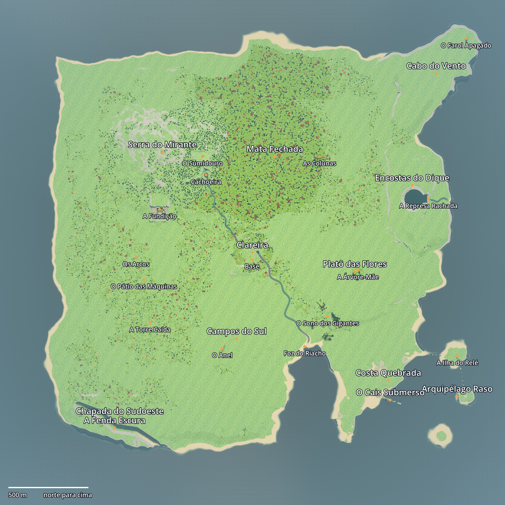

## 77. Teste do Terrain3D (2026-11-18)

O usuário achou três projetos para avaliar: Terrain3D (terreno), ProtonScatter (espalhar vegetação) e Cyclops Level Builder (construções em blocos). Os dois últimos são ferramentas de editor para montar à mão, e o jogo já faz por código o que eles fazem; só o Terrain3D foi testado.

- **Instalação:** Terrain3D 1.1.0 (MIT, Godot 4.5 a 4.8), baixado com permissão para `Projects/others/terrain3d/` (hash conferido) e copiado para `addons/terrain_3d/`. É uma extensão compilada (47 MB de bibliotecas, uma por sistema).
- **O teste** (`-- --terrain3d`, `TesteTerrain3D`): as malhas do chão do jogo saem de cena e o Terrain3D desenha o mesmo relevo, amostrado de `Vale.altura` a cada 2 m (1024 x 1024 pontos) e carregado por código. A colisão, as plantas, a água e as pedras continuam as do jogo. A cor é um mapa pintado simples (capim, areia, pedra nas encostas), não o shader do vale.
- **Encaixe:** as alturas batem (0,00 m de diferença em cinco pontos). Amostrar o relevo leva 0,6 s e montar o terreno menos de 0,1 s.
- **Desempenho no Mac (1600 x 900, meio-dia, `--perf`):** empate. Quadros por segundo, atual → Terrain3D: base 34 → 38; clareira 42 → 45; mata no chão 49 → 51; sobre a mata 54 → 59; platô 54 → 58; cachoeira 58 → 62; cume 57 → 61; campos do sul 61 → 60; do alto 55 → 55. A diferença fica dentro da variação entre uma rodada e outra. Os triângulos também ficam parecidos (o chão atual tem cerca de 0,7 milhão no mapa todo; o custo está nas árvores e no capim).
- **Aparência:** pior, como esperado sem o nosso shader: chão escuro e chapado, sem a pedra pintada nas encostas, sem o capim pintado ao longe e sem a luz em faixas. Para igualar seria preciso reescrever o shader do chão dentro do shader do Terrain3D.

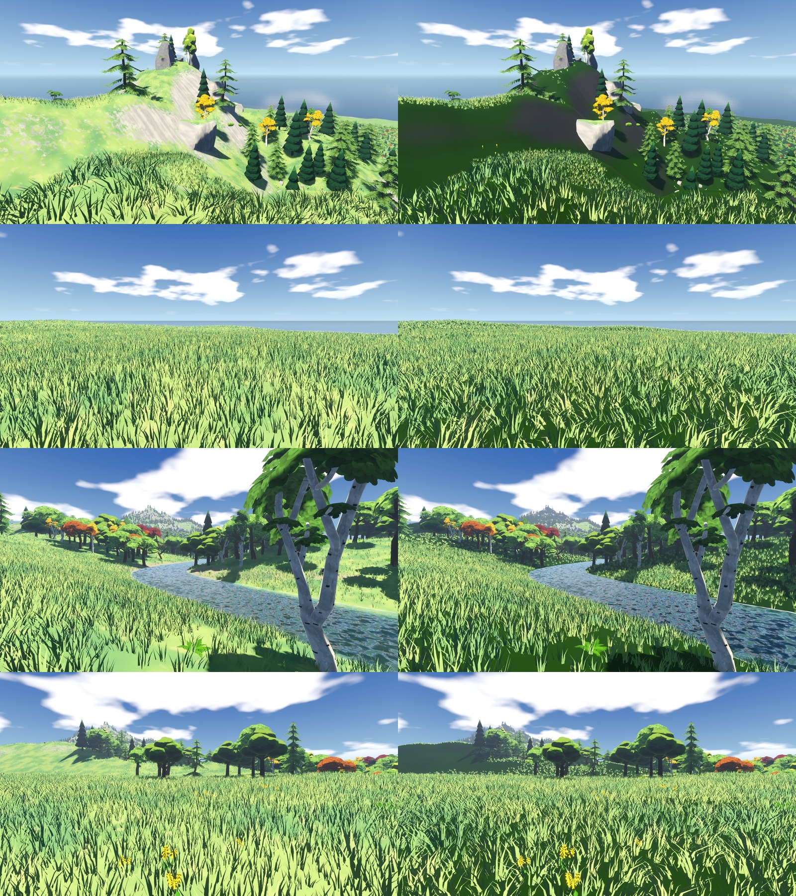

- **Conclusão:** na ilha de 2 km o Terrain3D não dá ganho de desempenho, porque o chão não é o que pesa. O que ele traria é chão com detalhe de 1 a 2 m em toda a ilha (hoje 4 m fora da clareira), uma malha só no lugar de duas, e esculpir e pintar no editor. O custo é reescrever o shader do chão, a colisão para bichos e mechas longe da câmera, e carregar a extensão em todas as builds.
- **Não medido:** o PC (Linux, NVIDIA), a ilha de 3 km e a colisão do Terrain3D.
- **Depois do teste:** a pedido do usuário, a extensão saiu do projeto (`addons/terrain_3d/` e a ligação no `main.gd`). O download continua em `Projects/others/terrain3d/`, e o script do teste ficou guardado em `tools/terrain3d/teste_terrain3d.gd.txt` para repetir na ilha de 3 km: copiar a extensão de volta para `addons/`, pôr o script em `scripts/vale/` e chamar `TesteTerrain3D.montar(ilha, camera.cam)` no `main.gd` depois de criar a câmera, ligando `TesteTerrain3D.seguir` ao `process_frame`.

## 78. Plano da ilha de 3 km (2026-11-18)

O usuário trouxe uma proposta completa para a ampliação (regiões, lugares e distribuição das peças). Foi avaliada contra o jogo e ajustada; o que ficou combinado:

**Regiões novas:** Costa Quebrada (sudeste: falésias baixas, baías, piscinas naturais), Encostas do Dique (faixa leste, pedra e um segundo riacho), Cabo do Vento (ponta nordeste, campo pedregoso e penhasco) e Arquipélago Raso (ilhotas no mar do sudeste).

**Lugares novos:** O Cais Submerso (Costa Quebrada), A Ilha do Relé (ilhota com torre de transmissão), A Represa Rachada (Encostas do Dique, com lagoa alta e córrego), O Farol Apagado (Cabo do Vento), O Sono dos Gigantes (robôs colossais desligados e tomados pelo mato, entre O Anel e A Árvore-Mãe) e A Fenda Escura (cânion fundo no sudoeste).

**Decisões do usuário:**
1. **Dois níveis de radiador:** um na fase 2, que ajuda a chegar à fase 3, onde fica o radiador melhor.
2. **Construções novas de metal e concreto**, mas velhas: ferrugem e vegetação tomando conta.
3. **Leste seguro:** sem máquinas hostis no leste e no sudeste (as quatro sentinelas de lá saem ou mudam de lado). O oeste continua o lado hostil.
4. **Scanner** vira um achado sem combate (não é prêmio da arena).
5. **Gigantes desligados**, não carcaças (a regra de que ninguém é destruído vale).

**Correções à proposta:** o robô não escala, ele voa, e o limite é o calor; por isso os desafios de altura são de tempo de voo. A Antena continua perto da base. Os efeitos reais das peças são os da seção 64 (Bocais: arrancada; Barbatanas: nado rápido).

**Regras de desenho:** costa orgânica com mar em toda a volta (sai a falésia artificial das bordas); de qualquer ponto do leste se vê um marco alto (Árvore-Mãe, Farol, Represa ou a Serra); leste de travessia, água e altura, oeste de combate.

**Etapas** (cada uma termina jogável e com fotos):
1. Relevo de 3 km: costa, as quatro regiões só no terreno e o mar em volta. Maquete antes, para aprovar. Repetir aqui o teste do Terrain3D.
2. Marcos altos: Farol, Represa com o segundo riacho, e os gigantes.
3. Água: Cais, ilhotas e a Ilha do Relé.
4. A Fenda Escura.
5. Redistribuir as peças (com os dois radiadores), já com os lugares prontos.
6. **Norte e oeste** (pedido do usuário em 2026-11-18, ao aprovar a maquete): as faixas novas do norte e do oeste ganharam só terra, sem nenhum lugar. Acrescentar ali alguns lugares ou marcos para não ficarem vazias. Entra depois das etapas acima, ou junto de uma delas se couber.

**Para rever depois das etapas prontas** (pedido do usuário em 2026-11-18, depois de ver a etapa 1):
- **Os pontos fracos da etapa 1** (lista no fim da seção 79): o Cabo do Vento sem as pedras, a Costa Quebrada pouco recortada e com uma piscina só, a mata da Torre Caída cortada em linha reta na chapada, a abertura mais lenta, o PC sem medir e o Terrain3D a repetir.
- **"Sinal fraco" longe da ilha:** conferir o controle do jogador muito longe da costa. Relato do usuário: mesmo voando de volta, em direção à ilha, a mensagem "sinal fraco" aparecia. (Hoje o aviso sai a 150 m da costa e a pane a 260 m, só pela distância, sem olhar para onde o robô vai: `LimiteMar`.)
- **Nadar e sair da água:** discutir uma melhoria na ação de nadar e numa saída rápida da água. É para conversar antes de mexer.
- **Manobras no ar:** discutir manobras durante o voo (pedido do usuário em 2026-11-18). Também é para conversar antes de mexer.

**Maquete da etapa 1 (2026-11-18, aprovada pelo usuário no mesmo dia):** `/usr/bin/python3 tools/vale/mapa_3km.py` lê o relevo de hoje e grava o de 3 km em `docs/mapa/3km/` (751 x 751 pontos, 4 m; o jogo ainda não usa) e a maquete `docs/mapa/maquete_3km_v1.png`.

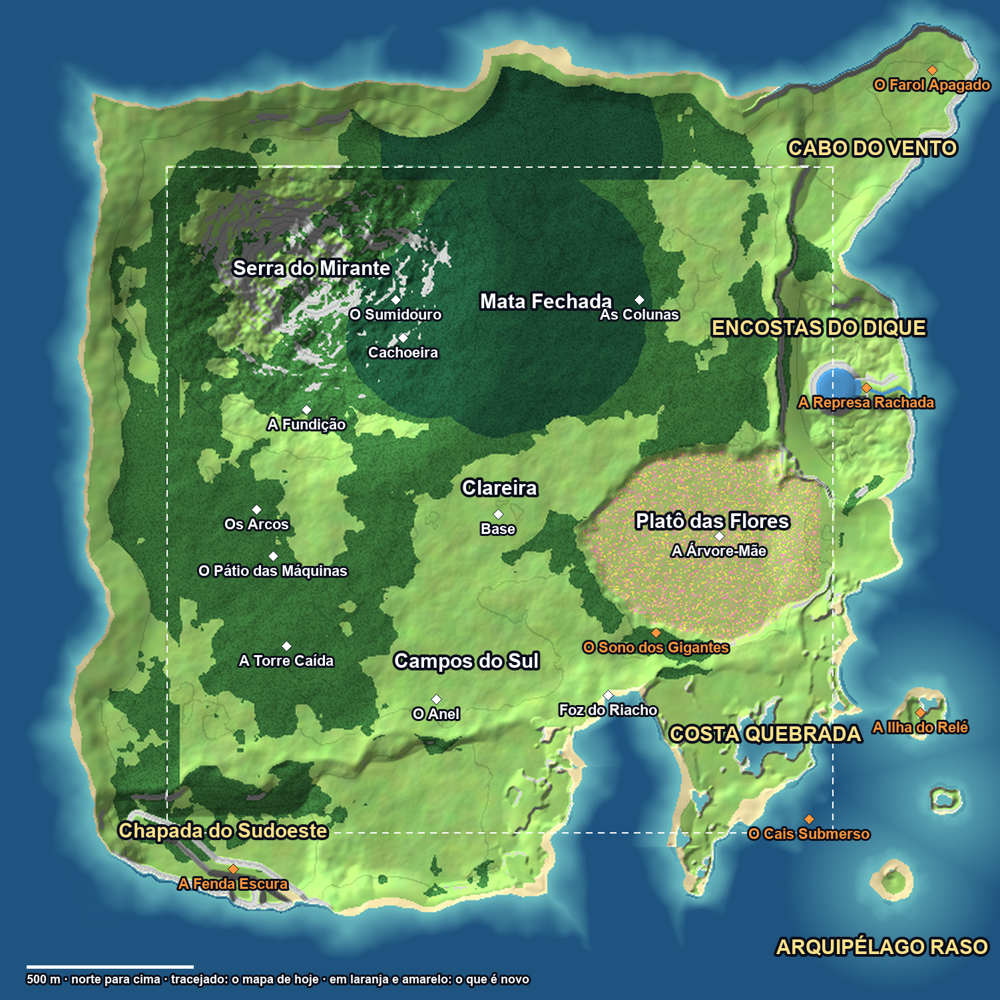

- A ilha de hoje fica no meio sem mudar: só 3,3% da terra atual muda mais de 1 m, tudo nas faixas de praia do sul e do leste, que deixam de ser costa. A Foz do Riacho continua no mar, no fundo de uma baía.
- A terra passa de 3,3 para 5,6 km², com mar em toda a volta e enseadas no norte, no noroeste, no oeste e no sul.
- Dentro dos 2 km a terra nova só levanta (nunca cava), e sobe aos poucos a partir da costa antiga para não formar paredão.
- A lagoa da represa fica a 41 m, com o córrego descendo até o mar do leste; a chapada do sudoeste tem 58 m e a Fenda corta até 3 m do nível do mar, com 16 m de largura no fundo.

## 79. Etapa 1 da ilha de 3 km: o relevo no jogo (2026-11-18)

O relevo aprovado na maquete entrou no jogo. Só terreno, costa, mata e bichos; os lugares novos (Farol, Represa, Cais, gigantes, Fenda com escuro) são das etapas seguintes.

- **Dados:** `assets/vale/mapa/alturas.bin` e `cobertura.bin` passaram a 751 x 751 pontos (4 m), de -1500 a 1500 m. O relevo de 2 km, que o gerador lê, foi guardado em `docs/mapa/2km/`. `Vale.F_N` 751, `F_META` 1500, grade da costa `C_N2` 189.
- **Costa:** vem pronta no arquivo. Saiu o `_borda_ilha`, que afundava as quatro bordas no carregamento; a falésia artificial da borda não gera mais nenhuma rocha.
- **Mata:** 16.381 árvores fora da clareira, umas 3.600 delas na terra nova. O vulto distante das árvores era desenhado só até 1.300 m; passou a 2.300 m (`Vale.VULTO_ATE`), senão do alto a terra do outro lado parecia pelada.
- **Bichos:** sorteados na ilha inteira e na mesma proporção da terra (24 manadas, 56 tocas, 30 bandos, 20 raposas, 8 alcateias).
- **Leste seguro:** as quatro máquinas hostis que moravam no leste foram para as faixas novas do oeste, do noroeste e do sudoeste (`InimigosVale.LUGARES`).
- **Nomes na tela:** Costa Quebrada, Encostas do Dique, Cabo do Vento, Arquipélago Raso e Chapada do Sudoeste.
- **Fundo do mar:** o plano além dos dados usa o shader do chão com a cor da areia, para o quadrado dos dados não aparecer do alto.
- **Fotos:** `-- --vale-captura --largo --novas` (20 vistas das regiões novas) e `--mapa` (o mapa de cima, agora com 3 km).


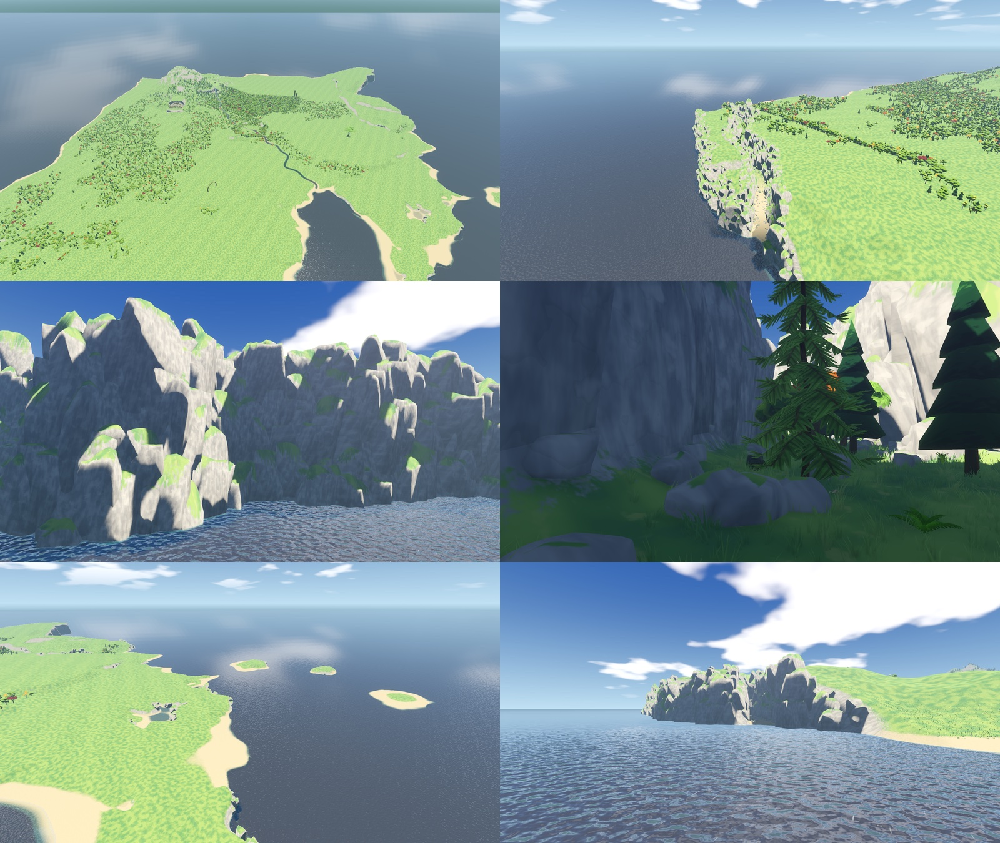

**Medido no Mac (1600 x 900, meio-dia):**

| Ponto | Ilha de 2 km | Ilha de 3 km |
|---|---|---|
| Base, olhando o campo | 34 qps | 38 |
| Campo da clareira | 42 | 43 |
| Mata fechada, no chão | 49 | 47 |
| Sobre a mata, a 60 m | 54 | 51 |
| Platô das Flores | 54 | 55 |
| Cachoeira | 58 | 70 |
| Do cume, vista inteira | 57 | 53 |
| Campos do Sul | 61 | 59 |
| Do alto, mapa inteiro | 55 | 55 |

O desempenho ficou igual, dentro da variação de uma rodada para outra. A abertura ficou mais lenta: o mundo fica pronto em 8,7 s na primeira vez (eram 6,1 s) e em 4,4 s com o cache (eram 3,2 s). O que mais cresceu foram os paredões de pedra (a Fenda e os penhascos têm muitos): 1,7 s só criando as formas de colisão.

**Testes:** três conferências estavam presas ao mapa antigo e foram ajustadas (o mar medido em z = 980, a manada escolhida já nascida perto do robô, e o cervo do teste de desvio, que agora o teste cria).

**O que falta nesta etapa ou ficou para as próximas:**
- A lagoa da represa é uma bacia seca e o córrego não tem água (etapa 2).
- O Cabo do Vento é capim liso; faltam as pedras do "campo pedregoso".
- A Costa Quebrada ainda é pouco recortada de perto: há uma piscina natural, não várias.
- A Fenda tem as paredes e o chão, mas não o escuro.
- Não medido: o PC (Linux, NVIDIA) e o teste do Terrain3D com a ilha de 3 km.
- Ninguém jogou ainda: tudo foi visto em fotos.
- Na chapada, a mata antiga da Torre Caída acaba numa linha reta, onde era a costa de hoje; pede um retoque na cobertura.
- Baterias com os dados finais: `--teste-vale` 67 pontos e `--teste` 95.

## 80. Etapa 2 da ilha de 3 km: os marcos altos do leste (2026-11-18)

Os três marcos ficam em `scripts/vale/marcos_leste.gd` (`MarcosLeste`), chamados no fim de `Marcos.montar`. A represa e o farol são montados bloco a bloco com a `Obra` das ruínas; os gigantes são mechas do pacote ampliados. Tudo tem colisão, nome na tela, e fica livre de árvores e de rochedos (`MarcosLeste.livre`, consultado por `Ruinas.livre` e pelos `Paredoes`).

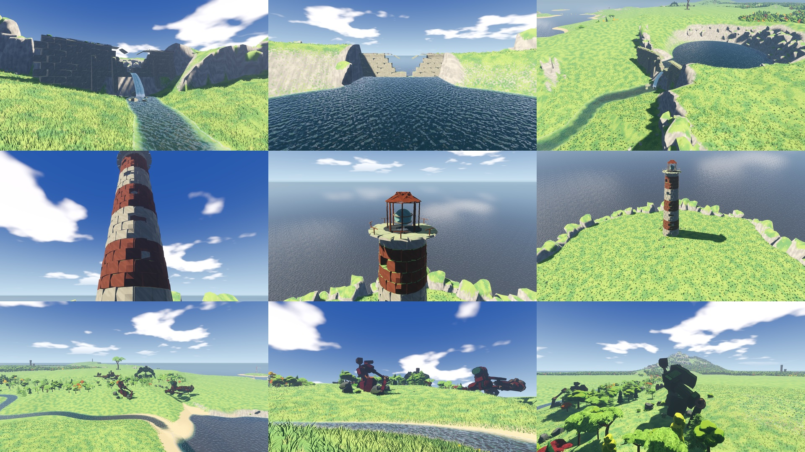

- **A Represa Rachada** (1102, -335): parede de concreto em arco, de 96 m, com o alto a 40 m, que fecha a garganta da lagoa. Tem um rombo em V no meio, até a linha d'água (26 m), com ferragem aparecendo, passadiço com corrimão de ferro, quatro escoras do lado de baixo e pedaços caídos no leito. A água sai pelo rombo numa queda de 14 m.
  - **A lagoa** mudou de lugar no relevo: na maquete encostava na costa antiga, que é mais baixa, e a água vazaria para o oeste. Agora fica toda em terra nova (centro em 1010, -335), cercada por terra de 42 m ou mais, com uma garganta só.
  - **O córrego** é um terceiro `Vale.Curso` (`RIO_REPRESA`): nasce ao pé da represa, a 12 m, e desce até o mar do leste. A água da lagoa é um disco mais uma lâmina que acompanha o arco da parede; `Vale.agua` responde pelos dois.
- **O Farol Apagado** (1338, -1338, na ponta do Cabo do Vento): torre de 62 m, com 7,6 m de raio no pé e 4,5 m no alto, pendendo 6 graus para o mar. Faixas de concreto e de tinta vermelha desbotada, porta no pé, uma racha em espiral, o alto quebrado do lado do mar, balcão com corrimão, gaiola de ferro com o chapéu torto e o que sobrou da lente. É oco e aberto em cima.
- **O Sono dos Gigantes** (470, 400): quatro robôs colossais desligados, de 50 a 74 m: dois deitados e dois de pé, enterrados até a cintura. A tinta virou ferrugem e pó, com pedras e mato encostados.
  - Na primeira versão tinham 22 a 34 m e sumiam entre as árvores; não eram marcos.
- **Materiais novos:** `concreto`, `tinta_velha` e `vidro_velho` (em `Clareira._materiais`).
- **Testes:** `--teste-vale` ganhou um ponto com três conferências (mar nas quatro bordas e terra nas regiões novas; lagoa, córrego e leste sem hostis; nomes e colisão dos três marcos) e passou a 70 pontos. `--teste` segue com 95.
- **Fotos:** `-- --vale-captura --largo --marcos-leste`.

**O que não está bom ou não foi conferido:**
- A represa lê como um muro de pedra escura, não como concreto: falta um material com cara de concreto (juntas, manchas de escorrido).
- A inclinação do farol quase não se nota de longe, e ele não tem trepadeira nenhuma.
- Os gigantes ainda têm cor demais (vermelho e verde) para quem dormiu tanto tempo, e nenhuma árvore cresce em cima deles.
- A colisão dos gigantes é por caixas largas: não dá para pousar num braço ou passar por baixo dele.
- Não medi o desempenho de novo nem a abertura; a montagem dos três marcos leva 0,1 s.
- Ninguém jogou: tudo foi visto em fotos. Som da queda da represa não conferido.

## 81. Etapa 3 da ilha de 3 km: os lugares de água (2026-11-18)

Ficam em `scripts/vale/marcos_mar.gd` (`MarcosMar`), chamados depois de `MarcosLeste.montar`. Tudo é montado com a `Obra` das ruínas mais algumas peças do kit da base, com colisão e nome na tela.

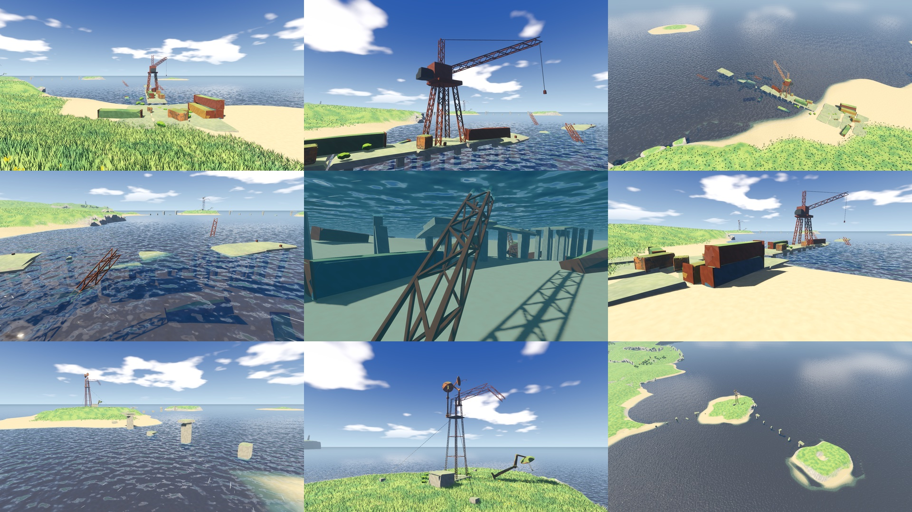

- **O Cais Submerso** (sai da praia em 806, 902 e avança 132 m baía adentro, na Costa Quebrada):
  - a laje do pátio na praia, com contêineres empilhados, caixas e tambores;
  - o cais em onze trechos de 12 m: os quatro primeiros de pé, a 2,3 m da água, depois tortos, afundados ou faltando (só os pilares quebrados);
  - um guindaste de pé no terceiro trecho, com a lança de treliça sobre a água, o cabo e o gancho; outro tombado no fim do cais, com a lança saindo da água; e a ponta de uma terceira lança furando a água;
  - 18 contêineres, 12 deles no fundo da baía (de 6 a 12 m de fundura). Um está aberto, de pé no fundo raso: a etapa das peças põe uma ali dentro (`MarcosMar.conteiner_aberto`).
- **A Ilha do Relé** (1282, 648, a uns 250 m da costa): torre de treliça de 46 m com o terço de cima dobrado, plataforma de serviço a 32 m, três antenas (uma presa, uma pendurada, uma no chão), estais (um arrebentado) e a casinha de concreto do relé.
- **A ponte antiga:** 12 pilares de concreto nos bancos de areia, da costa à Ilha do Relé e dela à ilhota do sul. Uns inteiros, com capitel e um resto de tabuleiro; outros quebrados na linha d'água; alguns tombados.
- **Modelos:** `Prop_SatelliteDish` e `Prop_Crate_Large`, do Sci-Fi Essentials Kit que já estava na máquina, copiados para `assets/vale/base/` sem as texturas próprias (usam as do kit que o jogo já tem). As treliças e os contêineres são feitos por código (`_trelica`, `_conteiner`).
- **Materiais novos:** `lata_azul`, `lata_verde` e `lata_ocre`. O `concreto` perdeu musgo (de 0,85 para 0,4): as lajes do pátio pareciam gramado.
- **Testes:** mais uma conferência em `--teste-vale` (tabuleiro do cais, trecho afundado, plataforma da torre, contêiner aberto no fundo, contagens): 71 pontos. `--teste` segue com 95.
- **Fotos:** `-- --vale-captura --largo --marcos-mar`.

**O que não está bom ou não foi conferido:**
- Os guindastes do cais e a torre do relé leem bem; os contêineres do fundo quase não aparecem de cima, só as sombras deles.
- O concreto dos pilares e do cais ainda ganha musgo verde vivo nas faces de cima.
- A água do mar aqui é a mesma do resto: a proposta falava em água turquesa e piscinas rasas na Costa Quebrada, que não existem.
- Não testei nadar entre os contêineres nem entrar no aberto: só a posição e a colisão por raio.
- Ninguém jogou: tudo foi visto em fotos. Desempenho e abertura não foram medidos de novo.

## 82. Etapa 4 da ilha de 3 km: A Fenda Escura (2026-11-18)

O cânion que corta a Chapada do Sudoeste. Fica em `scripts/vale/fenda_escura.gd` (`FendaEscura`), montada depois de `MarcosMar`.

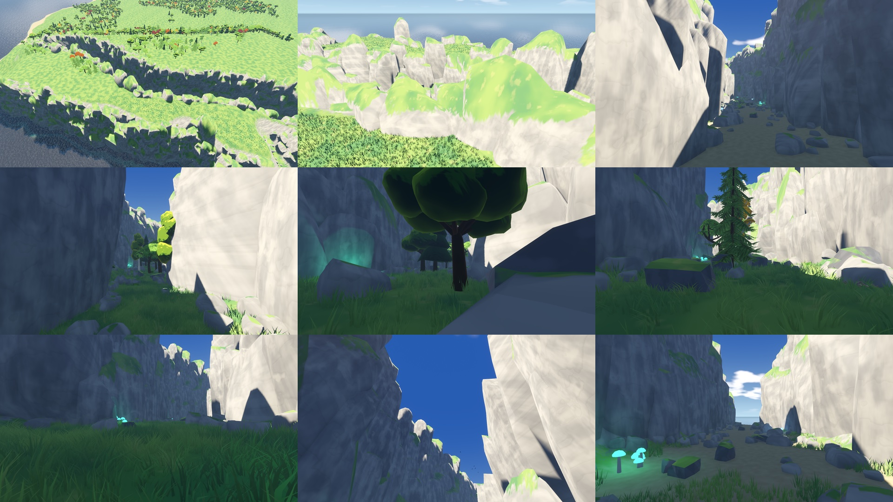

- **O corte** vem do relevo: uns 470 m de comprimento, 50 m de fundura e 24 m de chão, com uma boca no oeste e a saída para a praia no leste. Fica aberto para o céu.
- **O que a etapa acrescentou:** 19 tufos de cogumelos que brilham (verde-água e azul) junto das paredes, pedras soltas pelo chão, três bandos de morcegos no alto (a mesma classe do Sumidouro) e o nome na tela.
- **Tentativa descartada:** um teto de 106 lajes de pedra avançando das duas beiras, com claraboias, e a luz ambiente caindo a 5% no fundo (`CicloDia.sombra_local`). O usuário viu e rejeitou: "esses quadros formando o teto não estão bons, remove; estava bom antes, pode deixar sem a sombra". Saíram o teto e o escuro, e as árvores do fundo voltaram. Não refazer um teto de blocos.
- **Consequência:** a fenda não é escura. Ela é funda e as paredes fazem sombra em parte do dia, mas a luz do peito não é necessária ali. Isso pesa na etapa 5: a peça da luz do peito continua tendo só o Sumidouro como lugar de uso.
- **Testes:** uma conferência em `--teste-vale` (aberta para o céu, mais de 35 m de fundura, cogumelos, morcegos): 72 pontos. `--teste` com 95.
- **Fotos:** `-- --vale-captura --largo --fenda`.
- **Não conferido:** o scanner com os morcegos; ninguém jogou.

## 83. Etapa 5 da ilha de 3 km: as peças em três círculos e os dois radiadores (2026-11-18)

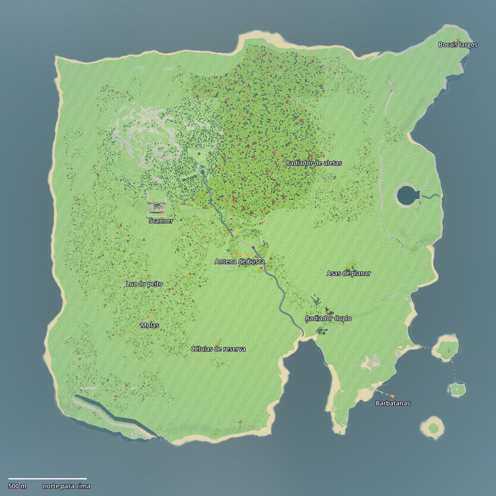

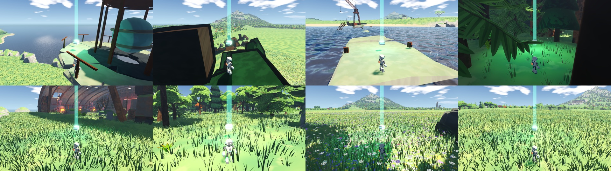

São dez peças agora (`Melhorias.NOMES`), distribuídas em `PecasMundo._ready`:

| Círculo | Peça | Onde fica | Distância da base |
|---|---|---|---|
| Perto | Antena de busca | ao lado da base | 48 m |
| Perto | Células de reserva | O Anel | 586 m |
| Perto | Luz do peito | na entrada do Sumidouro que dá para a cachoeira, do lado de fora | ~570 m |
| Meio | Scanner | no patamar em frente à Fundição, do lado de fora (sem lutar) | ~560 m |
| Meio | Molas | A Torre Caída | ~740 m |
| Meio | Radiador de aletas | As Colunas | 758 m |
| Meio | Barbatanas | na ponta do Cais Submerso, 1,4 m sobre a água | ~1.300 m |
| Longe | Asas de planar | ao pé da Árvore-Mãe | ~650 m |
| Longe | Radiador duplo | nas costas do maior gigante, a 36 m do chão | 631 m |
| Longe | Bocais largos | no balcão do Farol Apagado, a 59 m do chão | 1.927 m |

- **Dois radiadores** (decisão do usuário): o de aletas leva o voo de 61 s para 100 s (1,0 %/s; pairando 1,5 %/s); o duplo leva a 182 s (0,55 %/s; pairando 0,8 %/s). O duplo vale sozinho, sem o primeiro. No corpo, o duplo acrescenta duas aletas, uma de cada lado das quatro.
- **Três peças ficam em cima de construções:** a posição vem de um raio lançado de cima (`PecasMundo._de_cima`), não do relevo.
- **A luz do peito** fica na entrada do Sumidouro, ao lado do poço da cachoeira (pedido do usuário, que não quis o Pátio das Máquinas da proposta: "faz mais sentido lá"). Antes ficava dentro do salão; agora quem vai entrar no escuro acha a luz antes.
- **Sem peça:** a Cachoeira, a Serra do Mirante, o Sumidouro, Os Arcos, a Represa Rachada, a Ilha do Relé e a Fenda Escura. A proposta guarda esses lugares para outras recompensas, que ainda não existem.
- **Ferramenta:** `-- --vale-captura --mapa --so-pecas` grava o mapa das peças; `--pecas` fotografa cada uma no lugar.
- **Testes:** `--teste-vale` com 74 pontos (distâncias dos três círculos, as três peças no alto, os tempos dos dois radiadores, a luz na entrada do Sumidouro); `--teste` com 95.

**O que não está bom ou não foi conferido:**
- As distâncias não formam três círculos limpos: o radiador duplo (631 m) e as asas (650 m) ficam mais perto da base do que as barbatanas (1.300 m). Os lugares é que mandam; a ordem vem mais do que cada peça exige do que da distância.
- As barbatanas ficaram em cima do cais, e não dentro do contêiner aberto no fundo, como na proposta: não confirmei que o robô consegue mergulhar até 6 m sem elas.
- O radiador duplo, no alto do gigante, pede uns 36 m de subida; com o robô básico (61 s de voo) dá, mas não foi jogado.
- Um save antigo com o radiador instalado passa a ter o de aletas (100 s), não os 3 minutos de antes.
- Ninguém jogou: tudo foi visto em fotos e testes.

## 84. Etapa 6 da ilha de 3 km: o norte e o oeste (2026-11-18)

As faixas novas do norte e do oeste tinham ganhado só terra. Agora têm três lugares, em `scripts/vale/marcos_oeste.gd` (`MarcosOeste`), montados depois da `FendaEscura`. A escolha dos três foi minha (o usuário pediu "algumas coisas" para preencher o vazio).

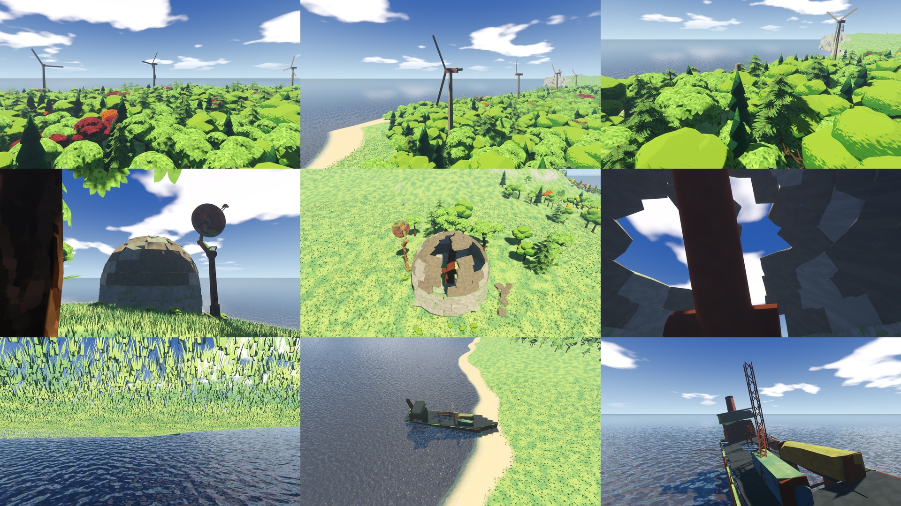

- **As Torres do Vento** (costa norte, de x = -10 a 534, z ≈ -1175): cinco torres de 48 m com pás de 21 m, acima das copas da Mata Fechada. Duas ainda giram devagar (`MarcosOeste.Rotor`), uma parou, uma perdeu uma pá (espetada no chão) e uma quebrou ao meio, com a metade de cima tombada.
- **O Observatório** (-700, -1088, num morro de 79 m no noroeste): tambor redondo de concreto com a porta para o sul, cúpula de 12 m de raio em sete fiadas, a fenda aberta para o norte com o telescópio ainda apontado, um rombo a oeste com a casca caída do lado de fora, e uma antena ao lado. Dá para entrar.
- **O Casco Encalhado** (-1206, 322, na enseada do oeste): um cargueiro de 76 m adernado, com a proa na areia e a popa na água. Costados com chapas faltando (dá para entrar no porão), convés com as bocas dos porões abertas, casa do leme de três andares, chaminé torta, dois mastros de carga e dois contêineres no convés.
  - Na primeira versão o navio estava fundo e longe demais: só a casa do leme saía da água.
- **Testes:** `--teste-vale` com 75 pontos (nomes, torres e as que giram, cúpula, convés do navio); `--teste` com 95.
- **Fotos:** `-- --vale-captura --largo --marcos-oeste`.

**O que não está bom ou não foi conferido:**
- O Observatório é pequeno para o morro em que está: de longe quase some. A antena ao lado ficou maior que ele em proporção.
- As torres nascem no meio da mata; do chão, entre as árvores, quase não se veem (do ar leem muito bem).
- O oeste é o lado hostil, e três mechas moram perto do navio e do observatório: não conferi se atrapalham a visita.
- Nenhum destes três tem peça nem outra recompensa.
- Ninguém jogou. Desempenho e abertura não foram medidos de novo desde a etapa 1.

## 85. Acertos depois das seis etapas (2026-11-18)

O usuário pediu para corrigir o aviso de "sinal fraco" e acertar os pontos fracos anotados em cada etapa, na ordem que fosse melhor.

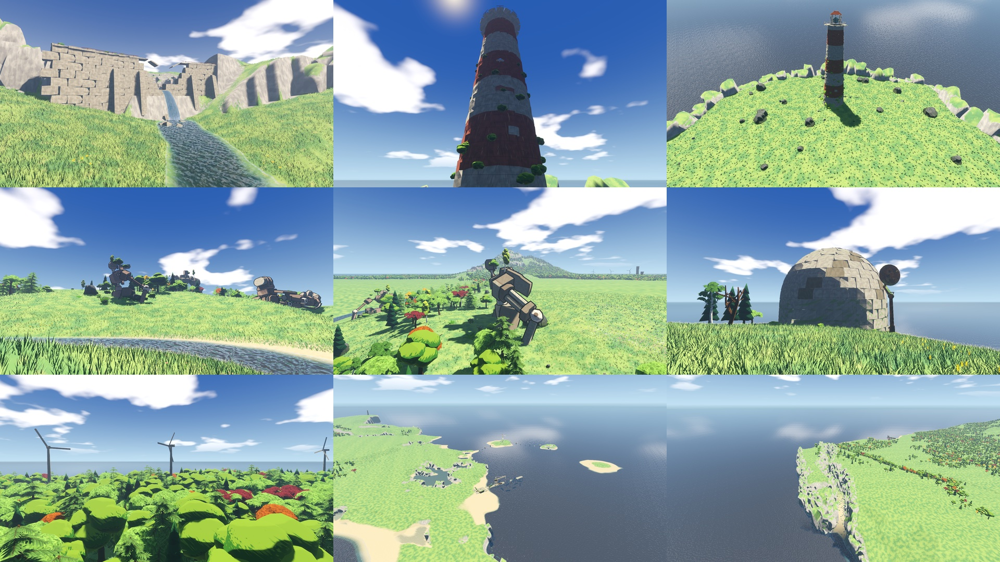

**Feito:**
- **"Sinal fraco":** `LimiteMar` passou a olhar se o robô está voltando (a distância até a costa caindo pelo menos 1 m/s). Voltando, não há aviso nem pane. Antes só contava a distância, e o aviso aparecia mesmo no voo de volta.
- **Concreto:** material novo (`vale_concreto.gdshader`, `Clareira._concreto`): cinza claro com as juntas das fôrmas, escorridos escuros, ferrugem em alguns pontos e limo escuro (não capim) nas faces de cima. Vale para a represa, o cais, os pilares da ponte, o farol e o observatório.
- **Farol:** inclinação de 6 para 11 graus, as faixas vermelhas pintadas no próprio concreto (desbotadas) e mato subindo pela parede do lado da terra.
- **Gigantes:** desbotados para ferrugem (`desbotado` no `vale_tex.gdshader`), com árvores e mato crescendo em cima deles.
- **Gigante flutuando** (visto pelo usuário): cada gigante agora se apoia no ponto mais baixo do chão debaixo do corpo inteiro. O terreno ali desce até 15 m de uma ponta à outra, e apoiado na altura do meio um deitado ficava com a ponta no ar.
- **Observatório:** cúpula de 12 para 20 m de raio, tambor de 12 m de altura, telescópio na mesma proporção.
- **Torres do Vento:** clareira de 28 m ao pé de cada uma, para aparecerem do chão.
- **Cabo do Vento:** 230 pedras espalhadas, desenhadas em lote por tipo; as grandes têm colisão.
- **Costa Quebrada:** mais piscinas naturais (o limiar no gerador era alto e só uma aparecia).
- **Chapada:** a mata da Torre Caída continua pela terra nova em vez de acabar em linha reta. A causa era a faixa de areia da costa antiga, que virava campo.
- **Teste dos projéteis:** passou a escolher um rumo livre para o tiro. Com a cobertura nova, uma pedra nasceu na linha e a bala parava nela.

**Não feito:**
- **Colisão dos gigantes por partes** (pousar num braço): continua em caixas largas.
- **Contêineres do fundo** pouco visíveis de cima, e a **água turquesa** da Costa Quebrada.
- **Lugares sem recompensa:** dez lugares não dão nada a quem visita. É decisão do usuário.
- **Barbatanas no contêiner do fundo:** depende de saber se o robô mergulha sem elas.
- **Terrain3D com a ilha de 3 km** e o **desempenho no PC**.

**Medições:**
- Abertura no Mac: mundo pronto em 5,2 a 5,5 s com o cache (eram 4,4 s na etapa 1), primeiro quadro aos 6,8 s. Os paredões seguem sendo o maior custo (1,8 s de formas de colisão).
- Desempenho no Mac: não comparável hoje. A máquina estava com carga 50 a 90 (um build do Xcode e o emulador do Android), e os tempos de processador dobraram em tudo, inclusive na física. Medido assim: de 34 a 56 qps, com o cume a 43 e o alto a 45 (eram 53 e 55). Repetir com a máquina livre.
- Baterias: `--teste-vale` 75 pontos, `--teste` 95.

**Ainda para conversar com o usuário:** nadar e sair da água, manobras no ar, e o que cada lugar sem peça dá de recompensa.

## 86. Do teste do usuário no PC: mar, ladeira e gigantes (2026-11-18)

Cinco pontos que o usuário trouxe depois de jogar a build.

- **Aviso e pane no mar mais longe:** `LimiteMar.AVISO` de 150 para 350 m e `PANE` de 260 para 550 m. A distância já era até a terra mais perto (qualquer praia ou ilhota, pela grade de `Vale.distancia_da_costa`), não até o meio da ilha; o que faltava era folga.
- **Barbatanas:** o usuário confirmou que dá para mergulhar sem elas, mas prefere a peça no cais. Fica onde está, na ponta do Cais Submerso.
- **Robô afundando no morro ao pousar correndo:** correndo depressa ladeira acima, `_subir_degrau` tratava a própria ladeira como degrau a cada quadro. O desconto do desenho (`_degrau_y`) acumulava, o boneco entrava no chão e subia devagar depois. Agora só conta como degrau o que barra de frente (normal com menos de 0,45 para cima), e o desconto nunca passa de um degrau e meio.
- **Gigante com "a bunda flutuando"** (em 459, 520): o corpo deitado cai para um lado a partir dos pés, e eu apoiava pela altura dos pés. Agora cada deitado se inclina com o chão que tem debaixo do corpo (pelos ossos) e desce até um quarto dos ossos ficar abaixo do chão.
- **Parede invisível no gigante da peça:** a colisão eram duas caixas largas em volta do corpo. Agora é uma cápsula por osso, do pai ao filho (162 no total nos quatro), mais grossa no tronco. Resolve também o ponto que tinha ficado sem fazer (pousar num braço).

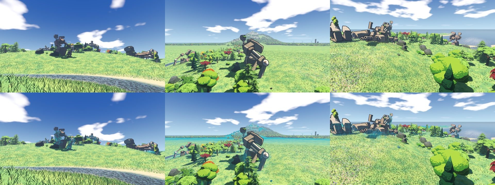

- **Testes:** `--teste-vale` 75 pontos (a pane no mar agora a 596 m no teste; o gigante de pé a 33 m; o radiador duplo a 33 m do chão), `--teste` 95.
- **Não conferido:** o afundamento na ladeira não tem teste próprio e não foi visto rodando: a correção vem da leitura do código. As cápsulas ficam um pouco para dentro das chapas do modelo, então o robô pode afundar um palmo no desenho ao pousar em algumas partes.

**Colisão real dos gigantes (mesmo dia, pedido do usuário):** as cápsulas por osso ainda falhavam: ele atravessava algumas chapas e era barrado em vãos. A colisão passou a ser a própria malha do corpo (`MarcosLeste._malha_do_corpo`): cada vértice das peças presas ao esqueleto é levado pelos ossos que o puxam, na pose em que o gigante dorme, e os extras vão com o osso de encaixe. Vira uma `ConcavePolygonShape3D` por gigante, com colisão dos dois lados: 15.798 triângulos nos quatro. As árvores de cima nascem em faces largas viradas para cima, e a peça do radiador duplo pousa numa chapa de verdade (a 31 m do chão). Fotos com `--debug-collisions` mostram a malha azul em cima das chapas. Baterias: vale 75, voo 95. Não conferido jogando; o custo da física com a malha não foi medido.

**A mesma solução nos outros robôs parados (mesmo dia):** a conta virou um utilitário, `MalhaCorpo` (`scripts/vale/malha_corpo.gd`), com duas saídas: `faces` (a malha inteira, para `ConcavePolygonShape3D`) e `cascos` (um casco convexo por peça do corpo, com até 64 pontos).
- **Gigantes:** continuam com a malha inteira (15.798 triângulos), que o usuário aprovou.
- **Os seis robôs velhos caídos da Fundição:** eram uma caixa de 1,5 x 0,9 x 2,4 m cada. Com a malha inteira dariam 24.706 triângulos para robôs de 1,9 m; o usuário disse que podia simplificar, e ficaram com cascos por peça (150 no total).
- **O Faísca caído, na base:** era uma caixa pequena. O modelo dele tem 139 mil triângulos, então também ficou com cascos por peça (69), montados no quadro seguinte, depois que o corpo assenta no chão.
- **Os mechas e as máquinas que andam** não mudaram: malha de colisão não serve para corpo em movimento.
- **Bala e o corpo do alvo:** o raio que para a bala em paredes não conta mais o corpo do próprio robô alvo.
- **Teste dos projéteis:** falhava de vez em quando. A conferência do rumo livre mirava 40 cm acima da linha real da bala e não via uma pedra baixa; agora mira o mesmo ponto, confere as duas camadas de colisão e as lombadas do terreno, e a bala tem três tentativas. O resultado dependia de onde a ronda deixava o mecha.
- **Baterias:** `--teste-vale` 76 pontos, `--teste` 95.

**Colisão dos gigantes deitados fora do lugar (visto pelo usuário, mesmo dia):** a do gigante de pé estava perfeita, a dos deitados não. Medido: o corpo desenhado estava 1,8 m e 4,0 m acima da colisão. A causa é o ajuste de `MechVisual._process`, que a cada quadro ergue um mecha caído até o osso mais baixo encostar no chão: ele seguia agindo depois de a colisão estar calculada. Nos gigantes o ajuste foi desligado (`set_process(false)`; eles já são assentados à mão), e nos robôs velhos da Fundição ele roda até assentar e só então é desligado, antes dos cascos. A pose da queda passou a ser posta com `seek(fim, true)`. A bateria ganhou a conferência (a malha de agora contra a da montagem: diferença zero) e foi a 77 pontos. `--vale-captura --largo --gigantes` imprime a diferença de cada um.

## 87. Oito ideias do usuário e a história da ilha (2026-11-18)

Depois de jogar a ilha de 3 km o usuário trouxe oito ideias. Todas aprovadas para fazer, nesta ordem: tiro sem calor, vento no chão no voo rasante, só árvores do pacote Nature; depois sair da água e manobras no ar; o drone instalando a peça; vida na água; e as memórias nos lugares sem peça.

**Decisões dele:**
- **Manobras:** o círculo fica livre para as manobras no voo; parar o voo é com L3 (corta os jatos) e L2/R3 (freia e paira).
- **Peças:** o drone instala a peça no robô, sem voltar à base, e só com o robô no chão. A base fica para armas e melhorias de luta.
- **Recompensa dos lugares sem peça:** uma memória que, tocada, abre um texto curto sobre o lugar, com uma música leve.

**A história da ilha (palavras do usuário, 2026-11-18):** "após anos tentando trazer paz pro mundo buscando novas fontes de energia limpa, robôs pra ajudar e outras coisas boas pro mundo, os humanos falharam e se extinguiram. Faísca era dessa época e tentou ajudar, depois que os humanos se foram ele tentou achar propósito e paz, mas seu corpo não pôde mais seguir e ele passou sua consciência pro robô novo (o nosso que jogamos). Depois de muitos anos, a natureza tomou seu lugar e ficaram apenas lembranças de boas pessoas tentando ajudar a melhorar o mundo."

O tom das memórias sai daí: gente boa tentando, sem vilão; tristeza leve, sem culpa; a natureza no fim. O robô que jogamos carrega a consciência do Faísca.

## 88. As oito ideias, feitas (2026-11-18)

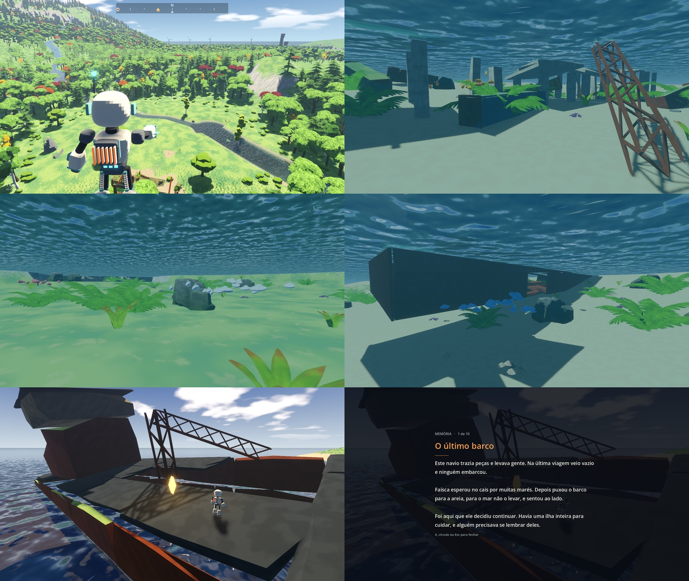

1. **Tiro sem calor.** Atirar não esquenta mais o robô (`Tiro._disparar` e os mísseis); o calor é só do voo. O campo `calor` de cada arma em `Arsenal.MODOS` ficou sem uso.
2. **Vento no voo rasante.** `EfeitosMato._rasante`: um emissor só, ligado enquanto o robô voa a menos de 4,5 m do chão e a mais de 8 m/s, fora d'água. Poeira clara e verde de capim saindo para os lados, mais forte quanto mais rápido e mais baixo. Sobre a água já existia o respingo (`EfeitosAgua`).
3. **Só árvores do pacote Nature.** `Clareira.tipo_variado` não devolve mais as três árvores feitas por código; todas viram as do pacote. As antigas só aparecem como vulto, além de 450 m, onde a forma não se nota e elas custam menos.
4. **Sair da água.** L3 dentro d'água dispara o robô para onde a câmera aponta, com um empurrão para cima: ele rompe a superfície e já sai voando, de qualquer fundura (`saidas_da_agua`; por 1 s não volta a nadar). O X na superfície virou um salto mais alto e para a frente.
5. **Manobras no ar com o círculo.** No voo: giro de caça (uma volta em torno do nariz, 0,55 s); com o analógico para um lado, desloca uns 5 m para lá. Pairando: um tranco de uns 4 m para onde o analógico aponta (para trás, sem direção). Espera de 0,75 s e 3% de calor por manobra. A freada com o círculo saiu: parar é com L3 (corta os jatos) ou L2/R3 (freia e paira; R3 de novo solta). O estado `FREAR` ficou sem botão.
6. **O drone instala a peça.** Com peça na mão e o robô no chão, o drone vem (`DroneColega.instalar`, modo `INSTALA`), dá a volta nele com o facho aceso e instala ali mesmo; o robô fica parado uns 3 s. Não é mais preciso voltar à base. A oficina continua sabendo instalar (os testes dela desligam o drone com `PecasMundo.auto`).
7. **Vida na água** (`VidaAgua`): 16.759 plantas e pedras de fundo (algas, plantas baixas, corais e seixos) no mar raso, nas piscinas e na lagoa da represa, em lotes desenhados só até 130 m; e 70 lugares de cardume, com 18 peixes coloridos cada, que nadam a meia água, fogem do robô e só existem a menos de 150 m dele.
8. **Memórias** (`Memorias`): dez cristais âmbar, um em cada lugar sem peça (Cachoeira, Serra, Sumidouro, Arcos, Represa, Ilha do Relé, Fenda, Torres do Vento, Observatório, Casco). Tocar para o jogo, escurece a tela e mostra um texto curto, com a música `memoria_loop.wav` (síntese, `tools/musica_memoria.py`). Fecha com X, círculo ou Esc; dá para reler. Os textos foram escritos por mim a partir da história que o usuário contou (seção 87) e esperam a revisão dele. O que foi lido fica no progresso (`memorias`).

**Testes:** `--teste-vale` 83 pontos (o drone instalando, tiro sem calor, rastro do rasante, saída da água, vida na água, memórias), `--teste` 95 (o tranco pairando e o giro no voo). Quatro testes antigos que usavam o círculo para parar o voo foram atualizados.

**O que não está bom ou não foi conferido:**
- Nada disto foi jogado. Controles (itens 4 e 5) só se julgam na mão.
- O giro de caça é uma volta do corpo inteiro; não vi se a câmera e as asas ficam bem durante ele.
- O nado rápido rente à superfície continua preso logo abaixo dela (a ideia de deslizar por cima não foi feita).
- A animação do drone instalando foi conferida só por teste, sem foto.
- As algas são samambaias do pacote, e os corais, cogumelos grandes: servem, mas não são modelos de fundo de mar.
- Com o tiro sem calor, as ondas da Fundição ficaram mais fáceis; o equilíbrio não foi refeito.
- Desempenho não medido de novo (a máquina seguia ocupada).

## 89. Água no jeito do voo, cachoeira, giro e as máquinas da forja (2026-11-18)

O usuário trouxe como referência a água de um jogo de armadura voadora (só a mecânica) e pediu a movimentação igual, para testar. Também pediu a cachoeira esfriando, o giro refeito e apontou um defeito na forja.

- **Água:** a câmera aponta e o analógico leva, como já era. O **L3 é o acelerador do nado**, para todos (as barbatanas deixam o nado rápido mais veloz: 13 m/s contra 10). Na superfície, parado ou devagar, o robô **boia de pé**, com a cabeça e os ombros fora (`boiando`). O **X na superfície dá o impulso para fora e já engata o voo**, para onde a câmera aponta. Para mergulhar de novo, câmera para baixo e analógico. Saiu o L3 que decolava do fundo, feito na seção 88: a referência não tem, e o L3 ficou sendo o acelerador.
- **Cachoeira:** atravessar uma queda d'água zera o calor na hora (`Vale.cortinas`, `Ilha.na_cachoeira`, sinal `Armadura.banho`). São duas: a da Cachoeira e a do rombo da Represa.
- **Não entrou** (propus e o usuário não pediu): zerar o calor ao mergulhar (a água já tira 30% por segundo) e um sinal de "resfriado" no medidor.
- **Giro no voo:** a volta agora é em torno do meio do corpo. Antes era em torno dos pés, e o robô varria um arco largo (`ArmaduraVisual.desvio_giro`). O deslocamento de lado continua.
- **Máquinas rodando em volta de obstáculo:** na forja, uma máquina com o robô do outro lado de uma planta ou esteira ficava dando voltas. `Vigia` agora confere, a cada 2 s, onde estava 4 s antes: desviando o tempo todo e ainda a menos de 3 m dali, troca o lado da volta; se continuar, atravessa o obstáculo por 1,6 s (`furou`). Contornar uma parede comprida não dispara isso.
- **Testes:** `--teste-vale` 84 pontos (água: L3 acelera, boia, X sai voando; cachoeira zera de 80% a 0), `--teste` 95.
- **Não conferido:** nada jogado. O caso da forja não tem teste próprio: a correção vem da leitura do código e não reproduzi o defeito. O giro não foi visto em movimento.

## 90. Nado ajustado, resfriado, munição na mira e os trancos da câmera (2026-11-18)

Depois de testar a seção 89 no PC, o usuário pediu:

- **Mergulhar zera o calor** na hora (`mergulhos_frios`), como a cachoeira.
- **"Resfriado" no medidor:** o arco do calor aparece em azul claro, com a palavra embaixo, por 3 s depois de um mergulho ou de uma cachoeira, e enquanto o rasante sobre a água ou a chuva esfriam o robô em voo (`Armadura.resfriado`, `Hud._frio_visto`). Saiu o texto antigo "esfriando na água".
- **Nado:**
  - quem entra na água acelerado (a mais de 9,5 m/s) segue no nado rápido; quem entra devagar, no normal;
  - acelerado e apontando 30 graus ou mais para cima, rompe a superfície e sai voando nesse rumo;
  - **segurar o X** (0,4 s) na superfície decola de pé, como no chão: sobe reto uns 10 m e segue para a frente. Um toque só faz subir;
  - saiu o salto para fora d'água com um toque no X;
  - perto da superfície e sem mergulhar, o robô sobe sozinho até boiar;
  - solto por mais de 0,8 s, o nado rápido volta ao normal (antes voltava no mesmo instante).
- **Munição ao lado da mira:** os contadores de baixo saíram. Com os mísseis escolhidos e mirando (ou travando), aparece um arco à direita da mira, um traço curvo por míssil, com o número ao lado. Segurando o botão da granada, o mesmo à esquerda. O que foi gasto fica apagado. A distância do alvo desceu para baixo da mira.
- **Trancos para a frente e para trás no voo** (vistos no PC e no Mac): a câmera perseguia a posição do robô com `lerp`, e a distância de atraso dependia do tempo de cada quadro. A 28 m/s, um quadro de 33 ms entre os de 16 ms deslocava o robô uns 20 cm na tela. Com a cena mais pesada (árvores do pacote, mais objetos) os quadros variam mais e isso voltou a aparecer. Agora o atraso é calculado pela velocidade (`CameraVoo._atraso`), sem depender do tempo do quadro. Também `Engine.physics_jitter_fix = 0`, porque o robô é desenhado entre dois passos da física.
- **Testes:** `--teste-vale` 84 pontos (o teste da água cobre as regras novas), `--teste` 95.
- **Não conferido:** os trancos não têm como ser medidos em teste; a causa vem da conta e da leitura do código. O contador da mira foi visto em foto, com pouco contraste sobre capim claro (ganhou sombra depois). Nada jogado.

## 91. Peixes do Cute Fish Pack (2026-11-18)

O usuário pediu para trocar os peixes pelos do Cute Fish Pack do Quaternius (CC0), que já estava na máquina dele em `Projects/others/Cute Fish Pack - Feb 2020`, variando as espécies e pondo mais peixes se fizesse sentido.

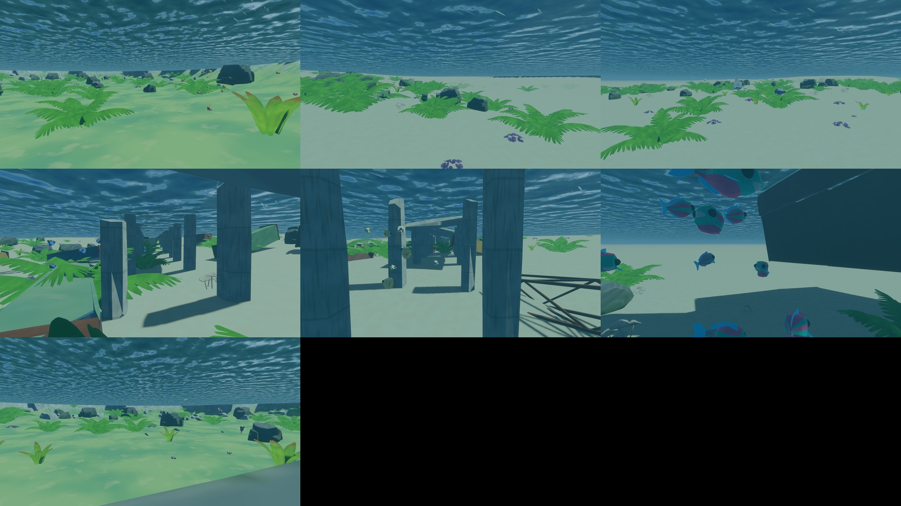

- **Modelos:** 32 espécies copiadas para `assets/vale/peixes/` (OBJ e MTL, 2,4 MB). Ficaram de fora o peixe-pescador, a piranha e o tubarão-duende, pelos dentes, e o que não é peixe (barco, píer, varas, iscas).
- **Cardumes de fundo** (`VidaAgua`): de 70 para 120 lugares, com 28 espécies em uso. Cada lugar tem uma espécie só:
  - no mar, 19 espécies pequenas (30 a 110 cm) em cardumes de 8 a 18; as que não andam em bando (linguado, baiacu, peixe-leão) em grupos de 3 a 6;
  - um lugar em cada seis, onde o mar tem mais de 6 m, é de peixe grande (tubarão, espadarte, atum, peixe-lua, napoleão, garoupa: de 1,1 a 3,8 m), sozinho ou em dois ou três, dando voltas largas;
  - na água doce (lagoa da represa e poço da cachoeira), carpas, peixes-dourados, bettas e tetras.
- **Peixes de superfície** (`Peixes`, na lagoa da clareira e no poço): também passaram a ser do pacote (carpa, dourados e tetra). O modelo é uma peça só, então o balanço da cauda virou um balanço leve do corpo inteiro.
- **Cor:** as cores do pacote vêm em valores lineares e o jogo as lia como de tela; os peixes saíam quase pretos. São convertidas e ficam um pouco mais vivas. Cada cor vira um material do vale (`VidaAgua.malha_de`).
- **Testes:** `--teste-vale` 84 pontos (120 cardumes, 28 espécies, 4 de água doce, 14 de peixes grandes), `--teste` 95.
- **Não conferido:** nada jogado. Os tamanhos foram escolhidos por mim; o tubarão de 3 a 3,8 m é manso como os outros (foge do robô). O modelo antigo `assets/vale/peixe.glb` ficou sem uso.

## 92. Teste de luz e cor (branch `visual-luz-e-cor`, 2026-11-18)

O usuário mandou seis imagens de referência de um jogo de floresta estilizada e perguntou, pedindo sinceridade, se dava para chegar perto. Resposta dada: na luz, na cor e no clima, sim; na modelagem das árvores e plantas, não sem modelos de artista. Ele pediu um teste numa branch nova.

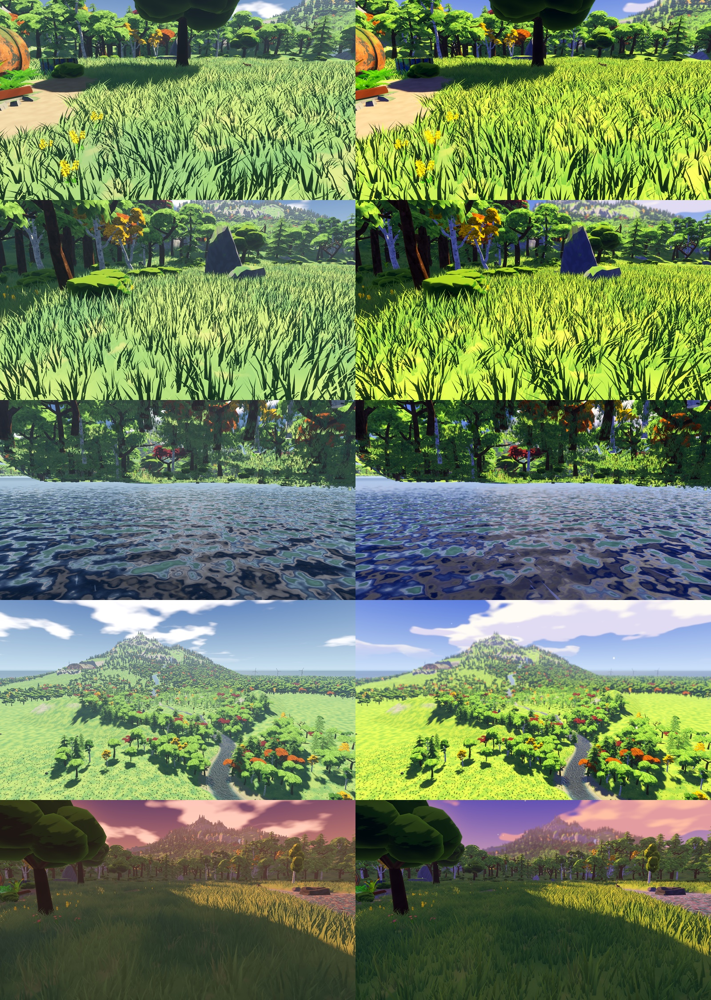

O visual novo tem uma chave: o parâmetro global de shader `estilo_novo` e `CicloDia.estilo_novo`. `-- --visual-antigo` mostra o de antes; `-- --vale-captura --largo --visual` tira as oito fotos do teste.

- **Sombra colorida:** a luz ambiente do dia puxa para o azul-violeta; o sol fica mais quente.
- **Capim:** verde-amarelado no sol, com a raiz mais funda e fria e a ponta clara.
- **Folhagem:** mais viva, e a luz atravessa as folhas (só nos materiais com recorte).
- **Distância:** a névoa azula mais cedo e o fundo desfoca de leve (`CameraAttributesPractical`).
- **Céu:** azul mais saturado; as nuvens tapam o céu em vez de somar luz, com borda firme e a barriga lilás.
- **Ar:** pólen flutuando em volta da câmera (`PoeiraLuz`), esverdeado à noite.
- **Cor geral:** mais saturação e contraste, brilho um pouco maior.

**O que não melhorou:** as árvores e o capim são os mesmos modelos. O capim continua em lâminas finas e escuras (as referências têm folhas largas, em tufos), e as copas continuam "de bloco". É aí que mora a maior diferença para as referências.
**Não conferido:** o custo do desfoque e do brilho no desempenho; como fica de noite e com chuva; nada jogado.

## 93. Visual novo aprovado, nado e o lago (2026-11-19)

O usuário testou a branch no PC: "a mudança de iluminação e visual novo ficou ótimo, pode aplicar no resto do mapa".

- **Resto do mapa:** a mudança já era global (shaders e ciclo do dia), então vale para a ilha toda. Conferido em fotos das regiões novas, dos marcos e da noite. Dois excessos corrigidos: a sombra dos paredões ficava roxa (a luz ambiente puxa menos para o violeta: 0,4 em vez de 0,6) e o chão visto do alto, limão (capim menos amarelo).

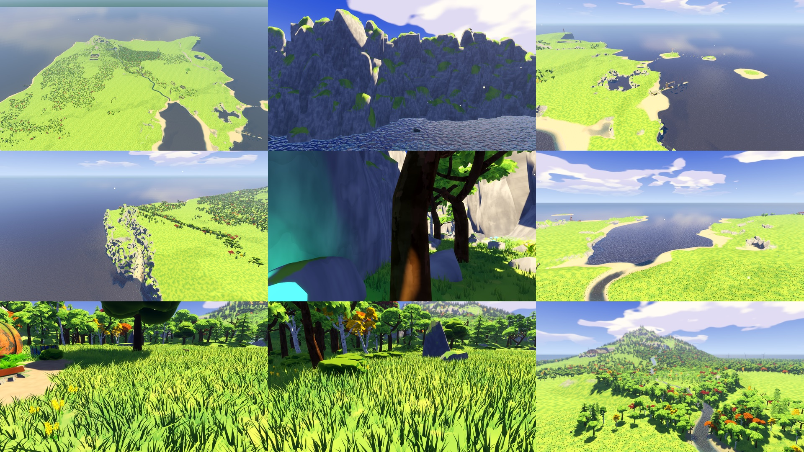

- **Nado** (ele achou que ainda não estava bom):
  - nadando, em velocidade normal ou alta, e apontando **10 graus ou mais para cima**, o robô rompe a superfície e sai voando nesse rumo (eram 30 graus e só acelerado);
  - **saiu o boiar de pé** na superfície, com os ombros de fora, e o subir sozinho até a tona: ele achou estranho. Parado, o robô fica logo abaixo da lâmina;
  - segurar o X na superfície continua decolando de pé.
- **Lago perto do cais** (a piscina natural grande da Costa Quebrada): tinha 0,7 m de fundura em toda a extensão. No gerador, o fundo passou a acompanhar o tamanho: piscina pequena continua rasa, e o meio de uma grande chega a uns 7 m.
- **Pacote de vegetação que ele achou** (a origem das imagens de referência): Stylized Nature Bundle, da Two Theories, na loja da Unity, 20 dólares, 64,5 MB, versão de 2021. Avaliação na conversa: os modelos e as texturas devem servir (pacote de Unity traz FBX e imagens), mas os shaders de folhagem são da Unity e teriam de ser refeitos na Godot; a página não mostrou o conteúdo nem a licença para uso fora da Unity. Nada comprado.
- **Testes:** `--teste-vale` 84 pontos, `--teste` 95.
- **Não conferido:** o custo do visual novo no desempenho; chuva; nada jogado depois destas mudanças.

## 94. Teste da mata: tufos, árvores tortas e pétalas (branch `visual-luz-e-cor`, 2026-11-18)

O que faltava do visual de referência eram os modelos. Antes de comprar pacote, testamos o que já estava no Mac e o jogo não usava, do Stylized Nature MegaKit Standard. A chave do teste é `Clareira.mata_nova()`: `-- --mata-antiga` volta ao de antes (e `-- --sem-tortas` tira só as árvores). Conversão: `tools/vale/pacotes_mata.py` (Blender).

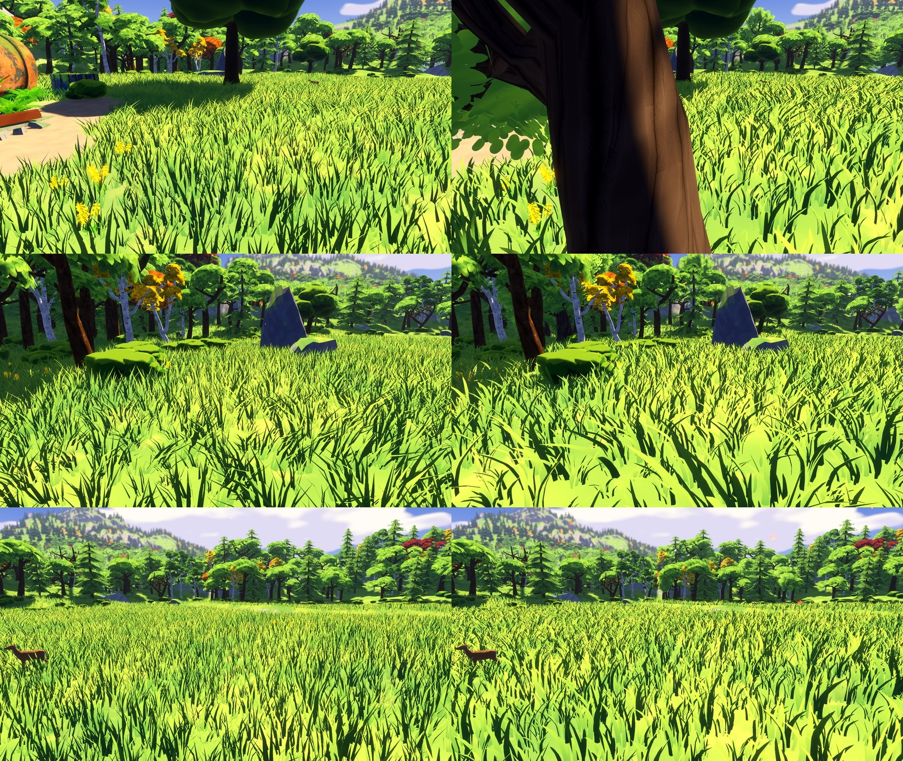

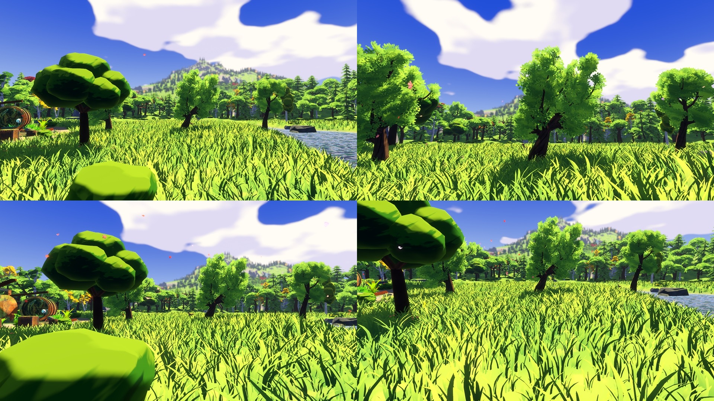

- **Capim em tufos** (`Grass_Common_Short` → `q_capim_a`): os tufos do pacote são folhas modeladas, sem textura (155 triângulos, contra 33 da touceira feita por código), então só a forma entra; a cor e o vento continuam no `vale_capim.gdshader` (parâmetro novo `altura`). O tufo abre 1,7 vez para os lados (`TUFO_LARGO`) e fica 1,4 vez mais espaçado (`TUFO_PASSO`): metade das touceiras, folhas curvas e largas. Os outros três tufos do pacote (326 a 622 triângulos) ficaram de fora por peso.
- **Árvores de tronco torto** (`TwistedTree_1/3/5` → `q_torta_a/b/c`): uma em cada sete árvores de folha larga (`tipo_variado`). No pacote cada uma tem 10 mil triângulos e mais de mil placas de folha sobrepostas; a primeira versão derrubou o fps em uns 20%. O conversor junta os vértices da casca e reduz a 20%, e fica com metade das placas de folha, maiores (2,6 a 3 mil triângulos de perto, 0,8 a 1 mil de longe). A textura das folhas é branca: a cor é a `tinta` do material `q_folha_torta`.
- **Pétalas no ar** (`PetalasAr`, `vale_petala.gdshader`, `Petal_1/3/5`): 72 pétalas em volta da câmera, levadas pelo vento do capim, girando, só de dia e sobre terra. O pólen (`PoeiraLuz`) ficou só para a noite, como vaga-lumes.
- **Desempenho** (Mac, fotos `--vale-captura --largo --visual`, mesmo momento): antes 33/31/31/32 fps nas vistas 1, 2, 4 e 5; depois 34/32/31/31. Os triângulos sobem de ~4 para ~6,7 milhões (o capim), sem custo medido.
- **Limites:** a colisão da árvore torta é a mesma das outras (tronco reto no pé), e o tronco delas se afasta do pé; as copas "de bloco" das árvores antigas continuam lá, lado a lado com as novas; nada foi jogado nem medido no PC.

## 95. Copas de bloco trocadas pelas do MegaKit, e a forma de sombra (2026-11-19)

O usuário pediu para trocar as copas "de bloco" por modelos do pacote. Elas vinham de dois lugares: os carvalhos postos à mão na clareira (os nossos antigos) e as árvores de folha larga da mata (`q_arvore_a` a `d`, do Textured Stylized Trees).

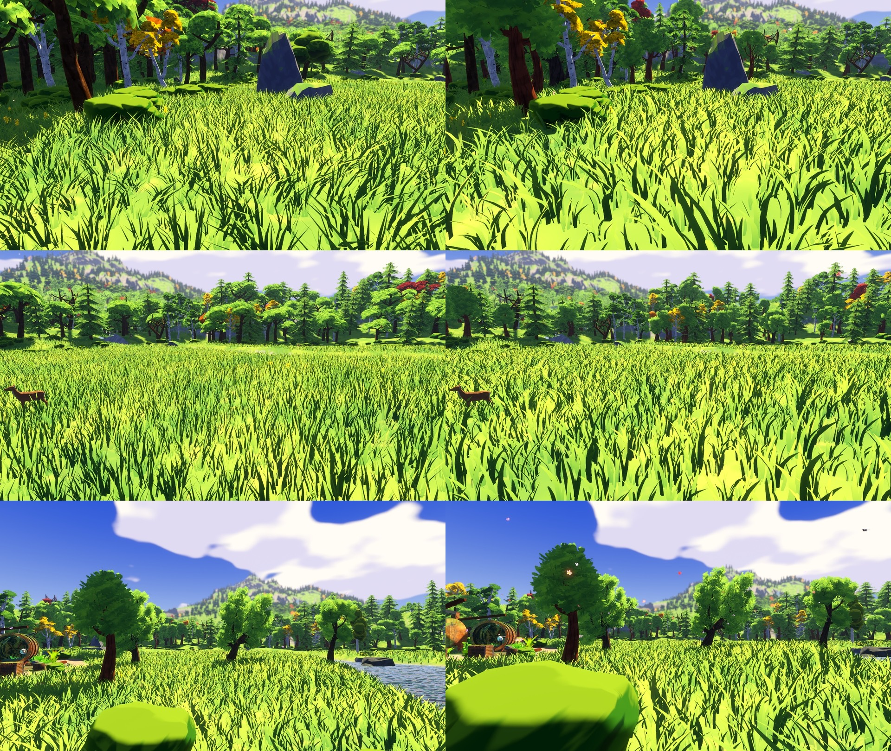

- **Árvores de folha larga:** as cinco `CommonTree` do MegaKit (`q_comum_a` a `e`), com casca reduzida a 900 triângulos e 450 placas de folha de perto (220 e 170 de longe). As variações vinho e laranja continuam, agora pela `tinta` (a textura da folha é branca). Na clareira, os três carvalhos postos à mão viraram `q_comum`. Com `--mata-antiga` volta tudo.
- **Ficam como estavam:** bétulas, pinheiros e árvores mortas; e os vultos de longe (além de 450 m), que ainda são as formas antigas.
- **O custo era a sombra, não a folha.** A troca derrubou o fps de 33 para 25. Cortar placas pela metade quase não ajudou (27); sem a sombra das árvores novas subiu para 37. Copa em placas com recorte é cara no mapa de sombra (quatro cascatas, cada placa pintada inteira).
- **Forma de sombra** (`Clareira.Q_SOMBRA`, `sombra_de`, modelos `_sombra`): as árvores do MegaKit não projetam sombra; quem projeta é um casco fechado da copa mais um tronco de 60 triângulos (150 no total), opaco, desenhado só no mapa de sombra (`SHADOWS_ONLY`). O conversor gera a forma de cada árvore.
- **Desempenho** (Mac, mesmas vistas): antes de tudo 33/31/60/31/33 fps nas vistas 1 a 5; com capim, árvores tortas, árvores comuns e pétalas 35/31/76/30/32. A lagoa e o capim de perto ganharam (60 → 76 e 59 → 79) porque sai sombra cara de cena.
- **Não feito:** a mesma forma de sombra nas bétulas e pinheiros (ganho provável, não medido); nada medido no PC; nada jogado.

## 96. O resto do pacote e o capim que abre para o robô (2026-11-19)

O usuário pediu todos os itens da lista do que ainda dava para usar do MegaKit, menos o capim fino (`Grass_Wispy`, pesado demais), e perguntou se o capim podia reagir ao robô.

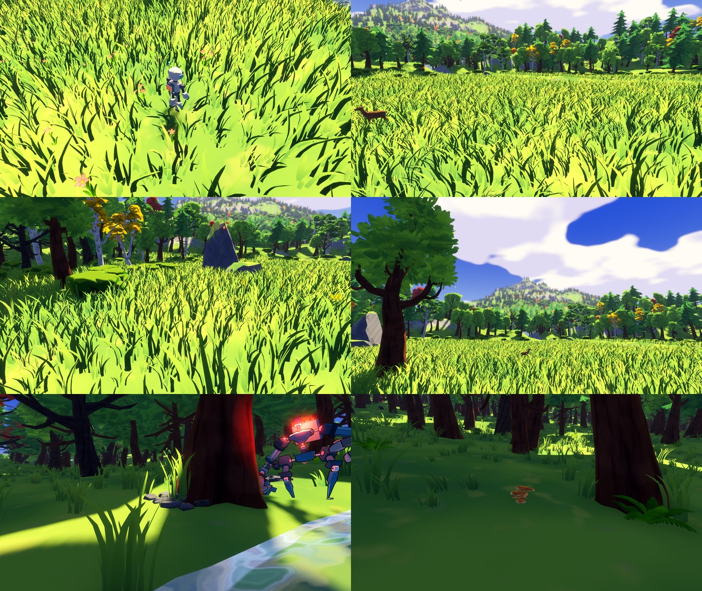

- **Forma de sombra** nas bétulas (`q_betula_a/b/c`, que vêm do outro pacote) e nos pinheiros novos. As árvores secas são só casca, opaca, e projetam a própria sombra.
- **Pinheiros do MegaKit** (`Pine_1` a `5` → `q_pinheiro_n_a` a `e`): no lugar dos do Textured Stylized Trees. O nome mantém "pinheiro" porque a colisão e os vultos procuram essa palavra. A folha é branca, tingida em `q_folha_pinho`.
- **Árvores secas** (`DeadTree_1` a `5` → `q_seca_a` a `e`), no lugar das `q_morta`. As da Fundição continuam as antigas.
- **As duas tortas que faltavam** (`TwistedTree_2` e `4` → `q_torta_d`, `e`).
- **Capim alto em manchas** (`Grass_Common_Tall` → `q_capim_alto`, 0,85 m): onde o ruído passa de 0,32 a mancha troca o tufo comum pelo comprido, com metade da densidade (`CapimVivo._criar`, `Clareira.capim_alto_malha`). Só fora da clareira do meio.
- **Miúdos no chão** (`Vale`, plantas do chão): nove seixos a mais, o segundo trevo, o cogumelo de tronco (`q_orelha`, em tufos no chão da mata; não está preso aos troncos) e as dez lajes de trilha (`q_laje_a` a `j`, reduzidas a 160–320 triângulos), soltas na beira de rio e lagoa como cascalho, nunca em linha.
- **Capim que abre para o robô:** parâmetro global de shader `robo_capim` (onde o robô pisa e quanto amassa: 1 no chão, 0 a 2 m de altura), atualizado por `EfeitosMato._process`. No `vale_capim.gdshader`, as folhas a menos de 1,25 m deitam para fora e baixam 60%. Custo: uma conta por vértice. O capim não guarda rastro: fecha de novo quando o robô sai. As flores não reagem.
- **Desempenho** (Mac, mesmas vistas): 34/29/82/30/32 fps nas vistas 1 a 5 (antes de tudo: 33/31/60/31/33).
- **Não conferido:** nada medido no PC; nada jogado; o capim abrindo só foi visto em foto parada, não em movimento.

## 97. Créditos dos peixes e limpeza (2026-11-19)

O visual novo e a mata do pacote foram para a `main` (merge da branch `visual-luz-e-cor`, apagada). O projeto ganhou um `README.md`.

- **Créditos:** o *Cute Fish Pack* (Quaternius, CC0) e o que entrou do MegaKit estão no `CREDITOS.md`.
- **Saíram do repositório:** as árvores do Textured Stylized Trees que a mata não usa mais (`q_arvore_a/c/d`, `q_pinheiro_a/b/c`, `q_morta_a/b/c`, com as versões de longe), três texturas de folha e o `peixe.glb` antigo. Ficou `q_arvore_b`, que é a Árvore-Mãe.
- **Saiu a chave `--mata-antiga`** (e `--sem-tortas`): `Clareira.mata_nova()` não existe mais, e a touceira feita por código também não. `--sem-pacotes` continua.
- **Trocas pequenas:** as árvores secas da Fundição e as plantas do Sono dos Gigantes passaram para os modelos do MegaKit.
- **Pendência riscada:** "preencher o norte e o oeste" já estava feito (Torres do Vento e Observatório).
- **Pendências que continuam:** revisão dos textos das memórias; equilíbrio da Fundição com tiro sem calor; trancos da câmera e robôs da forja por confirmar jogando; desempenho no PC; chuva e noite com o visual novo; vultos de longe e moitas ainda de bloco; colisão da árvore torta; contêineres do fundo do cais pouco visíveis; água da Costa Quebrada; Terrain3D com 3 km.

## 98. Lajes da margem trocadas por seixos (2026-11-19)

O usuário notou na borda dos rios "blocos de pedras que parecem usados pra fazer estrada". Eram as dez lajes `RockPath` do MegaKit (seção 96): cada modelo é um conjunto de pedras chatas já unidas, feito para calçar caminho, e espalhadas na margem davam cara de estrada. O vale não tem estradas.

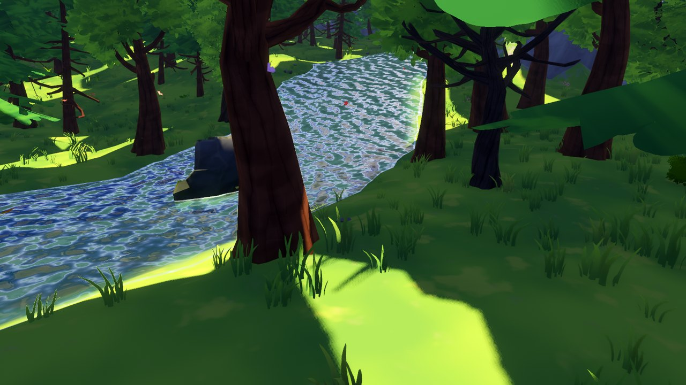

- **Saíram** os dez modelos `q_laje_a` a `j` (arquivos, lista `Q_PLANTAS` e a conversão em `tools/vale/pacotes_mata.py`). Não usar os `RockPath` do pacote no chão do vale.
- **No lugar:** os seixos soltos (`q_seixo_a` a `k`), com tamanho de 1,3 a 2,2, na mesma faixa de 4 m da água (`Vale`, plantas do chão).
- **Foto de conferência:** `plantas_amostra["margem"]` guarda um ponto de margem; a captura tira `v2NN_margem` e `v30_margem_aberta`.
- **Como ficou:** a margem está quase limpa; os seixos são pequenos e escuros, pouco visíveis no meio do capim. Se a beira parecer vazia, o caminho é aumentar ou clarear os seixos, não voltar às lajes.
- **Desempenho** (Mac): 34/28/82/29/31 fps nas vistas 1 a 5, igual a antes.

## 99. Quatro relatórios e os defeitos do QA (2026-11-19)

A pedido do usuário, quatro agentes (modelo Opus) rodaram no jogo, cada um num papel: jogador tester, QA sênior, game dev sênior e designer sênior. Nenhum jogou com as mãos; cada relatório marca o que foi visto rodando, lido no código ou deduzido. Estão em `docs/relatorios/`. O usuário escolheu começar pelos defeitos do QA.

**Corrigidos** (numeração do relatório do QA):

- **D1, tela preta depois de "Voltar à base" na pane:** `Armadura.recomecar` agora emite `saiu_pane` quando estava em pane, e a `Pane` guarda o tween para o de escurecer não terminar depois do de clarear.
- **D2 e D3, pausa por cima da memória:** `Pausa.pode_abrir()` recusa abrir com o jogo já parado por outra tela, e `Pausa._continuar` não faz nada com a pausa fechada. O Esc numa memória só fecha a memória.
- **D10, pausa dentro da oficina:** a oficina entra no grupo `sem_pausa` e responde `ocupada()`; a pausa não abre com ela em uso. Para sair do jogo dali, é preciso sair da oficina antes.
- **D5, oficina com o drone instalando:** `Oficina.entrar` e o convite do quadrado conferem `armadura.travado`.
- **D4, "Apagar o progresso" voltava:** `Guardado.apagado` trava a gravação do progresso até o jogo ser fechado. O botão passou a dizer "feche e abra o jogo para recomeçar". A partida em curso continua com o que tinha na memória.
- **D7, sem chão além de 1.500 m:** um fundo plano de 12 km de lado (uma caixa; o `WorldBoundaryShape3D` no Jolt só alcança 1 km do corpo), meio metro abaixo do ponto mais fundo do mapa (-14 m), no corpo `ChaoFora`. Lá fora o robô ainda passa do fundo desenhado até esse plano.
- **D8, Esc nas páginas da pausa:** o Esc volta uma página, como o círculo; o Options fecha a pausa inteira.
- **D9, tabela de comandos:** "Parar no ar: L2 · R3 / F" e, em linha própria, "Manobra (giro para o lado): O / C". A dica da mira diz que ela se fabrica na oficina.

**Teste novo:** o ponto 34 da bateria do vale (`_ponto_34`, "telas") cobre D1, D2, D3, D4, D5, D7 e D10.

**Não corrigidos, por serem decisão de desenho ou suspeita sem confirmação:** D6 (o drone prende o robô de 3 a 5 s mesmo em luta), D11 (sair da Fundição pela pausa evita perder metade dos materiais), D12 (interface em pixels fixos numa TV 4K), D13 a D21. Os buracos de cobertura (salvar e carregar, outras taxas de quadro, a build do PC) continuam.

## 100. Recomeço limpo, drone fora da luta, pane sem atalho, interface que escala e controle desconectado (2026-11-19)

Cinco decisões do usuário depois de ler a seção 99.

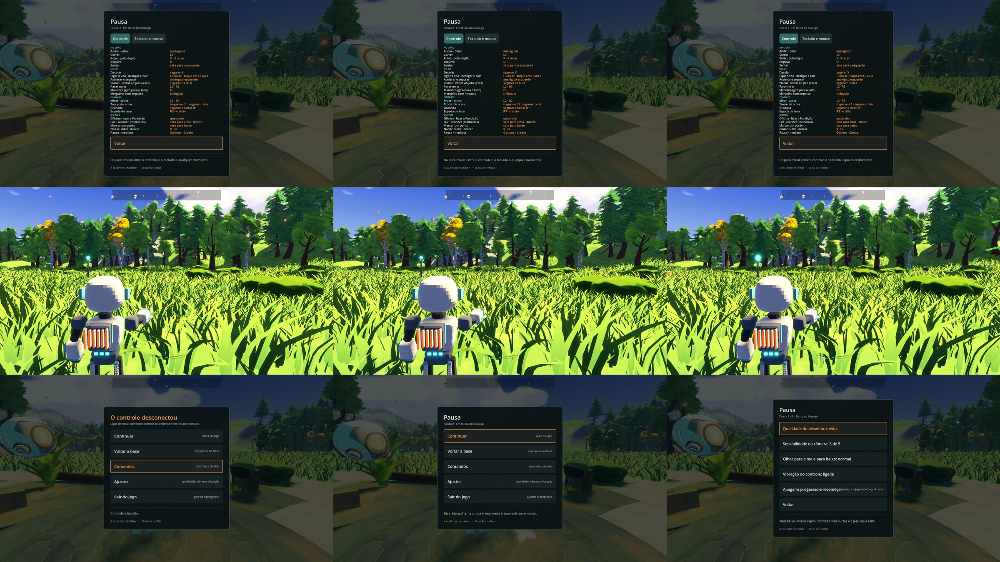

- **Recomeçar limpo sem fechar na mão:** "Apagar o progresso e recomeçar" (Ajustes, dois toques) zera o progresso e o jogo fecha e abre sozinho (`OS.set_restart_on_exit`), já limpo. Recarregar só a cena não serve: peças, armas, lugares e memórias vivem em variáveis estáticas de muitas classes. `Guardado.apagado` continua travando a gravação na saída.
- **O drone não instala no meio de uma luta:** `PecasMundo._luta_perto()` olha o grupo `maquinas`; com alguma ligada a menos de 45 m (`LUTA_RAIO`), o drone espera. As máquinas perto de peças continuam onde estão.
- **Em pane não há "Voltar à base":** o botão fica desligado, com o texto "robô desligado: aguarde o drone", e `Pausa._voltar` recusa. Isso fecha o atalho que evitava a perda de metade dos materiais na derrota da Fundição. Sair da Fundição pela pausa **antes** de cair em pane continua sem perda.
- **Interface que escala com a tela:** `window/stretch/mode = canvas_items` e `aspect = expand` no `project.godot`, com base em 1600×900. HUD, pausa, memória e oficina ficam com o mesmo tamanho relativo em qualquer resolução (conferido em fotos a 1280×720, 1600×900 e 2560×1378). O 3D segue na resolução da tela.
- **Controle desconectado:** `Pausa._controle_mudou` (sinal `joy_connection_changed`) para o jogo e abre a pausa com o título "O controle desconectou" e a linha "Ligue de novo, use outro controle ou continue com teclado e mouse". Ao reconectar, o título vira "Controle conectado". Não abre por cima de uma memória nem dentro da oficina.
- **Teste:** o ponto 34 da bateria do vale passou a cobrir o botão travado em pane, o aviso do controle e a espera do drone. A captura `--pausa` ganhou a foto `p6_controle_desconectou`.
- **Não conferido:** o reinício automático (não roda sem janela, e no PC depende de como o jogo é aberto pela Steam); a desconexão de um DualSense de verdade; a interface numa TV 4K real.

## 101. Trancos e desempenho, primeira leva (2026-11-19)

A partir do relatório do game dev (`docs/relatorios/game-dev-senior.md`), que mediu onde vai o tempo. O usuário escolheu esta frente depois dos defeitos do QA.

**Os trancos (processador):**

- **Colisão das árvores por célula.** Antes havia um corpo só com 900 formas, reescritas a cada 12 m andados ou voados: de 20 a 28 ms de cada vez (medida do game dev). Agora cada célula de 32 m da grade de árvores ganha um corpo próprio (`Ilha._criar_celula_colisao`), feito uma vez quando o robô chega a uns 95 m e solto além de 185 m. A mesma chamada (`atualizar_colisao_arvores`) passou a custar 0,34 ms na mediana e 2,7 ms no pior caso (40 passos de 12,5 m sobre a mata, cronometrado sem janela). Saiu o limite de 450 árvores com colisão. Os testes desligam a colisão com `colisao_arvores_ligada(false)`.
- **Capim em segundo plano.** As contas de cada bloco (uns 3 mil sorteios com altura e água) saíram do quadro principal para tarefas do `WorkerThreadPool` (`CapimVivo._calcular`, `_calcular_longe`, até duas ao mesmo tempo), que só leem o mapa. O quadro principal só monta o MultiMesh com o `buffer` pronto (`_montar`). Antes: de 8 a 10 ms por bloco, um bloco por quadro. Agora o `_process` do capim fica em 0,01 ms na mediana e 0,25 ms no pior quadro (300 m andados nos campos do sul).

**O quadro (placa):**

- **Sombra de contato e desfoque por nível de qualidade** (`Qualidade.NIVEIS`): SSAO desligado na baixa, leve na média e como era na alta; desfoque do fundo só na alta. Antes valiam iguais nos três.
- **Shader sem `discard` para o que não tem recorte** (`vale_tex_opaco.gdshader`, escolhido em `Clareira._tex_q` quando `corte` é 0): cascas, pedras, seixos e cogumelos. A troca por distância dessas peças ficou seca, sem a trama pontilhada.

**Medidas no Mac** (mediana do tempo de quadro, 1600×900; o "antes" é a tabela do game dev, medida com uma bateria de testes rodando ao lado):

| Vista | Alta antes → depois | Média antes → depois | Baixa antes → depois |
|---|---|---|---|
| Mata fechada, no chão | 34,4 → 27,8 ms | 29,2 → 22,0 ms | 24,1 → 15,8 ms |
| Base, olhando o campo | 33,6 → 32,2 ms | 27,3 → 24,8 ms | 21,6 → 18,0 ms |
| Sobre a mata, a 60 m | 39,1 → 37,4 ms | 32,6 → 28,8 ms | 26,9 → 18,7 ms |
| Campos do sul | 16,2 → 16,2 ms | 14,0 → 13,3 ms | 11,7 → 13,5 ms (no teto da tela) |

Fotos de conferência na alta: 38/31/75/31/34 fps nas vistas 1 a 5 (antes 34/28/82/29/31; a lagoa bate no teto da tela).

**Não feito, fica para decidir com foto:** folhas desenhadas de um lado só (3,5 a 6,4 ms, mas metade das placas some vista de trás); antisserrilhado mais leve (3 a 6 ms, o recorte serrilha mais); impostores na meia distância; capim fixo da clareira (5 ms na base); câmera que bate nas copas; interpolação de física do motor para 120/144 Hz.

**Não conferido:** nada medido nem jogado no PC, que é onde os trancos apareciam inteiros; o "antes" dos trancos é a medida do game dev, não minha; noite, chuva e Fundição não foram medidas.

**Pendência pequena:** a foto `v2NN_margem` deixou de sair (o ponto de amostra da margem só é guardado quando as plantas são geradas, não quando vêm do cache).

## 102. Ensinar os comandos: imagens dos botões e a simulação (2026-11-19)

O jogador tester e o designer puseram em primeiro lugar que o jogo não ensina nada. O usuário propôs um lugar de treino "dentro da cabeça do robô": vazio, sem limite para voar, com um tutorial que mostra a imagem de cada botão, de onde se sai com o Start e aonde se volta pela pausa, abrindo sozinho num save novo; e, no mundo, dicas do robô sobre a oficina e a forja. Combinado em quatro etapas: (1) imagens dos botões e o aviso na tela; (2) a simulação com um trecho obrigatório curto; (3) estações opcionais (combate, armas, scanner, nado); (4) dicas do drone no mundo. Esta seção cobre as etapas 1 e 2.

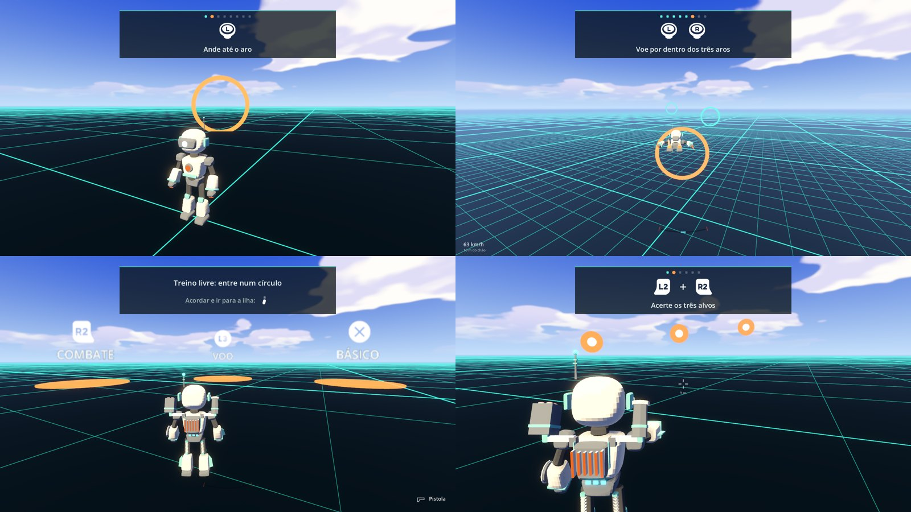

**Etapa 1, imagens dos botões:**

- **Pacote:** Input Prompts 1.5a do Kenney (CC0), baixado com permissão para `Projects/others/bibliotecas/kenney-input-prompts/`. Para o jogo foram 44 imagens de 128 px (`assets/ui/botoes/`): DualSense, teclado e mouse.
- **`Botoes`** (`scripts/botoes.gd`): num texto, `{acao}` vira a imagem do botão daquela ação no aparelho em uso, e `{@nome}` uma imagem certa. `Botoes.observar` (chamado de `Main._input`) guarda se o último toque veio do controle ou do teclado e mouse; as imagens trocam sozinhas. `Botoes.desenhar` serve a quem desenha no `_draw`; `TextoBotoes` é o nó para telas de nós.
- **Onde entrou:** o convite da oficina e o da Fundição no HUD (`{agir}  entrar na oficina`) e a tabela de comandos da pausa, que agora mostra as imagens nas duas abas.

**Etapa 2, a simulação:**

- **O mundo** (`SimMapa`, `scripts/simulacao/sim_mapa.gd`, extends `Ilha`): um chão plano com uma grade de luz (`sim_chao.gdshader`), sem relevo, água nem árvores. O chão e a colisão acompanham o robô, então não há borda. Usa o céu e a luz do vale, parados ao meio-dia. Monta em menos de um segundo.
- **As lições** (`Tutor`, `scripts/simulacao/tutor.gd`): oito, uma de cada vez num cartão no alto da tela, com a imagem do botão em tamanho grande e uma frase curta; só passam quando o jogador faz o que pedem. Olhar; andar até um aro; correr até um aro; pular e pular de novo no ar; segurar o pulo para decolar; voar por dentro de três aros; ver o motor esquentar; pousar. Depois fica "Pronto! Pode treinar à vontade. Acordar: Options".
- **Entrar e sair:** num jogo novo (nunca visto e nenhum lugar visitado) o jogo abre na simulação. Na pausa dela há "Acordar" (vai para a ilha) e "Voltar ao começo"; na pausa do mundo há "Simulação" (treinar de novo). `Main.trocar_mundo` recarrega a cena; só voltar ao vale pela segunda vez no mesmo processo é que faz o jogo fechar e abrir sozinho, pelo mesmo motivo do "Apagar e recomeçar" (seção 100). O save ganhou `simulacao_vista`.
- **O robô da simulação** é o do começo do jogo, sem melhorias, e nada do progresso é lido nem gravado lá.
- **Bateria própria:** `tools/teste_simulacao.gd` (12 pontos, uns 40 s): monta a simulação, faz cada lição e confere que fecha, confere o chão a 6 km do começo e, com janela, tira as fotos `tools/capturas/simulacao/`. A troca simulação → vale → simulação foi conferida à parte, sem janela.

**Diferente do pedido:** o Start abre a pausa da simulação, com "Acordar" logo abaixo de "Continuar", em vez de sair direto (combinado com o usuário). As estações opcionais e as dicas do drone no mundo são as etapas 3 e 4 (seção 103).

**Não conferido:** nada jogado com as mãos; o fechar e abrir sozinho; se uma criança que não lê entende os aros e os botões.

## 103. Ensinar os comandos: treino livre e dicas do drone (2026-11-19)

As etapas 3 e 4 do plano da seção 102.

**Etapa 3, o treino livre na simulação:**

- Depois do básico (ou logo de cara, para quem volta à simulação pela pausa) aparecem três círculos no chão, cada um com a imagem de um botão e o nome: **BÁSICO**, **VOO** e **COMBATE**. Pisar num círculo começa a sequência dele; no fim, volta ao treino livre (`Tutor._livre`, `_ver_postos`, `SEQUENCIAS`).
- **Voo:** decolar, parar no ar, arrancada, manobra (giro), abrir as asas e o mergulho com impacto.
- **Combate:** mirar; acertar três alvos; trocar de arma; granada; espada; esquiva. Os alvos (`AlvoTreino`, `scripts/simulacao/alvo_treino.gd`) são esferas de luz no grupo `maquinas`: levam tiro, míssil, granada e impacto como as máquinas do vale, desligam com dois acertos e religam em 8 s.
- **O robô do treino livre tem tudo:** as dez peças e todas as armas (`Tutor.equipar`). É só dentro da simulação: `Guardado.sem_progresso` impede qualquer gravação de progresso lá, fora a marca de que a simulação foi vista. O básico continua com o robô do começo do jogo.
- **Ficaram de fora da simulação:** nado e scanner (não há água nem o que escanear lá). Esses dois são ensinados no mundo, pelas dicas.

**Etapa 4, as dicas do drone no mundo** (`Dicas`, `scripts/vale/dicas.gd`):

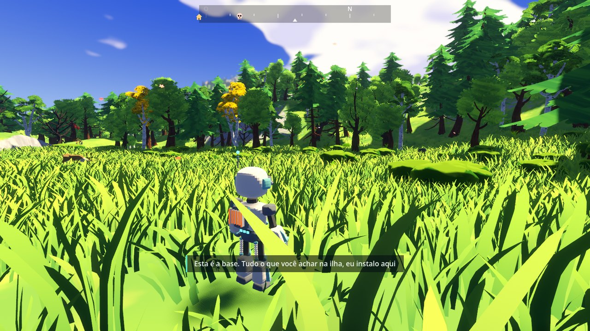

- Uma frase curta com a imagem do botão, numa faixa acima do convite de botão (`Hud.aconselhar`), por 10 s; o drone apita e olha em volta. Cada uma aparece **uma vez só** (o save guarda em `dicas`), e há pelo menos 14 s entre duas.
- **As nove:** chegada à base; oficina (a menos de 22 m do cilindro); primeira peça achada; a Fundição existe (depois da primeira instalação); o painel da Fundição e a perda de material; água (subir e descer, esfria o motor); motor quente; cristal de memória por perto; máquina antiga por perto (elas desligam; mirar e atirar).
- Nas fotos de conferência as dicas ficam de fora, a não ser com `--dicas`.

**Testes:** a bateria da simulação foi a 25 pontos: os círculos, o robô equipado, o save fechado, e as sequências de combate e de voo (mirar, acertar os três alvos, trocar de arma, granada, espada, esquiva, decolar e parar no ar com os botões de verdade; arrancada, manobra, asas e mergulho pelas condições). O ponto 35 da bateria do vale cobre as dicas.

**Não conferido:** nada jogado com as mãos; se os textos das dicas estão no tom certo; se 10 s bastam para ler; as dicas da água, do calor, da memória e da Fundição só foram conferidas pelo código (o teste cobre a chegada e a oficina).

## 104. Relatórios: o que não dependia de decisão (2026-11-19)

Uma leva de ajustes pedidos nos relatórios do jogador tester e do game dev que não mexem em regra do jogo.

- **Pulo guardado** (game dev): apertar o pulo caindo, a menos de 55 cm do chão, não gasta mais o pulo duplo; o aperto fica guardado por 0,14 s e vira um pulo ao pousar (`Armadura._pulo_guardado`). Coberto no ponto 35 da bateria do vale.
- **Mira, distância, velocidade e altura com contorno escuro** (tester): sumiam sobre o capim claro. O trilho do arco do calor ficou largo e escuro pelo mesmo motivo.
- **Bússola** (tester): a faixa ficou mais escura; a base e a Fundição, quando estão fora dos 120° da faixa, viram uma setinha na ponta do lado certo, em vez do ícone inteiro preso ali.
- **Fotos de conferência:** a vista `v6_voo_baixo` passou a medir a altura acima do chão (estava debaixo dele desde o relevo de 3 km), e o ponto da foto da margem volta a ser achado quando as plantas vêm do cache.

**O que sobra dos relatórios e depende do usuário** (levado a ele em 2026-11-19):

1. O X no voo cortar os jatos (tester e designer pedem que deixe de cortar; a doc mostra três idas e vindas).
2. A caveira da Fundição na bússola (trocar por um ícone neutro que só aparece depois da primeira visita).
3. As máquinas perto do começo e das recompensas: o mecha a 120 m da base, a dupla dos Arcos, o grande ao lado da peça das molas.
4. Sinal para as memórias (um ponto âmbar na bússola a menos de 300 m) e a região da peça na oficina.
5. Um "Caderno" na pausa: lugares visitados, memórias para reler, o que o scanner já leu.
6. Um fim: com as dez memórias, acender o Farol.
7. A ordem das peças (o radiador duplo cedo demais; o prêmio mais distante é fraco).
8. O chão: câmera mais alta e capim que abre também perto da câmera.
9. Retomar de onde parou e "Continuar / Novo jogo" na abertura.
10. Desempenho que muda o visual: folhas de um lado só, antisserrilhado mais leve, árvores de meia distância em cartão.
11. Câmera que bate nas copas, zona morta do analógico, interpolação para telas de 120/144 Hz.
12. Conteúdo: uma ação por lugar marcante, peças que abrem lugares, bichos com papel, música de vez em quando, luzes de noite nos marcos.

## 105. Relatórios: os seis ajustes recomendados (2026-11-19)

O usuário aprovou os seis primeiros itens da lista da seção 104 ("faz os recomendados").

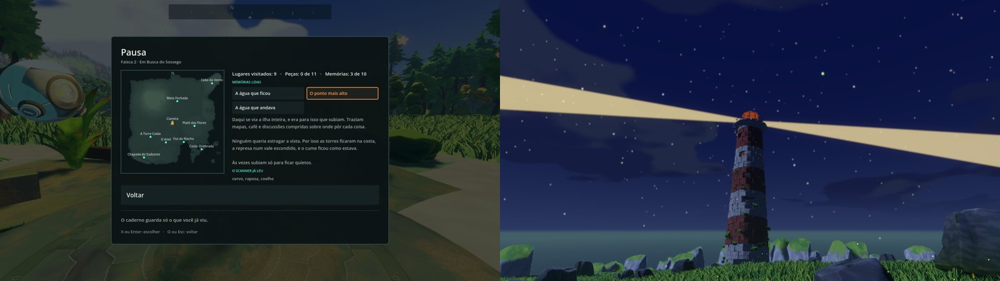

1. **O X no voo não corta mais os jatos.** Só o toque no L3 (Shift) corta. Segurar o X ainda troca jato e planador, com as asas. Era pedido do usuário de 2026-11-17 que os dois cortassem; mudou porque o X é o botão de pular e a criança caía do céu sem querer. A tabela da pausa e a lição "pousar" da simulação passaram a mostrar o L3.
2. **A Fundição na bússola é uma engrenagem, e só depois da primeira visita** (`Hud._fundicao_vista`, pelo lugar "A Fundição" visitado). A caveira saiu.
3. **A luta fora do caminho do sossego** (`InimigosVale.LUGARES`, `Main`): a dupla dos Arcos foi para o Pátio das Máquinas (-680, 190); o mecha que ficava entre a base e a cachoeira (-250, -330) foi para o oeste (-860, -430); o grande da Torre Caída ficou a uns 125 m da peça das molas (-750, 500); e o da clareira saiu de 120 m da base para uns 210 m (-128, -118).
4. **Memórias na bússola:** um losango âmbar para cada memória não lida a menos de 300 m, como a antena faz com as peças. Fora da faixa, vira setinha na ponta.
5. **Caderno na pausa** (`Pausa._abrir_caderno`, `MapaCaderno`): o contorno da ilha com só os lugares já visitados, a base e onde o robô está; as contas; as memórias lidas, para reler ali mesmo; e o que o scanner já leu. Nada do que falta aparece, fora o total de memórias, que o jogo já mostrava.
6. **Um fim: acender o Farol** (`FarolFinal`, `scripts/vale/farol_final.gd`). Com as dez memórias lidas, o drone avisa, a bússola ganha um sol âmbar no rumo do Farol e, a menos de 16 m da lente, aparece o convite `{agir}  acender o Farol`. Acender mostra uma última página e os créditos; depois o farol gira para sempre e o jogo continua. O feixe só existe do fim da tarde ao amanhecer: de dia a lente apenas brilha de leve, porque o cone é uma malha colorida e ao sol ficaria forte demais (aviso do usuário, pelo farol da Ilha Cafuné). O save guarda `farol_aceso`. Não há luta nem contagem.

**Teste:** o ponto 36 da bateria do vale cobre os itens 2, 3, 5 e 6; o item 1 está na bateria de voo e na da simulação.

**Textos novos, escritos por mim e por revisar:** a última página do Farol ("Foi a última luz que eles apagaram...") e a dica do drone que aponta para ele. Entram na mesma revisão dos textos das memórias, que continua pendente.

**Não conferido:** nada jogado com as mãos; o chão onde as máquinas movidas ficaram só foi conferido pelo teste (existem e estão longe do que deviam), não por foto; o sinal das memórias na bússola não tem teste próprio.

## 106. A câmera no mergulho com impacto (2026-11-19)

O usuário, jogando: "a câmera não acompanha bem o movimento do robô quando uso triângulo no ar, talvez a câmera deva inclinar pra observar o robô num ângulo mais acima pra ver o movimento de ataque até o solo".

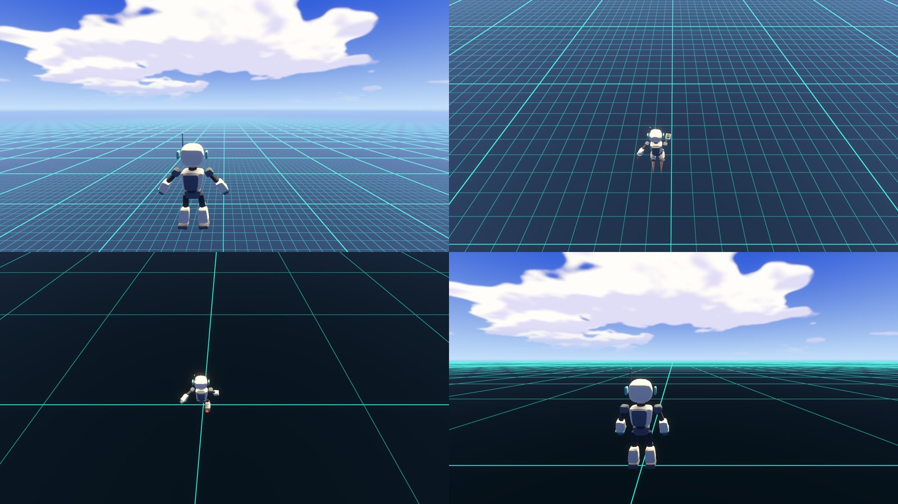

- No mergulho o robô desce a 42 m/s. A câmera ficava para trás na vertical (o atraso da velocidade) e mantinha o ângulo que o jogador tinha: o robô saía por baixo do quadro e a batida não se via.
- Agora, enquanto `armadura.mergulhando` (`CameraVoo._mergulho`): o ângulo vai para 52° olhando de cima (ou fica como está, se o jogador já olhava mais de cima), a distância cresce 55% e o atraso vertical cai 85%. Fica assim 0,55 s depois da batida e volta ao ângulo do jogador em meio segundo.
- O ângulo do jogador (`pitch`) não é mexido: a inclinação entra só no que a câmera mostra (`pitch_visto`), então a mira e o rumo do voo não mudam.
- Coberto na bateria da simulação (26 pontos).
- **Não conferido:** só vi em fotos paradas, na simulação; o movimento em si e o mergulho na mata (onde a câmera pode bater numa copa) ficam para o usuário sentir.

## 107. O céu da simulação (2026-11-19)

O usuário, vendo as fotos: "o céu não condiz com o cenário de simulação". A simulação usava o céu do vale ao meio-dia, com nuvens.

- Agora o ciclo do dia para na simulação (`Main._ceu_da_simulacao`) e entra o `sim_ceu.gdshader`: um escuro fechado, da cor do chão no horizonte (o chão some nele, sem borda), com um brilho fino na linha do horizonte e uma grade de cúpula apagada. Sem nuvens, sem névoa.
- O sol continua, mais frio e mais alto, só para o robô ficar bem iluminado.
- A foto da seção 102 (`visual/simulacao.jpg`) foi refeita com o céu novo.
- **Não conferido:** só em foto; a leitura do robô branco contra o escuro em movimento fica para o usuário.

## 108. Relatórios: peças, chão, retomar e câmera nas copas (2026-11-19)

O usuário mandou seguir com a lista da seção 104. Feitos os itens 7, 8, 9 (em parte) e 11 (em parte).


- **Item 7, ordem das peças:** o radiador duplo e os bocais trocaram de lugar. O duplo (que triplica o tempo de voo) ficava nas costas do maior gigante, a 588 m da base, e acabava com o calor nos primeiros minutos; agora está no balcão do Farol, a 1,9 km, e é o prêmio mais distante. Os bocais foram para o gigante. O resto da proposta do designer (juntar molas e células, peças que abrem lugares) não foi feito.
- **Item 8, o chão:** o capim baixa 80% num raio de uns 2 m da câmera quando ela está rente ao chão (`vale_capim.gdshader`), a câmera do chão subiu uns 20 cm e recuou de 3,8 para 4,3 (`Ajustes.CAM_DIST_CHAO`). As folhas do primeiro plano não cobrem mais o robô.
- **Item 9, retomar de onde parou:** o jogo anota a cada segundo o último chão firme (`Main._anotar_firme`: no chão, fora de pane, sem estar preso e com a Fundição parada), guarda no save (`posicao`) e abre ali, com a câmera virada como estava. Antes abria sempre na base. A tela de "Continuar / Novo jogo" na abertura **não** foi feita; recomeçar continua em Ajustes.
- **Item 11, câmera nas copas:** as copas de cada célula viraram um corpo à parte (`Ilha.rids_copas`) e o raio da câmera as ignora; o robô e os tiros continuam batendo nelas. A zona morta do analógico de andar caiu de 0,2 para 0,12. A interpolação de física do motor para telas de 120/144 Hz **não** foi feita.
- **De passagem:** a dica "Esta é a base" só aparece perto da base, já que o jogo pode abrir longe dela.
- **Teste:** dois pontos na bateria do vale (as peças nos lugares novos; o chão firme e as copas).

**Não conferido:** nada jogado com as mãos. A câmera subir e recuar no chão e a zona morta menor são mudanças de sensação: só jogando se sabe se ficaram melhores. O retomar foi conferido uma vez à mão, abrindo o jogo com um save de teste numa pasta temporária: o robô apareceu no ponto guardado, de pé no chão, e um ponto enterrado subiu para o chão de agora. Não há teste automático disso (as baterias não usam o save).

**Sobram da lista:** o item 10 (desempenho que muda o visual) e o 12 (conteúdo novo), mais os pedaços não feitos acima.

## 109. Os robôs de fora foram testados e saíram; o que ficou (2026-11-19)

Foram testados no lugar do robô de peças o GDbot da GDQuest (como veio e numa versão "menino"), e um boneco animado do Quaternius. O GDbot agradou no visual, mas cada pose do jogo (mira, voo, nado, esquiva, espada, sentar) teve de ser remendada por cima das animações prontas dele, e a arte dele é de uso não comercial. **Decisão: o robô do jogo continua sendo o nosso, de peças, e o visual dele é que vai ser redesenhado.** Tudo dos robôs de fora saiu do projeto (addons, modelos, scripts, os três cilindros de troca na base, o ajuste "Modelo do robô"). O experimento ficou guardado, fora do jogo, em `bibliotecas/gdquest-3d-characters/teste-no-faisca-2/`.

Do período ficaram, valendo para o robô de peças:

- **Velocidade no chão:** 3,0 m/s andando e 7,5 correndo no vale (eram 2,1 e 6,3). `Armadura.vel_andar`, `vel_correr`, lidas por `Armadura.andar()` e `correr()`.
- **Esquiva no voo:** um pico de velocidade lateral de 24 m/s que vale inteiro por 0,34 s e depois é freado forte (`MANOBRA_PICO`, `MANOBRA_VEL`, `exp(-14·dt)`), em vez de ir morrendo devagar.
- **Sentar saiu do jogo** (`Armadura.pode_sentar := false`; a lógica fica, desligada). Falta pensar em outra coisa para "aproveitar a vista".


## 110. O robô redesenhado e a baia com os cilindros vazios (2026-11-19)

O robô do jogo passa a ser `assets/vale/robo_v2.glb`, gerado por `tools/vale/robo_v2.py` (Blender; a mesma chamada faz a folha de estudo ou, com `EXPORTAR=`, o glb). É o robô de peças redesenhado, com os traços que agradaram no teste do GDbot mas desenho nosso: placas de armadura com cantos chanfrados, cabeça grande com visor escuro e dois olhos de tela, aba na testa, placas azuis nas laterais e uma faixa azul que acompanha a curva do capacete; tronco pequeno, luvas e botas grandes, juntas pretas; branco, azul e laranja. Tem os dois estabilizadores com chama no meio das costas e as abas nas juntas `aleta`.

- **Mesmas juntas, outros lugares.** Os nomes das juntas são os do `robo.py`, então as poses do `ArmaduraVisual` valem sem mudança; as posições mudaram (pernas mais curtas, cabeça mais baixa e maior). A altura continua 1,2 m.
- **Materiais.** `placa_clara`, `placa_escura` e `detalhe` continuam com esses nomes (as peças das melhorias leem as cores deles); entraram `laranja` e `vidro`, que o `ArmaduraVisual` também pinta no estilo do vale. O branco é 0,50 no gerador: mais claro que isso estourava no brilho da simulação.
- **Peças das melhorias.** Foram medidas no robô anterior. `MelhoriasVisual.DESLOCA_V2` diz quanto a parte de cada junta andou no robô novo, e `_ancora` leva a peça junto. Conferido na vitrine (`godot --path . -s tools/vitrine_melhorias.gd`, com `-- --armas` para as armas e `-- --robo-v1` para ver no robô anterior). As armas de braço e os lançadores de ombro ficaram no lugar aproximado; merecem um acerto fino.
- **Lâmina curta.** A espada virou uma lâmina de pulso de uns 35 cm, com brilho fraco; o alcance do golpe caiu de 3,6 m para 0,9 m (braço mais lâmina) e o arco largo de luz saiu.
- **Luvas que torcem.** Entre o cotovelo e o punho há a junta `luvaE`/`luvaD`. Em descanso a luva fica torcida 90 graus em torno do antebraço (polegar para a frente, palma para o corpo); para mirar, atirar ou golpear, a luva daquele braço destorce e a boca da arma aponta para a frente (`ArmaduraVisual._torcer_luvas`).
- **Mão que fecha e cano na luva.** A junta `dedosE`/`dedosD` dobra os dedos: mão aberta em descanso, punho fechado para mirar, atirar e golpear (junto com a luva destorcendo). Sobre as costas de cada antebraço há um cano pequeno com a boca virada para a mão; com o braço erguido ele fica por cima do punho, apontando para a frente. O tiro sai da junta `bocaE`/`bocaD`, na ponta dele (`ArmaduraVisual.boca_da_arma`, usada por `Tiro._mao`); antes saía do punho.
- **Sem jato nas mãos.** O robô novo não tem as chamas pequenas das mãos (`chamas_pequenas` fica vazia e não há `chama_tiro`).

A baia dos robôs voltou à base (`BaseVale._baia_dos_robos`: estrado com rampa, painel, cobertura), com os três cilindros de vidro do `CilindrosBase`, **vazios** e sólidos. A ideia guardada: o robô anterior (`robo_v1.glb`, que continua no projeto com o gerador dele) pode virar um item que se acha no vale e se usa ali.

## 111. Olhos com expressão, armas no encaixe da luva e tela de abertura (2026-11-19)

- **Olhos.** Cada olho tem a junta dele (`olhoE`, `olhoD`), no meio. `ArmaduraVisual._olhos` achata e inclina: pisca a intervalos desiguais; **foco** (estreitos, um pouco franzidos) ao mirar, atirar e golpear; **tonto** (balançando) com o motor superaquecido; **pane** (quase fechados, caídos para fora) com o robô desligado. `olhar` diz a expressão que vale; `expressao_forcada` fixa uma, para fotos.
- **Armas na luva.** As peças do antebraço (rajada, canhão, precisão, tiro duplo, escudo e o aro da mira) vão presas à junta da luva (`MelhoriasVisual._ancora_braco`), então torcem junto com ela. A arma encaixa por cima da base do cano, e o cano fixo daquele braço some enquanto ela está posta (`_cano_da_luva`). O tiro continua saindo da junta `boca`.
- **Tela de abertura.** É a própria pausa com outro rosto (`Pausa.abrir_abertura`): "Faísca 2 · Em Busca do Sossego", **Continuar** (ou **Começar**, sem partida guardada), **Novo jogo** (só com partida guardada; pede um segundo toque, apaga o progresso e o jogo reabre limpo), Comandos, Ajustes e Sair. Aparece uma vez por vez que o jogo abre: não na volta da simulação nem depois de recomeçar (o jogo reabre com `--sem-abertura`). Abre 45 quadros depois de montado o mundo, com o robô travado, para a câmera assentar atrás dele.
- **Ficou de fora:** a interpolação de física da Godot para monitores de 120/144 Hz (item 13 do relatório do game dev). Mexe em tudo o que se move e só dá para julgar num monitor rápido.
- **Golpe parado.** O golpe da lâmina não empurra mais o robô para a frente (eram 3,5 m/s de avanço): ele golpeia de onde está.

## 112. O robô anterior achável e o apreciar a vista (2026-11-19)

**O robô anterior** (`RoboAntigo`, `scripts/vale/robo_antigo.gd`). O robô de peças de antes (`robo_v1.glb`) fica desligado, sentado no chão dentro do Observatório, ao lado do pedestal do telescópio, de cabeça erguida para a fenda da cúpula. Perto dele aparece "acordar o robô"; ao apertar, abre a lembrança "O que vinha olhar" (ele subia o morro toda noite porque gostava) e o drone o leva para a base. A lembrança usa a tela das memórias mas **não conta entre as dez** (`Memorias.TEXTOS["robo_antigo"]`, fora de `ORDEM`; o cabeçalho diz "LEMBRANÇA").

- Depois de achado, o robô que não está em uso fica no primeiro cilindro da baia, desligado. Perto do cilindro, "trocar de robô" troca os dois (`Armadura.trocar_modelo`: o visual é refeito e as melhorias vestidas de novo).
- **Só o visual muda.** A jogabilidade é a mesma. O anterior não tem cano na luva: atira pelos jatos das mãos, como antes, e não torce as luvas nem muda os olhos.
- Guardado em `progresso`: `robo_antigo` (achado) e `robo_em_uso` (0 o novo, 1 o anterior). Novo jogo zera os dois.

**Apreciar a vista** (no lugar do sentar). Parado no chão, a seta para a esquerda (Ctrl) liga `Armadura.contemplando`: a câmera desliza para a direita e chega um pouco mais perto, o robô fica no canto esquerdo, desfocado (desfoque de perto da lente, só nesse modo), a tela some e a câmera gira bem devagar para a direita (2,2 graus por segundo) até o jogador mexer nela. Andar, outro toque ou qualquer ação devolve tudo. `CameraVoo.vista` vai de 0 a 1; `Hud.limpa` apaga a tela.

## 113. Conteúdo novo: luzes de noite e uma ação por lugar (2026-11-19)

Do item 12 dos relatórios o usuário aprovou as luzes de noite, as ações por lugar, as peças que abrem lugares e a música; "bichos com papel" não (no lugar: apreciar a vista pode, de vez em quando, mostrar alguma cena, sem exagero). O item de desempenho que muda o visual foi dispensado: ele está satisfeito com o visual como está.

**Luzes de noite** (`LuzesNoite`, `scripts/vale/luzes_noite.gd`). Pontos de luz pequenos (um disco que brilha, virado para a câmera; nada de cone nem feixe de malha, pela lição do farol da Ilha Cafuné): vermelho piscando no alto das cinco Torres do Vento e da torre do Relé, brasa na boca das duas chaminés da Fundição e um ponto âmbar sobre cada memória ainda não lida. Acendem com `ArmaduraVisual.noite` e de dia somem. Qualquer construção pede um ponto com `LuzesNoite.por(pai, pos, cor, tamanho, pisca)`.

**Ações por lugar** (`AcoesLugar`, `scripts/vale/acoes_lugar.gd`). Sem cronômetro nem placar; cada uma muda algo no mundo e a mudança fica (`progresso.acoes`):

- **O Anel:** atravessá-lo no ar acende uma faixa de luz por dentro do aro (discreta de dia, forte à noite).
- **Torres do Vento:** passar voando rente às pás de uma torre parada (a sem uma pá e a parada) faz a hélice voltar a girar. `MarcosOeste.rotores` lista os rotores.
- **Cachoeira:** nadar até 6 m de fundo no poço solta um cardume que não foge: acompanha o robô enquanto ele nada ali (`Peixes.seguir`).
- **Cume:** apreciar a vista a menos de 45 m do cume, entre 16h48 e 19h48, acende um ponto âmbar sobre cada lugar já visitado; some ao sair da vista.
- **Árvore-Mãe:** pousar no alto da copa faz um bando chegar voando e pousar em volta (`Passaros.chegar_em`); eles passam a morar lá. Para eles a copa é chão (`AcoesLugar.Poleiro`).

De passagem: ao apreciar a vista, o desfoque de longe da lente é desligado (com a lente mais forte ele borrava a paisagem inteira).

## 114. A pista do Anel, cenas raras da vista e música de vez em quando (2026-11-19)

**A pista do Anel** (`Pista`, `scripts/vale/pista.gd`; ideia do usuário). O Anel não dizia para que servia: virou o arco de aproximação de uma pista de pouso em ruínas. Ela começa 50 m à frente dele, do lado do mar, passa por dentro do aro e segue 150 m pela planície; 16 m de largura, em lajes de concreto de 8 × 10 m. Um quinto das lajes sumiu (mais nas pontas), três em cada dez estão partidas ao meio e desniveladas, sobrou parte da faixa do meio e das barras da cabeceira, e na beira há postes baixos de balizamento, uns de pé e outros caídos. Sobre as lajes o capim só nasce num tufo ou outro (`Pista.em`, lido pelo `CapimVivo`); nos vãos nasce o de sempre. Os postes de pé têm um ponto de luz ciano que só acende de noite **depois que alguém atravessa o Anel** (`LuzesNoite.ligadas["anel"]`). Não é estrada: é ruína no meio do capim.

**Cenas raras ao apreciar a vista** (`CenasVista`). No lugar de "bichos com papel", que o usuário não quis: depois de 7 s olhando a paisagem, às vezes acontece algo para ver. De dia, uma revoada de sete pássaros em cunha cruzando o céu ou folhas levadas pelo vento; de noite com céu limpo, duas estrelas cadentes. Raro de propósito, para não repetir nem perder a surpresa: no máximo uma por vista, sorteada (40%), com pelo menos quatro minutos entre uma e outra e nunca a mesma duas vezes seguidas. `CenasVista.forcar` pede uma (fotos e testes).

**Música de vez em quando** (`MusicaPasseio`; faixas de `tools/musica_passeio.py`, por síntese, sem nada baixado). Três temas curtos que entram e somem sozinhos: `lugar` (26 s) ao chegar pela primeira vez a um lugar com nome, `amanhecer` (46 s) quando o dia clareia e `voo` (42 s) depois de 8 s voando a mais de 90 m do chão. Pelo menos cinco minutos entre uma e outra; o primeiro minuto do jogo fica sem música; uma memória aberta cala a do passeio. **Ninguém ouviu as faixas ainda**: foram compostas no escuro, por código.

## 115. Peças que abrem lugares: os robozinhos e o mergulhador (2026-11-19)

O usuário definiu o que cada um dos quatro lugares guarda: um robô novo jogável, cinco mini robôs que passam a brincar na base, um animal voador grande que às vezes voa alto sobre a ilha, e um gancho para um lugar novo fora da ilha (a discutir). Feitos os dois primeiros.

**Luz do peito → os cinco robozinhos** (`MiniRobos`, `scripts/vale/mini_robos.gd`). Ficam sentados em roda num canto do salão do Sumidouro, longe da memória de lá. No escuro não aparecem; com a luz do peito acesa a menos de 13 m aparecem, e chegando a 3,5 m com ela acesa acordam: abre a lembrança "Os pequenos" e eles vão para a base. Lá brincam num pátio de 4 m de raio na frente da laje: andam, correm uns atrás dos outros, pulam, giram e chutam uma bola. São o robô novo em escala 0,42, cada um com uma cor; não têm colisão. Guardado em `progresso.achados.minis`.

**Barbatanas → o mergulhador** (`RoboAntigo`, que agora cuida de todos os robôs achados). Um robô novo jogável: `robo_v3.glb`, feito pelo mesmo gerador com `VARIANTE=mergulhador` (amarelo e verde-petróleo, escotilha redonda no lugar do visor, sem crista nem antena, dois cilindros de ar e pés de pato). Está no fundo da lagoa da Represa, ao pé da parede, segurando a roda da comporta. Dali sai uma correnteza de 11,6 m/s (inteira até 15 m, some aos 24): o nado rápido sem as barbatanas faz 10,1 m/s e não vence; com elas faz 13 e avança devagar. Quem chega embalado do ar é freado, e o convite só vale para quem está nadando há mais de 1,5 s. Lembrança: "O que segurava a comporta". Por usar o corpo novo, ele tem tudo o que o robô novo tem (`ArmaduraVisual.corpo_novo()`).

**Cilindros.** Cada robô achado tem o dele (o anterior no primeiro, o mergulhador no segundo); o terceiro guarda o robô novo quando outro está em uso. `RoboAntigo.usar(n)`: 0 o novo, 1 o anterior, 2 o mergulhador. Save: `robo_antigo`, `robo_mergulhador`, `robo_em_uso`.

## 116. Peças que abrem lugares: o ninho da ave e a torre quente (2026-11-19)

Nos dois, voar resolveria tudo, então cada porta ganhou uma regra de lugar no `Armadura`: `jato_cortado` (onde os jatos não funcionam: quem tem asas e está voando passa a planar sozinho; quem não tem, cai) e `calor_extra` (calor por segundo que o lugar soma ao motor).

**Asas → a ave grande** (`NinhoAve`, `scripts/vale/ninho_ave.gd`). O ninho fica no tabuleiro de um pilar da ponte antiga, 36 m acima do mar, 130 m ao sul da ilhota do sul do Arquipélago. Num raio de 175 m (até 230 m de altura) a maresia apaga os jatos; do mar não se sobe no pilar. Com as asas, quem chega alto atravessa planando e pousa. Pousando no tabuleiro a ave acorda, abre a lembrança "A dona do vento", sobe em espiral e some. Depois aparece de vez em quando (a cada 5 a 9 minutos, por uns 3) dando voltas a 270 m de altura sobre a ilha. O modelo é a águia do "Animal Pack Vol.2" do Quaternius (CC0), com 11 m de envergadura e duas animações, pousada e voando; as cores voltam por código (`CORES_AVE`), porque na conversão do FBX vieram todas cinza.

**Radiador → o gancho para fora da ilha** (`TorreQuente`, `scripts/vale/torre_quente.gd`). Uma torre de resfriamento fechada, de 62 m, a uns 125 m da Fundição (o lugar é escolhido pelo chão mais plano e sem árvore). Entra-se pela porta de baixo; o ar quente do meio leva o robô para cima a 9 m/s e soma 38% de calor por segundo sem radiador (dividido pelo mesmo fator do voo com ele). Medido: sem radiador o motor trava aos 3,9 s, a 35 m, e o ar deixa de sustentar; com o radiador chega à sacada (52 m) aos 6 s com 66% de calor; com o duplo, quase frio. Na sacada há um receptor: ligado, abre a lembrança "Alguém respondeu" (uma voz de sudoeste, de além do mar: "Tem lugar para vocês aqui") e acende de noite uma luz distante no horizonte, a sudoeste (`TorreQuente.SINAL`, `LuzesNoite.ligadas["sinal"]`). **É só o gancho:** o lugar de fora da ilha ainda vai ser discutido e construído.

Save: `progresso.achados` guarda `minis`, `ave` e `sinal`.

**Segunda passada no ninho e na torre (mesmo dia, a pedido).** O pilar do ninho passou a ser feito com a `Obra` das ruínas, como os outros pilares da ponte: fuste em três lances, capitel, tabuleiro com um canto partido e pendurado, guarda-corpo torto, vergalhões, um pilar partido mais baixo e um pedaço de tabuleiro caído ao pé, mato nos cantos. O ninho tem três voltas de galhos trançados, gravetos espetados, forro de palha, três ovos e penas caídas. A torre virou uma chaminé de resfriamento: vinte fiadas de blocos que afinam até dois terços e abrem de leve na boca (`TorreQuente.perfil`), remendos e o resto de uma faixa pintada, quatro cintas de ferro, porta com verga e duas folhas tortas, escada de marinheiro com um trecho caído, o duto que vem da Fundição sobre cavaletes, respiros acesos no pé, entulho e mato, grade de ferro fechando a boca (só passa a fumaça), fumaça e brasa no alto; por dentro, a grade do fundo, restos de passadiço e a sacada com guarda-corpo, o receptor com tela e botões e a antena. As medidas da porta de calor não mudaram.

**Contador de mísseis.** O arco de mísseis ao lado da mira só aparecia mirando ou com um alvo já travado: quem atirava sem mirar e sem máquina por perto nunca o via. Agora, com os mísseis escolhidos, aparece também ao segurar o gatilho e fica 2,2 s depois de cada disparo (`Hud._missil_fica`).

**Vibração do controle (pedido do usuário).** Acelerar no ar não vibra mais (vibrava o voo inteiro). No lugar: de 80% de calor para cima o controle zumbe, cada vez mais forte e pulsando mais depressa até travar (`Vibra.CALOR_AVISO`); levar dano ficou mais forte e mais longo, e o escudo engolindo um acerto dá um tranco leve; um marcador novo na bússola (memória a menos de 300 m, peça que a antena captou, o marcador do jogador) dá dois toques curtos (`Hud.marcas`). A freada no ar continua vibrando.

## 117. O gancho vai para a Ilha do Relé: o mastro de rádio (2026-11-19)

O usuário achou que uma torre de rádio muito alta fazia mais sentido que a chaminé ao lado da forja, e lembrou que a ilha já tem um lugar de comunicação por rádio. **A torre chaminé da Fundição saiu do jogo** (`TorreQuente` não existe mais); o gancho passou para a Ilha do Relé.

**O mastro grande do Relé** (`MastroRadio`, `scripts/vale/mastro_radio.gd`). Ao lado da torre velha e torta, no chão mais alto da ilhota, sobe um mastro de treliça de 150 m: quinze lances que afinam de 9 m para 2 m, com o miolo de cada lance barrando o voo por dentro; um patamar de serviço aos 60 m, para pousar e esfriar; tambores e painéis de antena a dois terços da altura; três estais; e, no topo, uma cabine de 5,6 m protegida por uma gaiola de ferro, com o receptor, e a haste da antena por cima. É lá em cima que o robô capta o sinal.

- **A porta:** a antena do topo ainda transmite. Num raio de 80 m em volta da cabine o motor ganha 40% de calor por segundo sem radiador, 62% disso com o radiador simples e 16% com o duplo (`Armadura.calor_extra`); dentro da gaiola (5 m) não esquenta. Como o campo é uma esfera em volta do topo, não há caminho que o evite. Medido, saindo frio do patamar: com o radiador simples o motor trava aos 3,4 s, a 38 m da cabine; com o duplo o robô entra nela aos 6 s.
- **O gancho:** o mesmo de antes. Ligar o receptor abre a lembrança "Alguém respondeu" (o texto agora fala do mastro) e acende de noite a luz distante a sudoeste (`MastroRadio.SINAL`).
- De noite o mastro tem balizamento vermelho no topo e no patamar e a antena em brasa.

## 118. Leva de ajustes do usuário (2026-11-20)

Catorze pedidos de uma vez. Feitos treze; o da base ficou como rascunho para discutir (`tools/capturas/esboco/base_rascunho.png`).

- **Janela de peça nova** (`CartaoPeca`, `scripts/cartao_peca.gd`). Quando uma peça é instalada ou uma arma é fabricada, o jogo para e aparece um cartão: o nome, uma figura animada do efeito (desenhada por código), o botão do controle ou a tecla em tamanho grande ("funciona sozinha" para as que não têm botão) e uma frase curta. Pensado para quem não lê. Só existe no jogo de verdade; os testes criam um para conferir.
- **Sumidouro escuro.** `CicloDia.escuro` vai a 1 com a câmera debaixo da terra (`Cavernas.no_subsolo`) e derruba a luz ambiente a 7% e o sol a 4%. A luz geral do salão caiu de 1,1 para 0,16; os cristais, de 2,2 e 17 m para 1,2 e 11 m; a câmara do fundo tinha dois cristais grandes num lugar apertado (era a "luz muito forte") e ficou com um só, pequeno. Quem ilumina agora é a luz do peito.
- **Nada no ar nas cavernas.** Saíram os pontinhos de luz do salão e da câmara; pólen, folhas, pétalas, vaga-lumes e chuva não aparecem debaixo da terra.
- **Morcegos.** O modelo animado de Danimal (OpenGameArt, CC0) no lugar dos de triângulos: 0,95 m de envergadura, a animação de voo com ritmo próprio em cada um, com a pintura do próprio modelo (as texturas vão ao lado do glb, reduzidas, porque na conversão não vieram ligadas aos materiais).
- **Pássaros pequenos.** A "bird basemesh" do OpenGameArt (CC0) no lugar do pássaro feito por nós. Ela vinha branca, inteiriça e sem animação: o `tools/vale/passaro_base.py` aplica o espelho, pinta por região (penas, peito claro, bico e pernas), separa as asas com a dobradiça na raiz, põe os olhos e exporta com os nomes de peça e de material que o jogo já usava (`corpo`, `asaE`, `asaD`; `pena`, `pena_clara`, `bico`, `pelo_escuro`), então o bando anima e é pintado como antes.
- **O que o vento leva.** Pelo vale: pólen ralo de dia e 16 folhas (eram 72 pétalas por toda a ilha). As pétalas só aparecem a menos de 260 m do meio do Platô das Flores (`PetalasAr.FLORES`).
- **Fundição sem botão.** Quem entra no galpão recebe um aviso que não para o jogo; ficando 30 s lá dentro (`Fundicao.T_PERIGO`), com outro aviso aos 10 s, a horda começa. Sair zera a contagem.
- **Espada de 80 cm.** A lâmina passou de 36 para 80 cm e o alcance do golpe de 0,9 para 1,4 m.
- **Robozinhos de frente.** Corriam de costas: o modelo estava virado.
- **Degraus.** O robô travava diante de beiras de 30 cm (a laje da base): a subida de degrau olhava a velocidade, que já era zero com ele encostado. Agora olha para onde o jogador quer ir (`Armadura._querer_andar`).
- **Árvore-Mãe.** A copa são quatro touceiras de folhas e a colisão era uma cápsula só no meio. Agora cada touceira tem um tampo largo e reto, medido nas folhas do próprio modelo (`Marcos._copas_da_mae`, `Marcos.copas_mae`).
- **Torres do Relé.** A colisão do miolo das torres saiu (barrava quem passava por baixo e ocupava o meio do patamar): ficou só nas quatro pernas, na torre velha e no mastro. A lembrança do Relé desceu da ponta de uma barra para o patamar reto da torre velha.
- **Chuva.** Some com a câmera debaixo d'água e debaixo da terra.
- **Música da vista.** Um laço calmo de 40 s (`musica_vista.wav`, do mesmo `tools/musica_passeio.py`) toca sempre que se aprecia a vista e sai ao voltar ao jogo.
- **IA dos inimigos:** só pesquisa. As bibliotecas que servem são a Beehave (GDScript puro, MIT) e a LimboAI (C++ por GDExtension, MIT). Fica para decidir com o usuário o que os inimigos devem passar a fazer.

## 119. A base aconchegante e a cabeça do Vigia em árvore (2026-11-20)

**A base** (`scripts/vale/base_lar.gd`, classe `BaseLar`, chamada por `BaseVale.montar`). Do rascunho aprovado
pelo usuário: "telhado aberto", a bancada de passatempos debaixo da cobertura, a horta fora, na terra.

- **Telheiro** aberto na frente: cobre do z 0,55 ao 7,5 da laje (os 6,5 m do fundo, 21 m de largura), com
  5,35 m na frente caindo para 4,3 m em cima da parede. Viga da frente em três postes (o canto esquerdo apoia
  no cilindro), oito caibros, telhas de chapas diferentes, uma lona no lugar de uma chapa e meia chapa
  faltando sobre a baia. O estrado de nascer fica a céu aberto (decolar reto não bate em nada).
  `BaseLar.teto_y(z)` dá a altura do telhado.
- **A porta do cilindro** saiu das dobradiças e está encostada na parede, atrás dele. Aberta, ela tomava o
  meio da base, onde hoje é o cantinho. As vigas caídas e os cabos pendurados saíram; as colunas baixaram.
- **Cantinho de descanso** (x -5 a -0,5, contra a parede): sofá virado para o campo, poltrona, tapete,
  mesinha, luminária de pé (a luz quente da base), cacto e o mural de quadros na parede.
- **Bancada de passatempos** (x 0,3 a 2,8, debaixo da janela): TV de tubo com a tela de um jogo de navinha
  acesa, o videogame com cartucho e controle, o rádio, livros, caneca e um banquinho. Por enquanto é só
  cenário: jogar o joguinho e ligar o rádio ficam para depois.
- **Horta e flores**, fora da laje, à frente e à esquerda: três canteiros de madeira (flores, verduras e
  brotos), um barril de água e uma cerquinha. **Fogueira** à frente e à direita, com anel de pedras, três
  bancos de tronco e brasa que acende de noite. O chão dos dois é de terra batida: entraram em
  `Clareira.CLAROS` (o capim não nasce ali).
- **Varal de luzinhas**: na beira do telheiro, por dentro do cantinho e num fio até o poste da fogueira.
  De dia são bolinhas de vidro; de noite cada uma é um ponto de `LuzesNoite` (sem feixe de malha).
- **Riscos de giz** no piso da frente (amarelinha, sol e estrela), ao lado do pátio dos robozinhos.
- O terminal alto que ficava entre a baia e o drone foi para o lado direito da baia.
- Móveis: KayKit Furniture Bits (CC0), em `assets/vale/moveis/`, a 62% do tamanho (são para gente de 2 m).
  Vestem o `vale_base.gdshader` com a textura do pacote. A TV, o rádio, o telheiro, os canteiros e a
  fogueira são feitos por código (`BaseLar.caixa`).

- **Sentar nos móveis** (pedido do usuário no mesmo dia): perto do sofá, da poltrona ou de um banco da
  fogueira (até 1,7 m), o botão de apreciar a vista (seta para a esquerda / Ctrl) senta o robô ali, virado
  para onde o móvel olha, e a câmera abre para a vista. Andar ou apertar qualquer ação levanta e põe o robô
  de pé à frente do móvel. São nove lugares (`Armadura.assentos`, enchida por `BaseLar.assento_em`); a pose
  é a de sentado que já existia (pernas esticadas). Sentado, o robô não usa a física (`Armadura.no_assento`).
- **A fogueira só acende de noite e sem chuva** (`scripts/vale/fogueira.gd`): de dia, ou chovendo, é lenha
  e carvão apagados, sem luz. Acesa, tem brasa, uma chama que treme, os pontos de `LuzesNoite` e uma luz
  quente em volta.

**A cabeça do Vigia** (`scripts/vale/vigia_arvore.gd`, classe `VigiaArvore`): teste da biblioteca **Beehave**
2.9.3 (bitbrain, MIT), em `addons/beehave`. A árvore só decide o `estado`; andar, desviar e atirar seguem no
`Vigia`. Vale para todas as máquinas que herdam dele (mechas e as do pacote).

- A árvore, do mais urgente para o menos: quente (calor ≥ 60, ou seja, dois tiros) **recua** de frente para o
  robô até esfriar (até 6 s, e só de novo 12 s depois; os chefes não recuam); vendo o robô, **caça** como
  antes; perdendo de vista por 2,5 s, **procura**: vai até onde viu por último e olha em volta por 4 s;
  longe de casa, **volta**; senão, **ronda**.
- Quem começa a caçar **avisa** as máquinas a até 38 m que estão em ronda: elas vão olhar o lugar.
- Antes a máquina seguia o robô até 70 m mesmo sem ver, e nunca recuava. Agora dá para despistar: sair de
  vista atrás de uma rocha ou ruína faz ela ir ao último lugar, e não a você.
- `Vigia.com_arvore = false` volta à máquina de estados antiga (ronda, caça, volta).
- A Beehave pede dois nós globais; entraram como `[autoload]` no `project.godot`. O plugin do editor
  (painel de depuração da árvore) não está ligado: ligar em Projeto → Plugins se quiser ver a árvore andando.
- Mudança local no addon: `debugger_messages.gd` só manda mensagem com o depurador ativo (sem isso, rodar
  fora do editor enchia o registro de erros).
- Bateria: `VALE_SO_PONTO=45 godot --headless --path . -- --teste-vale` roda só um ponto. O ponto 45 cobre a
  base nova e a árvore.

## 120. Limpeza de modelos e registro das licenças (2026-11-20)

O usuário quer abrir o repositório. Vai procurar outros robôs para o lugar dos mechas; por ora:

- **Saiu o robô provisório** (Tripo + Mixamo): `assets/armadura/` e `vendor/robot-test-v1.glb`. O modo de teste
  fora do vale (`-- --teste`) passou a usar o `robo_v2.glb`, como o jogo. Uma cópia dos dois arquivos ficou em
  `Projects/others/bibliotecas/faisca2-robo-provisorio/`. O caminho de esqueleto do `ArmaduraVisual` continua
  no código, sem uso.
- **Saíram modelos que o jogo não carregava**: 9 peças do hangar (`assets/vale/base/`), 27 do Factory Kit
  (`assets/vale/fundicao/`), 7 móveis copiados a mais (`assets/vale/moveis/`) e uma imagem de partícula. Só saiu
  o que falhou em duas conferências: nome não citado em nenhum script, e nenhum carregamento nas três baterias
  rodadas com `--verbose` (que lista cada `Loading resource`). Sons, peixes, ícones de botão e as árvores de
  longe têm o nome montado em código ou só carregam em certos momentos: ficaram todos.
- **Licenças** (`CREDITOS.md`): o texto da licença do *Mech_00*, a nota do robô provisório, a seção dos robôs
  do próprio projeto e, no fim, a lista do que falta para abrir o repositório: trocar os mechas, reescrever o
  histórico do git (os mechas e o robô provisório continuam nele) e escolher uma licença para o projeto.
- O `CREDITOS.md` vai ao lado da build (os sons CC-BY pedem o crédito junto do jogo).

## 121. Robôs inimigos do próprio projeto (2026-11-20)

Para abrir o repositório os mechas de pacote (*Mech_00*) têm de sair. O usuário pediu inimigos feitos como o
robô do jogador; viu a folha de estudo (`tools/vale/inimigos_estudo.py`) e escolheu **as três famílias
misturadas**, com três chefes.

- **Modelos** (`tools/vale/inimigos.py` → `assets/vale/inimigos/*.glb`): a **Lata** (1,8 m, tronco quadrado,
  cabeça em cúpula com uma lente âmbar), o **Guarda** (1,9 m, magro, joelho invertido, visor vermelho) e o
  **Barril** (1,6 m, um tambor com um olho ciano). Chefes de 3 m: o **Colosso** (da Lata, dois canos em cada
  luva), a **Lâmina** (do Guarda, duas lâminas) e o **Artilheiro** (do Barril, quatro pernas e quatro casulos
  de mísseis). Cada glb traz as juntas como nós (raiz, tronco, cabeca, ombro, cotovelo, boca, quadril,
  joelho) e as três armas como peças `arma_*`; o jogo mostra a que vale.
- **`InimigoVisual`** (`scripts/vale/inimigo_visual.gd`, herda de `MechVisual`): sorteia família, cor (três
  por família) e arma pela semente, e anima girando as juntas, sem esqueleto: parado, andando, correndo,
  atacando e desligado (arria nas pernas, tronco e cabeça caem, a chapa escurece).
- **Armas, as do jogador** (pedido do usuário):
  - **cano na luva**: para atirar o braço estende na direção do robô (sobe ou desce com ele) e o tiro sai
    da boca do cano. Fuzil, metralha ou canhão mudam só a cadência e o tipo do tiro;
  - **lâmina de luz**: só aparece no golpe e varre em arco de um lado ao outro, como a espada do jogador.
    Quem é alto desce o braço até a lâmina passar na altura do robô (`MechVisual.alvo_mira`, que o `Vigia`
    atualiza a cada quadro). O martelo saiu;
  - **mísseis** nos ombros.
- **`Mecha`** passou a usar o `InimigoVisual`; os números de luta são os de antes. O scanner mostra o nome
  da família ou do chefe.
- **Ainda no pacote antigo**: os gigantes do Sono dos Gigantes, os seis robôs caídos da Fundição (os dois
  usam `Mech00Visual` deitado, com colisão tirada do esqueleto) e as máquinas de pacote da Fundição (Stan,
  Trilobite e QuadShell, que são CC0 e podem ficar). Enquanto os dois primeiros não forem trocados, a pasta
  `assets/vale/mech00/` não pode ser apagada.
- Vitrine: `godot --path . -s tools/vitrine_inimigos.gd` fotografa todos, em cada pose, num estúdio liso.

## 122. Gigantes de obra e o fim do pacote de mechas (2026-11-20)

- **Os gigantes** do Sono dos Gigantes agora são robôs colossais de obra do próprio projeto
  (`tools/vale/gigantes.py` → `assets/vale/gigantes/`): a **Escavadeira** (lança e caçamba de dentes), o
  **Guindaste** (lança treliçada, cabo e gancho, contrapeso) e o **Bate-estaca** (torre, martelo e estaca).
  Esteiras nos pés, faixa de perigo na cintura e a cabeça é uma cabine de operador com capacete. A Betoneira
  do rascunho saiu a pedido do usuário. Rascunho: `tools/vale/gigantes_estudo.py`.
- **No lugar** (`MarcosLeste._gigantes`, na ordem de `DORMINDO`): Escavadeira deitada (62 m), Guindaste de pé
  (74 m, a lança passa dos 100), Bate-estaca deitado (54 m) e Escavadeira de pé
  (50 m). Os deitados ficam de costas, com a lança ou a torre para o céu.
- **Tinta velha**: cada material do modelo ganha a cor desbotada, ferrugem e musgo do `vale_base.gdshader`
  (`MarcosLeste.TINTAS_GIGANTE`), o mesmo da base e da Fundição.
- **De pé, em cima do chão** (pedido do usuário depois de ver as fotos: "estão enfiados no solo"): os dois de
  pé não ficam mais enterrados até a cintura. As esteiras descem só até o ponto mais baixo do terreno
  debaixo delas, para nenhuma ficar no ar na ladeira. O Guindaste de pé passa dos 100 m com a lança.
- **Chão**: os deitados inclinam com a ladeira debaixo deles e descem até um quarto do corpo ficar enterrado
  (a mesma regra de antes, medida agora pelos vértices do corpo e não pelos ossos).
- **Colisão**: a própria malha de cada gigante, na pose final (`MalhaCorpo.faces(gigante, null)`, 15,5 mil
  triângulos nos quatro). O robô solto em cima de cada um para de pé na chapa.
- **Robôs caídos da Fundição**: seis `InimigoVisual` (dois de cada família), deitados de costas ou de
  bruços, apagados e desbotados, assentados no piso pela peça mais baixa, com um casco de colisão por peça.
- **O pacote *Mech_00* saiu do jogo**: `assets/vale/mech00/` e `Mech00Visual` foram apagados, e as fotos
  antigas `--mechas` e `--mechas-tiro` do `capturas_vale.gd` também (a vitrine nova é
  `tools/vitrine_inimigos.gd`). Para abrir o repositório falta reescrever o histórico do git e escolher uma
  licença.

## 123. A peça e a memória do Sono dos Gigantes (2026-11-20)

- **A peça (bocais)** continua no maior gigante de pé, o Guindaste: o raio vindo de cima a assenta em cima do
  capacete dele, a 72 m do chão (antes, com ele enterrado, eram 41 m). O robô solto ao lado para de pé ali.
- **Memória nova, "Os que carregavam o pesado"** (ideia do usuário): a décima primeira de `Memorias.ORDEM`,
  em cima do peito da Escavadeira deitada, ao lado da cabine, a 11 m do chão. O ponto sai do próprio modelo
  (`MarcosLeste.gigantes[0]`) e um raio acha a chapa. O texto é meu e espera a revisão dele, como os outros.
- Com isso o fim do jogo (acender o Farol) passa a pedir onze memórias, e o caderno da pausa conta "de 11".
- Pedido do usuário no mesmo dia: **não rodar testes antes de ele dizer que a mudança está boa**. Estas duas
  mudanças e a dos gigantes de pé ficaram sem a bateria completa.

## 124. Revisão dos controles (2026-11-20)

O usuário pediu uma revisão "como gamer e game designer". O problema achado: as duas ações mais usadas (voar
e bater com a espada) dependiam do clique dos analógicos (L3 e R3), que é desconfortável, entorta a direção
ou a câmera sem querer e é difícil para criança. Ele aprovou a proposta e acrescentou a de parar no ar.

| Ação | Antes | Agora |
|---|---|---|
| Ligar o voo no ar | L3 | segurar X (acima de 4 m do chão liga direto; mais baixo, decola como antes) |
| Correr | L3 alterna | empurrar o analógico esquerdo até o fim (acima de 93%) |
| Nadar rápido | L3 alterna | idem, o analógico até o fim |
| Parar no ar | L2 ou R3 | também: puxar o analógico todo para trás por 0,22 s, o oposto da arrancada (ideia dele) |
| Espada | R3 no chão | quadrado |
| Oficina, acordar e trocar de robô | quadrado | triângulo no chão (no ar o triângulo segue sendo o mergulho) |

- O L3 e o R3 continuam fazendo o que faziam (correr, cortar os jatos, parar no ar); só deixaram de ser
  obrigatórios. O teclado não mudou.
- `Armadura.analogico()` lê o analógico esquerdo do controle, sem o teclado (no teclado andar seria sempre
  correr). `Armadura.analogico_teste` deixa os testes fingirem a inclinação.
- Depois de parar no ar puxando para trás, o analógico só volta a mexer o robô quando é solto.
- A lista de comandos da pausa, as janelas de peça nova e as lições do tutorial foram reescritas.
- **Sem testes:** as baterias não rodaram depois desta mudança (pedido do usuário: só depois de ele aprovar).

## 125. Leva de ajustes da base, do voo e da chuva (2026-11-20)

Pedidos do usuário depois de jogar:

- **Parar o voo com o X** (substitui o puxar o analógico para trás da §124, que saiu): voando para a frente
  (com ou sem turbo), um toque no X dispara os jatos para a frente e o robô para no ar (`Estado.FREAR`, depois
  `PAIRAR`); parado no ar, um toque no X volta a voar e segurar o X corta os jatos e o robô cai. Com asas,
  segurar o X no voo continua alternando planar e jato. O L3 ainda corta os jatos e o L2/R3 ainda param.
- **Sentar nos móveis com o triângulo** (perto do sofá, da poltrona ou dos bancos da fogueira, aparece
  "△ sentar"). O sentar agora tem pose de cadeira (`ArmaduraVisual._cadeira`): coxas na horizontal, canelas
  pendendo e mãos nos joelhos, com a bacia assentada pela peça mais baixa do tronco (antes ele usava a pose de
  sentar no chão, de pernas esticadas, e parecia flutuar). Sentar e levantar são animados
  (`Armadura.assento_fase`): chega à frente do móvel, dobra os joelhos e leva o peso para trás; para levantar,
  joga o tronco à frente e empurra com as pernas.
- **Os robozinhos**: a amarelinha do pátio só aparece quando eles vão para a base. De vez em quando um vai
  jogar videogame (`MiniRobos._jogando`): no banquinho da TV (a tela anima uma partida de navinha em 12
  quadros) ou com o portátil no sofá e na poltrona, de 16 a 34 s. São **colegas** (grupo `amigos`): com um
  deles na mira o tiro não sai, como com o drone, e o mirado leva um susto (pula com os braços para cima e
  balança a cabeça). O scanner os reconhece.
- **Móveis velhos**: o `vale_base.gdshader` ganhou `sujeira` (desbota para o sépia, manchas de umidade do
  tamanho de um móvel, grão e pó por cima), usada nos móveis da base.
- **Chuva**: com chuva o céu fecha de nuvens escuras (`fechado` no `vale_ceu.gdshader`), o sol cai para um
  quarto e a luz ambiente, a exposição e a névoa escurecem.
- **O cilindro de melhorias saiu de dentro da base**: fica à esquerda, num pedaço de laje próprio, debaixo
  do telheiro, que cresceu só para esse lado. O capim da clareira não nasce em volta dele
  (`BaseVale.limpo_cilindro`).
- **A pausa não tem mais "Voltar à base"** (só na simulação, como "Voltar ao começo").
- **O brilho do peito à noite**: o halo dos leds (`Noite._lanterna`) ficava a um palmo do peito e o
  estourava de branco, como se a luz do peito estivesse ligada; subiu para cima da cabeça e ficou mais fraco.
  O núcleo laranja do peito acende menos à noite (1,3 em vez de 3,2).
- **Sem testes:** as baterias não rodaram (só depois de o usuário aprovar).

## 126. Os inimigos são o nosso robô com outra pintura (2026-11-20)

O usuário aprovou a proposta de fazer os inimigos sobre o robô jogável e pediu para trocar os da §121. A Lata,
o Guarda, o Barril e os chefes de 3 m saíram do jogo (os glb em `assets/vale/inimigos/` e o
`tools/vale/inimigos.py` ficaram sem uso).

- **Modelos**: `tools/vale/robo_v2.py` com `VARIANTE=<nome>` exporta para `assets/vale/robos_inimigos/`. Cada um
  tem pintura, olhos e peças próprias, com as mesmas juntas do robô. **Comuns**: Sentinela (fuzil), Espadachim
  (lâmina de luz), Couraça (canhão, aguenta mais), Batedor (metralha, o menor e o mais rápido) e Artilheiro
  (mísseis dos casulos das costas). **Chefes**, de 2,8 a 3 m: Capataz (lâmina), Canhoneiro (dois canhões) e
  Guardião (atira de longe e bate de lâmina de perto).
- **Animados pelo código do jogador**: o `InimigoVisual` hospeda um `ArmaduraVisual` com o modelo do inimigo
  (`caminho_modelo`, sem as melhorias do robô) e o dirige com um `PoseInimigo`, que finge ser a `Armadura`.
  Assim os inimigos andam, correm, pulam, pousam, esquivam, miram de braço estendido, golpeiam de lâmina em arco
  e caem de joelhos, desligados, como o robô em pane. A velocidade vem do quanto o corpo andou de verdade e é
  medida no espaço do modelo, para a passada não escorregar. Para o golpe, quem é alto desce o braço
  (`espada_desce`); para os mísseis, o corpo se apruma e abre os braços (`sobrepor`).
- **As mecânicas do robô, menos voar e nadar** (`Mecha._mexer`, por cima da IA do Vigia):
  - os ágeis esquivam de lado quando o robô mira neles ou acaba de acertar um tiro;
  - os de lâmina saltam em cima do robô, de 3,5 a 9 m, e já chegam golpeando;
  - quem fica preso no caminho pula por cima.
  A ficha de cada um (`InimigoVisual.FICHAS`) diz arma, armadura, porte, altura, agilidade e se é misto.
- **Fundição**: os seis robôs velhos caídos são agora os cinco comuns, desbotados. O tufo de musgo foi para o
  lado, porque em cima ele escondia o corpo, que é mais fino que o dos modelos antigos.
- Vitrine: `godot --path . -s tools/vitrine_inimigos.gd` fotografa os oito em cada pose, com o nosso robô ao
  lado para comparar.
- **Sem testes:** as baterias não rodaram (só depois de o usuário aprovar).

## 127. A lâmina chega junto e ninguém roda em volta da coluna (2026-11-20)

O usuário jogou no PC (ainda com os inimigos da §121) e viu duas coisas: os de lâmina golpeavam de longe, sem
alcançar, e às vezes ficavam rodando em volta de uma planta dentro da Fundição. Ele também perguntou se a
Beehave funciona: funciona. A árvore (`VigiaArvore`) decide o estado a cada quadro; a prova está nos testes,
quando o robô cai em pane os inimigos passam para "procura", e só a árvore faz essa troca.

- **A lâmina golpeava no ar**: o golpe começava a até 4,8 m (`dist_tiro * 2.2`, a mesma conta dos tiros) e a
  máquina parava de andar enquanto golpeava, mas o golpe só pegava até 3,5 m. Agora (`Vigia.alcance()`, que a
  Mecha acerta pela altura, 1,45 vezes):
  - ele chega até 70% do alcance antes de armar;
  - só arma com o robô dentro do alcance e não muito acima ou abaixo;
  - enquanto arma, ainda avança.
  Medido na Fundição: o golpe começa a 1 a 2 m e acerta. Os de lâmina ficaram mais rápidos (andam até 6,5 m/s e
  golpeiam a cada 1,1 a 1,7 s, conforme a agilidade). O aviso antes do golpe ficou em 0,55 s.
- **As voltas**: a planta não é obstáculo, mas a coluna invisível do guindaste, logo atrás, é. O teste de
  "dando voltas" comparava a posição com a de 4 s antes, e correndo em volta da coluna ele dá uma volta e meia
  nesse tempo e cai do outro lado do círculo. O teste novo olha o progresso: se em 1,8 s ele não chega mais
  perto de onde quer ir, está desviando quase o tempo todo e não saiu de perto, ele troca o lado da volta; na
  segunda vez desiste (`_nao_chega`):
  - caçando, fica parado de frente para o robô até o robô sair de onde está;
  - na ronda, escolhe outro ponto;
  - na procura, larga a pista;
  - só voltando para casa ele ainda atravessa.
  Se o robô está em cima de um obstáculo e o caminho direto está fechado, ele já espera, sem tentar a volta. No
  teste com o robô em cima da coluna, antes ele deu duas voltas e entrou na coluna; agora para em 1 s e espera.
- **Sem testes:** as baterias não rodaram (só depois de o usuário aprovar).

## 128. Rajada que esquenta, tiro duplo mais cedo, a Fundição só com os nossos robôs, escudo de três e menos videogame (2026-11-20)

O usuário achou as lutas fáceis demais com a rajada comprada logo nas primeiras hordas, e pediu também
mudanças na Fundição.

- **A ordem das armas** (`Arsenal.ORDEM` e `RECEITAS`): o tiro duplo passou para o lugar da rajada, com nível
  1 e 10 de sucata. A rajada foi para o nível 4, com 45 de sucata e 2 núcleos.
- **O tiro duplo erra mais que a pistola**: cada tiro espalha um pouco (`espalha` 0,03), mesmo com a mira
  assistida (`solto`: a trava não acerta o rumo dele). A pistola segue certeira.
- **A rajada esquenta** (`Tiro.calor_rajada`):
  - cada tiro enche 1/26;
  - cheia, ela trava (`rajada_quente`) até esfriar abaixo de 25%;
  - esfria 0,55 por segundo, ou 0,4 travada, começando 0,25 s depois do último tiro.

  Medido: 27 tiros em 3,4 s de gatilho enchem, e a trava dura uns 2 s.

  A tela desenha uma curva à direita da mira, no jeito da curva do motor:
  - enche de baixo para cima, de azul a laranja e depois vermelho;
  - um risco vermelho marca o topo;
  - cheia, pisca em vermelho.

  A curva some quando esfria. Apertar com ela travada dá o som de "vazio", sem texto.
- **A horda vem mais cedo**: 18 s dentro do galpão (eram 30). O aviso de "saia em 10 segundos" continua.
- **Sair zera a horda**: saindo da cratera no meio da rodada (contagem, onda ou respiro), o ponto de volta
  volta para 1. Na volta, a horda começa da onda 1, mesmo depois de um minichefe vencido. O resumo mostra
  "Recomeça na onda 1". Perder lá dentro continua como antes.
- **Só os nossos robôs**: o Stan, o Trilobite e os QuadShells saíram das ondas. O "aracnídeo" que o usuário
  pediu para tirar era um dos dois de pernas. Todos são
  `Mecha`, e os minichefes se revezam:
  - Canhoneiro nas ondas 5, 20, 35...;
  - Capataz nas 10, 25...;
  - Guardião nas 15, 30...

  Isso fica em `Fundicao.arma_do_chefe`; o nome vai no aviso e na barra de vida. `MaquinaPacote` e
  `mech_pacote` não entram mais nas ondas; o arquivo fica até o usuário decidir.
- **O escudo aguenta três acertos** (`Arsenal.ESCUDO_CARGAS`, `Armadura.escudo_cargas`; era um):
  - cada golpe ou tiro gasta uma carga;
  - no terceiro ele quebra e recarrega em 20 s;
  - gasto em parte, enche de novo depois de 20 s sem levar acerto;
  - as caixas de conserto e a oficina o enchem.

  Na tela, o arco fino por baixo mostra três pedaços (os que restam acesos) e, quebrado, enche enquanto
  recarrega. Medido: três golpes sem avaria, e o quarto já conta.
- **Os robozinhos jogam menos videogame** (`MiniRobos`):
  - chance de 4% a cada escolha (eram 16%);
  - no máximo dois ao mesmo tempo;
  - depois de um sair para jogar, nenhum outro sai antes de 35 a 70 s;
  - a partida dura de 12 a 24 s (eram 16 a 34).

  Medido em 10 minutos de jogo:
  - antes das mudanças, 22 partidas e, em média, 1,2 robozinho no videogame;
  - agora, 8 partidas, 0,45 em média e nunca mais de um.
- **Fotos** em `tools/capturas/rajada_fundicao/`: a curva a 50%, a 85%, travada e já fria; os três minichefes
  saindo da porta com a barra; o resumo ao sair; a barra do escudo com 2, com 1 e quebrado.
- **Testes:** as baterias não rodaram (só depois de o usuário aprovar). Já acertados em `testes_vale`, sem
  rodar:
  - o minichefe da onda 5 é o Canhoneiro;
  - saindo da cratera a horda volta para a onda 1;
  - o escudo engole três;
  - um ponto novo da rajada esquentando e travando.

  O `capturas_vale` ainda fotografa o Stan, o Trilobite e o QuadShell (as classes continuam no projeto).

## 129. Sem os robôs de fora e toda horda na onda 1 (2026-11-20)

- **Os robôs de fora saíram do projeto** (pedido do usuário):
  - o Stan, o Trilobite e o QuadShell (modelos e texturas da Quaternius em `assets/vale/inimigos/`);
  - `MaquinaPacote` e `MechPacote`.

  O scanner não tem mais a ficha deles. As fotos `--chefes` do `capturas_vale` mostram o Canhoneiro, o Capataz e
  o Guardião. O CREDITOS.md perdeu a linha deles e ganhou a dos oito robôs inimigos do projeto
  (`assets/vale/robos_inimigos/`). Os modelos antigos do próprio projeto (Lata, Guarda, Barril, Colosso, Lâmina
  e Artilheiro) continuam na pasta, sem uso.
- **Toda horda começa da onda 1**: não há mais ponto de volta (`Arsenal.ponto_volta` saiu, e o save antigo
  ignora o campo). Parar a rodada, saindo da cratera ou perdendo, zera a contagem. O resumo diz "Recomeça na
  onda 1", e vencer um minichefe avisa "minichefe desligado · respiro de 15 s". Antes, quem perdia recomeçava
  na onda em que perdeu enquanto o resumo dizia outra coisa.
- **O que as baterias acharam** (rodadas depois da aprovação do usuário):
  - **Decolar do chão pulava a subida.** Com as melhorias de pulo, o robô já passa de 4 m quando o segurar do X
    conta (0,4 s), e a regra "no alto, segurar o X liga o voo direto" (§125) valia também para o pulo saído
    do chão. Agora o pulo do chão, e o duplo logo depois, sempre decola (sobe reto e sai voando). Só quem
    já está no alto sem ter pulado do chão (caiu de um penhasco, cortou os jatos) liga o voo direto. Para
    isso serve a marca `_origem_chao`, que existia sem uso.
  - **A ronda travava numa fila de pedras.** O detector de voltas da §127 marcava "rodando" quem não saía de
    5,5 m em 1,8 s, e a ronda, a 1,2 m/s, nunca sai disso. Agora ele olha o caminho andado: rodar é andar
    3 m ou mais e terminar a menos de 45% disso em linha reta de onde começou. Contornar uma fila leva para
    longe; dar voltas numa coluna, não. A coluna da Fundição continua resolvida (chega e golpeia).
  - **Testes que ficaram para trás nos comandos novos (§125):**
    - a pausa não tem mais "Voltar à base";
    - a roda passa da pistola para o tiro duplo;
    - perto do móvel, senta-se com o triângulo, e levantar leva um instante;
    - um toque no X voando ou planando freia e para no ar.

## 130. A Fundição reformada: arena desenhada, três entradas, ritmo e avisos por figura (2026-11-20)

O usuário aprovou a proposta da avaliação "como jogador e como game designer": reformar o miolo do galpão,
sem refazer a casca (o arco, a porta, as forjas e o morro ficam). Fotos de antes e depois em
`tools/capturas/fundicao_reforma/` (ignorada pelo git).

- **A arena (o chão de luta).**
  - O chão ficou limpo:
    - o capim do vale não nasce mais no miolo (`cavar` marca a cobertura 5, "chão sem capim", até 6 m das
      paredes);
    - o mato espalhado, a moita grande em volta do painel e as cinco árvores secas saíram;
    - o mato só fica ao pé das paredes, fora dos caminhos dos robôs (`_no_caminho`).
  - O piso agora é de lajes claras e inteiras, com juntas escuras: uma tira por baixo, que só aparece nas
    frestas. Sem ela, o chão do vale brilhava em verde-limão entre as lajes.
  - A proteção sorteada deu lugar a muretas desenhadas (`MURETAS`, `_mureta`):
    - antes: seis paredes quebradas de três lajes tortas e nove montes de escombros, cheios de quinas;
    - agora: seis muretas de 1,8 m num anel de 13 m em volta do meio, quatro de 2,4 m num anel de 23 m e
      uma barricada de 2,1 m na frente da porta;
    - cada mureta é uma caixa só de colisão, convexa, registrada nos `Obstaculos`;
    - os vãos entre elas ficam de frente para a porta e para as brechas;
    - o meio fica num círculo livre de uns 10 m.
  - Saíram também as colunas finas onde os robôs rodavam: os dois guindastes de chão e as árvores secas.
  - **O painel de partida do meio saiu** (pedido do usuário): a mesa de tela, a alavanca, o botão de chão e o
    tampo aceso com a luz dele. Ele não ligava mais nada desde que a horda passou a começar sozinha (18 s
    dentro do galpão).
  - Mudaram de lugar, para os cantos e as paredes, longe dos caminhos:
    - as engrenagens em pé;
    - os robôs velhos caídos (um estava colado no meio);
    - os cones;
    - os barris que tampavam o vão entre as forjas do leste.
  - A luz de serviço: quatro luzes brancas e largas sem sombra sobre o chão de luta. Os robôs se leem de longe,
    com os olhos acesos; o vermelho fica na porta e nas brechas.
- **Três entradas.**
  - Duas brechas na parede do arco, atrás das forjas, no vão entre elas (`BRECHAS`: oeste em z −11, leste em
    z +1): um buraco escuro com moldura de ferro, fila de lâmpadas e uma luz vermelha.
  - Da onda 3 em diante os robôs comuns se revezam em pares entre a porta e as brechas (`_entrada_de`). O
    minichefe e as ondas 1 e 2 saem só pela porta.
  - Uma brecha fechada pisca as lâmpadas e pulsa a luz por 1,6 s (`T_ABRE_BRECHA`), com o som da porta, antes
    de soltar o primeiro robô. Depois fica acesa enquanto solta.
  - Os robôs da porta se espalham para cinco pontos livres fixos (`SAIDAS_PORTA`), não mais para pontos
    sorteados que podiam cair dentro de uma proteção. Os das brechas atravessam o vão e se espalham na boca
    dele.
- **Ritmo.**
  - As três primeiras ondas soltam um robô a cada 0,6 s (antes 1,1).
  - O respiro (`respiro_de`):
    - 6 s depois das ondas 1 a 3;
    - 10 s no meio;
    - 15 s antes e depois de um minichefe, para fabricar e pegar as caixas.
  - **Ondas com tema** (`TEMAS`, `tema_da_onda`): da 6ª em diante, de três em três e sem ser a do minichefe,
    todos do mesmo robô:
    - lâminas: Espadachins, em bando;
    - batedores: em rajada;
    - couraças: poucas, lentas e duras.

    A Mecha ganhou `modelo_forcado`, que passa para `InimigoVisual.forcar_modelo`. O aviso da onda diz o tema
    e "pela porta e pelas brechas".
- **Avisos por figura** (o filho pequeno joga sem ler).
  - O tempo até a horda (18 s parado lá dentro) aparece nas lâmpadas:
    - a fila de seis sobre a porta e as das duas brechas acendem uma a uma, a próxima piscando, da esquerda
      para a direita de quem olha de dentro;
    - seis barras vermelhas iguais aparecem no HUD, embaixo da bússola (`hud.perigo`);
    - na contagem, todas piscam.
  - A arma acende antes do ataque: uma bola de luz laranja na boca do cano, ou na mão da lâmina, cresce e
    tremula durante o aviso (`InimigoVisual.carga`), junto com os olhos. Dá para ver quem vai atirar.
  - Uma seta mostra de onde veio o acerto: um arco com ponta em volta do meio da tela, virado para o atacante
    (a frente da câmera fica em cima). É vermelho, ou branco quando o escudo engoliu (o azul sumia na bolha).
    A Armadura guarda `golpe_de`, `golpe_n` e `golpe_no_escudo`.
  - A dica do drone dizia "30 segundos"; agora diz 18.
- **Pairar baixo não protege mais da lâmina.**
  - Antes, pairando a 1,5–4 m do chão, o robô ficava fora do alcance (o golpe exige menos de uma altura de
    diferença), e os de lâmina ficavam parados embaixo.
  - Agora o de lâmina, com o robô logo acima (de 0,7 da altura dele até 4,8 m), salta alto (`pulos_altos`). O
    topo do salto chega junto com o fim do aviso, e o golpe pega.
  - Na foto, pairando a 2,6 m sobre um Espadachim, foram dois saltos altos e dois acertos em 15 s.
- **Ficou de fora:** a crista de escombros dos lados, que encolheria o chão de luta para uns 60 m; as forjas e
  as esteiras já fecham os lados.
- **Testes:** só compilação e fotos, como o usuário pede (as baterias rodam depois do "está bom"). O teste da
  Fundição espera `T_RESPIRO + 1` pela onda 2, e o respiro depois da 1ª agora é de 6 s: continua passando.
  A receita da onda 9 virou toda de batedores; os testes de armas por onda (4, 7, 8, 9, 11) continuam valendo.

## 131. Robôs que rodavam na mureta, lâminas mais brandas no começo e o salto dos peixes (2026-11-20)

O usuário jogou a Fundição reformada e trouxe três coisas.

- **Robôs rodando em volta de (-568, 85, -289)**, duas vezes seguidas.
  - É o lugar (12, -19), a mureta de fora do nordeste, perto de um dos pontos para onde a porta manda os robôs
    (`SAIDAS_PORTA`).
  - Causa: o desvio de obstáculos olhava uns 2,3 m à frente, mais longe que o próprio ponto de chegada. Com a
    mureta ao lado, o rumo livre contornava o ponto sem nunca chegar a 1,3 m dele, e o robô ficava em órbita.
  - Conserto, em `Vigia`:
    - o olhar à frente nunca passa da distância até o destino (com um mínimo de 0,6 do raio);
    - o ponto guiado tem prazo de 10 s (`PRAZO_GUIADO`): passou disso, o robô larga e vai caçar;
    - a Mecha só ataca depois de largar o ponto guiado.
  - Conferido com o robô do jogador longe dali, no canto sul e pairando alto na frente, nas ondas 4 e 12.
    Ninguém rodou; o que mais ficou perto do ponto ficou 9,2 s, de ronda.
- **Lâminas difíceis demais**: saltavam, golpeavam e eram muito rápidas, até para o usuário.
  - A Fundição passa o número da onda para a Mecha (`onda_nivel`); fora dela (0) nada muda.
  - Velocidade e ritmo de ataque crescem com a onda: 70% na 1ª, mais 3,5% por onda, cheios da 10ª em diante.
  - A esquiva cai com o quadrado disso.
  - O pulo de ataque só vem da onda 10 (`ONDA_PULO_ATAQUE`), e o salto alto contra quem paira só da 15
    (`ONDA_PULO_ALTO`).
  - A ordem dos temas mudou:
    - na 6ª, couraças;
    - na 9ª, batedores, como antes;
    - na 12ª, lâminas, sem os dois robôs a mais que tinham. Antes eram a 6ª.
  - Medido com um robô só contra o robô do jogador parado no chão, sem escudo, por 20 s (o pior caso):

    | Robô | Onda | 1º acerto | Acertos | Dano | Anda | Ataca a cada |
    |---|---|---|---|---|---|---|
    | Espadachim | 1 | 2,9 s | 11 | 11 | 4,5 m/s | 1,6 s |
    | Espadachim | 6 | 2,4 s | 14 | 14 | 5,7 m/s | 1,3 s |
    | Espadachim | 12 e 15 | 2,2 s | 17 | 17 | 6,5 m/s | 1,1 s |
    | Batedor | 3 | 2,3 s | 18 | 6,1 | 3,2 m/s | 3,4 s |
    | Batedor | 12 | 2,3 s | 21 | 7,1 | 4,2 m/s | 2,6 s |
    | Couraça | 9 | 2,3 s | 8 | 5,4 | 3,7 m/s | 2,4 s |

    A bala vale um terço de acerto, por isso o batedor acerta muito e tira pouco.
  - Mesmo mais brando, o Espadachim continua sendo o que mais tira, cerca de 2× o batedor. Correndo (9 m/s),
    o robô do jogador escapa dele em qualquer onda.
- **Peixes estranhos ao subir e descer**, no poço da Cachoeira.
  - A superfície do poço estava certa (no máximo 2 cm de diferença) e o nado normal não dava degraus. O
    estranho era o salto:
    - o peixe subia e descia reto no mesmo lugar, como um elevador;
    - ficava de focinho para cima o tempo todo, mais ainda no alto;
    - na volta, afundava 17 cm num quadro só.
  - Agora o salto é um arco para a frente:
    - avança 1,6 m (ou 1,1 m e 0,7 m, o primeiro que cair em água funda, também no meio do caminho);
    - o focinho acompanha o arco: para cima ao sair, reto no alto, para baixo ao entrar;
    - começa e termina na profundidade do peixe, sem tranco;
    - debaixo d'água, ele se endireita em uns 0,3 s.
  - O anel na água sai onde o peixe cruza a superfície, ao sair e ao entrar. Vale para todos os cardumes (o
    da lagoa da clareira, o do poço e o que acompanha o robô).
- **Testes:** só compilação e fotos, até o "está bom". O teste "a onda 2 vem sozinha" passou a esperar
  `respiro_de(1) + 1`: o respiro depois da 1ª é de 6 s, e esperar 16 s deixava a onda 2 derrubar o robô.
  O teste de que os robôs não saem em fila reta mede aos 7,5 s depois da porta (era aos 4,5 s) e pede mais de
  6 m. Andando a 70% na onda 1, eles passam a porta quase em fila e se abrem dos 6 s em diante:
  - 7,5 m aos 6,5 s;
  - 16 m aos 7,5 s;
  - 20 m aos 8,5 s.

## 132. A revoada de bico reto, sem L3 e R3, o Observatório desenterrado e a rajada mais folgada (2026-11-20)

- **A revoada voava de cabeça para baixo.** É o bando em cunha que cruza o céu quando se aprecia a vista
  (`CenasVista`).
  - O `passaro.glb` é a pose de pousado: do rabo ao bico, o corpo desce 29°.
  - Cada ave agora sobe o bico 0,5 rad (`AVE_NARIZ`), e o corpo fica reto no horizonte.
  - Os pássaros comuns (`Passaros`) não mudaram.
- **O L3 e o R3 ficaram sem ação** (pedido do usuário). Tudo o que faziam tem outro jeito no controle:
  - correr e nadar rápido: o analógico até o fim;
  - parar no ar: o L2 ou um toque no X;
  - cancelar o voo parado e ligar o voo no ar: segurar o X;
  - cortar os jatos voando: um toque no X (para no ar) e depois segurar o X (cai).

  No teclado nada mudou (Shift e F). A ação `correr_alternar` continua existindo, sem botão, porque as fotos
  a usam. Foram atualizados:
  - a lista de comandos da pausa;
  - a lição "pousar" do treino, que agora mostra o toque e o segurar do X;
  - a figura do posto VOO (triângulo no lugar do L3);
  - o texto das asas;
  - as imagens de `correr`, `voar` e `pairar` (analógico, X e L2).
- **O robô dentro do Observatório ficava invisível.**
  - O morro sobe para o sudeste. Com a cúpula de 20 m, o chão de fora passava por dentro até 1,9 m acima do piso
    de concreto.
  - O robô anterior, sentado ali, ficava todo enterrado (o topo a 78,3 m e a grama a 79,4 m). Quem entrava
    pela porta chegava a ficar com a câmera dentro do capim.
  - Agora `MarcosOeste.cavar` deixa o chão plano dentro da cúpula, na altura do meio (a do piso). Ele passa
    1,5 m da parede, emenda no relevo em 10 m e tira o capim de baixo do piso.
  - O raio de cima agora para no piso, a 77,58 m, bem embaixo do robô.
  - O outro, o mergulhador no fundo da Represa, estava certo: visível, no chão, com as mãos na roda.
- **A rajada aguenta mais** (pedido do usuário): enche o calor em 35 tiros seguidos (uns 3 s de gatilho).
  Eram 26 (2,2 s); primeiro subiu 20%, para 31, e depois foi arredondada para 35.

## 133. Os menus revistos: letra maior, figuras, ajustes com setas e o caderno no touchpad (2026-11-20)

A revisão dos menus, feita como game designer, saiu com oito ideias. O usuário pediu as quatro primeiras, mais o
caderno num botão próprio.

- **Letra maior em tudo** (uns 30–40%):
  - pausa: título 34, botões 24, explicações 17, dica 19, tabela de comandos 18;
  - cartão de peça nova: título 36, frase 23, rodapé 20; a largura passou para 600;
  - resumo da Fundição: título 27, linhas 20; painel de 640.
- **Cada botão da pausa tem uma figura** à esquerda, desenhada em código (`IconeMenu`):
  - continuar (triângulo), comandos (controle), simulação (cubo), ajustes (engrenagem), sair (porta);
  - voltar (seta), apagar (lixeira), novo jogo (estrela), acordar (sol), voltar ao começo (casa).

  A figura acompanha a cor do botão: laranja com foco. Quem não lê acha pela figura.
- **Ajustes com setas.**
  - O valor fica à direita do botão, entre ◀ e ▶; a sensibilidade aparece como bolinhas.
  - O direcional para os lados muda o valor sem sair do botão. A qualidade e a sensibilidade param nas pontas
    (`_mudar_ajuste` com `volta = false`).
  - O X continua mudando, e dá a volta.
  - **Apagar o progresso** ficou separado, no fim da página, em vermelho e com a lixeira. *(Saiu dos ajustes em
    2026-11-21: fazia o mesmo que o Novo jogo. Agora o Novo jogo é o único jeito de apagar o progresso: na
    abertura fica na lista, e na pausa da ilha fica no fim, separado e em vermelho. Na simulação não aparece.)*
- **Confirmar numa telinha de Sim e Não** (pedido do usuário). Sair do jogo, Novo jogo e Apagar o progresso
  não pedem mais "aperte de novo" escrito no botão, que ficava comprido demais com a letra grande.
  - Abre uma telinha por cima da pausa escurecida (`_confirmar`): a figura grande, a pergunta, uma frase curta
    e dois botões, ✗ Não e ✓ Sim.
  - O foco começa no "Não" e não sai dos dois botões. O círculo (ou o Esc) também é "Não" e volta ao botão que
    abriu; a pausa fecha tudo. Um toque sem querer nunca apaga nem fecha o jogo.
  - Sair é cinza e laranja ("O progresso fica guardado."). Apagar e Novo jogo têm a borda e o "Sim" em
    vermelho, e dizem que não dá para desfazer.
  - O estilo comum dos botões foi para `_pintar_normal`, para o "Sim" trocar entre comum e vermelho.
- **Comandos em duas tabelas lado a lado**: chão e ar à esquerda, combate e outros à direita. Assim cabe tudo
  com a letra maior.
- **O caderno saiu da pausa e ganhou botão próprio**: o touchpad do DualSense (`JOY_BUTTON_TOUCHPAD`) ou o M no
  teclado (ação `caderno`). As figuras novas são do Kenney Input Prompts (CC0): `touchpad.png` e `k_m.png`.
  - Com o jogo rodando, o botão para o jogo e abre só o caderno, com o título "Caderno". Voltar, o círculo ou o
    mesmo botão fecham e o jogo volta (`abrir_caderno_direto`, `_so_caderno`).
  - Com a pausa aberta, o botão abre o caderno por cima dela; voltar cai de novo na pausa.
  - Na simulação e na tela de abertura o botão não faz nada.
  - Se no Bazzite o Steam Input segurar o clique do touchpad, o caderno pode ir para o Create, que hoje é o
    medidor.
- **O mapa do caderno ficou maior** (500 px; era 330) e a terra mais fina (grade de 160).
  - Os marcadores cresceram e ganharam contorno escuro: o robô em laranja, a base em casinha e os lugares em
    pontos verde-água.
  - Cada nome procura um lugar livre em volta do ponto (`MapaCaderno._arrumar_nomes`): em cima, embaixo, aos
    lados, nas diagonais e, por fim, mais longe. Nenhum nome tampa outro nome, o robô, a base ou o "N".
  - Quem não cabe tenta com letra 12 e, se nem assim couber, o ponto fica sem nome. Com os 29 lugares vistos,
    todos ganharam nome; dois ficaram com a letra menor.
  - As memórias lidas passaram a três colunas, e a página cabe na tela de 900 de altura.
- **Pequenos acertos**:
  - O aviso "Controle conectado" só troca o título se ele for o de controle desconectado. Antes, ligar um
    controle trocava também o título do caderno.
- **Testes** (depois do "está bom" do usuário): `--teste-vale` 112 pontos, `--teste` 94 e a simulação 26. O
  teste novo do vale abre e fecha o caderno pelo próprio botão, e confere que o Sair abre a telinha com o
  foco no "Não" e que o círculo desiste e volta ao botão. No voo, os dois testes do L3 viraram um só: "L3 e R3
  não fazem nada".

## 134. A história de abertura: prólogo, o Faísca no treino, o despertar e a memória da Fundição (2026-11-21)

O usuário achou o jogo quase no 1.0 e pediu a história de abertura, para quem começa entender aquele mundo.
A proposta tinha três momentos, e ele escolheu fazer os três, com o prólogo na própria ilha (cenas com
frases curtas), a voz do sinal de fora mantida como esperança e mais uma memória na Fundição. Pediu também que
o fim do treino básico perguntasse, numa telinha de Sim e Não, se é hora de acordar.

- **A ordem do jogo novo mudou.** Antes a simulação vinha primeiro. Agora:
  1. a ilha abre, com a tela de abertura ("Começar · começa a história");
  2. o prólogo passa;
  3. a cena recarrega na simulação, com o treino;
  4. ao acordar, a ilha abre de novo (o jogo reabre sozinho, como já fazia na volta da simulação);
  5. o despertar passa.

  Quem decide é o `Main`, pelo save. Há duas chaves novas no progresso, `prologo_visto` e `despertar_visto`.
  O despertar só passa para quem viu o prólogo: partidas antigas não o veem.

  Para a Clareira não contar como visitada antes da hora, a `Historia` para os lugares já ao montar, antes do
  primeiro quadro (`parar_tudo`). Novo jogo e Apagar o progresso zeram as duas chaves, e a história passa de
  novo.
- **O prólogo** (`scripts/vale/historia.gd`, classe `Historia`) tem sete tomadas na ilha, com faixas pretas de
  cinema e uma frase grande em cada uma. A frase é para quem lê em voz alta; a imagem conta sozinha.

  | Tomada | Frase | O que se vê |
  |---|---|---|
  | 1 | Aqui morava gente que queria ajudar o mundo. | Os Arcos de manhã, a câmera descendo do alto. |
  | 2 | Fizeram torres de vento, uma represa e robôs para ajudar. | As Torres do Vento, com a câmera correndo ao longo da fila. |
  | 3 | (a mesma frase) | A represa vista de baixo, com a água saindo pela rachadura. |
  | 4 | Um dia, não sobrou mais ninguém na ilha. Ficaram os robôs e as lembranças. | O Sono dos Gigantes no fim da tarde, a uns 200 m. |
  | 5 | O Faísca ficou e cuidou de tudo por muitos e muitos anos. | O vale visto da clareira, com o sol correndo um dia inteiro em 9 s. |
  | 6 | Quando o corpo dele cansou, ele passou tudo o que sabia para um corpo novo. | A base ao anoitecer. Uma faísca sai do peito do Faísca caído, sobe num arco com rastro e entra no robô novo, de pé no estrado, que acende. |
  | 7 | (sem frase) | De perto, os olhos do robô abrem e uma luz passa no rosto. A tela escurece. |

  "Na ilha" foi de propósito: a voz do sinal de fora ("Tem lugar para vocês aqui") continua como esperança de
  gente em outro lugar.

  Como o prólogo funciona:
  - Cada tomada é um dicionário: duração, hora do dia, câmera (uma ida `_vai` ou uma volta `_volta`) e o que
    acontece a cada quadro. A câmera é a da própria `Historia`.
  - Nas tomadas longe da base, o robô fica travado e escondido no chão perto da câmera. Assim o capim, os bichos
    e o som do lugar nascem em volta dele.
  - Lugares, peças, dicas, máquinas, Fundição, oficina, música do passeio e o limite do mar ficam parados.
    Também não chove, e a pausa não abre.
  - Segurar o X (1,2 s, com um anel que enche no canto) pula a cena.
  - A música é a `musica_vista`. Leva cerca de um minuto.
- **A história de novo:** a tela de abertura ganhou o botão "A história" (figura de livro), só quando há
  partida. O prólogo passa, o robô volta para onde estava e a abertura reaparece.
- **O Faísca ensina o treino.** Antes da primeira lição o cartão da simulação mostra a faísca dele e diz "Oi!
  Eu sou o Faísca. Antes de acordar, vou te ensinar a usar o seu corpo novo."
  - Dura 5,5 s e só começa a contar depois que a tela de carregamento some. O X pula depois de 1,5 s.
  - No fim do básico obrigatório (`Tutor.basico_feito`) abre a telinha de Sim e Não da pausa, sozinha, sem a
    pausa atrás: "Hora de acordar?" com a figura do sol.
    - Sim acorda e vai para a ilha. Não, o círculo ou o Esc fecham, e o treino livre segue.
    - O foco começa no Sim, porque é o caminho de quem joga. Os botões esperam 0,8 s, para o X que acabou a
      última lição não responder sem querer.
- **O despertar** é a primeira volta à ilha depois da simulação. Começa no escuro.
  - De frente para o rosto, de manhã, os olhos abrem, piscam e abrem de vez (`ArmaduraVisual.olhos_abertos`),
    com o som de religar.
  - Por cima do ombro do robô aparece o Faísca caído, de cara para o estrado. O drone chega ao lado dele e olha
    o Faísca, depois o robô, e fala (`DroneColega.cena_lugar` e `cena_olha`).
  - Um cartão diz "A ilha agora é sua para cuidar.", com três memórias âmbar, uma seta e o farol aceso. Embaixo
    vem a frase sobre as memórias e o farol.
  - O X começa o jogo. Segurar o X pula direto para o cartão.
- **A memória da Fundição** é a 12ª: "A forja que não parou".
  - Fica no patamar da frente, 52 m ao sul do meio e fora do galpão. Lê-se sem começar a horda.
  - Conta por que os robôs de lá atacam: a fábrica continuou montando robôs sem ninguém para dizer o que
    fazer, e eles estão confusos. Desligá-los com cuidado não faz mal.
  - O farol agora pede as 12.
- Fotos em `tools/capturas/revisao_historia/` (fora do git). Nas fotos o save do Mac foi trocado por um limpo
  e devolvido no fim.
- **Textos do tutorial revistos** (o usuário viu um errado, 2026-11-21). Conferi cada frase com o que o botão
  faz no código, e havia três erros:
  - Voo: a arrancada vinha logo depois de parar no ar. Parado, o robô não está voando, e o toque no X volta a
    voar (segurar desliga os jatos). Por isso a ordem nova é decolar, arrancada, manobra, planar, parar no ar e
    mergulho: tudo que pede "voando" vem antes de parar.
  - Voo: planar também vinha depois de parar no ar, e lá segurar o X desliga os jatos e o robô cai. Passou para
    antes, junto com o resto do voo.
  - Básico: o calor dizia "olhe o arco em volta da mira", mas o arco do calor fica embaixo, no meio da tela, e a
    mira nem aparece no voo. A frase agora é "O motor esquenta voando. Veja o arco embaixo da tela".
  - O resto confere: correr com o analógico até o fim, pulo duplo, segurar o X para decolar, toque e segurar
    para pousar, segurar o L2 e atirar, um toque no L1 troca de arma, segurar e soltar a granada, espada e
    esquiva só no chão.
- Testes:
  - `--teste-vale`: o ponto das memórias passou a contar 12 e a Fundição.
  - `teste_simulacao.gd`: no fim do básico, "Hora de acordar?" abre sozinha, pausa o jogo e começa com o foco
    no Sim. O Não segue no treino. Na estação de voo, a parada no ar usa o toque no X de verdade, na ordem nova.

## 135. O nome: Fagulha: Em Busca do Sossego (2026-11-21)

O usuário achou que "Faísca 2" passava a ideia de continuação do jogo infantil e pediu um nome que falasse da
passagem do Faísca caído para o robô novo. Escolheu **Fagulha: Em Busca do Sossego**: a fagulha é o pedacinho
que salta de um fogo e acende outro, como a faísca que sai do peito do Faísca no prólogo e entra no robô.

O que mudou:
- `config/name` no `project.godot`: o título da janela e a pasta do save (`user://`), que agora é
  `.../app_userdata/Fagulha- Em Busca do Sossego/`.
- O save passou a ser `user://fagulha.json`, na pasta nova. O save antigo (`faisca2.json`) ficou na pasta do
  nome antigo (`Faísca 2- Em Busca do Sossego`) e não é trazido, porque o usuário ia começar um jogo novo de
  qualquer forma. Assim o nome novo abre como jogo novo, direto no prólogo.
- A tela de abertura ("Fagulha"), o subtítulo da pausa e os créditos do farol.
- A arte da Steam em `docs/steam/` (capa, larga e logo), refeita pelo `tools/arte_steam.gd` só com o texto
  novo, no mesmo desenho.
- A build: `build/linux/Fagulha.x86_64`. No PC, o jogo foi para `~/Games/Fagulha/`, com `fagulha.desktop`, e o
  atalho da Steam (o mesmo appid 2572398341) ganhou o nome, o executável e a arte novos.
- O repositório no GitHub passou a ser `welingtonfidelis/fagulha`; o endereço antigo redireciona.
- O README.

O que ficou com o nome antigo: os relatórios de `docs/relatorios/` (são de 2026-11-19), as seções antigas desta
doc, o nome desta doc (`docs/JOGO-VOO.md`) e a pasta do projeto no Mac (`Projects/others/jogo-voo`).


Testes (2026-11-21, com a história, o tutorial revisto e o nome novo): `--teste-vale` 112 pontos, `--teste` 94 e
`teste_simulacao.gd` 28, todos passando.

## 136. Plano da 1.1 (2026-11-21)

Com a história e o nome novo, o usuário chamou o jogo de 1.0. Para a 1.1 a escolha foi aprofundar a ilha que já
existe, e não abrir um mapa novo. A ilha do sinal do sudoeste ("Tem lugar para vocês aqui") fica para a 1.2 ou
a 2.0.

Quem joga, nas palavras do usuário: ele gosta de andar e voar livre, sem objetivo, observando e ouvindo o lugar;
o filho é mais acelerado e gosta de combate e de coisas com objetivo. Regra de projeto que sai disso: **a ação
é sempre convidada**. Ela começa num lugar que o jogador escolhe (uma baliza, um acampamento, o quadro da base),
e nada vem perturbar quem só está passeando.

### Aprovado: as rotas do piloto de teste

- **Na história:** quem morava na ilha testava o voo dos robôs ajudantes em percursos marcados. Sobraram
  balizas velhas, de tinta apagada. A simulação foi montada a partir desses percursos, e por isso os aros são
  iguais aos do treino.
- **Como funciona:** pousar numa baliza acende a rota, com os aros de luz da simulação e o próximo aro em
  laranja.
- **A dificuldade, sem cronômetro:**
  - Não se pode pousar no meio da rota. O calor é o desafio, e esfriar no caminho (cachoeira, chuva, água) faz
    parte da manha.
  - Na versão difícil, cada aro vai apagando se o jogador demora: um relógio que se vê, sem número.
- **As rotas,** cada uma com uma habilidade:
  1. Rasante do rio: baixo e rápido pelas curvas, com a cachoeira para esfriar.
  2. Pás das Torres do Vento: zigue-zague entre as torres.
  3. Descida do mastro do Relé: de cima para baixo, até um mergulho com impacto.
  4. Maresia do ninho: só planando, porque ali os jatos não funcionam.
  5. Aros debaixo d'água: nado rápido na lagoa da Represa.
  6. Fenda Escura: aros no escuro, com a luz do peito.
  7. Volta da ilha: a rota longa, a prova final do calor.
- **Os prêmios:**
  - Por rota, na primeira vez: uma cor nova para o rastro dos jatos, escolhida na base.
  - Na versão difícil: uma miniatura do lugar na prateleira do cantinho da base.
  - Com todas as rotas fechadas: uma peça de voo exclusiva, por exemplo um bocal que deixa a arrancada durar mais
    sem esquentar tanto. É o único prêmio que muda o jogo.
  - Sucata e experiência não entram como prêmio: quem chega nas rotas já fabricou quase tudo.

### Feito em 2026-11-21: tudo da lista, menos o jogo a dois

Em 2026-11-21 o usuário pediu "todas que sugeriu", menos o jogo a dois, que vai para a 1.2 e ainda será
conversado. Tudo está feito e fotografado, esperando a aprovação pelas fotos. Seguindo a regra dele, as
baterias só rodam depois do "está bom". Cada parte tem a explicação no topo do próprio script.

- **Rotas do piloto de teste** (`Rotas`, `Miniaturas`):
  - Sete balizas.
  - A primeira vez de cada rota dá uma cor de rastro, que se troca na aba Rastro da oficina. Desde a §147 é a cor
    do fogo dos jatos, na aba Jatos, e as fitas (`RastroJatos`) saíram.
  - A versão difícil dá uma miniatura do lugar na estante do cantinho (`shelf_B_large`, do KayKit).
  - Com todas feitas, a peça "corrida".
- **Corrida contra o rival** (`RivalHolograma`):
  - Depois da difícil, a baliza dá a corrida. A gravação do recorde de um piloto de teste de antigamente, um
    holograma azul do robô, espera ao lado da baliza e sai quando o robô decola.
  - A velocidade é fixa por rota (`Rotas.RIVAL_VEL`), entre o voo normal e a arrancada. Na represa ele nada, no
    ninho ele plana.
  - Se ele chega antes, um aviso diz isso, e o jogador ainda pode terminar.
  - Chegar antes dele bate o recorde. Na primeira vez, cada rota dá 50 de experiência, 3 de sucata e uma
    tacinha dourada no pedestal da miniatura. O progresso fica guardado em `recordes`.
- **Acampamentos de máquinas** (`Acampamentos`): quatro, com o farolete vermelho. Desligadas todas ao mesmo
  tempo, o farolete fica verde, as máquinas dormem para sempre, nascem flores, os bichos voltam e uma semente da
  horta aparece ali.
- **Chefes procurados** (`Procurados`, `QuadroAvisos`): três chefes, cada um na sua toca, com uma coroa
  vermelha na bússola. O quadro de avisos da base mostra o retrato de cada um, com o visto verde depois de
  vencido. Cada chefe deixa uma peça.
- **Pedidos do drone** (`Pedidos`):
  - Três cartões só com figura no mesmo quadro, com sete tipos de tarefa: desligar máquinas, fazer uma rota,
    fotografar bichos, escanear, mergulho com impacto, achar uma semente, liberar um acampamento.
  - O cartão feito fica verde e dá experiência e sucata (o acampamento dá também um chip). Cinco minutos
    depois, troca por outro.
  - Fora da base, um aviso pequeno embaixo à direita mostra a figura e a conta.
- **Rádio da base** (`RadioBase`, `tools/musica_radio.py`): liga e desliga na bancada. Três músicas, de manhã,
  de tarde e de noite. O som sai do rádio, e a música do passeio espera enquanto ele toca perto.
- **Horta** (`Horta`):
  - Nove sementes: cinco perto dos lugares bonitos e quatro dos acampamentos.
  - A semente brilha de leve e se pega passando por ela. A bússola mostra uma folhinha verde a menos de 150 m.
  - No canteiro da base, o triângulo planta. A planta cresce em oito horas do jogo, e no dobro do passo com
    chuva.
- **Álbum e modo foto** (`Album`, `PaginaAlbum`):
  - O triângulo tira foto no scanner e apreciando a vista, sem a tela por cima.
  - Ganham página os bichos, os amigos, as máquinas, os procurados, as cenas raras (revoada, folhas, estrela,
    arco-íris, aurora, raio, neblina) e os lugares com nome. As fotos sem página ficam entre as oito soltas.
  - O álbum abre no caderno da pausa (botão "Álbum da ilha").
- **Clima novo** (`Clima`):
  - Neblina deitada no vale em quatro manhãs de cada dez.
  - Tempestade em uma chuva de cada três: raios longe, clarão e o trovão das gravações da chuva.
  - Arco-íris depois de chuva forte de dia.
  - Aurora no norte em uma noite de cada cinco.
- **Raposa que acompanha** (`RaposaAmiga`):
  - Ficando quieto perto de uma raposa calma, ela pega confiança em uns 40 s, com um coraçãozinho a cada terço.
  - Depois ela segue o robô pela ilha. Se ele voa para longe, ela reaparece atrás dele quando ele pousa.
- **Avisos em fila** (`Hud.avisar`): um aviso que chega com outro ainda novo na tela espera a vez. Antes, o
  aviso da rota sumia quando o pedido do drone era feito no mesmo instante.

### Ajustes de 2026-11-21, depois das fotos

- **Nada perto demais:**
  - O pedido do usuário: no mesmo lugar podem ficar várias coisas para achar ou para começar (memórias,
    peças, sementes, balizas, robôs), mas não perto demais uma da outra. A regra é de 50 m no espaço.
  - `PontosIlha` guarda todas as coisas, anotadas pelo `Main._anotar_pontos`. As sementes escolhem o lugar
    sozinhas, de 55 a 95 m do lugar bonito delas e a pelo menos 55 m de tudo, fora de troncos e pedras.
  - O que mudou de lugar:
    - A memória do Observatório foi para o platô ao lado, porque o robô de antes fica dentro da cúpula.
    - A memória da Represa foi para o meio da parede, longe do robô mergulhador na comporta. A baliza da
      Represa foi para a ponta da parede.
    - A memória da Fundição foi para o lado oeste do patamar, longe do scanner.
    - Os robozinhos foram para a câmara do fundo do Sumidouro. A memória do salão ficou do outro lado,
      longe também da baliza do rio, que fica no morro em cima.
    - A baliza do mastro foi para o oeste da Ilha do Relé. A baliza da volta da ilha ficou a 72 m do pé do
      farol.
  - Fica de fora o balcão do farol: o radiador duplo mora lá, e o fim do jogo acontece em outro momento.
- **Procurados de frente:** os retratos do quadro saíam de costas. O modelo olha para -Z, e agora gira meia
  volta antes da foto.

### Prêmios de fora, acampamentos que voltam e melhorias das armas (2026-11-21)

O pedido do usuário: vencer lá fora deve render como na Fundição; os acampamentos voltam a ser ocupados, mas
não tão cedo que vencer pareça à toa; e a experiência e as peças ganham onde gastar.

- **A mesma conta da Fundição:**
  - `Arsenal.premio(chefe, onda, semente)` é a conta da Fundição: 10 de experiência por máquina (80 por chefe),
    15 % a mais por onda; 1 ou 2 de sucata; da onda 4 em diante, às vezes um núcleo; o chefe dá 6 de sucata,
    2 núcleos e 1 chip. A Fundição, os acampamentos e os procurados usam a mesma função.
  - `Espolio` são os cubinhos de luz que voam da máquina para o robô, agora de todos.
  - Nos acampamentos, cada máquina desligada rende na hora, com o nível do acampamento no lugar da onda. O
    aviso da liberação mostra o total dali. O prêmio fixo da liberação saiu. A Planície rende 45 de
    experiência e 4 de sucata. O Planalto rende 135 de experiência, 7 de sucata e 1 núcleo.
  - Nos procurados, o chefe rende como um chefe da onda 15 (260 de experiência), mais a peça. Cada ajudante
    rende como uma máquina da onda 8.
  - As máquinas que dormem sozinhas (lugar liberado, chefe vencido) não rendem.
- **Acampamentos reocupados:**
  - Cada acampamento conta as horas de jogo desde a liberação, só jogando. Um dia de jogo é uma hora. A pane
    soma as três horas dela; a hora que volta para trás depois de uma cena não conta.
  - As máquinas voltam depois de 6 dias de jogo na Planície, 6,5 no Capinzal, 7 no Barranco e 8 no
    Planalto. Isso só acontece com o robô a mais de 290 m dali.
  - Na volta, as máquinas religam em casa, o farolete volta ao vermelho piscando, as flores e os bichos vão
    embora, o acampamento reaparece na bússola e o prêmio vale outra vez. A semente do acampamento é uma só.
  - As horas ficam guardadas em `acampamentos_horas`. Os bichos do lugar liberado agora também nascem com o
    jogo carregado; antes só nasciam na hora da liberação.
  - Os procurados não voltam: são três, com nome e peça.
- **Melhorias das armas na oficina:**
  - Na aba Armas, cada arma pronta sobe três degraus: a pistola e a espada de laser, que são de fábrica, e
    as fabricadas. O degrau aparece em três marquinhas ao lado do nome.
  - O que cada degrau soma está em `Arsenal.MELHORA`:
    - pistola: +15 % de dano e tiro 6 % mais depressa;
    - tiro duplo: +12 % de dano e um quarto menos de espalho;
    - canhão: +12 % de dano, carga 15 % mais curta e estouro 8 % maior;
    - precisão: +15 % de dano e recarga 10 % mais curta;
    - rajada: +12 % de dano, 20 % menos de espalho e esquenta 12 % menos;
    - mísseis: +10 % de dano e +2 mísseis (8 → 14); no último degrau travam 5 máquinas;
    - granadas: +10 % de dano, estouro 8 % maior e +1 granada (3 → 6);
    - espada: +15 % de dano e 10 % mais de alcance.
  - Os custos dos três degraus:

    | Degrau | Nível do robô | Material |
    |---|---|---|
    | 1 | nível da receita + 1 | 15 de sucata |
    | 2 | nível da receita + 3 | 30 de sucata e 1 núcleo |
    | 3 | nível da receita + 5 | 50 de sucata, 2 núcleos e 1 chip |

  - A `Tiro` lê os números por `Arsenal.dados(arma)`, já com os degraus. Os degraus ficam guardados no
    "arsenal".

### Lista para fazer (2026-11-21)

Feito e aprovado em 2026-11-21 ("está bom, roda"). Baterias depois disso: vale OK (113 pontos, com o teste novo
do escudo em degraus), voo OK (94) e simulação OK (28). Dois acertos que as baterias pediram:

- As peças de prêmio (corrida, couraça, cano, núcleo) não entram mais no `Melhorias.tudo` dos testes e das
  fotos. Elas se ganham, e mudavam as contas de antes delas (acertos da pane, dano dos tiros, calor da
  arrancada).
- Os pedidos do drone davam erro a cada quadro ao trocar um cartão feito: o cartão novo era sorteado com o
  velho vazio na lista.

O que entrou:

- **Todos os menus no tablet dobrável** (o usuário aprovou os rascunhos: "ficou ótimo, fantástico"):
  - A biblioteca de desenho é `scripts/tablet.gd` (cores, casca, telas, figuras, rodapé de botões, opções,
    pílulas, contas). A casca é o nó `TabletCasca` (`scripts/tablet_casca.gd`), aberto (duas telas, 916x830)
    ou fechado (uma tela, do tamanho de quem usa). `BotaoTablet` é o botão de foco do tablet, com os estilos
    opção, pílula e livre (este com um pintor próprio).
  - Oficina (`scripts/vale/oficina.gd`): quatro abas em pílulas (Peças, Armas, Defesa, Rastro), trilha de
    lâmpadas dos degraus, carimbos de material e o botão de segurar X.
  - Pausa (`scripts/pausa.gd`): as escolhas na esquerda e o quadro "Agora" na direita (hora, lugar, tempo,
    nível, materiais, quatro contas e a dica do drone). Abertura com o fundo de tela do farol no pôr do sol.
    Ajustes com o valor à vista (segmentos, bolinhas, chave) e a explicação ilustrada na direita. Comandos em
    duas tabelas (L1 e R1 trocam controle e teclado). Confirmação no tablet fechado, com o rodapé "○ também
    é Não".
  - Caderno com abas Mapa, Memórias e Álbum (L1 e R1 trocam). O mapa colorido é `MapaCaderno`, e o álbum de
    polaroides é `PaginaAlbum`.
  - Tablet fechado também na peça nova (`CartaoPeca`, sem a animação de antes), no resumo da Fundição (barra
    de tempo, porque o resumo não para o jogo) e na memória.
  - A barra de cima mostra a hora do jogo (`Tablet.hora`, que o `CicloDia` escreve).
- **Escudo em três degraus:** fabricado, segura 1 acerto; cada degrau dá mais um, até 3
  (`Arsenal.escudo_cargas()`). Os degraus custam como o 2º e o 3º das armas, nos níveis 6 e 8. A recarga
  continua em 20 s. Saves antigos com o escudo já fabricado ficam com os 3 acertos.
- **Ícone dos mísseis:** um foguete gordo, inclinado, com ponta redonda, duas aletas, janelinha e chaminha.

Ficam para a 1.2: o jogo a dois (o filho no drone colega, num segundo controle) e a ilha do sinal do sudoeste.

## 137. A terra nova do noroeste e a Montanha do Degelo (2026-11-21)

Pedido do usuário: crescer a ilha para o oeste e o norte, numa terra nova separada da ilha de hoje por um
canal, sem mudar a vista dos lugares de agora (principalmente das Torres do Vento). O contorno é o corte que o
usuário desenhou por cima do esboço (`esboco_corte`): o braço do norte começa estreito perto das Torres e
alarga para o oeste, e o braço do oeste desce até a altura da base. Na ponta do noroeste fica uma montanha bem
alta, com neve no alto, e a neve derrete em rios que descem até o mar. Os pés da montanha são mata boreal,
como nas Rochosas do Canadá: pinheiral escuro, álamos dourados, campina alpina, rio de degelo turquesa sobre
cascalho e lagos verde-água.

Ordem combinada:

1. O terreno novo inteiro (o relevo do contorno, a costa, o mar em volta).
2. A montanha e os pés dela (neve, rochas, rios de degelo, lagos, pinheiral).
3. O resto da terra nova fica com relevo e campo simples, para discutirmos depois o que vai em cada área.

Tarefas anotadas:

- [x] Uma ou duas cavernas na montanha de gelo (pedido do usuário, 2026-11-21): ficou uma, a Boca do Degelo (§137.13).
- [ ] Uma base mais perto da ponta nova, para o resgate e a oficina (o usuário concordou, 2026-11-21). O resgate já não
  precisa dela: desde 2026-11-21 o drone deixa o robô a uns 100 m de onde caiu (§34). Sobra a oficina.
- [x] O caderno (mapa) e o minimapa cobrindo a terra nova (o caderno cobre o mundo todo desde a §137.6; o jogo não tem minimapa).

### 137.1 Como ficou (2026-11-21)

O relevo sai de `tools/vale/mapa_terra_nova.py` (maquete em `docs/mapa/terra_nova_v1.png`) e o jogo monta em
`scripts/vale/terra_nova.gd` (classe `TerraNova`), que o `Vale` chama logo depois da colisão de fora.

- **Tamanho:** 8,5 km² de terra nova (a ilha de hoje tem 9). Grade de 4 m de x -3900 a 700 e z -3900 a 500;
  dentro do quadrado de hoje ela não vale.
- **Montanha do Degelo:** pico de 863 m em (-2820, -2860), com serras para o leste e para o sul. Granito
  escuro e frio, neve acima de uns 410 m em todo chão que não é parede, e mais alto ela gruda até nas
  encostas fortes.
- **Lagos e rios:**
  - O lago do circo, a 304 m, entre as paredes do pico.
  - O Lago Turquesa, a 45 m, no pé da montanha.
  - Dois rios de degelo:
    - o do leste, 1,9 km, do lago do circo pelo Lago Turquesa até o mar do leste, com 4 quedas;
    - o do sul, 2,5 km, da neve da face sul pelo braço do oeste até o mar do sul, com 5 quedas.
  - Cada queda é a própria fita d'água em pé, com água branca (`espuma_queda` no rio.gdshader). Atravessar uma
    esfria o motor, como na cachoeira do vale.
- **Pés da montanha:** 15,6 mil árvores. Pinheiral fechado com álamos dourados (as bétulas amarelas), campina
  alpina, pedra solta e cascalho na beira dos rios.
- **Como é desenhado:**
  - O chão vem em blocos de 200 m com quatro níveis de detalhe: 4 m até 650 m, depois 8, 20 e 40 m.
  - Cada bloco é uma grade plana que o shader `terra_nova_chao` levanta pela textura de alturas. Uma saia
    esconde a fresta entre os níveis.
  - Os blocos de longe usam `terra_nova_alturas_longe.bin`, em que a beira dos rios fica mais funda, senão a
    grade grossa tampava a água.
  - A colisão vem em telhas de 512 m.
- **Custo medido no Mac:** +0,5 a 0,9 ms por quadro nas vistas de cima e das Torres.
- **Mudanças em volta:**
  - O `Vale` pergunta à terra nova a altura, a água, a cobertura e a normal fora do quadrado de hoje.
  - A grade da costa (limite do mar e praia mais perto) cobre as duas terras.
  - O capim nasce na terra nova.
  - O jogo retoma a posição salva lá.
  - A rede de baixo do robô (recomeçar quem some do mapa) passou de 3 km para 7,5 km do meio.

**A preencher** (`docs/mapa/terra_nova_areas_vazias.png`):

- **A:** a ponta leste do braço do norte, ao norte das Torres. 0,9 km² de campo, entre a foz do rio do leste e
  o canal.
- **B:** o braço do oeste, abaixo da mata. 1,7 km² de campo, com o rio do sul passando no meio até o mar.

- [x] O terreno novo, a montanha, os rios de degelo, os lagos e o pinheiral (2026-11-21, falta o usuário ver
  as fotos).

### 137.2 Pedidos do usuário para depois (2026-11-21)

- [x] Área A: na ponta, uma praia ao longo da costa com caranguejos, gaivotas e outros bichos de praia (feita,
  §137.3).
- [x] Ideias minhas aprovadas ("gostei, pode fazer"): o navio encalhado na praia de A (§137.4) e as fontes
  quentes na metade leste de B (§137.5). Falta o usuário ver as fotos; o resto de A e o oeste de B seguem sem
  ideia.
- [x] Cavernas na montanha de gelo: uma, a Boca do Degelo, na nascente do rio do sul (§137.13, aprovada).
- [x] Mecânica nova para o calor do motor na região da neve: lá o motor esquenta devagar (§137.11, esperando
  aprovação pelas fotos).
- [x] Nas fontes quentes (§137.5): voando perto da água delas ou dentro dela, o robô esquenta mais rápido
  (pedido do usuário, 2026-11-21; feito com o ar quente da bacia inteira, §137.11).
- [x] Lembranças novas na terra nova, que não contam para o farol (as 12 do farol ficam como estão): as seis do
  Faísca e o fecho (§137.12, aprovado).
- [x] Algumas bases de inimigos para desbloquear: decidido em 2026-11-22 que três acampamentos bastam para uma
  ilha "pacata", bem longe uns dos outros, um deles na terra nova (§137.9).
- [x] Bichos novos: lagópodes, marmotas, patos-arlequim e corvos, todos feitos aqui, sem download (§137.14,
  aprovados).
- [x] Os restos de um pequeno vilarejo que havia na terra nova (pedido do usuário, 2026-11-21; §137.10, esperando
  aprovação pelas fotos no jogo).
- [x] A terra nova unida à ilha antiga por pontes de terra largas e de cara natural, com uma lagoa no canal
  entre elas (pedido do usuário, 2026-11-21; §137.7, esperando aprovação pelas fotos).

### 137.3 A praia da área A (2026-11-21)

A praia corre pela costa do canal até a ponta leste (`PONTA_A`, x 150, z −1790): uns 300 mil m² de areia seca e,
atrás dela, uma faixa de dunas baixas (cobertura 9, entre 98 e 215 m da água) antes do campo. Nos pacotes que
temos não havia bicho de praia que servisse, então todos são feitos por código, em formas simples:

- **Caranguejos** (`Caranguejos`, 14 lugares, 3 a 6 em cada): vermelhos, andam de lado, param e abanam as
  garras; com o robô a menos de 6,5 m correm de lado para a água e somem, e voltam quando ele passa de 18 m.
- **Focas** (`Focas`, 2 lugares perto da ponta, 2 a 4 em cada, junto de pedras cinza sem musgo): deitadas,
  levantam a cabeça de vez em quando; a 28 m olham o robô, a 13 m vão aos pulinhos até o mar, nadam com a
  cabeça de fora, mergulham e voltam a deitar quando ele passa de 50 m.
- **Gaivotas na areia** (5 bandos de 5 a 9): o bando dos passarinhos (`Passaros`) com `escala` 3, asa a 3,4
  batidas por segundo, pintado por `Gaivotas.pintar_gaivota` e pousando só na areia (`chao_ok`).
- **Gaivotas no ar** (`Gaivotas`, 2 lugares, 3 ou 4 em cada): voltas largas a 18–40 m, de asa aberta, inclinando
  nas curvas e batendo a asa de vez em quando.
- **Troncos** que o mar trouxe (44, com colisão), deitados ao longo da areia alta, alguns com o nó das raízes ou
  um galho quebrado.

Os lugares saem de `TerraNova._praia` (semente fixa) e a `VidaVale` cria e apaga os bichos como os outros. A
terra nova também ganhou os bichos da mata: 14 manadas de cervos, 22 tocas de coelho, 14 bandos de pássaros,
10 raposas e 5 alcateias (sorteados depois dos da ilha, que não mudam).

### 137.4 O navio encalhado (2026-11-21)

Um cargueiro velho deitado na praia de A, a oeste da ponta (`TerraNova.NAVIO`, x −450, z −1713), com a proa
virada para o canal. Está em `scripts/vale/naufragio.gd` (`Naufragio.montar`, chamado de `TerraNova._praia`).
A ideia foi minha; mais tarde pode virar uma base de inimigos (§137.2).

- **Tamanho:** desenhado como um navio de 46 m e crescido 1,45 vez (`E`), para dar 67 m de comprimento, 13 m de
  largura e 9,4 m da quilha ao convés. Menor que isso, quase não se via das Torres de vento.
- **Posição:** a quilha fica 2,75 m dentro da areia. O casco tomba 2° para um lado e afunda a popa 11°.
- **Casco:** feito por código, com seções de superelipse (46 cortes) que afinam até a proa. Tem pele de fora e
  de dentro, com 0,32 m de chapa, borda e popa fechadas.
  - Os 3 m de cima são pintados de azul-petróleo (`casco_navio`); o resto é ferrugem.
  - Furinhos de ferrugem perto da borda.
- **Rombo:** um rasgo grande no lado do canal que desce até a areia. Por ele o robô entra no porão; o sol entra
  pelo convés rasgado e desenha listras na areia de dentro.
  - A colisão é a malha do próprio casco (`ConcavePolygonShape3D`, dos dois lados): o robô anda dentro.
- **Convés:** chapas soltas e um porão da frente desabado, com chapas penduradas. Também tem a tampa da
  escotilha, um guindaste caído com a lança de treliça no chão e o mastro da proa.
- **Ponte de comando:** casa branca de dois andares com janelas foscas, a chaminé com a faixa escura e o mastro
  do rádio.
- **Na areia:** dois contêineres que caíram do navio (`MarcosMar._conteiner`), um azul fechado e um ocre aberto.
- **Lugar com nome:** "O Navio Encalhado" (raio 60 m). Num raio de 46 m não nascem bichos nem troncos.
- **Materiais novos:** `casco_navio`, `tinta_branca`, `chamine`, `conteiner_azul` e `conteiner_ocre`, todos sem
  musgo.
  - Lição: `tinta_velha` e `lata_*` têm musgo, que pinta de verde-limão toda face virada para cima. No convés
    isso parecia grama.

### 137.5 As fontes quentes (2026-11-21)

Na metade leste de B, uma bacia rasa de brejo boreal com poças de água quente soltando vapor. Ideia minha; elas
podem entrar na mecânica do calor do motor na neve (§137.2), por exemplo resfriando ou aquecendo o robô perto
delas.

- **Terreno** (`tools/vale/mapa_terra_nova.py`, seção das fontes; o mapa foi refeito):
  - A bacia tem o centro em (−2150, −560) e vai de 170 a 300 m de raio. O fundo fica 3,5 m abaixo da média da
    beira.
  - A oeste há um monte de 7 m em (−2270, −530), com uma poça no alto.
  - São 16 poças:
    - o **Olho Azul**, de 24 m de raio;
    - cinco médias;
    - a do monte;
    - duas escadas de degraus, de 5 e de 4 poças, que descem do monte.
  - Cada poça tem a beira 0,3 m acima da água. Há 7 respiros, cones baixos que só soltam vapor.
  - O JSON da terra nova ganhou `fontes` (`[centro, raio, nível, força]`, a primeira é o Olho Azul) e
    `respiros`.
- **Coberturas novas:**
  - **10, sínter:** o mineral cinza-claro em volta das poças e no monte.
  - **11, esteira:** a faixa de bactéria rente à água, laranja-ferrugem perto da poça e marrom para fora, com
    raios tortos.
  - **12, brejo:** manchas de chão encharcado, oliva escuro com musgo avermelhado.
  - As três estão em `terra_nova_chao.gdshader`, bem mais escuras que o real. Com a luz do jogo, albedo 0,2 já
    sai creme quase branco e 0,1 de vermelho já é laranja vivo.
  - O capim vivo nasce em 60% do brejo e não nasce na sínter nem na esteira.
- **Água:** `fonte_quente.gdshader` pinta cada poça pela distância ao centro: azul-escuro no furo, azul,
  turquesa, um verde raso e o laranja da borda. A superfície tem um tremido leve.
- **Vapor:** `VaporFonte` (`scripts/vale/vapor_fonte.gd`, feito por um agente Haiku e revisado por mim). São
  partículas de fumaça claras que sobem devagar e se espalham com o vento. A quantidade e a força seguem o
  tamanho da poça; o vapor aparece até 650 m.
- **Árvores:** 46 pinheiros secos (`q_seca_a…e`) no brejo e na sínter, entre 45 e 270 m do Olho Azul, longe da
  água (`TerraNova._secas`).
- **Lugar com nome:** "As Fontes Quentes" (raio 170 m).
- **No jogo:** esta linha dizia que a água delas não fazia nada, mas ela já entrava em `TerraNova.agua` e esfriava
  o robô como qualquer água (o game designer achou em 2026-11-22). Desde a §137.11 o vapor esquenta quem voa e a
  água delas esfria na metade da velocidade de outra água.

### 137.6 O mapa grande e o touchpad no PC (2026-11-21)

O usuário testou no PC e pediu duas coisas: o touchpad do DualSense abria a pausa em vez do caderno, e queria um
botão no caderno que abrisse o mapa mostrando onde o robô está.

- **Touchpad no PC:** a Steam liga o Steam Input nos atalhos de fora da loja. Ele troca o DualSense por um
  controle virtual de Xbox (no `config.vdf` aparece o "Steam Virtual Gamepad"), que não tem touchpad.
  - No modelo padrão de PS5 da Steam (`controller_ps5_gamepad_joystick.vdf`), clicar na metade esquerda do touch
    vira o Select (no jogo, o medidor), e na metade direita vira o Start (a pausa). O Options também é Start, e o
    Create é Select.
  - O jogo não tem como separar o touch do Options. O conserto é desligar o Steam Input só para o Fagulha (nas
    propriedades do jogo na Steam, aba Controle). Assim o jogo lê o DualSense pelo SDL3 da Godot, com o
    touchpad.
- **Mapa do caderno:**
  - `MapaCaderno` agora cobre o mundo todo, a ilha e a terra nova: um quadrado de 5,4 km, de (−3900, −3900) a
    (1500, 1500). O robô não sai mais do mapa na terra nova.
  - O relevo tem 720 x 720 pixels (7,5 m cada), com rios, lagos e as fontes quentes em azul e laranja.
  - As cores seguem a altura: capim até uns 70 m, mata até 120, pedra até 420 e neve acima.
  - A textura nasce no fim da montagem do Vale (`MapaCaderno.preparar_terra`, ~1,1 s no Mac na primeira vez de
    cada build) e fica no `Cache`.
- **Mapa grande (versão aprovada, a pedido do usuário):** a aba Mapa abre primeiro e o mapa ocupa as duas telas.
  - São duas metades `MapaCaderno` (uma de cada lado da dobra) que mostram pedaços emendados do mundo: o que
    fica embaixo da dobra não some (`Pausa._aplicar_zoom`, `MapaCaderno.mostrar`).
  - O triângulo (ou o E) troca o zoom: o mundo todo, 2600 m e 1300 m de altura. De perto, o robô fica no meio de
    uma das telas, nunca na dobra. O anel pulsa no robô.
  - Em cima da direita, a frase de onde o robô está, com o artigo certo ("você está no Navio Encalhado", "você
    está na Clareira", "você está perto das Fontes Quentes"; `Pausa._onde`).
  - A aba Memórias ficou como era (a lista na esquerda e a lida em foco na direita). A página de resumo da aba
    Mapa antiga (mapinha, legenda e "O scanner já leu") saiu; as contas seguem na tela inicial da pausa.
  - Baterias depois do "está bom": vale 113, voo 94, simulação 28. Build mandada ao PC em 2026-11-21 (a frase
    de onde o robô está ainda saía "você está em a ilha" nela; corrigida depois).
- **Botões trocados (pedido do usuário, depois do mapa grande):**
  - O Create (o Select no controle virtual da Steam) abre o caderno; o clique no touchpad continua abrindo também.
  - O medidor de desempenho saiu do Create: no controle, liga e desliga segurando L1 e R1 juntos por 2 s
    (`Controles.acorde`, contado no `Hud`); no teclado continua o F3.
  - Enquanto L1 e R1 estão juntos, e até soltar os dois, a roda de armas não abre, o L1 não troca de arma e a
    granada que estava na mão não sai.
  - A tela de comandos e a dica da pausa foram atualizadas.

### 137.7 As pontes de terra (2026-11-21)

O usuário imaginava as duas terras unidas. Dos esboços (duas pontes de terra ou tudo unido com uma baía no
norte) ele escolheu as pontes, mais largas e de cara natural, na largura "do meio".

- **Onde:** `tools/vale/pontes_de_terra.py`.
  - A ponte do oeste vai do braço do oeste até a costa oeste da ilha, ao norte do Casco Encalhado.
  - A do noroeste vai do pé do braço do norte até o morro do Observatório.
  - Cada uma tem 330 m de largura no meio e uns 600 m nas pontas, onde abre para encostar nas costas.
  - O canal entre as duas virou uma lagoa de água do mar, com uma ilhota.
  - Há mais quatro ilhotas por perto, duas delas no mar a oeste do Casco.
- **Forma:** a beira é torta em duas escalas, com curvas grandes e enseadas pequenas. Tem praia em volta,
  colinas de até uns 25 m no meio (nas pontas o chão de hoje manda) e manchas de mata. As fontes quentes ficam de
  fora: nada da ponte a menos de 330 m delas.
- **Emenda das duas grades:** o relevo das pontes é feito uma vez numa grade própria de 4 m, alinhada às duas.
  O `mapa_3km.py` (a ilha, ±1500 m) e o `mapa_terra_nova.py` copiam cada um o seu pedaço, com um máximo suave
  sobre o chão de hoje. Por isso as duas têm o mesmo valor na borda do quadrado.
  - Medido no jogo: degrau de 0,02 m na emenda do oeste e zero na do norte em cima das pontes.
  - Os dois geradores refazem o chão de hoje igualzinho (conferido byte a byte antes da mudança). Rodar
    qualquer um deles de novo já traz as pontes.
- **Cuidado:** ao sul de z 500 e a oeste de x −1500 não há grade, só o fundo do mar. Uma encosta de ilhota que
  passe dali acaba num corte reto debaixo d'água.
- **Notado, de antes das pontes:** na emenda do norte, de x −700 a 368, o mar raso da praia da área A fica até
  6 m acima do fundo da grade da ilha (−7,8 contra −14). É um degrau debaixo d'água ao longo de z −1500.

### 137.8 Uma terra só (2026-11-21)

O usuário achou o formato das duas ilhas "muito artificial". Dos rascunhos de costa ele aprovou o 5, de costa
natural ("ficou bem melhor, vamos seguir nesse formato").

- **Onde:** `tools/vale/terra_unida.py`, chamado pelo `tools/vale/mapa_mundo.py` depois dos dois geradores. Ele
  trabalha na grade do mundo (4 m, de −3900 a 1500 em x e z), já com as duas terras e as pontes de terra.
- **O canal virou terra:** um fechamento de 360 m, só onde as duas terras ficam perto. Ficam de fora a baía do
  norte (o Navio, a praia da área A e as Torres continuam de frente para o mar), a enseada do sudoeste (o Casco)
  e uma lagoa no meio.
- **A costa:** ganha forma em três escalas (curvas grandes, enseadas e pontas, recorte miúdo), mais forte na
  costa da montanha. Perto dos lugares com nome, dos rios e dos lagos ela não mexe. A costa da ilha de antes só
  muda perto do canal que virou terra.
- **Fiordes e baías:** fiordes na costa da montanha, baías na costa de fora (que era quase reta) e umas ilhas
  soltas.
- **O relevo:** o que era terra fica, descendo até a costa nova (em praia na planície, em parede na montanha). A
  terra que entrou é baixa perto das duas terras e tem colinas no meio.

### 137.9 Leva de ajustes do usuário (2026-11-22)

O usuário jogou a terra unida no PC e mandou uma lista. Tudo aprovado pelas fotos ("ficou bom").

- **O espadachim da base, mais fácil:** é o primeiro inimigo que o jogador iniciante e sem peças acha.
  - `Mecha.iniciante` (ligado no da semente 5, perto da base): anda a 45% da velocidade de caça, ataca com 1/0,45
    do intervalo, quase não se esquiva (0,1) e não pula. O aviso antes do golpe dura 1,6 vez mais, e o golpe
    esquenta 60% e empurra 60% (`Vigia.aviso_mult` e `Vigia.dano_golpe`).
  - Medido: anda a 2,92 m/s (o robô anda a 3,0), golpe a cada 2,44 s, aviso de 0,88 s, cinco golpes até a pane.
  - Os soltos pelo mapa lutam como a onda 2 da Fundição, e os grandes como a onda 4 (`InimigosVale.NIVEL` e
    `NIVEL_GRANDE`; antes lutavam no máximo). Os procurados ficam como estavam.
- **Três acampamentos, cada um de um jeito** (`scripts/vale/acampamentos.gd`, reescrito):
  - Capinzal, o posto de sinal (−160, 940): nível 3, três máquinas, mastro listrado com bandeirolas e
    telheiro.
  - Barranco, a oficina (−880, −100): nível 6, quatro máquinas, torre de vigia, oficina debaixo de um toldo e
    forja.
  - Planície, o ferro-velho (−2950, −650), no oeste da área B: nível 9, cinco máquinas, muro alto, contêineres,
    monte de sucata, ímã pendurado e cata-vento.
  - Ficam a 1,27 km, 2,14 km e 3,21 km uns dos outros. O Planalto saiu, e os saves antigos têm o `planalto`
    filtrado. Os ids continuam os mesmos.
  - Todos têm pátio de terra batida (`CapimVivo.batidos`), barricada com entrada e farolete. De noite as
    lanternas e os braseiros acendem; a luz vermelha no chão só aparece de noite (de dia parecia sangue).
  - A horta passou para oito sementes; a conta do "faltam" ignora a semente do Planalto de um save antigo.
  - Modelos: KayKit (Space Base, Resource, Block, RPG Tools, Halloween Bits) e Quaternius (Modular SciFi
    MegaKit, Sci-Fi Essentials), todos CC0, em `assets/vale/acampamentos/`; chapas, lonas, contêineres e cabos
    feitos por código.
- **Rios e cachoeiras da Montanha do Degelo:**
  - A fita d'água para na beira de cada queda e recomeça no pé (antes descia numa rampa que entrava no paredão).
    A beira anda para trás até achar leito firme, com margens que seguram a água (`TerraNova._leito_firme`).
  - A cortina é um meio-cano que sai da beira como um jato (2,4 m/s) e se afasta do paredão onde o chão estiver
    no caminho (`_cortina`, `_vao_livre`). Tem névoa no pé, esfria o motor e tem som.
  - O gerador põe a água em degrau na beira, cava um poço no pé de cada queda e dá leito e margem ao rio todo,
    onde antes a encosta deixava a fita solta (`rio()` em `mapa_terra_nova.py`). Medido: das 2530 pontas da fita,
    uma fica 0,1 m acima do chão.
  - **Saída dos lagos:** o espelho d'água passa 18 m da margem e ficava solto em cima da queda. Agora o rio sai
    no nível do lago por um canal com soleira e só cai 26 m além da margem (`soleira()`). No Lago Turquesa, onde a
    água descia 16 m numa rampa, nasceu uma cachoeira.
  - Quedas: o rio do leste tem cinco (56, 66, 58, 45 e 16 m) e o do sul tem cinco (64, 66, 59, 62 e 48 m).
- **Água funda:**
  - O mar afunda a partir da praia (`terra_unida.aprofundar`): 3,5 m a 40 m da costa, 13 m a 120 m, 26 m a 220 m
    e até 40 m longe (`TerraNova.FUNDO`).
  - O Lago Turquesa tem 16,6 m no meio, a lagoa do meio 14,8 m e a lagoa da represa 6 m (era 3,4;
    `Clareira.LAGOA_FUNDO`). Os rios da ilha ficaram 1 m mais fundos no meio (`Vale.RIO_FUNDO_MEIO`), e os da
    terra nova têm de 2,4 m a 3,8 m mais o poço.
  - As argolas e a peça das barbatanas, que já ficavam sobre ou dentro do mar, ficaram mais fundas; os pontos
    fixos não saíram do lugar.
- **Vida no fundo:** `VidaAgua` cobre o mundo todo: 30 mil plantas e pedras (eram 16,7 mil) e 170 cardumes de 31
  espécies. Abaixo de 10 m só nascem algas e pedras, e nenhuma planta passa da lâmina.
- **Gaivotas de ré:** o modelo das aves (`tools/vale/passaro_base.py`) tinha o bico e os olhos na cauda. Meia
  volta em Z conserta todas as aves; o nariz erguido do modelo é descontado (`Gaivotas.NARIZ`).
- **Debaixo d'água:** a natureza (mata, grilos, chuva, rios e cachoeiras) passa pelo barramento "Natureza", que
  ganha um passa-baixa forte e cai de volume. O resto fica só um pouco abafado. Entram um ronco de fundo, bolhas
  de vez em quando e o splash de quem mergulha, sons feitos por síntese em `tools/sons_agua.py`.
- **Baterias depois do "ficou bom":** vale 113, voo 94, simulação 28. Três testes do vale foram ajustados: o
  fundo de fora do mapa agora fica a 40 m; o mecha atirador começa frio (chegava quente dos pontos de antes,
  recuava e desligava um tiro antes); e o anel de pedras do "cercado" passou a ficar justo ao corpo do mecha
  (com o mapa refeito ele rodava dentro da folga de 1 m). A build foi mandada ao PC em 2026-11-22.
- **Pesquisa de skills:** o relatório ficou fora do repositório (`Projects/others/pesquisa-skills-claude-code.md`).
  Não há especialistas prontos que sirvam; os nossos agentes de game design, níveis e arte 3D estão sendo
  escritos em `.claude/agents/`. As próximas etapas esperam por eles (pedido do usuário).

### 137.10 O vilarejo da área A (2026-11-22)

Uma vila pequena de casas de laje em volta de uma caixa d'água, largada há muito tempo, no campo alto da área A
(x −756, z −2592), a 228 m do mar e a 145 m do rio do leste. É a ideia 1 da folha de estudo, que o usuário
escolheu; forma e pintura aprovadas no Blender e na vitrine ("a vila está boa"). Vila pequena numa ilha: nada de
prédio; os restos de rua ficam só dentro dela.

- **O que tem:** nove casas em estados diferentes (inteira, puxadinho, varanda caindo, meia laje, laje caída, sem
  teto com um pinheiro dentro), a escola com a grade caída e o parquinho, a oficina dos robôs de ajuda com o portão
  emperrado, a estufa, as hortas, a energia (placas e baterias), os postes de luz caídos com os fios no chão, a
  praça de lajotas com o chafariz e os bancos, o anel de asfalto rachado em volta dela, as ruelas que somem no mato
  (com meio-fio solto, bueiros e bocas de lobo) e a ruela de pedra até a escola.
- **Como é feito:** `tools/arte/vilarejo_vila1.py` (Blender, sem janela) faz tudo por código, menos três peças do
  OpenGameArt (cerca, grade e calçamento; créditos no `CREDITOS.md`).
  - `--pintar` assa a sujeira, os escorridos e as bordas gastas numa textura por casa ou área e exporta um .glb
    para cada uma (uns 9 min); `tools/arte/vitrine_vila.gd` mostra os .glb na luz do jogo.
  - `--jogo` (pouco mais de 1 min) grava o resto que o jogo usa: `vila.json` (árvores, moitas e casas) e
    `chao.bin` (o chão calçado). As árvores e as moitas do desenho viram árvores e moitas do jogo; o capim
    provisório sai, porque o do jogo nasce nas falhas da rua.
  - Os .glb, `vila.json` e `chao.bin` vão de `tools/capturas/vilarejo/vila1_glb/` para `assets/vale/vilarejo/`.
- **O chão:** `tools/vale/mapa_mundo.py` aplaina um platô de 58 m de raio na altura que o lugar já tinha (29,98 m),
  que volta ao chão de antes até 95 m. Por dentro é campo; em volta, uma mata rala com o lado do mar aberto. A vila
  fica fora de `terra_unida.LUGARES`, porque lá ela mexeria na costa. Conferido: só mudaram os 1765 pontos do
  platô e 166 de cobertura, tudo a menos de 97 m do meio.
- **No jogo:** `scripts/vale/vilarejo.gd`, chamado no fim de `TerraNova.montar`.
  - Cada .glb vai com o shader do vale (`vale_base`) e a textura assada. A colisão é a própria malha
    (`ConcavePolygonShape3D`, dos dois lados, 113 mil triângulos). O entulho, as hortas e o parquinho somem a partir
    de 320 a 380 m.
  - As árvores do desenho entram na fila de `TerraNova.plantar` (pinheiros do pacote e álamos amarelos, com a
    altura do desenho; um deles em cima de uma laje). As 74 moitas e trepadeiras viram `q_moita` (umas com flor).
  - O capim não nasce em cima de rua, praça, laje, piso e canteiro e fica ralo até 1,5 m dali, para a rua
    aparecer (`Vilarejo.calcado`, em `CapimVivo._chao`).
  - As casas, a caixa d'água, a estufa e a energia viram caixas para os bichos desviarem (`Obstaculos`). Bicho e
    planta solta não nascem a menos de 56 m do meio (`Ruinas.livre`).
  - "O Vilarejo" é lugar com nome (raio 60 m).
  - Nenhuma peça, memória, baliza, toca ou acampamento fica a menos de 106 m da praça (os 45 pontos de
    `PontosIlha`).
- **Fotos:** `-- --vale-captura --largo --vilarejo --hora 12 --pasta vilarejo_jogo`: as 13 tomadas da folha do
  Blender, no lugar, e três de longe. A folha fica em `tools/capturas/vilarejo_jogo/vilarejo_jogo.png`.
- **Ainda sem decisão:** lembranças, postes que acendem, um banco para o robô sentar, um prêmio. Nada de jogo foi
  posto na vila sem pedido.
- **Peso:** os .glb somam 35 MB (só a ruela de pedra tem 12,7 MB, pela textura baixada), e o Godot ainda extrai as
  texturas em .png ao lado. Antes do commit, ver se dá para diminuir.

### 137.11 O ar da terra nova: frio na montanha, calor nas fontes (2026-11-22)

Pedido do usuário (§137.2): na neve o motor esquenta devagar; perto das fontes quentes, e dentro da água delas,
esquenta mais rápido. Na hora de aprovar a proposta, ele pediu também que a bacia inteira das fontes seja uma
região quente, onde o voo esquenta mais depressa. A proposta veio do agente game-designer. Depois das fotos o
usuário escolheu: o frio que deixa 1/3 do calor; o vapor esquenta quem voa, mas a água das fontes esfria, na
metade da velocidade de outra água; e no frio o motor esfria mais depressa.

- **A regra:** o ar do lugar mexe no calor que sobe (voo, subida, arrancada e pairar); só o frio mexe também no
  que desce.
  - **Frio:** `frio = S(250, 520, y) × (1 − S(900, 1400, distância ao pico))`, com `S` a rampa suave
    (`smoothstep`). O calor que sobe vira `taxa × (1 − 0,667 × frio)`. No frio cheio sobra 1/3: o básico lá em
    cima voa como o radiador duplo voa no resto da ilha. O que esfria vira `taxa × (1 + 0,5 × frio)`, no ar, no
    chão e superaquecido (`FRIO_ESFRIA`). A ilha antiga fica toda fora.
  - **Calor da bacia:** `quente = (1 − S(200, 320, distância ao Olho Azul)) × (1 − S(50, 130, altura sobre a água
    dele))`. O calor que sobe vira `taxa × (1 + 0,5 × quente)`. Voando alto se passa por cima.
  - **Vapor das poças:** `vapor = força × (1 − S(0, 4, metros além da beira)) × (1 − S(8, 16, altura sobre a
    água))`, a poça ou o respiro mais forte. No ar, nada esfria ali (`taxa × (1 − vapor)` se esfriava) e o vapor
    soma `6 × vapor × r` %/s, com `r` o quanto o radiador deixa entrar (`Melhorias.fator_radiador`: 1, 0,61 e
    0,33).
  - **Dentro da água de uma poça**, a pé ou nadando: esfria na metade da velocidade de outra água (`FONTE_AGUA`
    0,5). Mergulhar numa poça não zera o calor, como zera nas outras águas: ali ele cai aos poucos (o robô do vale
    tem 1,25 m e nada em 10 das 16 poças).
  - **Superaquecido**, a fonte não soma nada e a água dela ajuda na metade: ninguém fica preso numa poça quente.
  - `calor_extra` continua só do `MastroRadio` (ele grava a cada quadro e apagaria um segundo escritor).
- **Medido no jogo** (pairando parado, `%/s`; hoje → agora):

  | Lugar | básico | radiador | duplo |
  |---|---|---|---|
  | ilha antiga | 2,40 | 1,50 | 0,80 |
  | montanha a 410 m (frio 0,64) | 1,38 | 0,86 | 0,46 |
  | montanha a 520 m ou mais (frio cheio) | 0,80 | 0,50 | 0,27 |
  | bacia, 40 m acima da água (quente cheio) | 3,60 | 2,25 | 1,20 |
  | bacia, 100 m acima | 2,78 | 1,74 | 0,93 |
  | 5 m acima do Olho Azul (quente e vapor cheios) | 9,60 | 5,89 | 3,20 |
  | 12 m acima do Olho Azul (vapor pela metade) | 6,74 | 3,97 | 2,22 |

  Esfriando, no básico (hoje → agora): caindo a 700 m na montanha, 12 → 18 %/s; superaquecido caindo lá, 12 s →
  8 s até religar; no chão na neve alta, 15 → 22,5 %/s (conta). A pé numa poça quente rasa, −30 %/s (outra água:
  −60). Nadando no Olho Azul, −37,5 %/s (na lagoa da clareira, −75). O mergulho no Olho Azul deixa o calor como
  estava; na lagoa continua zerando. Pairando 5 m acima do Olho Azul o vapor ainda esquenta (+9,6 %/s). Voo reto no frio cheio, contas do game designer: o
  básico enche em 182 s (eram 61 s), o radiador em 300 s e o duplo em 546 s; subindo do lago do circo ao pico, o
  básico para uma vez, o radiador sobe de uma vez e o duplo sobe de uma vez desde o pé.
- **Como o jogador percebe:**
  - à direita do arco do calor, um floco azul (frio) ou três fios de vapor laranja (bacia e poças), mais fortes
    quanto mais o lugar pesa; só voando (`Icones` "floco" e "vapor");
  - o "resfriado" azul não aparece mais em cima das fontes;
  - duas dicas do drone na fila das `Dicas`, uma vez só: "frio" e "fontes" ("O ar e o vapor das fontes esquentam
    o motor. A água delas esfria, mas devagar"); a "calor" ("voe rente à água") não sai na bacia;
  - no frio, com o motor ligado, um sopro branco curto sai da mochila em baforadas e fica para trás
    (`ArmaduraVisual._bafo_do_frio`, a fumaça do Kenney);
  - o medidor de desempenho mostra frio, quente, vapor e fonte.
- **Onde mora:** constantes `FRIO_*`, `QUENTE_*` e `FONTE_*` em `Ajustes`; `Ilha.clima` e `Ilha.fonte_em`
  (o `Vale` passa para a `TerraNova`); `Armadura.frio`, `quente`, `vapor` e `na_fonte`, lidos em `_agua_e_calor`.
- **Fotos:** `tools/capturas/frio_fontes/frio_fontes.png`.
- **Aprovado** ("ficou bom", 2026-11-22). Baterias depois: vale OK (113), voo OK (94) e simulação OK (28), já com o
  vilarejo da §137.10 na árvore de trabalho.
- **Encaixes para depois** (sem pedido): uma lembrança no pico, as cavernas da montanha e uma rota entre o vapor.

### 137.12 As lembranças do Faísca (2026-11-22)

Pedido do usuário: lembranças novas na terra nova, fora das 12 do farol. Proposta do game designer aprovada ("pode
fazer"), com uma troca: em vez de uma aba nova no caderno, um separador embaixo das memórias da ilha, com cartões
de outra cor para ficar fácil saber que são dele.

- **O que são:** seis lembranças contadas pelo próprio Faísca, em primeira pessoa, na ordem da vida dele na terra
  nova, e um fecho. Cada uma se lê sozinha; a ordem só importa no caderno. Os textos moram em
  `Memorias.TEXTOS_FAISCA` (chave → título e texto).

  | chave | título | onde | lugar no caderno |
  |---|---|---|---|
  | `f_navio` | Os que chegaram com a tempestade | no porão da frente do navio encalhado (entra a pé pelo rombo) | Navio Encalhado |
  | `f_oficina` | O nome | na calçada, na porta da oficina dos robôs de ajuda | Vilarejo |
  | `f_turquesa` | A cor da água | no fundo do Lago Turquesa, no meio, a 16,6 m (nadando) | Lago Turquesa |
  | `f_fontes` | O inverno nas fontes | no alto do monte de sínter das fontes | Fontes Quentes |
  | `f_circo` | A festa do degelo | na beira da saída do lago do circo, junto à queda | Lago do Circo |
  | `f_pico` | As luzes do outro lado | no pico da Montanha do Degelo | Pico do Degelo |
  | `f_fecho` | Para você | abre sozinho 1,2 s depois de fechar a sexta | Faísca |

  As duas pontas da história ficam presas: o portão emperrado da oficina (o mesmo do vilarejo, §137.10) e as
  luzes da ilha antiga, onde ele foi viver o resto (memórias da ilha).
- **No mundo:** uma fagulha em vez do cristal, a 1 m do chão: ponto creme, halo laranja (a bolinha do Kenney), sete
  faíscas miúdas subindo e uma luz laranja de 6 m. Não gira, pulsa devagar. Lida, fica menor, fraca e sem
  faíscas. De noite ganha o ponto de luz das `LuzesNoite` (menos no porão e no fundo do lago). Só existe com a
  terra nova montada; cada ponto acha o chão com um raio de cima (curto no porão e na oficina).
- **Tablet:** a mesma leitura das memórias, com a fagulha no lugar do cristal, o título em azul e o rótulo
  "Lembrança do Faísca · n de 6". Títulos compridos encolhem a letra para caber (`Tablet.caber`).
- **O fecho:** ao ler a sexta, o fecho já conta como lido (se o jogo fechar antes, ele fica no caderno), o desenho
  vai para o mural e, ao fechar a sexta, o fecho abre sozinho. O texto termina com o desenho das crianças.
- **O desenho no mural:** um papel de 46 × 33 cm preso com duas fitas embaixo do quadro grande, por cima do sofá
  (`BaseLar.desenho`, escondido até o fecho; `BaseLar.mostrar_desenho`). A arte é de giz de cera, feita por
  código: `tools/desenho_faisca.py` → `assets/vale/lembrancas/desenho_faisca.png` (o Faísca de braços para cima,
  três crianças de mãos dadas, a escola de teto reto, o sol e o lago turquesa, "FAÍSCA" em cima).
- **Caderno:** na aba Memórias, com alguma do Faísca lida, as vagas encolhem (52 px), vem o separador azul com a
  fagulha e "do Faísca", as seis dele em cartões azul-claros com a fagulha (as não lidas, vaga azul apagada) e o
  fecho largo por último, só depois de lido. A conta ganha "Do Faísca: n de 6".
- **Achar:** a bússola marca as não lidas a menos de 300 m com a fagulha laranja (as memórias seguem com o
  losango); a dica "fagulha" do drone, uma vez só, a 30 m de uma não lida ("Isso é do Faísca. Ele morou deste lado
  da ilha. Encoste para lembrar"); `PontosIlha` anota "lembranca:<chave>".
- **Save:** a chave "lembrancas" em `progresso` (as lidas, com "f_fecho"). Não conta para o farol: o `FarolFinal`
  continua olhando só as 12 de `Memorias.ORDEM`.
- **Fotos:** `tools/capturas/lembrancas/fotos/`. O Turquesa não se vê de cima da água (só nadando ou pela bússola).
- **Aprovado** ("está bom", 2026-11-22). Baterias depois: vale OK (113), voo OK (94) e simulação OK (28).

### 137.13 A Boca do Degelo, a gruta de gelo (2026-11-22)

Pedido do usuário: cavernas na montanha de gelo (§137.2). Das duas propostas ele escolheu a A, com estas respostas:
uma gruta só, na nascente do rio do sul; entrada só voando; para passear e olhar (cristais de enfeite, sem
objetivo); o mesmo frio da montanha.

- **Onde:** na encosta logo acima da nascente do rio do sul (o primeiro ponto de `TerraNova.rios[1]`), com a boca
  virada para o sul (o sol entra). A encosta ali é uma rampa de uns 58°, não um paredão em pé: a boca sai inclinada
  (de cima se vê dentro dela; de dentro se vê o céu pelo alto da abertura). O piso da boca fica 8 m acima da
  nascente, e o pulo duplo chega a 3,7 m: só voando.
- **Forma** (`BocaDegelo.vazio` e `extra`, por distâncias): um corredor de uns 70 m que sobe devagar (piso de 8 a
  15 m acima da nascente) e serpenteia (até 3,5 m para os lados) até um salão de uns 36 × 28 m e 20 m de altura,
  com duas colunas de gelo de cintura fina. Na boca, o corte é um arco largo e baixo (mais largo que alto), de
  borda torta (ali o ruído das paredes pesa mais).
- **Como entra no mapa:** é uma peça própria de rocha (`RochaMalha`, "surface nets", como o Sumidouro da §40), mas
  na grade da terra nova. `BocaDegelo.cavar` roda em `TerraNova.montar`, antes do chão e da colisão: guarda o chão
  de antes da caixa e rebaixa a grade de perto 2,2 m abaixo do piso do vazio (mais dois nós em volta). A malha
  refaz a encosta por cima. Ela fica gravada em `assets/vale/boca_degelo.res` (uns 29 mil triângulos;
  `-- --assar-rochas` gera de novo). Na grade de longe (blocos de 8 a 40 m por quadrado) só a boca desce, e não nos pontos dos blocos de
  20 e 40 m; o resto fica 1,5 m abaixo da casca, que cobre (com tudo rebaixado, abria-se uma cova larga vista de
  longe).
- **Cor:** a cor do chão da terra nova foi para um include (`terra_nova_cor.gdshaderinc`), que o chão e a gruta
  usam. A casca de fora tem a cor do chão. As paredes de dentro são gelo, menos os 3 primeiros metros abaixo da
  encosta: a beira da boca é uma beirada de pedra. O que é casca e o que é parede vem da forma (`BocaDegelo._fundo`:
  qual termo manda no ponto), não da fundura. Pela fundura, as encostas íngremes saíam com pontas de gelo azul
  furando o chão, por fora da montanha.
- **O gelo** (`boca_degelo.gdshader`):
  - covinhas de 1,2 m, as "conchas" que o degelo cava, que somem de longe para não piscar;
  - azul safira no fundo delas e a borda clara;
  - faixas finas de poeira, uma por inverno;
  - o piso de geada com seixos.

  A luz do dia atravessa o gelo: forte perto da boca, mais fraca no fundo e quase nada de noite. A uniforme `dia`
  vem do Ciclo por `BocaDegelo.luz`.
- **Luz e enfeites:**
  - lá dentro escurece (`ESCURO` 0,8; no Sumidouro é 1), e a névoa do céu quase some (`Ciclo.gruta_gelo`), porque
    lavava as paredes a 30 m;
  - 10 cristais de gelo acesos (7 no salão, 3 no corredor), com meia luz (`RochaMalha.cristal(..., luz_k)`), e uma
    luz fria e fraca no meio do salão;
  - 380 pingentes no teto, 80 deles numa franja na beira da boca.

  Lá dentro não chove e tem eco (`Cavernas.no_subsolo` e o `SomAmbiente`). O nome "A Boca do Degelo" aparece como
  lugar descoberto (raio de 55 m). Não nasce árvore em cima da parte rebaixada.
- **Frio:** o mesmo da montanha (§137.11); nada novo.
- **Conferência das brechas** (pedido do usuário: "cuidado com as bordas e paredes cortadas pra encaixar a caverna,
  não deixar brechas"):
  - **Encaixe:** nenhum nó rebaixado fica fora da caixa da peça, e a grade do chão não entra no vazio.
  - **De dentro:** com o céu magenta, fotografei 180 vistas (corredor e salão, para cima, para os lados, para a
    frente e para baixo). Cada pixel magenta virou um raio pela forma da gruta: nenhum cruzou rocha; todo céu
    visível passa pela boca.
  - **De fora:** com o lado de dentro magenta, olhei de 103 pontos, de 60 m a 3,5 km e de cima. Agora só aparece a
    boca. Esse teste achou dois defeitos, já corrigidos acima: as pontas de gelo nas encostas e a cova de longe.
  - **Vistas normais:** 24 vistas de 450 m a 2,2 km e 16 de raspão nas beiras da parte rebaixada, sem cova nem
    casca solta.
- **Fotos:** `tools/capturas/cavernas_gelo/fotos/` (a proposta ficou em `tools/capturas/cavernas_gelo/proposta/`).
- **Aprovado** ("está bom", 2026-11-22). Baterias depois: vale OK (113), voo OK (94) e simulação OK (28).

### 137.14 Os bichos da Montanha do Degelo (2026-11-22)

Último item da §137.2. Até aqui a terra nova só tinha os bichos da mata, abaixo de 380 m (cervos, coelhos,
passarinhos, raposas e lobos), os da praia de A e os peixes dos lagos. A montanha, a campina alpina, os rios do degelo
e as fontes estavam vazios.

Pedidos do usuário:
- bichos que façam sentido em cada região, sem exagero, porque é uma ilha com comida e espaço limitados;
- depois de ver a proposta, um pouco mais de cada e os lobos como estavam ("dei os limites como referência, mas você
  tem licença criativa").

Ficaram quatro espécies, cada uma num canto (sorteio em `VidaVale._montanha`, numa caixa de 2 km em volta do pico):

- **Lagópodes** (`Passaros` com o modelo `lagopode.glb`):
  - 5 bandos de 4 a 6 nas pedras, na neve e na campina, de 330 a 720 m (o sorteio pede 6; com 150 m entre eles,
    cabem 5);
  - dorso pintado de pardo e escuro, asa e pés brancos, cauda preta e crista vermelha;
  - voam baixo (3 a 6 m) com a asa batendo rápido e pousam logo adiante;
  - só pousam no alto.
- **Marmotas** (`Marmotas`, feitas por código como as focas):
  - 5 colônias de 3 a 5 na campina alpina, de 200 a 420 m, cada uma com uma pedra cinza e duas a quatro tocas (o monte
    de terra cavada e o buraco);
  - uma fica de vigia, sentada em pé na pedra; as outras pastam perto das tocas;
  - com o robô a menos de 40 m da colônia, a vigia dá o alarme (a cabeça jogada para trás) e todas ficam em pé
    olhando para ele;
  - a menos de 20 m, cada uma corre para a sua toca e some;
  - depois põem a cabeça para fora e, com o robô a mais de 32 m, voltam a pastar.
- **Patos-arlequim** (`Patos`, por código):
  - casais e trios no lago do circo, no Lago Turquesa, em três poços embaixo de quedas (dois no rio do circo e um no
    do sul) e no Olho Azul, a água morna das fontes;
  - o macho é azul-ardósia, com os flancos castanhos e os riscos brancos; a fêmea é parda, com as pintas brancas na
    cara;
  - nadam de cabeça balançando, mergulham atrás de comida e voltam à tona uns metros adiante;
  - com o robô perto, nadam para longe; perto demais, mergulham e só aparecem longe dele;
  - nunca passam de um poço para outro numa queda (o nível da água tem de ser o da casa).
- **Corvos** (`Corvos`, com o modelo `corvo.glb`):
  - três casais: no pico, no Vilarejo e na beira do lago do circo;
  - pousam nas pedras altas e nos telhados (o alto de cada poleiro vem de um raio de cima;
    `Vilarejo.telhados` dá o meio e as beiras de cada casa);
  - pulam, olham em volta e grasnam (o corpo dá trancos para a frente);
  - de tempos em tempos, ou com o robô chegando, levantam voo juntos, planam em voltas largas e às vezes um dá uma
    cambalhota; depois descem para outro poleiro, longe do robô.

**Os modelos.** As três aves (o passarinho, o lagópode e o corvo) saem da mesma "bird basemesh" CC0 por
`tools/vale/aves.py`, que substituiu o `passaro_base.py`:
- cada espécie deforma os vértices por uma conta só, igual em todas as peças;
- a asa separada é só a parte de cima e da frente do flanco: antes ela levava os dedos dos pés e as pontas da cauda,
  que giravam para fora quando a asa dobrava;
- as pernas são uma peça própria, com a junta no quadril.

Os bichos de código usam formas simples, como as focas. As cores novas estão na Clareira (`lagopode`, `corvo`,
`marmota`, `pato`...).

**Asas fechadas.** No lagópode e no corvo a asa fecha mais (`dobra_max` 1,48) e estreita (`encolhe` 0,4). Assim
ela vira uma faixa junto do corpo, em vez de uma tábua de lado.

**Pés no voo** (pedido do usuário, 2026-11-22: "nos pássaros voando eles não colocam os pés guardados"; aprovado):
`Passaros.recolher_pes` gira as pernas no quadril para trás (`PES_GIRO` 1,7) e as encolhe (`PES_ENCOLHE`: a perna
dobra e os dedos fecham), e o pé some quase todo nas penas da barriga. Fazem isso os passarinhos, as gaivotas, a
revoada, os lagópodes e os corvos. No pouso, os pés descem no planeio final. Os buracos que as pernas deixavam na
barriga, ao saírem do corpo, são fechados pelo `aves.py` com a cor dela (apareciam como anéis vistos de baixo).

**Álbum e scanner.** Cada ave e cada bicho dos grupos é um `BichoFicha` no grupo "bichos" (o nó do grupo fica na
origem): o scanner mostra a ficha da espécie e o álbum ganhou quatro páginas (Lagópode, Marmota, Pato-arlequim e
Corvo). Os tiros assustam todos: as marmotas correm para a toca, os patos mergulham e os corvos voam.

**Fotos:** `tools/capturas/bichos_montanha/`.

## 138. O cilindro de melhorias por dentro (2026-11-22)

Pedido do usuário: "o cilindro de upgrades precisa de uma melhoria visual, por dentro ser mais tecnológico e
melhor conservado (imagine que deixaram ele fechado durante os anos todos e a parte interna ficou mais
conservada), a forma que o robo fica parado la dentro podia ser melhor trabalhado também pra dar uma nocao de
que o robo pode ser desmontado e reconstruído ali". O rascunho vai servir de base para uma proposta dele.

**Estado:** no jogo desde 2026-11-22. O usuário aprovou o rascunho ("ficou bom") e escolheu ligar no jogo.
Fica em `scripts/vale/interior_cilindro.gd` (`InteriorCilindro`). A chave `InteriorCilindro.ativo` já vem
ligada; desligada, volta o interior antigo, com os braços antigos da `Oficina`. As fotos ficam em
`tools/fotos_cilindro.gd` e `tools/capturas/cilindro_rascunho/`.

**A ideia.** Por fora, o cilindro continua velho, com ferrugem e musgo. Por dentro, ficou fechado e se
conservou: uma sala técnica limpa. Na boca, uma vedação de borracha preta e um aro de aço limpo marcam a
passagem do ferrugem de fora para o limpo de dentro.
- **Forro:** painéis cinza-claros em 16 faces (o tubo fica facetado), com juntas escuras entre eles. Painéis
  mais escuros embaixo, como um rodapé. Costelas grafite a cada 75 cm, cada uma com uma luzinha laranja na
  altura da cintura. No teto, uma placa de luz branca por vão; nos dois lados de cima, faixas verde-água.
- **Piso:** grade de placas de 60 cm, luzes de pista nas beiradas e faixas de aviso amarelas na boca. O número
  "07" está pintado nas paredes, perto da boca.
- **Fundo:** a tela redonda com a planta do robô. Ela tem a grade, uma varredura girando e, instalando, mostra a
  planta com as peças afastadas. Em volta, luzinhas na moldura e dois consoles com teclas acesas.
- **Nichos:** quatro armários com vidro nas paredes do fundo, com peças de reposição do próprio modelo do
  robô (um braço de cada lado, a cabeça, uma perna), cada um com luz própria.
- **Braços de ferramenta:** dois trilhos no teto, com três braços: pinça, solda e leitor. Ficam recolhidos ao
  longo do trilho e, instalando, chegam por trás e pelos lados até as folgas das peças.

**O robô no berço.**
- **Prato giratório:** o robô fica num prato de 1,5 m, com anel de luz e duas placas para os pés.
- **Presilhas e cabos:** os tornozelos ficam presos por presilhas com luz laranja. Dois cabos descem do teto e
  se encaixam na mochila.
- **Aro de leitura:** pendurado do teto por três hastes. Fica acima da cabeça e desce na instalação.
- **Pose parada:** pose de manequim, com os braços um pouco abertos e as pernas um pouco afastadas. Cada encaixe
  tem um anel de luz fraco: o do pescoço, os ombros, os cotovelos, a cintura, os quadris, os joelhos e as costas.
- **Instalando:** as peças se afastam alguns centímetros (vista explodida) e os anéis acendem mais. A cabeça
  sobe, os braços abrem para os lados e a mochila sai para trás; o tronco sobe e as pernas descem. O modelo sobe
  o mesmo tanto que as pernas descem, então os pés não saem das presilhas.
- **Funções:**
  - `prender(visual)` monta a pose, os anéis, as presilhas e os cabos.
  - `abrir(f, brilho)` afasta as peças: 0 é o robô inteiro, 1 é a vista explodida. Também mexe no aro, na
    tela, nos braços e na solda.
  - `seguir()` leva presilhas, prato e cabos junto quando o robô vira.
  - `soltar(visual)` devolve tudo ao lugar.
  - `trabalhar(visual, f)` faz tudo de uma vez, para as fotos.

**Achados no caminho** (problemas do cilindro antigo; as correções valem com a chave ligada):
- **Berços de fora:** os dois berços que seguram o cilindro (0,9 m de altura) furavam o piso e apareciam lá
  dentro, como uma laje escura ao lado do robô. Com a chave, eles têm 0,59 m.
- **Estrado:** o bloco de ruína do estrado tem calombos que passavam da grade nova. Com a chave, a parte que se
  vê desce 10 cm e a colisão fica onde estava.
- **Sol:** o casco não segura o sol, e as manchas alaranjadas de dentro do cilindro de hoje são sol. O forro do
  rascunho faz sombra dos dois lados.
- **Terra no fundo:** o chão da clareira sobe acima do piso no fundo do tubo e aparecia lá dentro como terra
  (o usuário viu nas primeiras fotos do rascunho). Com a chave, o `vale_chao.gdshader` deixa de desenhar o chão
  dentro do tubo (`recorte_ativo`, `recorte_para_local`, `recorte_meio`, ligados por
  `InteriorCilindro._recortar_chao`); o casco cobre a borda por fora. O teste do magenta, de dentro e de fora,
  de perto e de longe, não achou brecha.
- **Luz da oficina:** agora é branca fria, para combinar com a sala técnica (antes era quente). Também ficou
  mais fraca (0,95 no lugar de 1,3), porque a sala já tem luzes próprias.

**Na oficina:**
- **Braços antigos:** com a chave ligada, a `Oficina` não monta mais os três braços antigos.
- **Ao abrir a tela:** `_abrir` prende o robô no berço.
- **Tela aberta:** a cada quadro, `seguir` acompanha o robô quando ele vira para mostrar uma peça; as
  presilhas, o prato e os cabos vão junto.
- **Instalando:** as peças se afastam e voltam no tempo da instalação (`sin` de 0 a π em 1,9 s), e os braços
  tremem um pouco no trabalho.
- **Ao sair:** `sair` e `_fechar` soltam o robô. As fotos conferiram que, depois de entrar e sair duas vezes, as
  juntas voltam ao lugar e não sobra anel nem presilha.

**Falta:** conferir de noite e no PC.

## 139. As fontes quentes refeitas (2026-11-22)

Feito a partir da revisão do game designer. Antes, cada poça da bacia (área B, leste) era um disco opaco. A
grade de 4 m do chão deixava a beira em serrote, o laranja em volta era largo e liso, e do alto cada poça
parecia um alvo. O usuário escolheu três coisas: o Olho Azul vivo, de cartão-postal; um gêiser pequeno de vez
em quando, além do vapor e das bolhas; e o vapor que muda com a hora só na vista (o calor não muda).

**Onde fica:** `scripts/vale/fontes_quentes.gd` (`FontesQuentes`, montado pela `TerraNova`),
`scripts/vale/geiser_fonte.gd` (`GeiserFonte`), os shaders `fonte_quente`, `fonte_crosta`, `fonte_lama`,
`fonte_meia`, `geiser_jato` e o pedaço `fontes_chao.gdshaderinc` (no `terra_nova_chao`), e o vapor em
`vapor_fonte.gd`.

- **A beira de verdade:** para cada poça, em 64 ângulos, o ponto onde o chão (do jeito que a malha desenha, em
  triângulos) passa da altura da água. A água vai até ali, transparente pela espessura. Uma crosta baixa de
  sínter, com crista ondulada de mineral branco, cobre a emenda. A beira que se vê é a de verdade, alisada.
- **Os tons:** o Olho Azul, azul leitoso, esmeralda e o turquesa dos degraus.
- **O chão em volta:** faixas pelo calor a partir da beira e um canal de escoamento pelo lado mais baixo de
  cada poça. Do lado da saída, a crista baixa e fica molhada.
- **Bolhas** no Olho Azul e nas poças médias, e **duas poças de lama** cinza que estouram devagar, com um "blop"
  só quando alguém está perto.
- **O gêiser** fica no respiro mais perto do Olho Azul, num cone baixo de sínter. A cada 2 a 4 minutos (o
  primeiro mais cedo), ele avisa com um gorgolejo e borrifos curtos. Depois jorra uns 7 s, até 5 a 7 m de
  altura, e acaba num bafo de vapor que o vento leva. É só vista e som: ninguém se machuca e nada muda no jogo.
  As partículas usam `circle_05` e `smoke_04` do Kenney Particle Pack (CC0).
- **A "meia branca":** os pinheiros secos da bacia ganham por cima uma camada de mineral branco.
- **O som:** borbulhar, chiado dos respiros, gêiser e lama, sintetizados por `tools/sons_fontes.py` (registrado
  no CREDITOS.md).

## 140. A planície do ferro-velho (2026-11-22)

Pedido do usuário: em volta do acampamento da Planície (área B, oeste), a paisagem estava "pelada", só capim.
Das ideias propostas, entraram as quatro primeiras. Fica em `scripts/vale/planicie.gd` (`Planicie`), montado
pela `TerraNova`; as árvores entram na mata dela.

- **Pedras:** nove afloramentos (uma pedra grande, as menores em volta e seixos no pé) e lajes soltas.
- **Árvores:** cinco capões (grupos pequenos de árvores com moitas na beira) e quatro árvores sozinhas no campo.
- **Restos de gente, sem estrada:**
  - uma linha de seis torres de energia de sul para norte: de pé, uma torta, uma caída e um toco, com os
    cabos pendurados ou no chão;
  - a lança de um guindaste deitada no capim, em cima do contrapeso;
  - um trator velho afundado perto de um capão;
  - um contêiner meio enterrado e tombado, com a porta aberta.

  Tudo velho, com ferrugem, tinta desbotada e musgo (as cores `velho_*` dos `Acampamentos`).
- **O chão:**
  - manchas de palha no capim, pelo global `palha` do shader;
  - manchas de flores do campo (`CapimVivo.floridos`);
  - terra nua (`CapimVivo.batidos` e uma pele de terra sem as manchas de óleo).
- **Distâncias:** nada fica a menos de 75 m do acampamento (o pátio e a volta das máquinas) nem perto da água.

## 141. Chuva sob telhados e a colisão do chão da terra nova (2026-11-22)

**Chuva:** dentro da base e do cilindro, chovia. Agora as gotas somem no primeiro telhado, casco, copa ou água
por cima. O `CicloDia` usa um `GPUParticlesCollisionHeightField3D` de 48 m que segue a câmera (só em x e z; a
altura acompanha a câmera que está mostrando, senão o alto do cilindro ficava fora do mapa). As gotas ficam numa
camada fora desse mapa, para não baterem na própria chuva.

**Colisão:** o usuário achou o robô afundando ou flutuando nos degraus das fontes quentes (perto de -2265, 35,
-529). O Jolt corta cada quadrado do `HeightMapShape3D` pela outra diagonal, e o chão desenhado (`_grade`) corta
do canto (i, j) ao (i + 1, j + 1). Em chão plano não muda nada, mas nos degraus a colisão ficava até 2 m fora do
chão. Agora cada telha de colisão da terra nova é girada 90°, com os dados remapeados, e corta igual ao desenho.
Vale para a terra nova inteira.

## 142. Mais vida na ilha: pássaros, peixes, bichos de longe e insetos (2026-11-22)

Pedido do usuário: "eu sinto que a ilha é vazia de vida animal, custaria muitos fps adicionar mais animais,
passaros e peixes?". Foram oferecidas quatro opções, e ele escolheu as quatro. Tudo em MultiMesh, com formas
feitas por código (`FormasBicho`, em `scripts/vale/formas_bicho.gd`) e o movimento no shader: as asas, a
cauda e a cabeça mexem pelo alfa da cor do vértice. Ligado no `main.gd` depois dos inimigos.

**Pássaros no céu** (`AvesCeu`, shader `ave_ceu`). O voo é calculado no shader a partir de um tempo global,
`tempo_bichos`, que o `AvesCeu` atualiza e reinicia a cada 2 h. O `onde(bando, i)` repete a conta no
GDScript. A direção sai do próprio caminho e a ave inclina na curva.
- **Andorinhas:** bandos de 10 sobre os campos (a 380 m uns dos outros) e uns poucos sobre os lagos baixos.
- **Gaviões:** 1 ou 2 rodando alto sobre os morros, a 750 m uns dos outros.
- **Gaivotas:** 3 a 6 no litoral, em cima dos cardumes de sardinha.
- **Gansos:** um bando de 11 em V cruza a ilha de vez em quando, com espera de 70 a 200 s entre as travessias.
- Somem de noite e com chuva forte.

**Peixes rasos** (`PeixesRaso`, shader `bicho_lote` modo 0).
- **Onde:** trutas nos rios, percas nos lagos e cardumes de sardinha no mar raso. Ficam fora das fontes quentes,
  das grutas e de perto da nascente da Boca do Degelo.
- **Quando:** só existem perto do robô: nascem a 320 m e somem a 380 m.
- **Do alto:** nadam rasos e fazem sombra no fundo. Sobre as sardinhas fica a "água nervosa" (`agua_nervosa`),
  anelzinhos que abrem e somem, porque do alto é isso que se vê de um cardume.
- **Perto do robô:** fogem quando ele chega a 7 m. De vez em quando um peixe salta, com o anel da `AguaFx`.
- **Na largada:** 60 lugares de trutas, 7 de percas e 36 cardumes, achados em uns 24 ms.

**Bichos de longe** (`VidaLonge`, `bicho_lote` modo 1). A mais de 200 m do robô, nos lugares do `VidaVale` que
estão sem bicho de verdade, aparecem figuras simples de cervo, lobo, raposa e foca, nas mesmas posições, que
pastam abaixando a cabeça. Chegando perto, entram os bichos de verdade. São 178 figuras em 4 espécies; somem a
mais de 1600 m da câmera.

**Insetos** (`Insetos`, `bicho_lote` modos 2 e 3). Até 14 borboletas (amarelas, brancas, laranja e azuis) nos
campos de flores e 6 libélulas sobre a água doce rasa. Nascem num raio de 30 m em volta do robô e somem a
46 m. As borboletas voam a 1,25–1,9 m do chão (o capim chega a 1 m) e fogem do robô; as libélulas dão
arrancadas curtas. Só de dia e sem chuva. Depois das primeiras fotos, as asas das borboletas ficaram mais
claras, com um brilho leve, e 40% maiores.

**Custo medido** (no campo da base e na costa, ligando e desligando os quatro): de 6 a 13 chamadas de desenho a
mais, sem diferença de tempo maior que a variação normal.

**Falta:** sons dos bichos novos (o grasnado dos gansos, por exemplo); conferir de noite e no PC.

**Estado das §139 a §142:** baterias OK em 2026-11-22 (vale 113, voo 94, simulação 28), build no PC no mesmo dia.

## 143. O corpo em peças: 13 conjuntos e a aba Corpo (2026-11-22 e 23)

Pedido do usuário: um robô modular, "só visual". Ele escolheu os modelos de referência, com a regra de que
"o tamanho/comprimento das peças devem ser os mesmos do atual pra nao gerar problemas de mecanicas ou
animacoes". O corpo tem quatro partes trocáveis: **cabeça, tronco, braços e pernas**. Cada uma pode vir de um
conjunto diferente. A mochila (o jato) e as melhorias continuam as mesmas em todos.
Desde a §146 (2026-11-23) são seis partes, com braço e perna de cada lado à parte, e a aba é outra.

**Os conjuntos** (dois por nível, do 1 ao 7; desde a §148 é um por nível, do 2 ao 12):

| Nível | Conjuntos |
| --- | --- |
| 1 | Gato, Cachorro |
| 2 | Urso, Enfermeira |
| 3 | Besouro, Marinheiro |
| 4 | Caldeira, Lucano |
| 5 | Majestade, Dente-de-sabre |
| 6 | Samurai, Solar |
| 7 | Cavaleiro |

Gato, Cachorro e Dente-de-sabre têm rabo. A arte foi aprovada pelas folhas do Blender: `todos_frentes`,
`todos_costas` e `rabos`, em `tools/capturas/robo_pecas/`.
Em 2026-11-23 os presões do Dente-de-sabre ficaram com metade do comprimento e mais finos, porque o usuário
achou feios os compridos (`tools/capturas/corpo/6_sabre_dentes_antes_depois.jpg`).

**Como as peças são feitas** (`tools/vale/robo_pecas.py`). O gerador roda o corpo do `robo_v2.py` até a marca
`# ---- fim do corpo`. Depois põe as peças de cada conjunto presas nas mesmas juntas, com as mesmas medidas.
- `FOLHA=conjuntos|frentes|costas|rabos` faz as folhas de prova.
- `EXPORTAR_PECAS=assets/vale/corpo` grava um `<conjunto>.glb` por conjunto: o esqueleto inteiro, com juntas
  vazias, e só as peças daquele conjunto (8,9 MB os 13).
- `RETRATOS=assets/vale/corpo/retratos` grava os retratos de fundo transparente da tela (`atual.png` é o de
  fábrica).
- Os materiais das peças começam com `placa_`, `detalhe_` ou `laranja_`. `ArmaduraVisual._da_familia` aceita
  esses nomes na troca para o estilo do vale.
- Nada pode se chamar `grade*` nem `radiador`: as melhorias escondem esses nomes. A grade do Solar virou
  `linha_painel`.

**No jogo** (`scripts/corpo.gd`, classe `Corpo`).
- **O que fica guardado:** `Corpo.vestido` diz o conjunto de cada parte (`""` é a de fábrica). Vai no
  progresso, na chave `corpo`, carregado no `main.gd` junto com o `Arsenal`.
- **Abertos:** `Corpo.aberto(chave)` compara com `Arsenal.nivel()`. Nos testes e nas fotos, `Corpo.tudo` abre
  todos.
- **A troca** (`ArmaduraVisual.vestir_corpo(pedido)`): as malhas de fábrica de cada parte ficam guardadas.
  Quando a parte é de um conjunto, elas são escondidas e renomeadas `guardada_*`, com a meta `guardada`. Assim
  as melhorias acham o cano e a luz da arma das peças novas pelos nomes de sempre. As malhas do conjunto passam
  para a junta de mesmo nome do robô, sem dono (`_sem_dono`, para o Godot não reclamar). O rabo entra inteiro,
  preso na `raiz`.
- **O resto do robô:** o berço do cilindro e as melhorias seguem funcionando sem mudança, porque as peças
  ficam presas nas juntas. No fim da troca as melhorias são vestidas de novo, porque o tronco de fábrica traz o
  radiador de volta. Só o robô do jogador troca; o mergulhador e os inimigos ficam como são.

**O rabo** (`ArmaduraVisual._animar_rabo`). O rabo é feito de gomos em juntas (`rabo0`, `rabo1`… e
`rabo_ponta`).
- **Parado:** balança numa onda que vai da raiz à ponta, larga e devagar (20°).
- **Correndo:** estica para trás e um pouco para cima.
- **Voando e nadando:** estica no sentido contrário ao do movimento.
- **Esticado:** sobra 25% da curva original, e a ponta tremula curtinho (5°) e rápido.
- **Em pane ou sentado:** não estica.

A conta é feita no referencial do modelo. O primeiro gomo vira para o alvo, e cada um dos seguintes desfaz
75% da dobra que tinha em relação ao anterior.

**A aba Corpo na oficina** (a quinta pílula; com cinco, as pílulas ficam estreitas e o `Tablet.pilula` diminui
a margem e a letra).
- **Na esquerda:** em cima, uma fileira com as partes (Tudo, Cabeça, Tronco, Braços, Pernas), com ícones novos
  em `Icones`. Embaixo, 14 cartões com retrato: Original e os 13 conjuntos. Os fechados aparecem apagados, com
  cadeado e "nível N".
- **Na direita:** o nome, o retrato grande e as quatro partes, com as que vão mudar em destaque. Embaixo, o
  "segure para vestir" ou o "Em uso".
- **A prévia:** o cartão em foco já aparece no robô, até os fechados, para dar vontade. Todos ficam de frente,
  também os de rabo (antes os de rabo viravam de lado; o usuário pediu de frente em 2026-11-23).
- **Vestir:** segurar X faz os braços trabalharem ("Trocando…") e o berço abrir. Depois disso grava e mostra
  "Vestido!". Saindo da aba ou da oficina, o robô volta ao corpo vestido.

**Ferramentas.**
- `tools/vitrine_corpo.gd`: o robô de cada conjunto em fundo liso, e os rabos com uma armadura de mentira
  (`-- --rabos`).
- `tools/fotos_corpo.gd`: no jogo, a aba e os seus estados, o gato e o dente-de-sabre parados, correndo e
  voando, e a fila dos conjuntos com as melhorias no chão batido da base. As fotos ficam em
  `tools/capturas/corpo/`.

**Testes.** O ponto 46 do `--teste-vale` confere a troca, o rabo (balança parado e estica correndo) e a aba
Corpo (prévia, vestir inteiro, só a cabeça, fechado por nível e o corpo vestido ao sair). Depois do "pode
enviar" do usuário: `--teste-vale` 115 pontos e `--teste` 94.

**Falta:**
- no jogo, o Dente-de-sabre fica mais amarelo que no Blender, e o rabo dele, curto, quase não aparece;
- conferir no PC e no controle.

## 144. Os robôs achados moram na base e abrem um conjunto (2026-11-23)

Pergunta do usuário: com as peças abrindo por nível, que sentido tem resgatar os dois robôs achados (o antigo do
Observatório e o mergulhador da Represa) para jogar com eles? A resposta aprovada ("Sim, faz assim"): ninguém
troca mais de robô. Os dois acordam e **viram amigos que moram na base**, e cada resgate abre um conjunto
especial na aba Corpo.

**Os conjuntos** (`tools/vale/robo_pecas.py`, classes `Antigo` e `Mergulhador`):
- **Antigo:** creme, verde-água e grafite, com a cabeça arredondada, o visor e um olho redondo só (duas meias-luas,
  uma em cada junta de olho), as orelhas e a antena.
- **Mergulhador:** amarelo-ouro e petróleo, com a escotilha na cabeça, os cilindros de ar nas costas e as nadadeiras
  nos pés.
- Em `Corpo.CONJUNTOS` eles têm nível 0 e ficam em `Corpo.ACHADOS`, com o robô, a figura e o lugar. `Corpo.aberto`
  olha `Corpo.resgatados`, que o `RoboAntigo` preenche.

**Na aba Corpo:**
- **Fechado:** o cartão mostra a sombra e um círculo com a figura do lugar (a lua do Observatório, as
  nadadeiras da Represa). Na direita, uma pílula clara diz "acorde o robô no Observatório" ou "no fundo da
  Represa".
- **Prévia:** fechado, o conjunto não aparece no robô, para não estragar a surpresa.
- **Aberto:** o cartão ganha um selo com a figura no canto.

**Os amigos** (`scripts/vale/amigo_robo.gd`, classe `AmigoRobo`, criados pelo `RoboAntigo`). O jogo carrega o
GLB do robô original de cada um e converte os materiais para o estilo do vale. Eles acenam quando o jogador
chega perto depois de ter estado longe: os de pé se viram para ele; os sentados viram só a cabeça. O scanner
mostra a ficha deles.
- **O antigo:**
  - De dia, troca entre a horta, a beira do campo e o banco da fogueira.
  - De noite, pula com o jato para o telhado do telheiro e fica sentado olhando o céu.
  - De manhã, desce.
- **O mergulhador:**
  - Mora na lagoa da clareira, sentado na água rasa, de frente para a base. A `Clareira.CLAROS` abriu uma
    prainha sem capim para ele aparecer.
  - De vez em quando, entra e nada em roda.
- **Para quem já usava um deles:** quem salvou o jogo com um robô achado em uso fica com o corpo inteiro do
  conjunto dele, e o `robo_em_uso` volta a 0. O cilindro não pergunta mais "trocar de robô".

**Ferramentas.** `tools/fotos_achados.gd` tira as fotos da aba, dos vestidos e dos dois na base. As fotos ficam
em `tools/capturas/achados/`.

**Testes.** Os pontos 38 e 39 do `--teste-vale` foram reescritos para a base e a lagoa.

**Estado:** o usuário aprovou ("Ficou bom", 2026-11-23). Na rodada completa do `--teste-vale`, 114 de 115
passaram. O ponto 38 falhou porque o aceno que ele mesmo testa antes ainda durava 2 s, e acenando o robô não
anda. Depois de zerar o aceno no teste, o 38 passou sozinho. O `--teste` passou com 94 pontos. Sem commit.

## 145. Lista para consertar depois (2026-11-23)

Pedidos do usuário anotados para uma leva futura:
- [ ] **Sentar em lugar já ocupado.** Hoje o nosso robô senta em cima de outro, nos bancos
  (`Armadura.assentos`, `BaseLar.assento_em`) e nas poltronas. Tem de perceber quando o lugar está ocupado:
  - sentar no lugar livre ao lado;
  - ou não mostrar o "sentar".
  Os casos:
  - os mini robôs jogando no sofá e na poltrona (`MiniRobos`, `BaseLar.lugares_minis`);
  - o robô antigo no banco da fogueira (`AmigoRobo`, lugar "banco"). O usuário chamou de "o robô do farol".

## 146. A aba Corpo peça por peça (2026-11-23)

Pedido do usuário: "achei dificil trocar peças separadas, eu tinha imaginado algo mais focados nas peças separadas
(exemplo o jogar precisa ecolher cabeça, braço direito, braço esquerdo, etc)", e "durante a troca de peças, da foco
em cada peça que esta sendo trocada e coloca um botao de açao pra visualizar tudo de longe". O game designer
propôs a aba nova, o usuário aprovou o rascunho em fotos ("Sim, faz assim") e ela foi feita. As fotos do rascunho
estão em `tools/capturas/corpo/rascunho/`.

**Por que a de antes era difícil:**
- a parte escolhida funcionava como um modo escondido na fileira de cima;
- o cartão mostrava o robô inteiro;
- cada parte pedia um "segure X";
- braços e pernas iam sempre em par.

**Seis partes** (`Corpo.PARTES`): cabeça, tronco, braço D, braço E, perna D e perna E. D e E são do robô, então,
de frente, o braço D fica à esquerda de quem olha.
- `Corpo.JUNTAS` separa os lados, as mesmas vagas do gerador. Não precisou de arte nova.
- O save antigo, com "bracos" e "pernas", vira os dois lados no `Corpo.carregar` (`Corpo.ANTIGAS`).
- Cada nível novo abre 12 peças.

**Na esquerda: uma linha por parte, como nos Ajustes.**
- A primeira linha é **Inteiro**: troca as seis peças de uma vez, a partir do conjunto do tronco, e diz
  "Misturado" quando elas são de conjuntos diferentes.
- Cada linha tem:
  - o robozinho de traço com a parte acesa e o nome pequeno;
  - as setas ◀ ▶ (clicáveis);
  - a miniatura só da peça;
  - o nome do conjunto;
  - o visto na peça vestida.
- A linha em foco ganha os pontinhos, um por peça:
  - cheio: aberta;
  - vazio: fechada;
  - verde-água: de robô achado;
  - grande e laranja: a peça da vez.
- **Controle:** o direcional para cima e para baixo troca de linha. Para os lados, troca a peça e dá a volta.
  Segurando, as peças passam sozinhas (0,45 s e depois a cada 0,14 s).
- A aba abre na linha da cabeça.

**Na direita: a planta.**
- As seis peças ficam no formato do corpo.
- A peça da linha em foco tem a borda laranja, as que mudam têm o brilhinho e as fechadas têm o cadeado.
- Embaixo: "N mudam", "N fechadas" e um só **segure para vestir**, que veste a montagem toda.
- Clicar numa peça da planta põe o foco na linha dela.

**Peças fechadas:**
- **Por nível:** aparecem apagadas, com o cadeado e "nível N", e mesmo assim mostram no robô, para dar vontade.
  O vestir mostra "abre no nível N", e apertar X faz a linha piscar vermelha.
- **De robô achado:** mostram a sombra e a figura do lugar. O robô não muda, porque é surpresa. O vestir mostra
  "acorde o robô" e o lugar.

**A câmera** (`Oficina._camera_perto`):
- **Na linha:** a câmera chega perto da parte em foco e a põe no meio da faixa que o tablet deixa livre. A
  distância fica em `CAM_PERTO`: cabeça 1,85 m, tronco 1,8, braço 1,95, perna 2,2.
- **No movimento:** ela desliza (`interpolate_with`, uns 0,35 s). As setas para os lados não mexem a câmera,
  então dá para comparar peças no mesmo quadro.
- **O robô** vira um pouco para o lado da linha: −0,35 rad no lado D e +0,35 rad no lado E.
- **O △ (E no teclado):** alterna entre perto e "ver tudo". No rodapé aparece o △, depois a figura (o robô entre
  cantos de enquadrar, ou a lupa) e por último o texto. Ao trocar de linha, a câmera volta para perto. Na linha
  Inteiro, o △ some.
- **Vestindo:** a câmera afasta para mostrar o robô inteiro e fica longe até a próxima troca de linha.

**A montagem** (`Oficina._montagem`) fica guardada ao trocar de aba e some ao sair da oficina. Nesse caso o robô
volta ao corpo vestido.

**As miniaturas** (`assets/vale/corpo/pecas/<conjunto|atual>_<vaga>.png`, 96 de 160 px, 2,4 MB):
- saem do `robo_pecas.py` com `MINIATURAS=assets/vale/corpo/pecas`;
- cada vaga é fotografada sozinha, com câmera ortográfica de três quartos pela frente, do lado da vaga;
- o tronco do Gato, do Cachorro e do Dente-de-sabre é fotografado de três quartos por trás, para o rabo aparecer.

**Ferramentas e testes:**
- `tools/fotos_aba_corpo.gd` tira as fotos no nível 3, que ficam em `tools/capturas/corpo/aba/`.
- O ponto 46 do `--teste-vale` foi reescrito: setas, Inteiro, só a cabeça, só o braço D, a câmera perto e longe,
  a peça fechada e a saída.
- `tools/fotos_corpo.gd` e `tools/fotos_achados.gd` usam as linhas.

**Estado:** aprovada ("ficou muito bom a aba de corpo"). `--teste-vale` 115/115 e `--teste` 94/94. Sem commit.

## 147. A cor dos jatos no lugar do rastro (2026-11-23)

**O pedido, em duas voltas:**
1. Ao entrar na aba Rastro, o robô sobe um pouco com os jatos ligados, para mostrar a cor nova.
2. Vendo as fotos, o usuário mudou a ideia: em vez de fitas atrás do robô no voo, o prêmio das rotas passa a ser a cor
   do fogo dos jatos dos pés e das costas.

**As fitas saíram:** o `RastroJatos` (§136) foi apagado.

**A cor** (`ArmaduraVisual`, ao lado do alfa de `mat_chama`):
- o fogo dos pés e das costas acende em `Rotas.CORES[Rotas.rastro]`;
- sem cor escolhida, fica o laranja de fábrica (`COR_CHAMA`);
- os jatos das mãos ficam sempre laranja;
- só o robô do jogador muda; as máquinas e os amigos usam o mesmo visual e ficam no de fábrica.
- O nome `Rotas.rastro` e a chave "rastro" do save ficaram, para não perder a escolha de quem já tinha.

**A aba passou a se chamar Jatos**, com a figura dos bocais:
- a primeira linha virou "De fábrica", com a bolinha laranja;
- o título é o nome da cor ("Azul do rio") ou "Cor não ganha";
- o quadro da direita mostra um robozinho de costas subindo, com o fogo na cor;
- o aviso da rota feita diz "jatos novos: …".

**No berço** (`InteriorCilindro.pairar`):
- o robô fica de costas, com o mesmo giro de quando mostra os bocais;
- ele sobe `PAIRA` (0,34 na medida do modelo) em 0,7 s, na pose da subida da decolagem, a de segurar o X
  (`POSE_SUBIDA`);
- as presilhas seguem presas aos tornozelos, e os cabos e os braços da máquina ficam como sempre;
- os jatos ficam acesos (`jatos_vitrine` 1,2, o fogo da decolagem) na cor em foco (`cor_vitrine`);
- a cor ainda não ganha não aparece (na lista ela é um "?"): os jatos ficam no laranja.

**Ao trocar de aba, sair ou fechar a oficina**, `_rastro_de_volta` apaga os jatos e desce o robô, que volta à
pose do berço (`POSE_BERCO`).

**Fotos:** `tools/fotos_aba_rastro.gd` tira a aba, a volta ao estrado e a decolagem com o vermelho, de dia e de noite.
Ficam em `tools/capturas/rastro/aba/`.

**Os jatos das costas** (2026-11-23, depois da aprovação da cor), em `tools/vale/robo_v2.py`:
- o bocal, a brasa e a chama de cada lado se inclinam 25° para fora (`ESTAB_FORA`), a esquerda para a esquerda e a
  direita para a direita;
- a caixa de onde saem ficou em pé e menor (`ESTAB` 0,78 das medidas antigas), para caber dentro da mochila sem
  sobrar borda; o bocal e a chama saem da ponta dela, já inclinados;
- antes e depois em `tools/capturas/rastro/costas_antes_depois.jpg`.

**Estado:** a cor dos jatos foi aprovada em 2026-11-23 ("ficou bom a mudança dos jatos"). Os jatos das costas
inclinados foram trocados pelos dos cantos da mochila (§149), aprovados no rascunho. Testes: ver §149.

## 148. A experiência: descobertas, fôlego da luta e um conjunto por nível (2026-11-23)

**O pedido:** o robô ganha experiência achando lugares novos e memórias, além das lutas dentro e fora da Fundição.
Os níveis abrem os conjuntos do corpo (§143), sem abrir tudo depressa demais nem pedir horas demais: umas 15 h para um
jogador que luta na Fundição com frequência. O jogador precisa saber quando um conjunto novo abriu.
O level designer propôs o plano e o usuário escolheu:
1. o fôlego da luta, além da curva nova;
2. um conjunto por nível;
3. a experiência começa do zero (no Mac, o save ganhou alguns níveis para o teste);
4. as máquinas soltas dão experiência dentro do fôlego;
5. o fôlego aparece no fogo das forjas;
6. na base, só a luz e o pontinho (sem holograma).

**A curva** (`Arsenal.xp_do_nivel(n) = 250·n·(n−1)`): o nível 2 pede 500, o 3 pede 1500, o 6 pede 7500 e o 12 pede
33000. Um conjunto por nível, do 2 ao 12: Urso, Enfermeira, Besouro, Marinheiro, Caldeira, Lucano, Majestade,
Dente-de-sabre, Samurai, Solar e Cavaleiro (Gato e Cachorro no 1). Os dois robôs achados abrem o deles ao acordar (§144).

**Do zero:** o save guarda `versao` (`Arsenal.XP_VERSAO` 2) no arsenal. O save sem ela volta a experiência para
zero ao carregar; o resto (materiais, armas, peças) fica.

**O fôlego da luta** (`Arsenal.folego`, até `FOLEGO_MAX` 1200, guardado):
- a luta da Fundição e das máquinas soltas passa por `Arsenal.pelo_folego`: a experiência entra inteira até acabar o
  fôlego e, passado dele, vale um quarto (`FOLEGO_FORA`);
- os materiais entram sempre inteiros;
- ele enche de novo com as horas do dia: um dia inteiro do jogo (uma hora jogando) enche tudo (`Experiencia._relogio`,
  no relógio dos acampamentos);
- os acampamentos, os procurados, os pedidos e as descobertas ficam fora dele;
- **no fogo:** as bocas e as luzes das forjas seguem o fôlego devagar; cheio é o fogo laranja de sempre, vazio é uma
  brasa vermelha fraca (`Fundicao.fogo_forja`, `BRASA_FORJA`). O resumo da rodada mostra uma brasa ao lado da
  experiência quando a rodada acabou sem fôlego.

**As descobertas** (`Experiencia.descobrir(chave, quanto)`, uma vez cada; as chaves ficam em `Arsenal.descobertas`):

| O quê | Experiência |
| --- | --- |
| Lugar com nome, na primeira chegada (a Clareira não conta) | 120 |
| Memória | 240 |
| Lembrança do Faísca (o fecho também) | 240 |
| Peça da ilha | 160 |
| Robô acordado | 240 |
| Ação de lugar (a primeira vez de cada uma) | 120 |
| Rota: a primeira volta, a difícil, a corrida | 100, 100, 160 (a corrida dava +50) |
| Semente | 50 |
| Página do álbum (os lugares não contam: já deram ao chegar) | 40 |
| Máquina solta desligada, a cada vez (dentro do fôlego) | 13; a grande 48 |

Os pedidos do drone dão o dobro de antes. Cada descoberta solta um cubinho verde-água que voa para o robô.

**O aviso** (`Experiencia.festejar`):
- a aura e o som do nível, no primeiro quadro sem pausa (a memória aberta pausa o jogo);
- o **cartão do nível** no alto, debaixo da bússola, sem parar o jogo (`Hud.cartao_nivel`, 5,5 s): o anel com o
  número, o cadeado que abre e vira o retrato do conjunto novo (até três, e "+N"), as figuras das armas que abriram
  naquele nível e "Urso · na oficina";
- no meio de uma onda da Fundição só aparece o "Nível N" de sempre, e o cartão espera o respiro (`Experiencia.segurar`);
- o cartão também espera o recado da descoberta passar ("Semente achada!", o nome do lugar: `Hud.aviso_na_tela`), e um
  recado que chega com o cartão na tela desce para debaixo dele;
- o robô achado mostra o cartão sem nível, com a figura do corpo no anel, depois de a lembrança fechar;
- o resumo da Fundição leva o retrato do conjunto que abriu na rodada.

**Até ver o conjunto** (`Corpo.novos()`; visto é guardado em `corpo_vistos`; os do nível 1 nunca são novos):
- a casinha da base na bússola ganha um pontinho laranja (também ao lado da seta da ponta);
- a boca do cilindro da base tem um aro de luz amarelo-laranja (mais claro que a ferrugem, com um halo) que respira
  devagar, a cada 2,6 s, e uma luz que pinta o chão da frente;
- na oficina, a pílula Corpo tem um pontinho; a aba abre na linha Inteiro com o conjunto novo na montagem; a
  linha Inteiro tem o pontinho, a peça nova ganha uma estrelinha (✦) e, nos pontinhos das peças, o novo é uma
  estrelinha;
- o conjunto conta como visto depois de 1,5 s em foco na montagem (`Oficina.VER`).

**Fotos:** `tools/fotos_experiencia.gd` tira o cartão, a bússola, a boca de dia e de noite, a oficina, o fogo das
forjas e o resumo. Ficam em `tools/capturas/experiencia/`.

**Falta depois do "está bom":** acertar os testes que contam com a curva velha (`testes_vale`, `capturas_vale` e
`tools/fotos_aba_corpo.gd`, que usa 380 de experiência) e rodar as baterias.

**Estado:** aprovada junto com a §149. Os testes que usavam a curva velha (o nível da Fundição, a fabricação da mira,
do escudo e da vida extra, e as fotos `capturas_vale` e `fotos_aba_corpo`) passaram a usar `Arsenal.xp_do_nivel`. Testes: ver §149.

## 149. As armas saem do punho, jatos nos cantos da mochila e acertos do corpo (2026-11-23)

Pedidos do usuário a partir de rascunhos no Blender: ele achou as armas de antes (canos por cima do antebraço) pesadas e
mandou uma folha de arte com a ideia de a mão entrar no braço e a arma sair no lugar. Rascunhos 2 a 7 em
`tools/capturas/rascunho_armas2..7/`; o 7 foi aprovado ("Está bom"). Regra que saiu daqui: ajuste visual em discussão
vira rascunho novo antes de ir ao jogo.

**As armas do punho** (`tools/vale/robo_armas.py` → `assets/vale/armas.glb`):
- ao mirar ou atirar, a mão fecha, sobe para dentro da luva e encolhe; a boca escura do punho aparece; depois a arma
  desliza para fora (`ArmaduraVisual._armas_do_punho`, `_arma_k` a 6/s: a primeira metade é a mão, a segunda a arma);
- **pistola** (a de sempre, sem outra arma equipada): corpo cinza, um cano, boca de latão e mira laranja;
- **tiro duplo**: a mesma pistola, uma em cada braço (o esquerdo arma no L2);
- **rajada**: cubo, anel laranja, seis canos que giram enquanto atira (o nó `giro`) e outro anel;
- **precisão**: base, dois trilhos com faixa azul, luz amarela entre eles e quatro aletas em X de ponta laranja que
  abrem no fim da saída (o nó `aletas`);
- **canhão**: cano octogonal, boca larga, furo escuro e placas azuis dos lados;
- cada arma é um nó `arma_<nome>_<lado>` no meio da boca do punho, no espaço do modelo; `MelhoriasVisual._arma_punho`
  prende na luva (`_espaco_luva`, irmão de uma malha presa direto na junta) e registra em `ArmaduraVisual.armas_punho`;
- **o tiro sai da ponta** de cada arma (`boca_arma`, por `boca_da_arma`); no primeiro tiro sem mirar a arma ainda
  está saindo (0,17 s) e o tiro sai perto do punho;
- **nos conjuntos** a ponta do antebraço fica em alturas diferentes: `tools/vale/medir_punhos.py` mede cada uma no
  Blender (`PUNHO_FIM` em `melhorias_visual.gd`) e a boca e a arma vão até ela; a boca escura não recebe sombra (a
  sombra da borda da luva fazia um xadrez nela);
- o robô do jogador e os conjuntos não têm mais cano por cima do antebraço (`cano()` em `robo_pecas.py` não faz nada);
  o mergulhador e os inimigos (`VARIANTE`) seguem com a pistola por cima;
- os lançadores dos ombros não mexem no braço: granada e míssil usam `Armadura.lancando` (o corpo vira para a mira e
  só a cabeça acompanha), e no modo de mísseis mirar com L2 deixa o braço parado (`ArmaduraVisual._mira_braco`).

**Os jatos das costas** saem dos cantos de baixo da mochila, abertos 32° para fora e 25° para trás (`ESTAB_FORA`,
`ESTAB_TRAS` em `robo_v2.py`), com um aro laranja na base; aprovados no rascunho.

**Acertos do corpo:**
- o cachorro (bazuca) e a caldeira (cano de latão) perderam as armas do antebraço;
- a pata do gato subiu 1,3 cm (`mao(..., dz=)`): o antebraço dele termina 2 cm acima do de fábrica;
- a Antena de busca põe o anel e a luz no mastro que a cabeça já tem (`MelhoriasVisual._mastro`; a de fábrica e a do
  Antigo); antes ela ficava no lugar do robô anterior e parecia uma segunda antena;
- com o tronco de um conjunto, a faixa da mochila, as abas das costas e as peças das melhorias vão na cor dele
  (`Corpo.COR`, `ArmaduraVisual._pintar_mochila`, `cor_detalhe`); a barbatana azul do braço é a melhoria Barbatanas e
  ficou como estava, a pedido do usuário.

**Fotos:** `tools/fotos_armas_jatos.gd` (`--conjuntos`, `--detalhes`, `--lancadores`, `--jatos`), em
`tools/capturas/armas_punho/`, `detalhes_corpo/` e `lancadores/`.

**Save do Mac:** a pedido do usuário, o save ganhou as seis armas fabricadas (duplo, granadas, canhão, precisão,
rajada e mísseis).

**Estado:** aprovada ("ficou muito bom"). Testes em 2026-11-23, sem janela (`--headless`; com a janela aberta o
tempo dos quadros muda e os pontos 1, 2 e 25 do vale falham): `--teste-vale` 115/115, `--teste` 94/94 e a
simulação 28/28. O ponto 29 agora espera só a pistola do punho no robô básico.

## 150. O tiro que bate na água (2026-11-23)

Pergunta do usuário: dá para pôr um efeito quando o tiro acerta a água? (dentro d'água não se atira, e tudo bem.)
A água não tem colisão, então o raio do tiro passava pela lâmina e batia no fundo, com o efeito quase invisível.
Das três ideias (A: igual para todos; B: cada arma com seu jeito; C: explosivos fortes) ele escolheu "B com C"; o
rascunho com fotos foi aprovado ("Pode levar").

**A conta** (`TiroAgua.cruzamento`, em `scripts/vale/tiro_agua.gd`): se o ponto final do caminho está embaixo da
lâmina (`mapa.agua`) e o começo está fora, acha a entrada por bisseção (14 passos). Entra em quatro lugares do
`tiro.gd`:
- `_ponto_de_impacto`: o ponto mirado para na lâmina (o tiro reto, o míssil sem trava e o alvo da granada);
- `_um_tiro`: o caminho da arma até o alvo também é cortado (o tiro travado que cruza a água deixa de seguir a máquina);
- `_granada`: a granada que cruza a lâmina entra com respingo e afunda (`_granada_afundando`): desce a 1,3 m/s
  soltando bolhas e estoura no fundo ou 0,6 s depois de entrar (`_estouro_submerso`);
- `arco_granada`: o arco desenhado termina onde ela entra na água.
`_impacto` e `_estouro` olham se o ponto está na lâmina (`_agua_em`) e trocam o efeito; o dano nas máquinas segue igual.

**Os efeitos** (Kenney Particle Pack e bolinhas de malha, sem sombra; anéis e espuma com `render_priority` 1 para
não sumir sob a lâmina transparente). São maiores que os de verdade, porque o jogador vê o tiro de 20 a 40 m:
- **pistola e tiro duplo** (`laser`): brilho na cor do tiro, um jorrinho branco, gotas, borrifo baixo, vapor e dois anéis;
- **rajada** (`rajada`): o mesmo em menor, a cada tiro; vários seguidos fazem a fileira;
- **precisão** (`precisao`): esguicho fino de uns 5 m com névoa, coroa baixa e anel largo;
- **canhão e míssil** (`coluna`, `forte` 0 e 1): coluna de uns 5 m (o míssil sobe mais e solta um clarão de fogo),
  coroa de gotas, borrifo que corre baixo, espuma que fica 3 s e três anéis;
- **granada** (`entrada`, `bolhas`, `cupula`): respingo na entrada, bolhas enquanto afunda, a lâmina incha numa
  cúpula de uns 2,8 m que rompe e solta a coluna.
Os peixes já fugiam de qualquer impacto (grupo "bichos").

**Sons** (`tools/sons_tiro_agua.py`, síntese com as peças de `sons_agua.py`): `agua_tiro_1..3` (o plic do respingo,
o chiado do vapor e bolhinhas; a rajada toca 5 dB mais baixo) e `agua_estouro_1..2` (baque grave, rugido da coluna e
a chuva da água caindo; o míssil ainda toca a explosão baixinho).

**Fotos:** `tools/fotos_tiro_agua.gd`, rodando com `--fixed-fps 60` (as fotos contam quadros; pelo relógio, a captura
de cada foto pulava o tempo dos efeitos). Sem opção: cada efeito sozinho na lagoa da Clareira; `--jogo`: tiros de
verdade de cada arma pela câmera do jogo; `--so=<arma>` roda uma só. Saem em `tools/capturas/tiro_agua/`.

**Teste:** ponto 47 do vale (a conta da entrada, a pistola que para na lâmina e respinga com som, e a granada que
afunda e estoura embaixo).

**Estado:** aprovado pelas fotos do jogo ("Está bom"). Testes em 2026-11-23, sem janela: `--teste-vale` 116/116 (com o
ponto 47), `--teste` 94/94 e a simulação 28/28.

## 151. A água que não passava para o riacho da base (2026-11-23)

Visto pelo usuário em (-82, 19, -62): entre o fim do rio do norte e o riacho que passa pela base, a água parava
num degrau de terra. O fim da linha do rio de baixo (`Curso` "baixo") entra no riacho da Clareira, que tem lâmina
própria. Depois do fim da linha, `Vale._cavar_rio` ainda levantava a margem de "terreno baixo" (o dique que segura
o rio onde o chão é mais baixo que a água) por cima do leito do riacho. O resultado era um dique 0,5 m acima da
água, e ela não passava de (-88, -65) a (-75, -57).

**A correção:** depois do fim da linha (`r.y >= c.total()`), o rio só baixa o chão (`novo = minf(novo, h)`). Ali
quem manda é o riacho. O resto do rio não muda.

**Fotos:** `tools/capturas/riacho/` (`antes_*`, `depois_*` e a folha `antes_depois.png`).

**Estado:** aprovada ("Está bom"), com os testes da seção 152.

## 152. Os robozinhos fora dos espinhos e o cristal na lagoa (2026-11-23)

O usuário gostou do lugar dos robozinhos na câmara do fundo do Sumidouro, perto de (-347, 112, -614). Pediu que
fossem um pouco mais para o fundo, fora dos espinhos de pedra, e que a pedra brilhante fosse para a beira da água.

- **Os espinhos** são as estalagmites de `RochaMalha.pingentes`, que nascem por toda a câmara. No meio dela, onde
  os robôs dormiam, duas nasciam bem em cima deles.
- **O lugar novo** é `Sumidouro.canto_dos_robos()`: 3,5 m mais para dentro (no sentido da passagem do salão para
  a câmara) e 5,5 m de lado. Ali há uma clareira lisa sem estalagmite a menos de 3,5 m. Fica em
  (-351, 112, -619). `MiniRobos._canto_do_salao` tenta esse ponto primeiro. Se não couber, volta para o meio da
  câmara e depois para os cantos do salão. As estalagmites não mudaram.
- **A pedra brilhante** era o cristal âmbar pequeno da câmara (`COR_2`, porte 0,4). Agora fica a 4,8 m do eixo
  do poço, na beira da lagoa, do lado da passagem para a câmara. A lâmina tem 5,6 m, mas a água que se vê vai só
  até uns 3,8 m (o resto passa por baixo do piso). A primeira tentativa, a 6,9 m, ficou longe da água.
  A ordem do sorteio dos cristais é a mesma, então os outros não mudaram.

**Fotos:** `tools/capturas/sumidouro_robos/` (`antes_*`, `depois_*` e a folha `antes_depois.png`).

**Estado:** aprovado ("Está bom"). Testes em 2026-11-23, sem janela: `--teste-vale` 116/116 (o ponto dos
robozinhos acha os cinco no lugar novo), `--teste` 94/94 e a simulação 28/28.

## 153. Os avisos ao fechar o jogo (2026-11-23)

O usuário viu três erros no terminal ao fechar o jogo. Não têm a ver com fechar pela janela: saem em toda saída,
inclusive nos testes.
- **"Capture not registered: 'beehave'"** foi consertado no addon (`addons/beehave/debug/global_debugger.gd`). Agora
  ele só registra o canal do depurador com o editor ligado (`EngineDebugger.is_active()`) e desfaz o registro em
  `_exit_tree`. **Se o beehave for atualizado, refazer.**
- **"4 shaders of type ParticlesShaderRD were never freed"** e o RID do `MaterialStorage::Shader` ficaram como
  estão (o usuário disse "Pode deixar"). São 4 shaders de `ParticleProcessMaterial`: um de esfera, um de anel e
  dois de caixa. Eles sobram até quando as 72 partículas perdem o material e o mundo é apagado antes de fechar.
  Uma partícula sozinha e uma cópia das do gêiser, num projeto vazio, não deixam sobra. Inofensivo: o sistema
  libera a memória.

## 154. A experiência mais devagar e os conjuntos mais espaçados (2026-11-23)

O usuário começou um jogo novo e chegou ao nível 3 depressa, com pouco esforço: umas poucas lembranças e os
robozinhos. A essa altura já tinha quatro conjuntos além do Original (Gato e Cachorro de saída, Urso no 2 e
Enfermeira no 3). Pediu que as lembranças valessem menos e que os conjuntos viessem mais espaçados. O primeiro
deve chegar no nível 3 ou 4, para o jogador usar bastante o Original, enjoar um pouco e se animar com o próximo.

**As descobertas** (`Experiencia`) que pedem pouco esforço caíram para menos da metade:

| O quê | Antes | Agora |
| --- | --- | --- |
| Memória, lembrança do Faísca | 240 | 100 |
| Robô acordado | 240 | 150 |
| Peça da ilha | 160 | 100 |
| Lugar com nome, ação de lugar | 120 | 60 |
| Semente, página do álbum | 50, 40 | 30, 25 |

As rotas, a corrida e as máquinas soltas pedem esforço e ficaram como estavam. O mesmo passeio que antes dava o
nível 3 agora dá uns 45% da experiência e para no nível 2.

**A curva:** o passo caiu de 500 para 400 (`Arsenal.xp_do_nivel(n) = 200·n·(n−1)`), porque agora são 15 níveis
com conjunto em vez de 12. O nível 2 pede 400, o 3 pede 1.200, o 4 pede 2.400, o 6 pede 6.000, o 12 pede 26.400 e
o 15 pede 42.000 (antes o último conjunto, no nível 12, pedia 33.000).

**Os conjuntos** (`Corpo.CONJUNTOS`): o jogo começa só com o Original. Depois vem um por nível, do 3 ao 15:

| Nível | 3 | 4 | 5 | 6 | 7 | 8 | 9 | 10 | 11 | 12 | 13 | 14 | 15 |
| --- | --- | --- | --- | --- | --- | --- | --- | --- | --- | --- | --- | --- | --- |
| Conjunto | Gato | Cachorro | Urso | Enfermeira | Besouro | Marinheiro | Caldeira | Lucano | Majestade | Sabre | Samurai | Solar | Cavaleiro |

- Os dois robôs achados (Antigo e Mergulhador) continuam abrindo o deles ao acordar, em qualquer nível.
- As armas não mudaram de nível (do 1 ao 5).
- O save não volta a experiência para zero. Quem estava vestindo um conjunto que o nível ainda não abre volta ao
  Original ao carregar (`Corpo.carregar`).

**Depois do "está bom":** `tools/fotos_aba_corpo.gd` passou para o nível 6 (do Gato à Enfermeira abertos, a
Majestade fechada). `tools/fotos_experiencia.gd` tira o primeiro cartão no nível 3 (o Gato) e os dois níveis de uma
vez no 4 e no 5. O ponto da aba Corpo em `testes_vale` usa `Corpo.tudo` e não precisou mudar.

## 155. A natureza baixa na vista (2026-11-23)

Pedido do usuário: apreciando a vista (a seta para a esquerda), a natureza baixa aos poucos para a música e o resto
se ouvirem melhor. Ao sair, volta aos poucos.

- O barramento "Natureza" (o mesmo que abafa debaixo d'água) cai até −9 dB (`SomAmbiente.VISTA_DB`).
- Baixa em 3 s (`VISTA_ENTRA`) e volta em 2,5 s (`VISTA_SAI`), numa curva suave. Só o volume muda, sem filtro.
- Passam por esse barramento a mata de dia e de noite, o fundo da floresta, a chuva, o trovão, o rio, o riacho, a
  cachoeira e o eco das cavernas. Agora também as fontes quentes (borbulhar, respiros e lama) e o gêiser
  (`SomAmbiente.na_natureza`), que também passam a abafar debaixo d'água.
- Medido no jogo, a cada 0,5 s: entrando, 0, −0,7, −2,3, −4,5, −6,7, −8,3 e −9 dB. Saindo, −9, −8,1, −5,8, −3,2,
  −0,9 e 0 dB.

## 156. O golpe e a esquiva não ligam mais o voo parado (2026-11-23)

O usuário viu, algumas vezes, o robô entrar no voo parado (flutuando) depois de levar um foguete ou de esquivar.
Achou que era o chão desnivelado.

**A causa:** no ar, mirar (L2 segurado) liga o voo parado (`Armadura._ar`). Isso é de propósito: pular e mirar
paira. O míssil empurra o robô para cima (`forca·0,35`, 2,8 m/s) e a esquiva no chão também (3,2 m/s). Os dois
tiram o robô do chão por mais de 0,15 s, ele passa para o estado de ar e, com o L2 ainda segurado da luta, paira na
hora. Acontecia até no plano. Na ladeira fica mais tempo no ar. "Não é sempre" porque dependia de estar mirando.

**A correção:** `_ar_sem_querer`. Ele é marcado quando o robô sai do chão com a esquiva em curso ou até 0,6 s depois
de um golpe (`_desde_golpe`). Assim, o L2 que já estava segurado não liga o voo parado. Um aperto novo no L2 ou no
F liga, e o pulo duplo volta ao normal. Ele é desmarcado ao mudar para qualquer estado fora do ar.

**Medido no jogo** (L2 segurado; ladeira de 37° perto da Clareira):

| Caso | Antes | Depois |
| --- | --- | --- |
| Míssil na ladeira | chão, ar, **voo parado** | chão, ar |
| Esquiva morro abaixo | chão, ar, **voo parado** | chão, ar, pouso |
| Míssil no plano | chão, ar, **voo parado** | chão, ar |
| Pulo de propósito | ar, voo parado | ar, voo parado (igual) |

## 157. O robô senta no lugar vago (2026-11-23)

O robô ainda sentava no mesmo lugar de um robozinho que estava jogando no sofá ou na poltrona. Os assentos do robô
(`Armadura.assentos`) e os lugares de jogar dos robozinhos (`BaseLar.lugares_minis`) são listas separadas, e
nenhuma olhava a outra.

- `MiniRobos.lugar_ocupado(p)`: um robozinho subindo, jogando ou descendo a menos de 0,35 m do assento `p`.
- `Armadura.assento_perto` pula o assento ocupado. Se o mais perto tem robozinho, o alcance cresce 1 m
  (`ASSENTO_PERTO` + 1), para o convite achar o outro lado do sofá.
- Do outro lado: um robozinho não escolhe o lugar onde o robô do jogador está sentado
  (`Armadura.assento_atual`). Se o robô sentou ali enquanto ele vinha, ele desiste e volta ao pátio.
- Medido: com um robozinho no lado esquerdo do sofá e o robô parado na frente dele, o convite escolhe o lado
  direito e o robô senta a 0,9 m do robozinho. O próximo robozinho que vai jogar escolhe a poltrona.

**Foto:** `tools/capturas/pedidos_1123/sofa_lado_a_lado.png`.

**Estado (§154–157):** aprovado ("Está bom"). Testes em 2026-11-23, sem janela: `--teste-vale` 116/116,
`--teste` 94/94 e a simulação 28/28.

## 158. As armas espalhadas pela curva lenta (2026-11-24)

Pedido do usuário: o game designer revisou os níveis e os custos de cada arma depois da curva lenta da §154. Achado
principal: as armas e os degraus tinham sido pensados para a curva antiga, quatro vezes mais rápida. Tudo do arsenal
ainda abria até o nível 10, quase tudo entre o 2 e o 6 (o nível 2 sozinho abria seis coisas). Quem luta ganhava 17
coisas na primeira hora e depois ficava de 5 a 6 horas, do nível 11 ao 15, só com as armaduras.

O usuário escolheu a proposta A do game designer, com duas mudanças dele: a rajada abre antes do canhão, e o tiro
duplo tira menos.

- **Uma coisa nova por nível, do 1 ao 9** (`Arsenal.RECEITAS`, na ordem em que abrem):

  | Item | Nível antes → agora | Custo antes → agora |
  |---|---|---|
  | Tiro duplo | 1 → 1 | 10 de sucata |
  | Mira assistida | 2 → 2 | 15 de sucata |
  | Escudo | 3 → 3 | 30 de sucata e 2 núcleos |
  | Lança-granadas | 2 → 4 | 20 → 25 de sucata |
  | Vida extra | 4 → 5 | 40 de sucata e 3 núcleos |
  | Precisão | 3 → 6 | 30 → 45 de sucata, 1 núcleo |
  | Rajada | 4 → 7 | 45 → 50 de sucata, 2 núcleos |
  | Canhão | 2 → 8 | 25 + 1 núcleo → 55 + 2 núcleos |
  | Lança-mísseis | 5 → 9 | 60 + 2 núcleos + 1 chip → 70 + 3 núcleos + 1 chip |

- **Degraus até o nível 15.** O terceiro degrau soma 6 ao nível da receita (era 5; `CUSTO_DEGRAU`). A pistola e a
  espada, que não têm receita, partem de `BASE_DEGRAU`: a pistola no 1, 3 e 6; a espada no 3, 5 e 8. O escudo fica
  no 6 e no 9. Os custos dos degraus não mudaram.
- **O tiro duplo tira 0,7 por tiro** (`Arsenal.MODOS`; era 1,0, igual à pistola com dois gatilhos). Ainda tira mais
  que a pistola, mas não passa mais a rajada e as outras.
- **A roda e a oficina seguem a ordem nova**: `Arsenal.ORDEM` é pistola, duplo, precisão, rajada, canhão e mísseis
  (as teclas 1 a 6 também); a aba Armas (`Oficina.ARMAS`) é pistola, espada, duplo, precisão, rajada, canhão,
  mísseis e granadas. As granadas ficam no fim da lista, depois dos mísseis (pedido do usuário): é só a posição na
  tela, elas continuam abrindo no nível 4.

O que abre em cada nível (tirado do código):

| Nível | Conjunto | Arsenal |
|---|---|---|
| 1 | — | tiro duplo, pistola 1 |
| 2 | — | mira assistida, duplo 1 |
| 3 | Gato | escudo, pistola 2, espada 1 |
| 4 | Cachorro | lança-granadas, duplo 2 |
| 5 | Urso | vida extra, granadas 1, espada 2 |
| 6 | Enfermeira | precisão, pistola 3, escudo 1 |
| 7 | Besouro | rajada, duplo 3, precisão 1, granadas 2 |
| 8 | Marinheiro | canhão, rajada 1, espada 3 |
| 9 | Caldeira | lança-mísseis, canhão 1, precisão 2, escudo 2 |
| 10 | Lucano | rajada 2, mísseis 1, granadas 3 |
| 11 | Majestade | canhão 2 |
| 12 | Dente-de-sabre | precisão 3, mísseis 2 |
| 13 | Samurai | rajada 3 |
| 14 | Solar | canhão 3 |
| 15 | Cavaleiro | mísseis 3 |

Ficaram para outra conversa (achados do game designer):
- **O material sobra.** O catálogo inteiro custa 1.115 de sucata, 38 núcleos e 10 chips. Uma rodada até a onda 10
  dá 90 de sucata, 16 núcleos e 2 chips. Para quem luta, o que segura o ritmo é o nível. Com os custos novos e
  todos os degraus, são 1.180 de sucata, 40 núcleos e 10 chips. Decisão do usuário (2026-11-24): por enquanto fica
  assim. Se ainda sobrar material demais jogando, cada arma ganha mais degraus, talvez até o 5. Os degraus 4 e 5
  passariam do nível 15 e dariam o que fazer depois do último conjunto.
- **A rajada** fica como está por enquanto: o usuário acha que dano parecido com o da pistola desequilibraria,
  porque ela atira muito rápido. Os degraus a levam a 0,46 por tiro no nível 13. Antes de mexer, olhar o filho
  jogar com ela.
- **O cartão de nível** (`Hud.cartao_nivel`) mostra só as receitas. Do nível 10 em diante ele mostra só o conjunto,
  embora o nível também abra degraus.

Testes ajustados: em `testes_vale.gd`, a vida extra pede o nível 5 e os degraus do escudo pedem o 9.

**Fotos:** em `tools/capturas/arsenal_158/`: os cartões dos níveis 7 (Besouro e rajada) e 8 (Marinheiro e canhão) e
a aba Armas no nível 4.

**Estado:** aprovado (o usuário pediu as granadas no fim da lista e mandou testar e enviar). Testes em 2026-11-24,
sem janela: `--teste-vale` 116/116, `--teste` 94/94 e a simulação 28/28. Os três achados acima ficam para conversar.

## 159. O cartão de nível mostra as luzes novas das armas (2026-11-24)

Pedido do usuário: o cartão do nível mostrava só as armas novas, mas desde a §158 todo nível do 1 ao 15 também
abre degraus. Agora o cartão mostra os dois:
- as armas novas, em laranja, como antes;
- depois delas, as luzes novas: a figura da arma em branco com a trilha de três luzes embaixo, e a luz que abriu
  acesa (a mesma trilha da oficina; no escudo, a 2ª e a 3ª).

Só aparece a luz de uma arma que o robô já tem (a pistola e a espada vêm de fábrica) e que ele ainda não acendeu.
Cabem seis figuras; o resto vira "+n". Sem conjunto nem arma nova, o texto de apoio diz "melhorias novas na
oficina".

- `Arsenal.base_degrau`, `Arsenal.luzes_do_nivel(n)` e `Arsenal.luz_por_acender(arma, luz)`; `custo_degrau` usa a
  mesma base.
- `Hud.cartao_nivel` junta `_cartao_luzes`; `_desenhar_cartao` desenha as figuras (`CARTAO_FIGURAS` = 6).

**Fotos:** `tools/capturas/arsenal_158/cartoes_com_luzes.png`, os níveis 7, 9 e 12.

**Estado:** aprovado ("Está bom"). Testes em 2026-11-24, sem janela: `--teste-vale` 116/116, `--teste` 94/94 e a
simulação 28/28.
