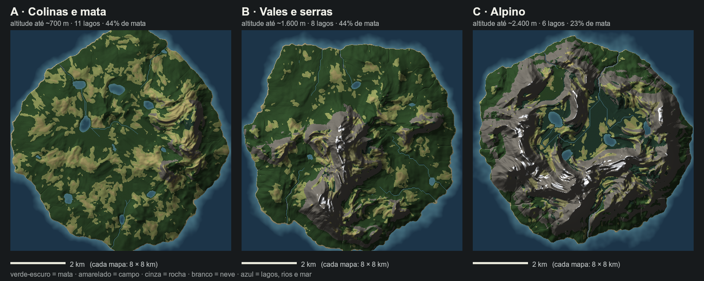
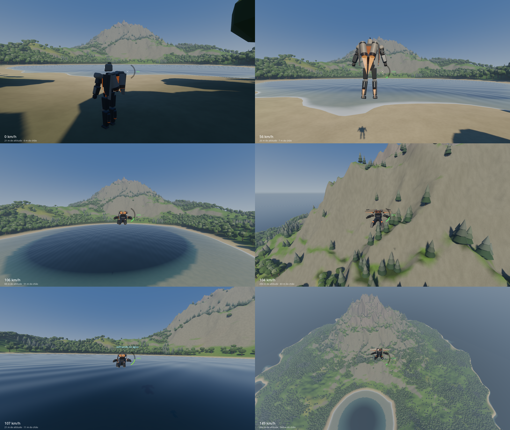
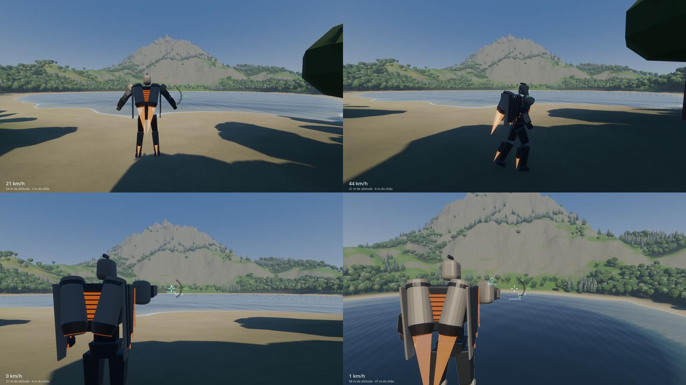
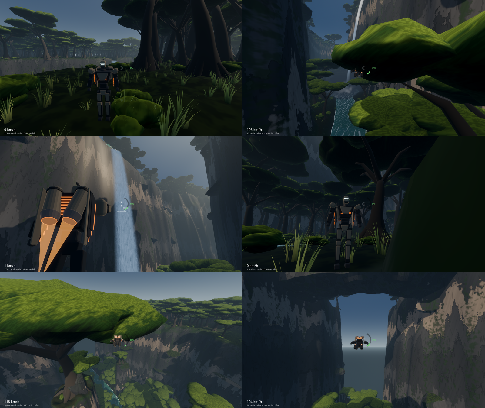
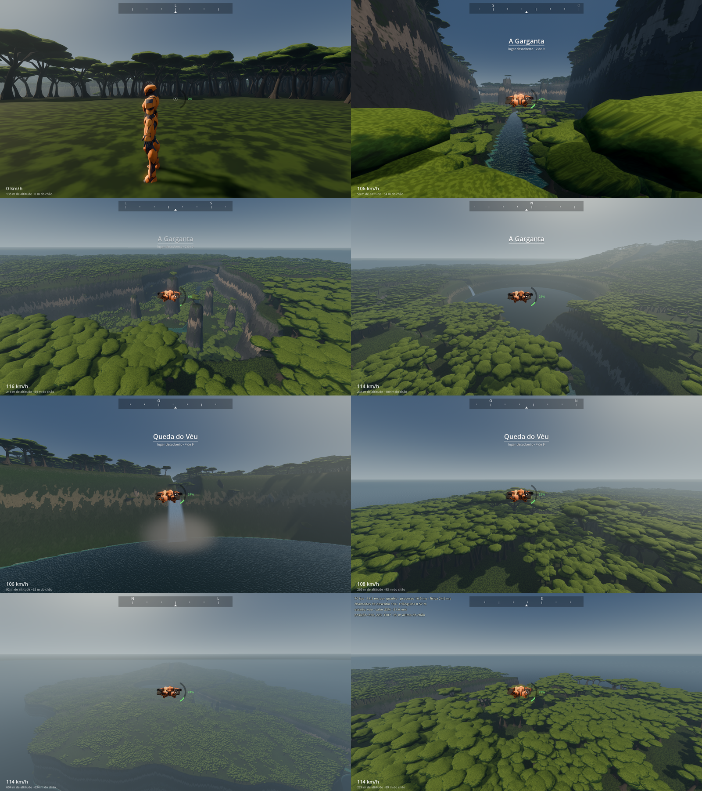
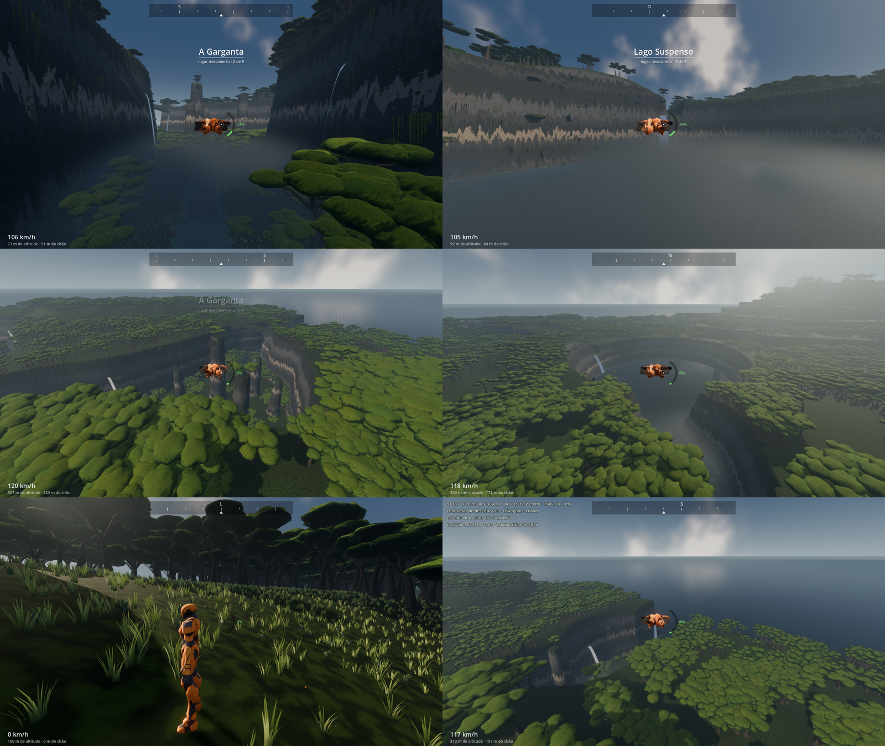
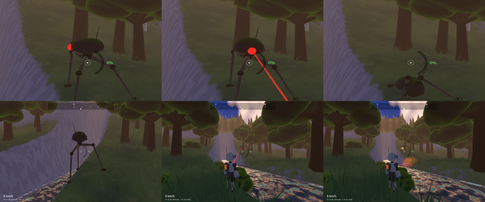
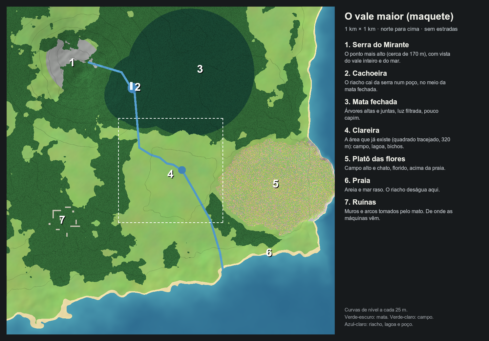

# Jogo de voo (nome provisório)

Plano aprovado pelo usuário em 2026-11-14. É a base da implementação. Nenhum código do jogo foi escrito ainda.


## 1. Ideia

Um jogo adulto em que o jogador anda, corre, voa e plana com uma armadura num mundo procedural de mata, lagos, vales e morros. A inspiração é a sensação de movimento e voo do Anthem. Personagens, nomes e visual do Anthem não entram.

O jogo é para o usuário jogar no PC com Bazzite (RTX 3060 Ti, Ryzen 5 5500, 16 GB, DualSense por Bluetooth, Steam no modo jogo).

## 2. Decisões

| Assunto | Decisão |
|---|---|
| Motor | Godot 4.7.2 com GDScript. Terreno e mata pesados vão para shaders e threads. |
| Mundo | **Feito à mão, não procedural** (decisão do usuário em 2026-11-14, para facilitar um mundo rico e vasto). Ilha com o mar como borda; tamanho e regiões saem da maquete do mapa (§13) |
| Relevo | **Vertical, o mais perto possível do vídeo de referência** (§12.1): cânions, pilares de pedra, penhascos, cachoeiras, cavernas, árvores colossais e ruínas gigantes. Substitui o relevo A (decisão de 2026-11-14) |
| Personagem | Armadura de ~2,6 m, ágil |
| Estilo | Estilizado com atmosfera: formas simples, luz, névoa e céu fazendo o trabalho, paleta sóbria |
| Calor do motor | Fica a regra da água: rasante, cachoeira e chuva esfriam o motor (essa regra vem do Anthem) |
| Pontos de interesse | Fora da primeira versão (ver §10) |
| Rumo do jogo | Exploração, movimento e jogabilidade até ficarem finos; inimigos, armas, saque, oficina e base ficam para o futuro (decisão de 2026-11-14). Mirar no ar e no chão entra já, sem arma |
| Pulo | X pula; X no ar dá o pulo duplo; segurar X decola ou liga o voo (aprovado em 2026-11-14) |

## 3. Motor: por que a Godot

| Opção | A favor | Contra |
|---|---|---|
| **Godot 4.7 + GDScript** (escolhida) | Já instalada. O caminho até a Steam do Bazzite já funciona desde a Ilha Cafuné. Cenas em texto, então dá para editar, testar e tirar fotos sem o editor. Tem névoa volumétrica, céu e sombras boas. | Não tem mundo aberto pronto: terreno grande, detalhe por distância e mata por blocos são feitos por nós. GDScript é lento em conta pesada. O teto visual é mais baixo que o da Unreal. |
| Godot com C# | Bem mais rápido em conta pesada | Outra build da Godot e o SDK do .NET; só compensa se o shader não resolver |
| Unreal 5 | Melhor visual, terreno, água e mata procedural prontos | Pesada no Mac de 16 GB; Blueprints binários; build para Linux saindo do Mac é complicada |
| Unity 6 | C# e terreno pronto | Editor obrigatório, conta Unity, nada instalado |
| Web (Three.js) | Roda no iPhone | Navegador no modo jogo do Bazzite é ruim; mundo grande com mata densa pesa no JavaScript; sem gatilho adaptativo |

## 4. Terreno procedural (abandonado em 2026-11-14)

O mundo passou a ser feito à mão (§13). Esta seção fica como registro e como fonte de técnicas (erosão, lagos pelo transbordo, biomas), que ainda servem de ferramenta para montar o relevo à mão.



### 4.1 Geração (uma vez por semente, guardada em disco)

1. **Forma:** ruído com distorção de domínio (fBm), cristas para as serras e uma máscara de baixa frequência que decide onde há morros. Uma queda radial com ruído faz a ilha e o mar em volta.
2. **Erosão:** lei do fluxo implícita (a água cava conforme a área que drena para cada ponto) mais difusão das encostas, por umas 20 rodadas. Isso cava os vales e faz os rios descerem até o mar.
3. **Água:**
   - Lagos: bacias cavadas no fundo dos vales; o nível sai do transbordo (priority-flood), então a água é sempre plana.
   - Rios: onde a área de drenagem passa de ~1,6 km².
   - Mar: abaixo do nível 0.
4. **Biomas:**
   - Mata densa onde é úmido (perto de rios e lagos, fundo de vale), com folhosas embaixo e pinheiros acima de ~520 m.
   - Campo e clareiras onde é seco.
   - Rocha onde a inclinação passa de ~40°.
   - Areia na beira do mar.

Parâmetros do relevo A na prévia (`tools/previa/gerar_mapa.py`, variante `colinas`): semente 11, base 140 m, colinas 150 m, serras 1100 m, viés de serra −0,25, erosão kdt 0,0035 em 20 rodadas, 11 lagos, linha das árvores 1000 m.

Na Godot, a geração vira compute shader (erosão e mapas) com o FastNoiseLite para o ruído. Resolução alvo do mapa assado: um ponto a cada 2 a 4 m (a prévia usa 16 m). O detalhe fino, como ondulações de ~0,5 m e pedrinhas, é somado perto do jogador.

### 4.2 Carregamento em volta do jogador

- **Relevo:** uma malha só, em anéis de detalhe (fino perto, grosso longe), deformada pela placa a partir da textura de alturas. A ilha inteira fica sempre visível.
- **Colisão:** HeightMapShape3D em blocos de 64 m, só num raio de ~250 m, gerada em thread.
- **Mata:** em células de 64 m, com posições fixas pela semente, desenhada por MultiMesh e com três distâncias:
  - completa até ~150 m, com colisão nos troncos;
  - simplificada até ~600 m;
  - figuras planas (impostores) até ~3 km.

  Depois disso, só a cor do chão.
- **Grama:** só até ~50 m, com vento. O propulsor achata a grama na decolagem e em voo baixo.
- **Água:** um plano por lago no seu nível, uma malha por rio e o mar.
- **Threads:** tudo carrega pelo WorkerThreadPool, sem travar a tela.
- **Precisão:** 8 km cabem na precisão normal (float) sem tremedeira, com a origem no centro da ilha.

## 5. Movimento

### 5.1 Estados e números (para afinar na etapa 1)

| Estado | Velocidade | Calor do motor |
|---|---|---|
| Andar / correr | 3 / 9 m/s | esfria rápido |
| Decolar (segurar X no chão) | sobe ~15 m em 1 s | +15% de uma vez |
| Voar reto | 30 m/s (108 km/h) | enche em ~20 s |
| Subir | perde velocidade | 2× mais rápido |
| Arrancada (L3 no voo) | 45 m/s | 3× mais rápido |
| Planar (motor desligado; X no voo alterna) | desce devagar e ganha velocidade | esfria |
| Mergulhar | até 70 m/s | esfria mais |
| Rasante na água, cachoeira, chuva | — | esfria quase na hora |
| Superaquecido (100%) | o motor apaga ~3 s, com alarme; o robô cai ou plana | volta a 40% |

- O voo segue a câmera: o analógico direito (ou o mouse) aponta e o robô vai para lá.
- O teto de voo é proposto em ~1.500 m de altitude: acima dele o motor perde força. Calibrar na etapa 1.

### 5.2 Controles

| Ação | DualSense | Teclado e mouse |
|---|---|---|
| Andar / correr | analógico esquerdo; L3 corre | WASD; Shift |
| Pular / decolar | X; segurar X decola | Espaço; segurar |
| Pulo duplo | X no ar (uma vez) | Espaço no ar |
| Ligar o voo no ar | segurar X no ar | segurar Espaço no ar |
| Esquiva | O no chão, no ar (uma vez) ou pairando | C |
| Mirar / pairar | L2 (no voo, apertar o L2 freia e paira) | botão direito |
| Marcar um ponto | R2 mirando (mirar o céu apaga) | botão esquerdo mirando |
| Planar ↔ motor | X no voo | Espaço no voo |
| Arrancada | L3 no voo | Shift no voo |
| Soltar do voo | O no voo | C no voo |
| Direção e câmera | analógico direito | mouse |
| Pausa | Options | Esc |

Desde 2026-11-14, L2 mira (no ar, paira) e R2 marca um ponto; quando houver armas, o R2 atira. Toda função nova precisa funcionar no controle.

### 5.3 Sensação

- Na decolagem, o robô agacha 0,2 s, a câmera fica para trás e depois alcança, a grama achata e sobe poeira.
- Nas curvas, o robô inclina.
- Pouso rápido faz tremor, nuvem de poeira e marca no chão. Pouso em ângulo raso vira corrida.
- Raspar numa árvore desvia o robô e tira velocidade. Bater de frente derruba (sem dano por enquanto).
- O som do vento cresce com a velocidade, e ele faz metade da sensação de voo.

### 5.4 Física

O robô usa CharacterBody3D com movimento próprio, no estilo arcade, e o Jolt cuida das colisões. Nada de corpo rígido.

## 6. Câmera

- Terceira pessoa por cima do ombro: perto no chão (3,5 m), mais longe no voo (6–7 m).
- O campo de visão abre com a velocidade, de 70° a 95°.
- O amortecimento é crítico, com leve inclinação nas curvas.
- Tremor fino em alta velocidade. No superaquecimento, chacoalhão e vinheta vermelha.
- A câmera colide com o chão e com os troncos. Folhas perto dela ficam transparentes.
- Opções: inverter Y e sensibilidade.

## 7. Escala e desempenho

- **Escala:** armadura de 2,6 m numa ilha de 8 × 8 km = 64 km², uns 5 min de voo reto de ponta a ponta. O calor obriga a planar e mergulhar, e isso dá ritmo ao voo.
- **Alvo:** 60 fps estáveis em 1440p na 3060 Ti, com o FSR 2 da Godot se precisar (se a tela for TV 4K, ajustar).
- **Orçamento inicial:**
  - ~3–5 milhões de triângulos na tela;
  - poucas chamadas de desenho, graças ao MultiMesh;
  - sombra do sol até ~500 m;
  - névoa cobrindo o longe.
- **Medição:** um voo de teste gravado roda no Bazzite pelo SSH e devolve a média e o pior 1% do tempo de quadro. Uma etapa só fecha se passar. Na tela, F3 mostra fps, tempo de quadro e os blocos carregados.

## 8. Arte e som

- **Modelos:** árvores, pedras e a armadura originais, feitos por script no Blender 5.3 (já instalado), com LOD e impostores.
- **Chão:** texturas geradas no shader, ou baixadas do ambientCG ou do Poly Haven (CC0). Download só com permissão, dizendo nome, origem e tamanho.
- **KayKit:** o Combat Mech é chibi e a floresta é fofa, então não combinam com o tom. Aproveitar só o KayKit Character Animations (Rig_Medium/Rig_Large: andar, correr, pular) como base da armadura. As poses de voo saem do código.
- **Efeitos:** o Kenney Particle Pack (local) dá fumaça, faísca e fogo para os propulsores, a poeira e o pouso. O pixelfx também está disponível.
- **Som:** sintetizado por script, como na Ilha Cafuné: motor por propulsor, vento, alarme de calor e pouso.
- **DualSense:**
  - vibração separada para cada propulsor;
  - barra de luz com a cor do calor (verde → laranja → vermelho);
  - R2 endurecendo com o calor.

  A barra de luz e o gatilho exigem escrever direto no controle (hidraw no Linux), com os bytes já conferidos no teste-dualsense. Cuidado com o Steam Input, que costuma tomar o controle.

## 9. Etapas

### Etapa 0: maquete da armadura (antes de qualquer código)

Decisão do usuário (2026-11-14): uma silhueta só. Outras armaduras, com jeitos diferentes de jogar, entram depois (§10). O estilo visual segue as prévias (`docs/previas/`), sem testes de estilo à parte.


Armadura v1 (`docs/maquetes/armadura_v1.png`, gerada por `tools/maquete/armadura.py`):
- **Corpo:** 2,6 m, com ombros largos e cintura fina (forma em V) e capacete com viseira fina.
- **Propulsores:** dois grandes nas costas, inclinados com o bocal para baixo e para trás, e dois pequenos nas panturrilhas.
- **Aletas-radiador:** três de cada lado, dobradas ao lado da mochila. Abrem como asas ao planar, então de longe dá para ver se a armadura está planando ou com o motor ligado.
- **Calor visível:** as bordas das aletas, os respiros do peito, o radiador das costas e os bocais brilham em laranja, mais forte quanto mais quente.
- **Cores:** grafite e areia escura; a viseira é azul-esverdeada.
- **O que é provisório:** as peças são blocos chanfrados, sem detalhe fino.

Para regerar a folha:

```bash
/Applications/Blender.app/Contents/MacOS/Blender -b --factory-startup -P tools/maquete/armadura.py -- "$PWD/docs/maquetes/armadura_v1.png" 1.0
```

- **Pronto quando:** o usuário aprova a silhueta.

### Etapa 1: primeiro voo (pequena e jogável)

- Projeto Godot nesta pasta, com tudo montado por código, como na Ilha Cafuné.
- Ilha de teste de 2 × 2 km com ruído simples, sem erosão, e um lago.
- Terreno com detalhe por distância e colisão em volta.
- Árvores de bloco (cilindro + cone) por MultiMesh, para dar referência de velocidade.
- Boneco de blocos de 2,6 m com andar, correr, pular, decolar, voar, arrancada, planar, mergulhar, soltar e pousar.
- Calor do motor com barra perto da mira, superaquecimento e água que esfria.
- Câmera da §6.
- Controle DualSense e teclado e mouse.
- Medidor F3.
- Build Linux instalada no Bazzite e adicionada na Steam.
- Testes automáticos (headless) dos estados e do calor, e capturas de tela.
- **Pronto quando:** o usuário voa 5 minutos no PC e acha gostoso, e os números da §5.1 estão afinados com ele.

**Estado (2026-11-14):** feita e instalada no PC Bazzite. Falta o usuário jogar e afinar os números.



O que tem:
- **Ilha de teste** (`scripts/ilha.gd`, semente 7):
  - 2 × 2 km, um ponto a cada 4 m, com colinas e um morro de ~400 m a sudeste;
  - um lago de 150 m de raio, com margem suave até 2,4 raios e nível tirado da borda da bacia, para a água não vazar;
  - mar em volta e ~18 mil árvores de bloco (cones e copas redondas) em MultiMesh, por bloco de 256 m.

  Com 2 km, o relevo inteiro cabe na placa de vídeo sem níveis de detalhe; os anéis de detalhe ficam para a etapa 2. A colisão do chão é um HeightMapShape3D com escala uniforme 4. A das árvores liga só num raio de 70 m (tronco e copa).
- **Armadura** (`scripts/armadura.gd`): a v1 exportada do Blender (`EXPORTAR=... tools/maquete/armadura.py` → `assets/armadura/armadura_v1.glb`), animada por código (`scripts/armadura_visual.gd`). As juntas giram para a pose de cada estado, o corpo segue o nariz no voo e inclina nas curvas, as aletas abrem ao planar, as chamas aparecem com o motor e o brilho laranja acompanha o calor.
- **Voo:** física de planador com motor.
  - A gravidade age sempre e a velocidade gira para o nariz (sustentação, fraca devagar).
  - O motor empurra até 30 m/s (45 na arrancada), e acima de ~45° de subida a velocidade cai.
  - O arrasto deixa o mergulho chegar perto de 70 m/s.
  - Planando devagar demais, o nariz cai.
  - Bater de frente a mais de 22 m/s derruba do voo; raspar tira velocidade.
  - Acima de 900 m o motor perde força.
  - Os números ficam em `scripts/ajustes.gd`.
- **Câmera** (`scripts/camera_voo.gd`): a da §6, com 5,2 m no voo e campo de visão até 90°.
- **Tela** (`scripts/hud.gd`, `scripts/pausa.gd`): mira com arco de calor, aviso de superaquecimento e de "esfriando na água", velocidade e altura, medidor (F3 ou Create) e pausa com a lista de comandos.
- **Ainda não tem:** som, partículas, DualSense além dos botões (vibração, luz e gatilho ficam para a etapa 5) e o que fazer no mundo.

Rodar (da pasta `jogo-voo`):

```bash
godot --path .
```

Testes (44 pontos: chão, pulo, decolagem, voo, arrancada e L3, planar, mergulho, água, superaquecimento, teto, pouso, soltar, batida numa árvore e os botões do controle; ~45 s; termina com "VOO OK"):

```bash
perl -e 'alarm 300; exec @ARGV' godot --headless --path . -- --teste
```

Fotos (10, em `tools/capturas/`, fora da build):

```bash
godot --path . -- --captura
```

Build e PC:
- O comando é `godot --headless --path . --export-release "Linux" build/linux/JogoVoo.x86_64` (~74 MB).
- No Bazzite, o jogo fica em `~/Games/JogoVoo/`, com `jogo-voo.desktop` e `icone.png`.
- Entrou na Steam como "Jogo de voo (teste)" pelo `steamos-add-to-steam`, com `DISPLAY=:0 WAYLAND_DISPLAY=wayland-0 XDG_RUNTIME_DIR=/run/user/1000`.
- O PC mudou de IP (estava em 192.168.0.25 em 2026-11-14); use `bazzite.local`.
- Para atualizar, copie o executável novo por cima com o jogo fechado.

### Etapa 2: mundo de verdade

- O gerador da §4.1 passado para a Godot, com compute shader e semente.
- A ilha de 8 × 8 km com o relevo A, lagos e rios no nível certo, e o mar.
- O carregamento da §4.2: relevo até o horizonte, colisão e mata por células.
- Voo de teste automático no Bazzite medindo o desempenho.
- **Pronto quando:** dá para voar a ilha inteira a 60 fps sem travadas.

### Etapa 3: vida e atmosfera

- Mata, pedras e grama originais do Blender, com LOD e impostores.
- Água com shader (cor por profundidade, espuma na beira, reflexo).
- Céu, nuvens, névoa, dia e noite e chuva (a chuva esfria o motor).

### Etapa 4: a armadura

- Modelo original, animações (base do KayKit mais poses de voo em código), propulsores com partículas, sons, poeira no pouso e grama soprada.

### Etapa 5: controle fino

- DualSense completo (vibração, barra de luz, gatilho), opções, menu, pausa e salvar.

### Depois

- Pontos de interesse (§10).
- O que fazer no mundo: exploração, desafios de voo ou combate.

## 10. Ideias guardadas para depois

### Outras armaduras

Armaduras novas, cada uma com um jeito diferente de jogar (por exemplo, mais pesada e resistente, ou mais leve e rápida no voo). Pedido do usuário em 2026-11-14, para depois da primeira versão. Cada uma ganha a sua maquete antes de entrar.

### Pontos de interesse com marcos de longe


- **Exemplos:** torre em ruínas, árvore colossal, coluna de fumaça e sinal de luz.
- **Regra:** de qualquer ponto da ilha, ver pelo menos 2 marcos. O gerador confere isso pela linha de visão no mapa de alturas.
- **Lugares:** picos, cristas, ilhas de lago e fins de vale. O terreno esconde e revela: subir uma crista mostra o vale seguinte.
- **Silhueta:** cada tipo tem um contorno que se reconhece de longe. Os detalhes e a recompensa só aparecem de perto.
- **Godot:**
  - os marcos ficam fora do corte por distância e usam uma versão simples de longe;
  - a névoa deles é limitada, para nunca virarem só céu;
  - brilham à noite;
  - a fumaça de longe é desenhada por shader.
- **Quantidade:** uns 20 a 40 na ilha.
- **Em aberto:** o tema (ruínas, natureza, máquinas caídas ou mistura).

## 11. Prévias

Ficam em `docs/previas/`. Os scripts estão em `tools/previa/`, são rascunho de planejamento e rodam com o Python do Blender, que tem numpy:

```bash
/Applications/Blender.app/Contents/Resources/5.3/python/bin/python3.13 -I tools/previa/gerar_mapa.py saida 512
```

```bash
/Applications/Blender.app/Contents/MacOS/Blender -b --factory-startup -P tools/previa/vista_aerea.py -- saida/colinas.npz "$PWD/vista.png" 1600 900 430 225 260 220 265 120
```

- `vista_aerea.py` recebe a linha e a coluna da câmera no mapa de 512, a altura dela sobre o chão, e a linha, a coluna e a altitude do alvo.
- Com `MARCOS=1`, ele lê o `marcos_bloco.py` e põe os marcos.
- O OpenImageIO do Blender não tem FreeType, então os textos nas imagens são escritos com `blf` (`rotulos.py`).

## 12. Estrutura do jogo (proposta em discussão, 2026-11-14)

O usuário testou a etapa 1 ("está legal") e pediu uma análise de um vídeo de jogo livre do Anthem (8 min 35 s, sem narração), para montar a estrutura do nosso jogo. Vale a regra de sempre: levar a mecânica e a sensação, nunca nomes, personagens ou visual.

### 12.1 O que o vídeo mostra

- **Movimento:** a maior parte do tempo é no ar.
  - Voo baixo por cânions, entre pilares de pedra, por baixo de arcos e por dentro de túneis e anéis gigantes.
  - Pairar parado no ar para olhar e mirar.
  - Planar e mergulhar de braços abertos entre penhascos, na chuva.
  - No chão, corrida rápida pela mata.
  - Um aviso de esquiva aparece quando um tiro vem.
  - O motor fica esfriado quase o tempo todo, porque chove e há cachoeiras.
  - Nas bordas do mapa, uma tempestade empurra a armadura de volta.
- **Mundo:** muito vertical.
  - Penhascos de centenas de metros, pilares, cachoeiras por toda parte, cavernas escuras com fogo aceso e árvores colossais em forma de guarda-chuva.
  - Ruínas de uma tecnologia antiga engolidas pela mata: um arco gigante sobre o vale, um anel de pedra e um tubo com nervuras.
  - Névoa, raios de sol, chuva e fim de tarde.
- **Exploração:**
  - tarefas pequenas no mundo livre (achar 3 peças espalhadas e levar à base);
  - nome do lugar aparecendo ao chegar;
  - itens no chão;
  - plantas que se colhem segurando um botão (material de fabricação);
  - reputação com um grupo subindo.
- **Combate** (pouco, no vídeo):
  - bichos pequenos e rápidos em bando;
  - uma torre de vigia com laser vermelho num posto de ferro enferrujado;
  - números de dano e marcador de acerto.
- **Interface:** duas barras (escudo e blindagem), bússola no alto com marcas, tarefa no canto, munição de 2 armas e uma barra com 4 ou 5 habilidades com recarga.
- **Multiplayer:** outros jogadores aparecem no mesmo mundo, porque o jogo é cooperativo.

### 12.2 Proposta para o nosso jogo

Pilares:
1. Mover-se é o prazer.
2. O mundo é feito para voar e esconder coisas.
3. O que se coleta vira equipamento.
4. A luta pede movimento.

| Tema | Proposta |
|---|---|
| Pulo e pulo duplo | X pula; X no ar dá um segundo pulo com os propulsores (uma vez, +3% de calor); segurar X, no chão ou no ar, decola ou liga o voo |
| Esquiva | O no chão ou pairando dá um tranco curto para o lado do analógico (+5% de calor); no voo, O solta |
| Pairar e mirar | L2 no ar fica parado e mira (esquenta devagar); L2 no chão mira por cima do ombro |
| Mundo | Somar cânions, pilares de pedra, cachoeiras e cavernas ao relevo; ruínas antigas gigantes (arcos, anéis, tubos) como pontos de interesse; tempestade sobre o mar como borda |
| Coleta | Plantas (fibra e resina), veios de minério (metal), destroços antigos (componentes), núcleos de energia (de inimigos e ruínas) e baús raros nas ruínas; segurar Triângulo 1 s para colher |
| Tarefas no mundo | Juntar peças, caçar uma fera, desligar uma torre, limpar um posto; bússola e mapa com marcas |
| Vida | Escudo, que recarrega sozinho, mais blindagem, que só volta com kit ou na base |
| Armas | Duas por vez: fuzil, escopeta, precisão, lança-granadas e metralhadora pesada (esta só na armadura pesada). R2 atira, Triângulo troca |
| Habilidades | Duas de ataque (granada, míssil), uma de suporte (escudo de área) e uma especial que carrega lutando. R1, L1 e R1+L1 |
| Inimigos | Fauna (bando de caçadores rápidos, voadores que perseguem no ar, uma fera grande por região) e um grupo hostil com postos, torres de laser, soldados, drones e um gigante blindado; golpe com aviso vermelho para esquivar |
| Oficina | Na base: gastar materiais para fabricar e melhorar armas, habilidades e peças da armadura (radiador = mais tempo de voo, propulsor = velocidade, casco = blindagem, gerador = escudo) |
| Armaduras | Novas armaduras com jogabilidade própria (§10), fabricadas com material raro |
| Raridade | Comum, incomum, rara e épica, por cor |
| Abrir caminho | Melhorias que abrem lugares: radiador para zonas quentes, vedação para mergulhar nos lagos, propulsor para os picos altos |
| Fica de fora | Multiplayer, saque com dezenas de números aleatórios, reputação de grupos (talvez depois) e base com conversas |

Ciclo: explorar → coletar e lutar → oficina → equipar → voltar mais forte para áreas novas e mais difíceis.

### 12.3 Ordem das próximas etapas (aprovada em 2026-11-14)

O usuário mudou a ordem: exploração, movimento e jogabilidade até ficarem finos antes de inimigos e armas.

1. **Movimento completo** na ilha de teste: pulo duplo, esquiva, pairar e mirar no ar e no chão, sem arma.
2. **Maquete do mapa feito à mão** (§13), para aprovação.
3. **Primeira região construída:** vertical, com cânions, pilares, cachoeiras e cavernas, e o carregamento por distância.
4. **Exploração:** lugares com nome ao chegar, mapa, bússola e marcador, segredos e caminhos que pedem bom voo.
5. **Atmosfera e som:** névoa, chuva, cachoeiras, dia e noite, vento e motor; a armadura final; o DualSense completo.
6. **Futuro:** inimigos, armas, coleta, oficina, base e armaduras novas (§12.2 fica como proposta guardada).

**Passo 1 feito (2026-11-14):** movimento completo na ilha de teste.



- **Pulo duplo:** X no ar dá 9,5 m/s para cima, uma vez por pulo, com +3% de calor; o pulo simples sobe 1,7 m e com o duplo chega a ~3,7 m. Segurar X depois do pulo duplo liga o voo. A conta de pulo duplo e esquiva no ar zera ao pousar, ao ligar o voo e ao pairar.
- **Esquiva:**
  - O no chão, no ar (uma vez) ou pairando.
  - 18 m/s por 0,28 s, ~4 m, para o lado do analógico (sem direção, para trás).
  - +5% de calor e 0,55 s de recarga. No voo, O continua soltando.
- **Pairar:** apertar o L2 no voo freia e para no ar, e segurar o L2 depois de um pulo também paira. Pairando, a armadura:
  - segura a altura e desliza a 5 m/s com o analógico;
  - esquenta 4%/s;
  - liga o voo com X e cai ao soltar o L2.

  Superaquecer pairando apaga o motor e plana.
- **Mirar sem arma:**
  - L2 no chão aproxima a câmera por cima do ombro (2,4 m, 56°), deixa a armadura andando a 3 m/s virada para a mira e aponta o braço direito para onde a câmera olha.
  - A mira mostra a distância até onde aponta.
  - R2 mirando marca um ponto: um losango com a distância aparece na tela, e ele some ao chegar a 6 m.
- **Tela corrigida:** desde a etapa 1, a tela e a pausa eram desenhadas encolhidas no canto de cima (faltava `set_anchors_and_offsets_preset`); agora a barra de calor fica junto da mira e a velocidade no canto de baixo.
- **Testes:** 69 pontos ("VOO OK"); fotos `c11` a `c14`.

## 13. Mundo feito à mão (método proposto, 2026-11-14)

- **Maquete primeiro:** um mapa 2D com regiões, rotas de voo e pontos altos, para aprovar antes de construir.
- **Relevo:**
  - Um mapa de alturas desenhado por nós, por formas posicionadas à mão: cânions ao longo de curvas, platôs, vales, morros.
  - A erosão é feita uma vez nas ferramentas e o resultado fica salvo no projeto (EXR ou PNG de 16 bits). O jogo só lê; nada é sorteado ao jogar.
  - Mudar o mundo = mudar os dados e assar de novo.
- **O que o mapa de alturas não faz:** pilares, arcos, saliências e cavernas viram peças de rocha modeladas por script no Blender e postas à mão (lista de posições no projeto).
- **Ruínas gigantes:** peças modulares do Blender (arcos, anéis, tubos, pontes) montadas à mão.
- **Água:** rios e cachoeiras como malhas ao longo de curvas, e os lagos.
- **Mata:** mapas de densidade desenhados mais regras de inclinação e altura, com árvores especiais postas à mão.
- **Tamanho:** construir por região. A primeira tem ~2 × 2 km, densa e vertical; as outras crescem em volta.
- **Relevo grande:** com o mundo crescendo, o plugin Terrain3D (níveis de detalhe, colisão, pintura de textura) volta a ser candidato. Ele é baixado só com permissão.

## 14. Teste de qualidade visual na Godot (2026-11-14)

O usuário perguntou se valia trocar para a Unity para chegar à qualidade do vídeo. A resposta foi não:
- o visual realista da Unity vem do HDRP, que entrou em modo de manutenção em 2026;
- o que muda o teto de verdade é a Unreal 5, com custo alto no nosso fluxo;
- a maior diferença está na arte.

Ele pediu o teste na Godot.


- **Arte baixada** (permitida pelo usuário): 19 arquivos CC0 do Poly Haven (174,5 MB) em `vendor/polyhaven/` (fora da Godot, com `.gdignore`).
  - Rochas: coastal_cliff_01, rock_face_01 e 02, mountainside, rock_moss_set_01 e 02, boulder_01.
  - Plantas: island_tree_02, pachira, anthurium, calathea, fern_02, shrub_02, root_cluster_01.
  - Texturas 2k: cliff_side, forest_ground_04, aerial_grass_rock.
  - Céu: kloofendal_misty_morning_puresky.
- **Preparação:** `tools/teste_visual/preparar.py` (Blender) reduz os triângulos e exporta GLB para `assets/teste_visual/` (a árvore vai de 1 milhão para 117 mil triângulos; a versão leve de 29 mil perdeu as folhas e saiu de uso). Exportar com `export_image_format="AUTO"`: com `"JPEG"` a Godot não lia uma das imagens.
- **Cânion** (`scripts/teste_visual/canion.gd`, classe `Canion` que herda a `Ilha`):
  - 640 × 640 m, um ponto por metro.
  - Paredões de 114 m com rochas do Poly Haven encaixadas e colisão por malha.
  - Um vale largo com três pilares de 60 a 96 m e uma ponte de rocha natural (coastal_cliff_01).
  - Cachoeira de ~110 m num poço, com névoa local (FogVolume) e borrifo de partículas.
  - Córrego no platô, rio no fundo, 825 árvores (cada uma com redução automática pela distância, `lod_bias` 0,3), sub-bosque e grama com vento em MultiMesh.
- **Luz:** céu do HDRI, névoa volumétrica, SDFGI, SSR, SSAO, brilho e antisserrilhado temporal (`Main._ambiente_canion`).
- **Shader do chão** (`scripts/shaders/terreno_canion.gdshader`): rocha triplanar puxada para cinza esverdeado, musgo nas paredes, grama e chão de mata pela inclinação, molhado perto da água.
- **Rodar:**
  - `godot --path . -- --canion` abre o cânion.
  - `godot --path . -- --canion-captura` tira 7 fotos em `tools/capturas/canion/` com o fps de cada uma.
  - No jogo, a pausa troca entre a ilha e o cânion. A cachoeira também esfria o motor.
- **Desempenho no Mac (M4, 1600 × 900):** 13 a 29 fps, com 9 a 22 milhões de triângulos e ~550 a 850 chamadas de desenho. Falta medir na 3060 Ti; está no PC desde 2026-11-14 (pausa → "Ir para o cânion", F3 para o medidor).
- **Leitura do resultado:**
  - Rochas, paredões e ponte ficaram no nível realista.
  - A mata é o ponto fraco, pela arte: as árvores do Poly Haven parecem oliveiras secas, e faltam árvores de selva com copa densa.
  - O céu enevoado deixa a luz chapada.
  - A água do rio ainda é simples.

## 15. Direção e equipe (2026-11-14)

O usuário definiu o jogo como hobby, sem fins lucrativos, fortemente inspirado no Anthem (referência: o vídeo da §12.1). O Claude é o líder técnico e o artista. Agentes Haiku fazem código e tarefas paralelas, cada um com arquivos próprios, sem tocar no `main.gd`, e o líder revisa e integra.

**Estilo em avaliação:** o usuário aceitou o realista da §14, mas ofereceu um estilo pintado como o do Breath of the Wild, com tom sério, adulto e escuro. Recomendação do líder: **pintado e sério**.
- Toda a arte sai dos nossos scripts e combina entre si.
- Roda 3× mais leve.
- Não depende de arte fotografada, que não temos para a selva.

O usuário decide comparando os dois cânions no PC.



- **Cânion pintado** (`scripts/teste_visual/canion_estilo.gd`, classe `CanionEstilo`, herda `Canion`):
  - Formas do Blender em `tools/estilo/gerar.py` → `assets/estilo/`: 3 árvores de copa larga, árvore colossal, moita, 4 rochas talhadas e o arco.
  - Cor nos shaders `terreno_estilo` (rocha em estratos, musgo, capim escuro) e `folha_estilo`.
  - Luz em `Main._ambiente_estilo`, sem SDFGI, porque ele deixava preta a sombra debaixo das copas.
  - 3.231 árvores em MultiMesh; no Mac dá 56 a 75 fps (o realista dá 13 a 29).
  - Abrir com `-- --canion-b`; fotos com `-- --canion-b-captura`.
  - Falta: as sombras ainda estão escuras demais no chão, e a armadura precisa de material no mesmo estilo.
- **Som** (agente Haiku): `tools/gerar_sons.py` gera 13 WAVs em `assets/sons/`; `scripts/sons.gd` (classe `Sons`) toca vento e motor pela velocidade, os toques pelos estados e a cachoeira em 3D. Ninguém ouviu ainda.
- **Rio** (agente Haiku): `scripts/shaders/rio.gdshader`, com correnteza, refração e espuma na beira; as riscas de espuma ainda parecem pontilhado.
- **Testes do cânion** (agente Haiku): `-- --teste-canion` (9 pontos, "CANION OK"; somar `--canion-b` testa o pintado). A bateria achou pedras de parede invadindo o vale e travando o voo; agora elas ficam enterradas no paredão.
- **Batida:** de través também derruba (impacto > 14 m/s com velocidade > 28 m/s).
- **Pausa:** o botão "Próximo mapa" roda ilha → cânion pintado → cânion realista.

**Estilo escolhido (2026-11-14): pintado e sério.** O jogo abre no cânion pintado (`--ilha` e `--canion` abrem os outros mapas; `--teste` e `--captura` seguem na ilha). Mudanças do dia:
- Sombras clareadas (luz ambiente 3,0, opacidade da sombra do sol 0,86).
- A armadura de teste ganhou material fosco com borda acesa.
- Bússola no topo da tela (agente Haiku, `Hud._desenhar_bussola`): N, L, S, O, marcas a cada 15° e o losango do marcador.
- Armadura nova: o usuário vai procurar um modelo no Tripo AI e salvar em `vendor/tripo/`. O pedido é GLB em pose A ou T, sem arma, com desenho original. O líder corta nas juntas no Blender e prende na animação atual.

**Armadura v2 (2026-11-14):** o Tripo não deu um modelo bom, e o usuário mandou como referência a folha do Ranger do Anthem. Não copiamos esse modelo; a v2 é original (`tools/maquete/armadura_v2.py` → `assets/armadura/armadura_v2.glb`, folha em `docs/maquetes/armadura_v2.png`). Ela tem placas em camadas sobre traje escuro, ombreira dupla, reator no peito, pernas com pistões e capacete com crista, em osso, grafite e azul-petróleo. Usa as mesmas juntas da v1, então a animação do jogo vale igual. Avaliação do líder: melhor que a v1, mas ainda com cara de robô de brinquedo (clara demais, peças soltas, formas de caixa). Modelagem só por script tem teto; ver as opções na conversa.

**Armadura provisória do usuário (2026-11-14):** `vendor/robot-test-v1.glb` (Tripo com esqueleto Mixamo, pose em T, 6 mil triângulos, textura 2k), copiado para `assets/armadura/robo_teste_v1.glb`. Fica até acharmos a definitiva.


- `ArmaduraVisual` detecta o `Skeleton3D` e manda as mesmas poses para os ossos (`OSSOS`, `_aplicar_ossos`): a rotação de cada junta é acumulada de pai para filho no referencial do modelo e convertida para a pose local do osso; os braços descem 78° do T antes da pose.
- O modelo é escalado para 2,6 m.
- Tem duas chamas simples presas à espinha.
- Não tem aletas nem o brilho do calor no corpo.
- Qualquer modelo com esqueleto Mixamo entra trocando só a constante `MODELO`.

## 16. Maquete do mapa (2026-11-14, esperando aprovação)


Ilha de 4 × 4 km feita à mão (`tools/mapa/mapa.py`: contorno, cânions por linhas, lago, terras altas e pilares postos à mão; o script grava também `docs/mapa/mapa_alturas.npy`, um ponto a cada 4 m, que vira a base do relevo no jogo).

| # | Lugar | O que é |
|---|---|---|
| 1 | Platô da Chegada | Começo do jogo, na borda oeste da Garganta |
| 2 | A Garganta | Cânion principal, do lago até o mar; o cânion de teste atual é um trecho dele |
| 3 | Vale dos Pilares | Alargamento da Garganta com 5 pilares de 64 a 110 m |
| 4 | Lago Suspenso | Lago a 62 m de altitude, onde três cursos d'água se encontram |
| 5 | Queda do Véu | Cachoeira da Fenda do Oeste caindo no lago |
| 6 | Terras Altas | Morro de ~360 m a nordeste, nascente do rio alto |
| 7 | Bosque Colossal | Morro a oeste com as árvores gigantes |
| 8 | Braço Leste | Cânion lateral que encontra a Garganta |
| 9 | Costa dos Paredões | Foz da Garganta no mar, entre paredões |

Ruínas antigas (pontos de interesse, estilo a definir): Arco sobre a Garganta, Anel junto ao lago, Tubo no Braço Leste, Farol antigo a oeste e Ponte caída no rio alto.

Ordem de construção proposta: 1 → 2 → 3 (o que já existe no teste), depois 4 e 5, e o resto em volta.

**Exploração, primeiro passo (2026-11-14):**
- `scripts/locais.gd` (classe `Locais`, agente Haiku): lugares com nome, raio e "já visto"; o sinal `chegou` faz a tela mostrar o nome grande e "lugar descoberto · N de M".
- No cânion já existem Platô da Chegada, Queda do Véu, Vale dos Pilares e Ponte de Pedra.
- A bússola ganhou fundo escuro, e o losango do marcador fica abaixo das letras.
- Rio (`rio.gdshader`): cor por profundidade em faixas e beira limpa. O brilho por face de onda virava um pontilhado branco e foi tirado na revisão.
- Ninguém viu ainda o aviso de lugar na tela com o jogo aberto.

## 17. O mundo no jogo, primeira versão (2026-11-14)

O usuário mandou seguir depois da maquete, e a ilha de 4 km virou o mapa de entrada do jogo.



- **Dados:** `JOGO=assets/mundo blender ... tools/mapa/mapa.py` grava `alturas.bin` e `agua.bin` (1025 × 1025, 4 m por ponto, linha 0 = norte) e `dados.json` (lugares, lago, quedas, pilares, bosque, ruínas). A maquete mudou um pouco: lago a 40 m, platô a ~126 m, cânions com curvas, e os dois rios altos caem ~55 m no lago.
- **Jogo** (`scripts/mundo.gd`, classe `Mundo`, herda `Ilha`):
  - relevo em 256 blocos com o shader pintado, e colisão por mapa de alturas;
  - água lida do `agua.bin` (um quadrado por célula molhada) com o shader do rio, mais o mar e duas cachoeiras com névoa;
  - 650 pedras talhadas enterradas nos paredões, com colisão;
  - ~50 mil árvores em blocos de 256 m (modelo completo até 420 m, modelo leve de 170 triângulos depois);
  - 16 árvores colossais no Bosque e o Arco sobre a Garganta;
  - os 9 lugares com nome.
- **Desempenho no Mac:** 43 a 75 fps, com 0,5 a 2,3 milhões de triângulos.
- **Rodar:** `godot --path .` abre o mundo; `-- --mundo-captura` tira 8 fotos; `--canion-b`, `--canion` e `--ilha` abrem os mapas antigos. A build inclui `*.bin` e `*.json` (`include_filter`).
- **Falta:**
  - testes automáticos do mundo;
  - grama e moitas;
  - as outras quatro ruínas;
  - a parede dos cânions é lisa (4 m por ponto) e pede mais pedras e saliências;
  - a névoa de longe ainda apaga a ilha vista do alto;
  - ninguém voou nele de verdade ainda.

**Mundo v2: passada de composição (2026-11-14).** O usuário achou o mundo distante do vídeo de referência. Diagnóstico do líder: faltavam verticalidade, água por todo lado, selva variada e névoa nos vales.



- **Relevo** (`tools/mapa/mapa.py`): platô em andares de 55 m (de ~90 a ~230 m), terras altas até ~500 m, cânions com parede de 6,5:1 e largura variada, bacia do lago com paredão de ~200 m, 10 pilares de até 185 m, costa mais alta.
- **Água** (`Mundo._agua_mundo`, `_queda`): além das duas quedas no lago (~95 m), 22 cachoeiras finas escorrem dos paredões para os rios. O jogo acha os lugares andando do rio até um paredão 85 m mais alto.
- **Selva:**
  - 2.200 cortinas de cipó e musgo nos paredões (`_cipos`, shader `cipo_estilo`);
  - manchas largas de cor na mata, pelo shader (oliva e azul-petróleo);
  - clareiras;
  - árvores maiores no platô, e menores e mais raras no fundo dos cânions;
  - 1.300 pedras talhadas.
- **Ar:** névoa deitada no fundo dos vales (FogVolume a cada ~170 m de rio), nuvens pintadas no céu, sol mais baixo.
- **Chão vivo** (agente Haiku, `scripts/chao_vivo.gd`): grama, samambaias e flores só em células de 32 m num raio de ~100 m do jogador.
- **Erro corrigido:** paletas por bloco deixavam quadrados amarelos de 256 m na mata; a variação passou para o shader.
- **Ainda longe da referência:** as árvores são todas do mesmo tipo (copa larga), falta arquitetura antiga gigante, e as paredes têm pouca saliência grande (arcos, saliências, cavernas).
- Testes do mundo (agente Haiku): `-- --teste-mundo`, 10 pontos, "MUNDO OK" (lugares, lago, mar, todas as cachoeiras esfriando, voo alto, quedas sem atravessar o chão).

## 18. Novo rumo (2026-11-14, em discussão; nada implementado)

O usuário avaliou que superestimamos a capacidade de construção e que perseguir a escala e o visual do Anthem não estava dando certo. As seções 12 a 17 ficam como registro. O que ele quer:

- **Jogo:** para se entreter sem objetivos — voar, caminhar, correr, observar. "Cozy, mas adulto."
- **Mundo:** pequeno e caprichado (um vale de ~800 m a 1 km feito à mão, crescendo um canto por vez). Floresta temperada com campos.
- **Tempo:** dia e noite passando sozinhos, com chuva às vezes.
- **Vida:** bichos naturais pacíficos. O combate é um tempero, contra máquinas agressivas.
- **Personagem:** um robô pequeno (~1,2 m) no jeito do Faísca da Ilha Cafuné, em tom sério (metal gasto, visor de uma luz só, movimentos contidos).
- **Propulsores:** jatos nos pés e nas mãos. No voo, os dos pés são os fortes (empurram) e os das mãos são mais fracos (equilibram e guiam). Os das mãos também são a arma. Atirar esquenta o mesmo motor do voo.
- **Estilo:** técnica do Breath of the Wild (luz em faixas, borda clara, muito capim ao vento, cores limpas, distância azulada, céu pintado), sem copiar arte nem personagens.
- **Primeiro passo proposto:** um quadro só, uma clareira de ~100 m com capim, árvores, pedras, riacho, o robô novo e um bicho pastando, até o visual ser aprovado.
- **Reaproveita:** movimento, câmera, calor, chão vivo, lugares com nome, sons, testes e o caminho de build.

## 19. Primeiro quadro do novo rumo: a clareira (2026-11-14)


- **Mapa** (`scripts/vale/clareira.gd`, classe `Clareira`, herda `Ilha`): 320 × 320 m feitos à mão, um ponto por metro. Campo de capim, trilha de terra, riacho até uma lagoa, pedra-mirante, carvalhos e bétulas postos à mão, e ~1.500 árvores fechando o quadro nas colinas. É o mapa de entrada do jogo; a pausa troca para os antigos.
- **Estilo** (`scripts/shaders/vale_*.gdshader` e `vale_comum.gdshaderinc`): luz em duas faixas (`luz_faixas`), borda clara, copas em três tons, e o capim com a mesma cor do chão (`cor_capim`), com rajadas de vento atravessando o campo. São 140 mil touceiras em blocos de 32 m. Ambiente em `Main._ambiente_vale`: céu azul com nuvens, sombra azulada, sem luz global.
- **Robô v1** (`tools/vale/robo.py` → `assets/vale/robo_v1.glb`, folha em `docs/vale/robo_v1.png`): 1,2 m, cabeça grande com visor de um olho só, botas e antebraços largos com as brasas dos jatos (pés fortes, mãos fracas). Usa as mesmas juntas da armadura, então a animação é a mesma. `Armadura.porte = 0.48` encolhe a cápsula e aproxima a câmera.
- **Natureza** (`tools/vale/natureza.py` → `assets/vale/`): dois carvalhos, bétula e pinheiro (cada um com versão leve de longe), arbusto, três pedras e o cervo em peças.
- **Cervo** (agente Haiku, `scripts/vale/cervo.gd`): pasta, anda, fica alerta e foge. Chegando devagar, ele se acalma. Há três na clareira. O teste do agente cobriu os estados e o chão; ninguém viu a animação de perto ainda, e o focinho não chega ao chão ao pastar.
- **Desempenho no Mac:** 47 a 100 fps.
- **Rodar:** `godot --path .`; fotos com `-- --vale-captura`.
- **Falta neste quadro:** tiro pelas mãos, dia e noite, chuva, som do lugar, testes automáticos da clareira e a pose de voo com as mãos guiando.

**Retorno do usuário sobre o quadro (2026-11-14):** "ficou muito lindo o ambiente".
- **Feito:** a decolagem (segurar X) sobe ~24 m (`DECOLAGEM_IMPULSO` 21, `DECOLAGEM_TEMPO` 0,85). Por 1,6 s depois de decolar, o nariz não aponta abaixo do horizonte (`DECOLAGEM_GRACA`), para o voo não bater no chão com a câmera olhando para baixo. Teste novo na bateria (70 pontos).
- **Lista de implementação** (pedidos do usuário):
  - física da água melhor (ondas e respingo ao tocar, rastro no rasante, entrar e sair d'água);
  - partículas ao atravessar a copa das árvores (folhas soltando).
- **Ainda da lista do quadro:** tiro pelas mãos, dia e noite, chuva, som do lugar, testes da clareira, pose de voo com as mãos guiando, tom mais sóbrio, cervo visto de perto.

**Decisões e pedidos de 2026-11-14 (noite):**
- **Tom:** o dia tem momentos com tons diferentes — amanhecer, manhã, tardezinha e noite — e chuva às vezes. Os estudos estão em `docs/vale/tons.png` (`-- --clima tarde` e `-- --clima nublado`); o fim de tarde precisa de sombra menos escura.
- **Jogabilidade, para fazer:**
  - Superaquecer no voo: o robô cai (hoje ele plana). Se o jogador não recuperar o voo antes do chão, pousa "estilo herói" (impacto forte, agachado, poeira).
  - Desligar o voo perto do chão: cai com estilo também, mas mais leve, porque a altura era pequena.
  - A força do pouso segue a altura da queda.
- **Lista de implementação:** física da água; partículas ao atravessar as copas; tiro pelas mãos; ciclo do dia com os tons; chuva; som do lugar; testes da clareira; pose de voo com as mãos guiando; cervo visto de perto.


## 20. A clareira ganha vida (2026-11-14, noite)


Tudo da lista de implementação da §19 foi feito, menos o cervo visto de perto.

- **Calor (pedido do usuário):** 25 s de voo até superaquecer (`CALOR_VOO` 4,0). Superaquecido, esfria em 12 s no ar (`ESFRIA_SUPER_AR`) e em 5 s no chão (`ESFRIA_SUPER_CHAO`); água e chuva (`ESFRIA_CHUVA`) ajudam. Religa quando o calor chega a `RELIGA_EM`.
- **Queda e pouso:** superaquecer no voo derruba o robô (estado AR, sem pulo duplo). Queda acima de `QUEDA_HEROI` (12 m) dá o pouso de herói (`pouso_forca` 1,0: um joelho, punho no chão, 0,95 s); acima de `QUEDA_LEVE` (3 m), o pouso leve (0,5). `queda_altura` guarda os metros.
- **Ciclo do dia** (`scripts/vale/ciclo.gd`, `CicloDia`): um dia leva 60 minutos (pedido: nada de ciclo rápido). Tabela `CHAVES` com os tons por hora: noite azul com lua, amanhecer rosado, manhã com névoa, dia limpo, tardezinha dourada, pôr do sol. Chuva a cada 7–16 min, por 2,5–5 min, com céu fechado e gotas em volta da câmera. Outros sistemas leem `CicloDia.atual.hora` e `.chuva`. O medidor mostra o momento e a hora. Para fotos: `-- --hora N`, `-- --chuva`, `-- --dia-rapido`.
- **Tiro pelas mãos** (agente Haiku, `scripts/vale/tiro.gd`, `Tiro`): mirando (L2) e segurando R2, um disparo a cada 0,28 s, 3,5 de calor por tiro, projétil de luz da mão direita, estrela e faísca no impacto. Os bichos do grupo `bichos` fogem do disparo e do impacto (`Cervo.assustar`). No chão o motor esfria mais rápido do que os tiros esquentam; o calor do tiro só pesa pairando.
- **Folhas e poeira** (agente Haiku, `scripts/vale/efeitos_mato.gd`, `EfeitosMato`): folhas ao entrar numa copa e enquanto passa por dentro; anel de poeira no pouso (tamanho conforme `pouso_forca`), sopro na decolagem e risco na esquiva.
- **Água** (agente Haiku, `scripts/vale/efeitos_agua.gd`, `EfeitosAgua`): respingo e anel ao cair na água, anéis ao andar no raso, rastro de borrifo e anéis no rasante, anéis lentos ao pairar baixo.
- **Som do lugar** (agente Haiku, `scripts/vale/som_ambiente.gd`, `SomAmbiente`; WAVs novos em `tools/gerar_sons.py`): mata de dia (brisa e pássaros), mata de noite (grilos e coruja), riacho em quatro pontos, chuva e trovão. Segue a hora e a chuva do ciclo. **Ninguém ouviu ainda.**
- **Pose de voo:** braços abertos como lemes; na curva um fecha e o outro abre. Os jatos das mãos brilham 40% dos pés e acendem no tiro.
- **Partículas:** fumaça e estrela do Kenney Particle Pack (CC0, cópia local em `Projects/others/kenney-particle-pack`), em `assets/fx/kenney/`.
- **Testes:** `-- --teste-vale` (agente Haiku, `scripts/vale/testes_vale.gd`): "VALE OK (11 pontos)". A bateria antiga segue em "VOO OK (75 pontos)".
- **Fotos:** `-- --vale-captura --curta --hora N --pasta nome` (três fotos por hora) e `-- --vale-captura --efeitos` (tiro, pouso, copa, voo, água).
- **Não verificado:** o som (só volumes calculados); o respingo do mergulho em foto (o rasante foi visto); o jogo no PC com o DualSense.
- **Depois:** máquinas agressivas, crescer o vale, cervo de perto, estrelas no céu da noite, luzes do robô acesas à noite.

**Pedido do usuário (2026-11-14, noite): sem estradas.** Não faz sentido ter estradas abertas, como se alguém passasse sempre ali. Clareiras naturais em alguns pontos fazem sentido; estradas, não. A trilha de terra da clareira (`Clareira.TRILHA`) deve sair, e o vale novo não ganha caminhos batidos. Ainda não feito.

## 21. Sem trilha, noite viva e cervo de perto (2026-11-14, madrugada)


- **Sem estradas (feito):** a trilha de terra saiu. No lugar há quatro claros naturais de terra e capim ralo, de borda torta (`Clareira.CLAROS`, função `_claro`).
- **Noite** (`scripts/vale/noite.gd`, classe `Noite`): 1.500 estrelas que somem com a chuva, vaga-lumes sobre o capim do anoitecer à madrugada, e a luz do próprio robô (as barras do peito e o visor acendem mais, e ele ilumina uns 5 m em volta como uma lanterna).
- **Cervo v2** (`tools/vale/natureza.py`): corpo mais liso, coxas e ombros, barriga e garupa claras, olhos, nariz, canelas escuras, cor menos laranja. Fotos de perto com `-- --vale-captura --cervo` (o cervo tem `pose_foto` para ficar parado num estado).
- **Não verificado:** a animação do cervo em movimento (só poses paradas em foto).

## 22. Mais bichos e maquetes das máquinas (2026-11-15)


- **Pássaros** (agente Haiku, `scripts/vale/passaros.gd`, `Passaros`): três bandos de 5 a 7. Ciscam no chão de asas fechadas, levantam voo juntos quando o robô chega perto (9 m, ou 16 m se ele vem rápido) ou com um tiro, dão voltas a 12–20 m e pousam em outro lugar.
- **Coelhos** (agente Haiku, `scripts/vale/coelho.gd`, `Coelho`): cinco, perto dos claros. Sentam, comem, andam em pulinhos e fogem em ziguezague.
- **Peixes** (agente Haiku, `scripts/vale/peixes.gd`, `Peixes`): cardume de nove na lagoa. Nadam rasos (a água é pouco transparente), fogem de respingos e do robô, e um salta de vez em quando, com anéis na água.
- **Modelos** em `tools/vale/natureza.py` (`passaro`, `coelho`, `peixe`). No jogo ficam maiores que o real (1,7×, 1,55× e 1,5×), senão somem no capim.
- Todos estão no grupo `bichos` e reagem a `assustar(ponto)` (o tiro chama).
- **Máquinas agressivas (só maquete, esperando a escolha do usuário):** `tools/vale/maquinas.py` → `docs/vale/maquinas_v1.png`. Três conceitos de metal gasto com musgo e lente vermelha: **Zangão** (voador de 0,9 m, em dupla, rajadas lentas), **Sentinela** (torre andante de 3,2 m, lenta, tiro forte com aviso) e **Carrapato** (rasteiro de 0,6 m, em trio, investe com aríete).
- **Fotos:** `-- --vale-captura --bichos`.
- **Não verificado:** os bichos em movimento contínuo (só fotos); o salto do peixe; o bater de asas no ritmo certo (9 Hz pode ser rápido demais).

## 23. Sentinela e a pane (2026-11-15)



**Regra do usuário:** ninguém é destruído. Nosso robô e as máquinas desligam por excesso de calor e voltam a funcionar depois.

- **Pane do nosso robô** (`Armadura.levar_golpe`, `scripts/vale/pane.gd`): cada acerto de máquina empurra e soma `GOLPE_CALOR` (35). Com `PANE_GOLPES` (3) acertos acumulados ele entra em pane: ajoelha apagado, a tela escurece, o dia avança `PANE_HORAS` (3 h) e ele religa no mesmo lugar, frio, depois de `PANE_TEMPO` (5 s reais). Um acerto sara a cada `AVARIA_SARA` (25 s) sem levar golpe. Por `PANE_GRACA` (12 s) depois de religar as máquinas não o enxergam.
- **Sentinela** (agente Haiku, `scripts/vale/sentinela.gd`; modelo em peças por `tools/vale/sentinela.py`): torre de três pernas com IK, pés plantados e um passo por vez (~0,8 m/s). Patrulha em volta da casa (rio acima, a ~130 m do começo). Vê o robô a 55 m com linha de visão; avisa 1,6 s com a lente piscando e um feixe vermelho que trava a mira nos últimos 0,35 s; dispara um projétil lento (38 m/s) que dá para desviar; recarrega 3,2 s.
- **Calor do Sentinela:** cada tiro nosso na cabeça soma 17; esfria 5 por segundo depois de 2,5 s sem levar tiro. Com 100 ele desliga: arria no lugar com a lente apagada. Religa ali mesmo depois de 3.600 s reais (um dia inteiro do jogo; pedido do usuário, para haver paz depois da batalha vencida). A pane do jogador desconta 3 h desse tempo (`avancar_tempo`).
- **Ganchos:** o tiro do robô chama `levar_tiro(ponto)` no grupo `maquinas`; a cabeça tem colisão na camada 2.
- **Testes:** `-- --teste-vale` agora tem 13 pontos (pane e Sentinela entraram). Fotos: `-- --vale-captura --sentinela`.
- **Não verificado:** o Sentinela andando em movimento contínuo (só fotos), o som dele (não tem), e o combate jogado de verdade com o controle.
- **Faltam das maquetes:** Zangão e Carrapato.

**Decisão do usuário (2026-11-15):** Zangão e Carrapato ficam para depois da expansão do mapa; a clareira atual só tem o Sentinela. Ele vai testar o tempo de paz de 60 minutos da máquina desligada e dar retorno.

## 24. Peso no movimento (2026-11-15, retorno do teste no PC)

O usuário achou que: ao desligar os propulsores no voo o robô continuava planando; faltava atirar sem mirar; andar e correr deslizavam, sem peso; e a esquiva não parecia física.

- **Desligar o voo (O no voo):** sobra 60% da velocidade de lado (`SOLTAR_CORTE`), o ar tira o resto (`ARRASTO_QUEDA`) e a gravidade vale 1,3× (`QUEDA_PESADA`) até pousar ou religar. O mesmo quando o motor trava por calor. Medido: de 28 m/s de lado para 6 em 1 s, caindo a 33 m/s.
- **Tiro sem mirar:** R2 atira no chão, caindo, pairando ou voando, para onde a câmera aponta. No chão o robô vira para a câmera e ergue o braço (`Armadura.atirando`).
- **Andar e correr:** o robô pequeno anda a 2,1 m/s e corre a 6,3 m/s (`Armadura.vel_chao` 0,7; antes 3 e 9, rápido demais para pernas de 0,45 m). A passada da animação segue a distância andada (ciclo de 2,0 a 4,0 × porte), para o pé não escorregar. Ganhar velocidade leva um instante (`ACEL_CHAO` 20) e parar é mais firme (`FREIO_CHAO` 34).
- **Esquiva → arranque de jato:** um empurrão só, com um salto curto (`ESQUIVA_SALTO`), que o chão e o ar vão freando; acabou a velocidade forçada por 0,28 s.
- **Testes:** `-- --teste-vale` com 15 pontos (queda pesada e tiro sem mirar entraram).
- **Não verificado:** a sensação com o controle; a animação da passada em movimento.

**Mais retorno do usuário (2026-11-15):**
- **Pouso sempre animado:** toda chegada de voo, de voo parado ou de queda acima de `QUEDA_TOQUE` (2,2 m) passa pelo estado POUSO, em três graus: toque (`pouso_forca` 0,25; 0,24 s), médio (0,5; acima de 3 m) e herói (1,0; acima de 12 m). Chegando perto do chão (`Armadura.chegando_ao_chao`), o robô já arma as pernas e abre os braços.
- **Voo parado:** L2 no ar liga e ele continua parado mesmo soltando o L2. X volta a voar para a frente; O desliga o propulsor e ele cai pesado. A esquiva no voo parado saiu (o O agora desliga).
- Testes: `--teste` com 76 pontos, `--teste-vale` com 15. Fotos da chegada: `-- --vale-captura --pouso`.

**Passada refeita (2026-11-15, pedido: "robô muito avançado, a movimentação deve ser fluida"):** 
- Defeitos achados: o joelho dobrava na fase errada (com a perna indo para trás) e a suavização das juntas (12/s) comia quase metade do movimento na corrida.
- Agora (`ArmaduraVisual`, bloco do chão): cada perna vai à frente dobrando o joelho, estica para pisar, cede com o peso e empurra com o pé (`_pulso`); a bacia gira com as pernas e o tronco e os braços ao contrário; a cabeça fica firme; o corpo sobe e desce em curva suave; o tronco inclina ao arrancar e ao frear (`_acel`) e o corpo deita para dentro da curva. Parar e andar se misturam sem estalo (`w`). Andando, as juntas seguem a 34/s.
- Fotos quadro a quadro: `-- --vale-captura --passada` (esconde o capim).
- **Não verificado:** a corrida quadro a quadro (a câmera da foto perdeu o robô) e tudo em movimento.
- **Correção (2026-11-15):** o tiro acendia todos os jatos (usava `impulso`); agora usa `Armadura.clarao_tiro` e só o jato da mão direita acende. O tiro ainda não tem som próprio.
- **Regra do tiro (2026-11-15):** no chão atira mirando ou não; no ar, só no voo parado (voando ou caindo, não). Som do tiro fica para depois.
- **Andar atirando ou mirando (2026-11-15):** as pernas viram para onde o robô anda (até 65° da mira) e o tronco torce para a mira (`_torcao`); indo para trás ele recua de costas, com a passada ao contrário (`_re`). Fotos: `-- --vale-captura --mirando`.

## 25. O vale maior (maquete, 2026-11-15, esperando aprovação)



O usuário aprovou seguir para a expansão ("a ambientação tá linda, jogar com ele está divertido") e pediu: uma parte alta com vista da paisagem, um campo de flores em platô perto da praia, uma mata fechada com cachoeira e ruínas antigas tomadas pelo mato.

- **Maquete** (`tools/vale/mapa_vale.py` → `docs/vale/mapa_v1.png`): 1 km × 1 km, a clareira atual no meio. Serra do Mirante a noroeste (~170 m); o riacho nasce nela, cai na cachoeira dentro da mata fechada ao norte, cruza a clareira e deságua na praia ao sul; platô das flores a leste, acima do mar; ruínas a oeste, na mata. Sem estradas.
- **Plano:** aprovar a maquete, depois construir um canto por vez.
- **Antes de construir:** criar o repositório git local (o projeto não tem controle de versão) e escolher o nome do jogo; o usuário pediu para pensarmos num nome.
- **Para depois:** som do tiro e do Sentinela; Zangão e Carrapato no mapa grande.

**Maquete v2 (2026-11-15):** o usuário achou 1 km pouco (a clareira de 320 m já não parece grande e seria um terço do total). Nova maquete com **2 km × 2 km** em `docs/vale/mapa_v2.png` (`E = 2.0` m por pixel em `tools/vale/mapa_vale.py`): mesmos lugares em escala dobrada, mais os Campos do sul (capim aberto até o mar). A clareira fica no meio, do tamanho que tem. Esperando aprovação e o nome do jogo.

## 26. Nome, repositório e plano da expansão (2026-11-15)

- **Nome do jogo:** "Faísca 2: Em Busca do Sossego" (escolha do usuário; já em `project.godot`). **Repositório:** `faisca-2`, git local criado em 2026-11-15 com o estado aprovado da clareira (a pasta continua `jogo-voo`; nada foi enviado para a internet). Fora do git: `.godot/`, `build/`, `tools/capturas/`, `vendor/polyhaven/`.
- **Maquete v2 aprovada** (2 km × 2 km, `docs/vale/mapa_v2.png`).
- **Pedido para o fim das tarefas importantes:** se o jogador tentar cruzar o mar, depois de certa distância o robô entra em pane e volta para a praia.
- **Ordem de construção proposta** (um canto por vez, cada um no capricho da clareira):
  1. **Base do vale inteiro:** terreno de 2 km em blocos, mar, e a clareira atual encaixada no meio sem mudar. Tudo fora da clareira ainda simples (relevo, cor do chão, mata de longe), mas já dá para voar por cima de tudo.
  2. **Campos do sul e praia:** capim até o mar, areia, ondas; e a pane ao cruzar o mar.
  3. **Platô das flores.**
  4. **Mata fechada e cachoeira.**
  5. **Serra do Mirante.**
  6. **Ruínas**, com o Zangão e o Carrapato.
- **Pendências menores:** som do tiro e do Sentinela.
