# Jogo de voo (nome provisório)

Plano aprovado pelo usuário em 2026-11-14. É a base da implementação. Nenhum código do jogo foi escrito ainda.

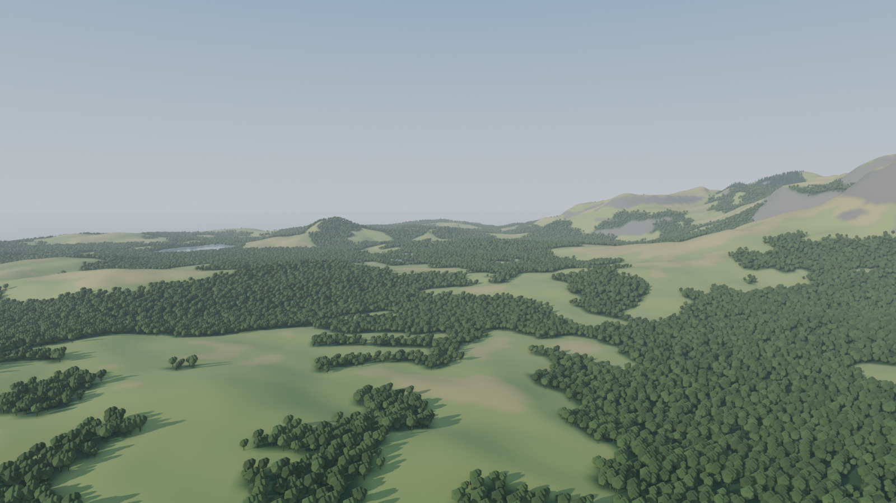

## 1. Ideia

Um jogo adulto em que o jogador anda, corre, voa e plana com uma armadura num mundo procedural de mata, lagos, vales e morros. A inspiração é a sensação de movimento e voo do Anthem. Personagens, nomes e visual do Anthem não entram.

O jogo é para o usuário jogar no PC com Bazzite (RTX 3060 Ti, Ryzen 5 5500, 16 GB, DualSense por Bluetooth, Steam no modo jogo).

## 2. Decisões

| Assunto | Decisão |
|---|---|
| Motor | Godot 4.7.2 com GDScript. Terreno e mata pesados vão para shaders e threads. |
| Mundo | **Feito à mão, não procedural** (decisão do usuário em 2026-11-14, para facilitar um mundo rico e vasto). Ilha com o mar como borda; tamanho e regiões saem da maquete do mapa (§13) |
| Relevo | **Vertical, o mais perto possível do vídeo de referência** (§12.1): cânions, pilares de pedra, penhascos, cachoeiras, cavernas, árvores colossais e ruínas gigantes. Substitui o relevo A (decisão de 2026-11-14) |
| Personagem | Armadura de ~2,6 m, ágil |
| Estilo | Estilizado com atmosfera: formas simples, luz, névoa e céu fazendo o trabalho, paleta sóbria |
| Calor do motor | Fica a regra da água: rasante, cachoeira e chuva esfriam o motor (essa regra vem do Anthem) |
| Pontos de interesse | Fora da primeira versão (ver §10) |
| Rumo do jogo | Exploração, movimento e jogabilidade até ficarem finos; inimigos, armas, saque, oficina e base ficam para o futuro (decisão de 2026-11-14). Mirar no ar e no chão entra já, sem arma |
| Pulo | X pula; X no ar dá o pulo duplo; segurar X decola ou liga o voo (aprovado em 2026-11-14) |

## 3. Motor: por que a Godot

| Opção | A favor | Contra |
|---|---|---|
| **Godot 4.7 + GDScript** (escolhida) | Já instalada. O caminho até a Steam do Bazzite já funciona desde a Ilha Cafuné. Cenas em texto, então dá para editar, testar e tirar fotos sem o editor. Tem névoa volumétrica, céu e sombras boas. | Não tem mundo aberto pronto: terreno grande, detalhe por distância e mata por blocos são feitos por nós. GDScript é lento em conta pesada. O teto visual é mais baixo que o da Unreal. |
| Godot com C# | Bem mais rápido em conta pesada | Outra build da Godot e o SDK do .NET; só compensa se o shader não resolver |
| Unreal 5 | Melhor visual, terreno, água e mata procedural prontos | Pesada no Mac de 16 GB; Blueprints binários; build para Linux saindo do Mac é complicada |
| Unity 6 | C# e terreno pronto | Editor obrigatório, conta Unity, nada instalado |
| Web (Three.js) | Roda no iPhone | Navegador no modo jogo do Bazzite é ruim; mundo grande com mata densa pesa no JavaScript; sem gatilho adaptativo |

## 4. Terreno procedural (abandonado em 2026-11-14)

O mundo passou a ser feito à mão (§13). Esta seção fica como registro e como fonte de técnicas (erosão, lagos pelo transbordo, biomas), que ainda servem de ferramenta para montar o relevo à mão.


### 4.1 Geração (uma vez por semente, guardada em disco)

1. **Forma:** ruído com distorção de domínio (fBm), cristas para as serras e uma máscara de baixa frequência que decide onde há morros. Uma queda radial com ruído faz a ilha e o mar em volta.
2. **Erosão:** lei do fluxo implícita (a água cava conforme a área que drena para cada ponto) mais difusão das encostas, por umas 20 rodadas. Isso cava os vales e faz os rios descerem até o mar.
3. **Água:**
   - Lagos: bacias cavadas no fundo dos vales; o nível sai do transbordo (priority-flood), então a água é sempre plana.
   - Rios: onde a área de drenagem passa de ~1,6 km².
   - Mar: abaixo do nível 0.
4. **Biomas:**
   - Mata densa onde é úmido (perto de rios e lagos, fundo de vale), com folhosas embaixo e pinheiros acima de ~520 m.
   - Campo e clareiras onde é seco.
   - Rocha onde a inclinação passa de ~40°.
   - Areia na beira do mar.

Parâmetros do relevo A na prévia (`tools/previa/gerar_mapa.py`, variante `colinas`): semente 11, base 140 m, colinas 150 m, serras 1100 m, viés de serra −0,25, erosão kdt 0,0035 em 20 rodadas, 11 lagos, linha das árvores 1000 m.

Na Godot, a geração vira compute shader (erosão e mapas) com o FastNoiseLite para o ruído. Resolução alvo do mapa assado: um ponto a cada 2 a 4 m (a prévia usa 16 m). O detalhe fino, como ondulações de ~0,5 m e pedrinhas, é somado perto do jogador.

### 4.2 Carregamento em volta do jogador

- **Relevo:** uma malha só, em anéis de detalhe (fino perto, grosso longe), deformada pela placa a partir da textura de alturas. A ilha inteira fica sempre visível.
- **Colisão:** HeightMapShape3D em blocos de 64 m, só num raio de ~250 m, gerada em thread.
- **Mata:** em células de 64 m, com posições fixas pela semente, desenhada por MultiMesh e com três distâncias:
  - completa até ~150 m, com colisão nos troncos;
  - simplificada até ~600 m;
  - figuras planas (impostores) até ~3 km.

  Depois disso, só a cor do chão.
- **Grama:** só até ~50 m, com vento. O propulsor achata a grama na decolagem e em voo baixo.
- **Água:** um plano por lago no seu nível, uma malha por rio e o mar.
- **Threads:** tudo carrega pelo WorkerThreadPool, sem travar a tela.
- **Precisão:** 8 km cabem na precisão normal (float) sem tremedeira, com a origem no centro da ilha.

## 5. Movimento

### 5.1 Estados e números (para afinar na etapa 1)

| Estado | Velocidade | Calor do motor |
|---|---|---|
| Andar / correr | 3 / 9 m/s | esfria rápido |
| Decolar (segurar X no chão) | sobe ~15 m em 1 s | +15% de uma vez |
| Voar reto | 30 m/s (108 km/h) | enche em ~20 s |
| Subir | perde velocidade | 2× mais rápido |
| Arrancada (L3 no voo) | 45 m/s | 3× mais rápido |
| Planar (motor desligado; fora do jogo desde a §32, o estado segue no código) | desce devagar e ganha velocidade | esfria |
| Mergulhar | até 70 m/s | esfria mais |
| Rasante na água, cachoeira, chuva | — | esfria quase na hora |
| Superaquecido (100%) | o motor apaga ~3 s, com alarme; o robô cai ou plana | volta a 40% |

- O voo segue a câmera: o analógico direito (ou o mouse) aponta e o robô vai para lá.
- O teto de voo é proposto em ~1.500 m de altitude: acima dele o motor perde força. Calibrar na etapa 1.

### 5.2 Controles

| Ação | DualSense | Teclado e mouse |
|---|---|---|
| Andar / correr | analógico esquerdo; L3 corre | WASD; Shift |
| Abaixar / sentar | R3 no chão: toque abaixa, segurar 0,6 s senta | Ctrl |
| Pular | X; segurar sobe mais | Espaço |
| Pulo duplo | X no ar (uma vez) | Espaço no ar |
| Ligar e desligar o voo | L3 no ar | Shift no ar |
| Mergulho com impacto | triângulo no ar | V |
| Esquiva | O no chão, no ar (uma vez) ou pairando | C |
| Mirar / pairar | L2 ou R3 (no voo, freia e paira) | botão direito |
| Marcar um ponto | R2 mirando (mirar o céu apaga) | botão esquerdo mirando |
| Acelerador do voo (arrancada no talo) | analógico esquerdo | W / S |
| Frear e desligar o voo | O no voo | C no voo |
| Direção e câmera | analógico direito | mouse |
| Pausa | Options | Esc |

Desde 2026-11-14, L2 mira (no ar, paira) e R2 marca um ponto; quando houver armas, o R2 atira. Toda função nova precisa funcionar no controle.

### 5.3 Sensação

- Na decolagem, o robô agacha 0,2 s, a câmera fica para trás e depois alcança, a grama achata e sobe poeira.
- Nas curvas, o robô inclina.
- Pouso rápido faz tremor, nuvem de poeira e marca no chão. Pouso em ângulo raso vira corrida.
- Raspar numa árvore desvia o robô e tira velocidade. Bater de frente derruba (sem dano por enquanto).
- O som do vento cresce com a velocidade, e ele faz metade da sensação de voo.

### 5.4 Física

O robô usa CharacterBody3D com movimento próprio, no estilo arcade, e o Jolt cuida das colisões. Nada de corpo rígido.

## 6. Câmera

- Terceira pessoa por cima do ombro: perto no chão (3,5 m), mais longe no voo (6–7 m).
- O campo de visão abre com a velocidade, de 70° a 95°.
- O amortecimento é crítico, com leve inclinação nas curvas.
- Tremor fino em alta velocidade. No superaquecimento, chacoalhão e vinheta vermelha.
- A câmera colide com o chão e com os troncos. Folhas perto dela ficam transparentes.
- Opções: inverter Y e sensibilidade.

## 7. Escala e desempenho

- **Escala:** armadura de 2,6 m numa ilha de 8 × 8 km = 64 km², uns 5 min de voo reto de ponta a ponta. O calor obriga a planar e mergulhar, e isso dá ritmo ao voo.
- **Alvo:** 60 fps estáveis em 1440p na 3060 Ti, com o FSR 2 da Godot se precisar (se a tela for TV 4K, ajustar).
- **Orçamento inicial:**
  - ~3–5 milhões de triângulos na tela;
  - poucas chamadas de desenho, graças ao MultiMesh;
  - sombra do sol até ~500 m;
  - névoa cobrindo o longe.
- **Medição:** um voo de teste gravado roda no Bazzite pelo SSH e devolve a média e o pior 1% do tempo de quadro. Uma etapa só fecha se passar. Na tela, F3 mostra fps, tempo de quadro e os blocos carregados.

## 8. Arte e som

- **Modelos:** árvores, pedras e a armadura originais, feitos por script no Blender 5.3 (já instalado), com LOD e impostores.
- **Chão:** texturas geradas no shader, ou baixadas do ambientCG ou do Poly Haven (CC0). Download só com permissão, dizendo nome, origem e tamanho.
- **KayKit:** o Combat Mech é chibi e a floresta é fofa, então não combinam com o tom. Aproveitar só o KayKit Character Animations (Rig_Medium/Rig_Large: andar, correr, pular) como base da armadura. As poses de voo saem do código.
- **Efeitos:** o Kenney Particle Pack (local) dá fumaça, faísca e fogo para os propulsores, a poeira e o pouso. O pixelfx também está disponível.
- **Som:** sintetizado por script, como na Ilha Cafuné: motor por propulsor, vento, alarme de calor e pouso.
- **DualSense:**
  - vibração separada para cada propulsor;
  - barra de luz com a cor do calor (verde → laranja → vermelho);
  - R2 endurecendo com o calor.

  A barra de luz e o gatilho exigem escrever direto no controle (hidraw no Linux), com os bytes já conferidos no teste-dualsense. Cuidado com o Steam Input, que costuma tomar o controle.

## 9. Etapas

### Etapa 0: maquete da armadura (antes de qualquer código)

Decisão do usuário (2026-11-14): uma silhueta só. Outras armaduras, com jeitos diferentes de jogar, entram depois (§10). O estilo visual segue as prévias (`docs/previas/`), sem testes de estilo à parte.


Armadura v1 (`docs/maquetes/armadura_v1.png`, gerada por `tools/maquete/armadura.py`):
- **Corpo:** 2,6 m, com ombros largos e cintura fina (forma em V) e capacete com viseira fina.
- **Propulsores:** dois grandes nas costas, inclinados com o bocal para baixo e para trás, e dois pequenos nas panturrilhas.
- **Aletas-radiador:** três de cada lado, dobradas ao lado da mochila. Abrem como asas ao planar, então de longe dá para ver se a armadura está planando ou com o motor ligado.
- **Calor visível:** as bordas das aletas, os respiros do peito, o radiador das costas e os bocais brilham em laranja, mais forte quanto mais quente.
- **Cores:** grafite e areia escura; a viseira é azul-esverdeada.
- **O que é provisório:** as peças são blocos chanfrados, sem detalhe fino.

Para regerar a folha:

```bash
/Applications/Blender.app/Contents/MacOS/Blender -b --factory-startup -P tools/maquete/armadura.py -- "$PWD/docs/maquetes/armadura_v1.png" 1.0
```

- **Pronto quando:** o usuário aprova a silhueta.

### Etapa 1: primeiro voo (pequena e jogável)

- Projeto Godot nesta pasta, com tudo montado por código, como na Ilha Cafuné.
- Ilha de teste de 2 × 2 km com ruído simples, sem erosão, e um lago.
- Terreno com detalhe por distância e colisão em volta.
- Árvores de bloco (cilindro + cone) por MultiMesh, para dar referência de velocidade.
- Boneco de blocos de 2,6 m com andar, correr, pular, decolar, voar, arrancada, planar, mergulhar, soltar e pousar.
- Calor do motor com barra perto da mira, superaquecimento e água que esfria.
- Câmera da §6.
- Controle DualSense e teclado e mouse.
- Medidor F3.
- Build Linux instalada no Bazzite e adicionada na Steam.
- Testes automáticos (headless) dos estados e do calor, e capturas de tela.
- **Pronto quando:** o usuário voa 5 minutos no PC e acha gostoso, e os números da §5.1 estão afinados com ele.

**Estado (2026-11-14):** feita e instalada no PC Bazzite. Falta o usuário jogar e afinar os números.


O que tem:
- **Ilha de teste** (`scripts/ilha.gd`, semente 7):
  - 2 × 2 km, um ponto a cada 4 m, com colinas e um morro de ~400 m a sudeste;
  - um lago de 150 m de raio, com margem suave até 2,4 raios e nível tirado da borda da bacia, para a água não vazar;
  - mar em volta e ~18 mil árvores de bloco (cones e copas redondas) em MultiMesh, por bloco de 256 m.

  Com 2 km, o relevo inteiro cabe na placa de vídeo sem níveis de detalhe; os anéis de detalhe ficam para a etapa 2. A colisão do chão é um HeightMapShape3D com escala uniforme 4. A das árvores liga só num raio de 70 m (tronco e copa).
- **Armadura** (`scripts/armadura.gd`): a v1 exportada do Blender (`EXPORTAR=... tools/maquete/armadura.py` → `assets/armadura/armadura_v1.glb`), animada por código (`scripts/armadura_visual.gd`). As juntas giram para a pose de cada estado, o corpo segue o nariz no voo e inclina nas curvas, as aletas abrem ao planar, as chamas aparecem com o motor e o brilho laranja acompanha o calor.
- **Voo:** física de planador com motor.
  - A gravidade age sempre e a velocidade gira para o nariz (sustentação, fraca devagar).
  - O motor empurra até 30 m/s (45 na arrancada), e acima de ~45° de subida a velocidade cai.
  - O arrasto deixa o mergulho chegar perto de 70 m/s.
  - Planando devagar demais, o nariz cai.
  - Bater de frente a mais de 22 m/s derruba do voo; raspar tira velocidade.
  - Acima de 900 m o motor perde força.
  - Os números ficam em `scripts/ajustes.gd`.
- **Câmera** (`scripts/camera_voo.gd`): a da §6, com 5,2 m no voo e campo de visão até 90°.
- **Tela** (`scripts/hud.gd`, `scripts/pausa.gd`): mira com arco de calor, aviso de superaquecimento e de "esfriando na água", velocidade e altura, medidor (F3 ou Create) e pausa com a lista de comandos.
- **Ainda não tem:** som, partículas, DualSense além dos botões (vibração, luz e gatilho ficam para a etapa 5) e o que fazer no mundo.

Rodar (da pasta `jogo-voo`):

```bash
godot --path .
```

Testes (44 pontos: chão, pulo, decolagem, voo, arrancada e L3, planar, mergulho, água, superaquecimento, teto, pouso, soltar, batida numa árvore e os botões do controle; ~45 s; termina com "VOO OK"):

```bash
perl -e 'alarm 300; exec @ARGV' godot --headless --path . -- --teste
```

Fotos (10, em `tools/capturas/`, fora da build):

```bash
godot --path . -- --captura
```

Build e PC:
- O comando é `godot --headless --path . --export-release "Linux" build/linux/JogoVoo.x86_64` (~74 MB).
- No Bazzite, o jogo fica em `~/Games/JogoVoo/`, com `jogo-voo.desktop` e `icone.png`.
- Entrou na Steam como "Jogo de voo (teste)" pelo `steamos-add-to-steam`, com `DISPLAY=:0 WAYLAND_DISPLAY=wayland-0 XDG_RUNTIME_DIR=/run/user/1000`.
- O PC mudou de IP (estava em 192.168.0.25 em 2026-11-14); use `bazzite.local`.
- Para atualizar, copie o executável novo por cima com o jogo fechado.

### Etapa 2: mundo de verdade

- O gerador da §4.1 passado para a Godot, com compute shader e semente.
- A ilha de 8 × 8 km com o relevo A, lagos e rios no nível certo, e o mar.
- O carregamento da §4.2: relevo até o horizonte, colisão e mata por células.
- Voo de teste automático no Bazzite medindo o desempenho.
- **Pronto quando:** dá para voar a ilha inteira a 60 fps sem travadas.

### Etapa 3: vida e atmosfera

- Mata, pedras e grama originais do Blender, com LOD e impostores.
- Água com shader (cor por profundidade, espuma na beira, reflexo).
- Céu, nuvens, névoa, dia e noite e chuva (a chuva esfria o motor).

### Etapa 4: a armadura

- Modelo original, animações (base do KayKit mais poses de voo em código), propulsores com partículas, sons, poeira no pouso e grama soprada.

### Etapa 5: controle fino

- DualSense completo (vibração, barra de luz, gatilho), opções, menu, pausa e salvar.

### Depois

- Pontos de interesse (§10).
- O que fazer no mundo: exploração, desafios de voo ou combate.

## 10. Ideias guardadas para depois

### Outras armaduras

Armaduras novas, cada uma com um jeito diferente de jogar (por exemplo, mais pesada e resistente, ou mais leve e rápida no voo). Pedido do usuário em 2026-11-14, para depois da primeira versão. Cada uma ganha a sua maquete antes de entrar.

### Pontos de interesse com marcos de longe

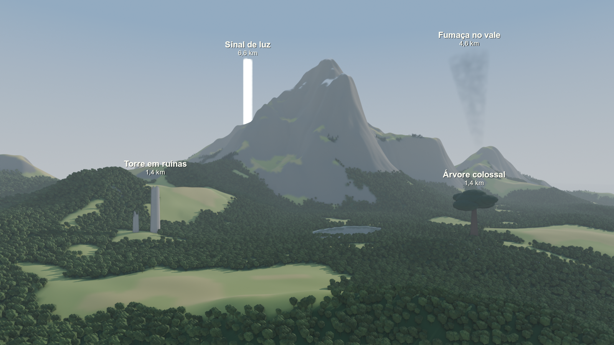

- **Exemplos:** torre em ruínas, árvore colossal, coluna de fumaça e sinal de luz.
- **Regra:** de qualquer ponto da ilha, ver pelo menos 2 marcos. O gerador confere isso pela linha de visão no mapa de alturas.
- **Lugares:** picos, cristas, ilhas de lago e fins de vale. O terreno esconde e revela: subir uma crista mostra o vale seguinte.
- **Silhueta:** cada tipo tem um contorno que se reconhece de longe. Os detalhes e a recompensa só aparecem de perto.
- **Godot:**
  - os marcos ficam fora do corte por distância e usam uma versão simples de longe;
  - a névoa deles é limitada, para nunca virarem só céu;
  - brilham à noite;
  - a fumaça de longe é desenhada por shader.
- **Quantidade:** uns 20 a 40 na ilha.
- **Em aberto:** o tema (ruínas, natureza, máquinas caídas ou mistura).

## 11. Prévias

Ficam em `docs/previas/`. Os scripts estão em `tools/previa/`, são rascunho de planejamento e rodam com o Python do Blender, que tem numpy:

```bash
/Applications/Blender.app/Contents/Resources/5.3/python/bin/python3.13 -I tools/previa/gerar_mapa.py saida 512
```

```bash
/Applications/Blender.app/Contents/MacOS/Blender -b --factory-startup -P tools/previa/vista_aerea.py -- saida/colinas.npz "$PWD/vista.png" 1600 900 430 225 260 220 265 120
```

- `vista_aerea.py` recebe a linha e a coluna da câmera no mapa de 512, a altura dela sobre o chão, e a linha, a coluna e a altitude do alvo.
- Com `MARCOS=1`, ele lê o `marcos_bloco.py` e põe os marcos.
- O OpenImageIO do Blender não tem FreeType, então os textos nas imagens são escritos com `blf` (`rotulos.py`).

## 12. Estrutura do jogo (proposta em discussão, 2026-11-14)

O usuário testou a etapa 1 ("está legal") e pediu uma análise de um vídeo de jogo livre do Anthem (8 min 35 s, sem narração), para montar a estrutura do nosso jogo. Vale a regra de sempre: levar a mecânica e a sensação, nunca nomes, personagens ou visual.

### 12.1 O que o vídeo mostra

- **Movimento:** a maior parte do tempo é no ar.
  - Voo baixo por cânions, entre pilares de pedra, por baixo de arcos e por dentro de túneis e anéis gigantes.
  - Pairar parado no ar para olhar e mirar.
  - Planar e mergulhar de braços abertos entre penhascos, na chuva.
  - No chão, corrida rápida pela mata.
  - Um aviso de esquiva aparece quando um tiro vem.
  - O motor fica esfriado quase o tempo todo, porque chove e há cachoeiras.
  - Nas bordas do mapa, uma tempestade empurra a armadura de volta.
- **Mundo:** muito vertical.
  - Penhascos de centenas de metros, pilares, cachoeiras por toda parte, cavernas escuras com fogo aceso e árvores colossais em forma de guarda-chuva.
  - Ruínas de uma tecnologia antiga engolidas pela mata: um arco gigante sobre o vale, um anel de pedra e um tubo com nervuras.
  - Névoa, raios de sol, chuva e fim de tarde.
- **Exploração:**
  - tarefas pequenas no mundo livre (achar 3 peças espalhadas e levar à base);
  - nome do lugar aparecendo ao chegar;
  - itens no chão;
  - plantas que se colhem segurando um botão (material de fabricação);
  - reputação com um grupo subindo.
- **Combate** (pouco, no vídeo):
  - bichos pequenos e rápidos em bando;
  - uma torre de vigia com laser vermelho num posto de ferro enferrujado;
  - números de dano e marcador de acerto.
- **Interface:** duas barras (escudo e blindagem), bússola no alto com marcas, tarefa no canto, munição de 2 armas e uma barra com 4 ou 5 habilidades com recarga.
- **Multiplayer:** outros jogadores aparecem no mesmo mundo, porque o jogo é cooperativo.

### 12.2 Proposta para o nosso jogo

Pilares:
1. Mover-se é o prazer.
2. O mundo é feito para voar e esconder coisas.
3. O que se coleta vira equipamento.
4. A luta pede movimento.

| Tema | Proposta |
|---|---|
| Pulo e pulo duplo | X pula; X no ar dá um segundo pulo com os propulsores (uma vez, +3% de calor); segurar X, no chão ou no ar, decola ou liga o voo |
| Esquiva | O no chão ou pairando dá um tranco curto para o lado do analógico (+5% de calor); no voo, O solta |
| Pairar e mirar | L2 no ar fica parado e mira (esquenta devagar); L2 no chão mira por cima do ombro |
| Mundo | Somar cânions, pilares de pedra, cachoeiras e cavernas ao relevo; ruínas antigas gigantes (arcos, anéis, tubos) como pontos de interesse; tempestade sobre o mar como borda |
| Coleta | Plantas (fibra e resina), veios de minério (metal), destroços antigos (componentes), núcleos de energia (de inimigos e ruínas) e baús raros nas ruínas; segurar Triângulo 1 s para colher |
| Tarefas no mundo | Juntar peças, caçar uma fera, desligar uma torre, limpar um posto; bússola e mapa com marcas |
| Vida | Escudo, que recarrega sozinho, mais blindagem, que só volta com kit ou na base |
| Armas | Duas por vez: fuzil, escopeta, precisão, lança-granadas e metralhadora pesada (esta só na armadura pesada). R2 atira, Triângulo troca |
| Habilidades | Duas de ataque (granada, míssil), uma de suporte (escudo de área) e uma especial que carrega lutando. R1, L1 e R1+L1 |
| Inimigos | Fauna (bando de caçadores rápidos, voadores que perseguem no ar, uma fera grande por região) e um grupo hostil com postos, torres de laser, soldados, drones e um gigante blindado; golpe com aviso vermelho para esquivar |
| Oficina | Na base: gastar materiais para fabricar e melhorar armas, habilidades e peças da armadura (radiador = mais tempo de voo, propulsor = velocidade, casco = blindagem, gerador = escudo) |
| Armaduras | Novas armaduras com jogabilidade própria (§10), fabricadas com material raro |
| Raridade | Comum, incomum, rara e épica, por cor |
| Abrir caminho | Melhorias que abrem lugares: radiador para zonas quentes, vedação para mergulhar nos lagos, propulsor para os picos altos |
| Fica de fora | Multiplayer, saque com dezenas de números aleatórios, reputação de grupos (talvez depois) e base com conversas |

Ciclo: explorar → coletar e lutar → oficina → equipar → voltar mais forte para áreas novas e mais difíceis.

### 12.3 Ordem das próximas etapas (aprovada em 2026-11-14)

O usuário mudou a ordem: exploração, movimento e jogabilidade até ficarem finos antes de inimigos e armas.

1. **Movimento completo** na ilha de teste: pulo duplo, esquiva, pairar e mirar no ar e no chão, sem arma.
2. **Maquete do mapa feito à mão** (§13), para aprovação.
3. **Primeira região construída:** vertical, com cânions, pilares, cachoeiras e cavernas, e o carregamento por distância.
4. **Exploração:** lugares com nome ao chegar, mapa, bússola e marcador, segredos e caminhos que pedem bom voo.
5. **Atmosfera e som:** névoa, chuva, cachoeiras, dia e noite, vento e motor; a armadura final; o DualSense completo.
6. **Futuro:** inimigos, armas, coleta, oficina, base e armaduras novas (§12.2 fica como proposta guardada).

**Passo 1 feito (2026-11-14):** movimento completo na ilha de teste.


- **Pulo duplo:** X no ar dá 9,5 m/s para cima, uma vez por pulo, com +3% de calor; o pulo simples sobe 1,7 m e com o duplo chega a ~3,7 m. Segurar X depois do pulo duplo liga o voo. A conta de pulo duplo e esquiva no ar zera ao pousar, ao ligar o voo e ao pairar.
- **Esquiva:**
  - O no chão, no ar (uma vez) ou pairando.
  - 18 m/s por 0,28 s, ~4 m, para o lado do analógico (sem direção, para trás).
  - +5% de calor e 0,55 s de recarga. No voo, O continua soltando.
- **Pairar:** apertar o L2 no voo freia e para no ar, e segurar o L2 depois de um pulo também paira. Pairando, a armadura:
  - segura a altura e desliza a 5 m/s com o analógico;
  - esquenta 4%/s;
  - liga o voo com X e cai ao soltar o L2.

  Superaquecer pairando apaga o motor e plana.
- **Mirar sem arma:**
  - L2 no chão aproxima a câmera por cima do ombro (2,4 m, 56°), deixa a armadura andando a 3 m/s virada para a mira e aponta o braço direito para onde a câmera olha.
  - A mira mostra a distância até onde aponta.
  - R2 mirando marca um ponto: um losango com a distância aparece na tela, e ele some ao chegar a 6 m.
- **Tela corrigida:** desde a etapa 1, a tela e a pausa eram desenhadas encolhidas no canto de cima (faltava `set_anchors_and_offsets_preset`); agora a barra de calor fica junto da mira e a velocidade no canto de baixo.
- **Testes:** 69 pontos ("VOO OK"); fotos `c11` a `c14`.

## 13. Mundo feito à mão (método proposto, 2026-11-14)

- **Maquete primeiro:** um mapa 2D com regiões, rotas de voo e pontos altos, para aprovar antes de construir.
- **Relevo:**
  - Um mapa de alturas desenhado por nós, por formas posicionadas à mão: cânions ao longo de curvas, platôs, vales, morros.
  - A erosão é feita uma vez nas ferramentas e o resultado fica salvo no projeto (EXR ou PNG de 16 bits). O jogo só lê; nada é sorteado ao jogar.
  - Mudar o mundo = mudar os dados e assar de novo.
- **O que o mapa de alturas não faz:** pilares, arcos, saliências e cavernas viram peças de rocha modeladas por script no Blender e postas à mão (lista de posições no projeto).
- **Ruínas gigantes:** peças modulares do Blender (arcos, anéis, tubos, pontes) montadas à mão.
- **Água:** rios e cachoeiras como malhas ao longo de curvas, e os lagos.
- **Mata:** mapas de densidade desenhados mais regras de inclinação e altura, com árvores especiais postas à mão.
- **Tamanho:** construir por região. A primeira tem ~2 × 2 km, densa e vertical; as outras crescem em volta.
- **Relevo grande:** com o mundo crescendo, o plugin Terrain3D (níveis de detalhe, colisão, pintura de textura) volta a ser candidato. Ele é baixado só com permissão.

## 14. Teste de qualidade visual na Godot (2026-11-14)

O usuário perguntou se valia trocar para a Unity para chegar à qualidade do vídeo. A resposta foi não:
- o visual realista da Unity vem do HDRP, que entrou em modo de manutenção em 2026;
- o que muda o teto de verdade é a Unreal 5, com custo alto no nosso fluxo;
- a maior diferença está na arte.

Ele pediu o teste na Godot.

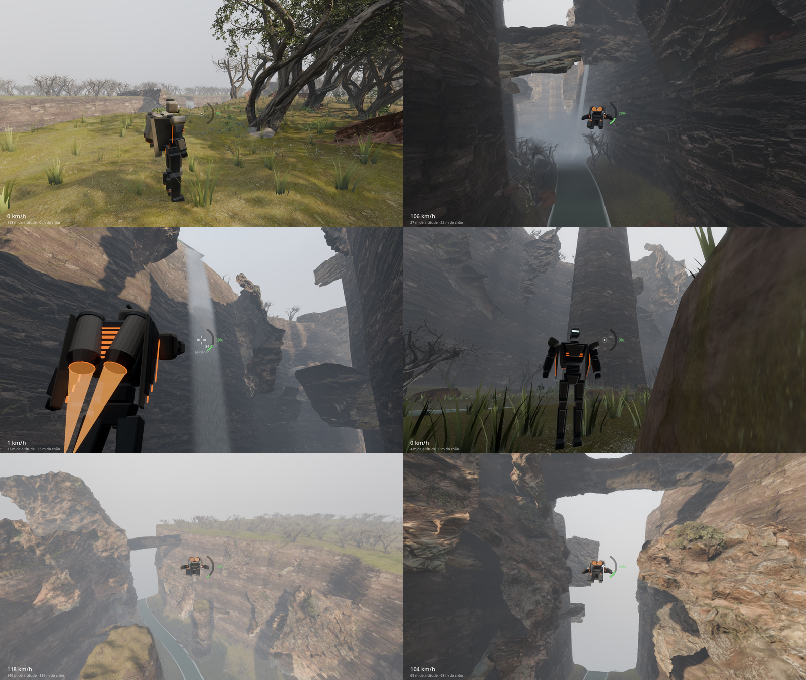

- **Arte baixada** (permitida pelo usuário): 19 arquivos CC0 do Poly Haven (174,5 MB) em `vendor/polyhaven/` (fora da Godot, com `.gdignore`).
  - Rochas: coastal_cliff_01, rock_face_01 e 02, mountainside, rock_moss_set_01 e 02, boulder_01.
  - Plantas: island_tree_02, pachira, anthurium, calathea, fern_02, shrub_02, root_cluster_01.
  - Texturas 2k: cliff_side, forest_ground_04, aerial_grass_rock.
  - Céu: kloofendal_misty_morning_puresky.
- **Preparação:** `tools/teste_visual/preparar.py` (Blender) reduz os triângulos e exporta GLB para `assets/teste_visual/` (a árvore vai de 1 milhão para 117 mil triângulos; a versão leve de 29 mil perdeu as folhas e saiu de uso). Exportar com `export_image_format="AUTO"`: com `"JPEG"` a Godot não lia uma das imagens.
- **Cânion** (`scripts/teste_visual/canion.gd`, classe `Canion` que herda a `Ilha`):
  - 640 × 640 m, um ponto por metro.
  - Paredões de 114 m com rochas do Poly Haven encaixadas e colisão por malha.
  - Um vale largo com três pilares de 60 a 96 m e uma ponte de rocha natural (coastal_cliff_01).
  - Cachoeira de ~110 m num poço, com névoa local (FogVolume) e borrifo de partículas.
  - Córrego no platô, rio no fundo, 825 árvores (cada uma com redução automática pela distância, `lod_bias` 0,3), sub-bosque e grama com vento em MultiMesh.
- **Luz:** céu do HDRI, névoa volumétrica, SDFGI, SSR, SSAO, brilho e antisserrilhado temporal (`Main._ambiente_canion`).
- **Shader do chão** (`scripts/shaders/terreno_canion.gdshader`): rocha triplanar puxada para cinza esverdeado, musgo nas paredes, grama e chão de mata pela inclinação, molhado perto da água.
- **Rodar:**
  - `godot --path . -- --canion` abre o cânion.
  - `godot --path . -- --canion-captura` tira 7 fotos em `tools/capturas/canion/` com o fps de cada uma.
  - No jogo, a pausa troca entre a ilha e o cânion. A cachoeira também esfria o motor.
- **Desempenho no Mac (M4, 1600 × 900):** 13 a 29 fps, com 9 a 22 milhões de triângulos e ~550 a 850 chamadas de desenho. Falta medir na 3060 Ti; está no PC desde 2026-11-14 (pausa → "Ir para o cânion", F3 para o medidor).
- **Leitura do resultado:**
  - Rochas, paredões e ponte ficaram no nível realista.
  - A mata é o ponto fraco, pela arte: as árvores do Poly Haven parecem oliveiras secas, e faltam árvores de selva com copa densa.
  - O céu enevoado deixa a luz chapada.
  - A água do rio ainda é simples.

## 15. Direção e equipe (2026-11-14)

O usuário definiu o jogo como hobby, sem fins lucrativos, fortemente inspirado no Anthem (referência: o vídeo da §12.1). O Claude é o líder técnico e o artista. Agentes Haiku fazem código e tarefas paralelas, cada um com arquivos próprios, sem tocar no `main.gd`, e o líder revisa e integra.

**Estilo em avaliação:** o usuário aceitou o realista da §14, mas ofereceu um estilo pintado como o do Breath of the Wild, com tom sério, adulto e escuro. Recomendação do líder: **pintado e sério**.
- Toda a arte sai dos nossos scripts e combina entre si.
- Roda 3× mais leve.
- Não depende de arte fotografada, que não temos para a selva.

O usuário decide comparando os dois cânions no PC.


- **Cânion pintado** (`scripts/teste_visual/canion_estilo.gd`, classe `CanionEstilo`, herda `Canion`):
  - Formas do Blender em `tools/estilo/gerar.py` → `assets/estilo/`: 3 árvores de copa larga, árvore colossal, moita, 4 rochas talhadas e o arco.
  - Cor nos shaders `terreno_estilo` (rocha em estratos, musgo, capim escuro) e `folha_estilo`.
  - Luz em `Main._ambiente_estilo`, sem SDFGI, porque ele deixava preta a sombra debaixo das copas.
  - 3.231 árvores em MultiMesh; no Mac dá 56 a 75 fps (o realista dá 13 a 29).
  - Abrir com `-- --canion-b`; fotos com `-- --canion-b-captura`.
  - Falta: as sombras ainda estão escuras demais no chão, e a armadura precisa de material no mesmo estilo.
- **Som** (agente Haiku): `tools/gerar_sons.py` gera 13 WAVs em `assets/sons/`; `scripts/sons.gd` (classe `Sons`) toca vento e motor pela velocidade, os toques pelos estados e a cachoeira em 3D. Ninguém ouviu ainda.
- **Rio** (agente Haiku): `scripts/shaders/rio.gdshader`, com correnteza, refração e espuma na beira; as riscas de espuma ainda parecem pontilhado.
- **Testes do cânion** (agente Haiku): `-- --teste-canion` (9 pontos, "CANION OK"; somar `--canion-b` testa o pintado). A bateria achou pedras de parede invadindo o vale e travando o voo; agora elas ficam enterradas no paredão.
- **Batida:** de través também derruba (impacto > 14 m/s com velocidade > 28 m/s).
- **Pausa:** o botão "Próximo mapa" roda ilha → cânion pintado → cânion realista.

**Estilo escolhido (2026-11-14): pintado e sério.** O jogo abre no cânion pintado (`--ilha` e `--canion` abrem os outros mapas; `--teste` e `--captura` seguem na ilha). Mudanças do dia:
- Sombras clareadas (luz ambiente 3,0, opacidade da sombra do sol 0,86).
- A armadura de teste ganhou material fosco com borda acesa.
- Bússola no topo da tela (agente Haiku, `Hud._desenhar_bussola`): N, L, S, O, marcas a cada 15° e o losango do marcador.
- Armadura nova: o usuário vai procurar um modelo no Tripo AI e salvar em `vendor/tripo/`. O pedido é GLB em pose A ou T, sem arma, com desenho original. O líder corta nas juntas no Blender e prende na animação atual.

**Armadura v2 (2026-11-14):** o Tripo não deu um modelo bom, e o usuário mandou como referência a folha do Ranger do Anthem. Não copiamos esse modelo; a v2 é original (`tools/maquete/armadura_v2.py` → `assets/armadura/armadura_v2.glb`, folha em `docs/maquetes/armadura_v2.png`). Ela tem placas em camadas sobre traje escuro, ombreira dupla, reator no peito, pernas com pistões e capacete com crista, em osso, grafite e azul-petróleo. Usa as mesmas juntas da v1, então a animação do jogo vale igual. Avaliação do líder: melhor que a v1, mas ainda com cara de robô de brinquedo (clara demais, peças soltas, formas de caixa). Modelagem só por script tem teto; ver as opções na conversa.

**Armadura provisória do usuário (2026-11-14):** `vendor/robot-test-v1.glb` (Tripo com esqueleto Mixamo, pose em T, 6 mil triângulos, textura 2k), copiado para `assets/armadura/robo_teste_v1.glb`. Fica até acharmos a definitiva.

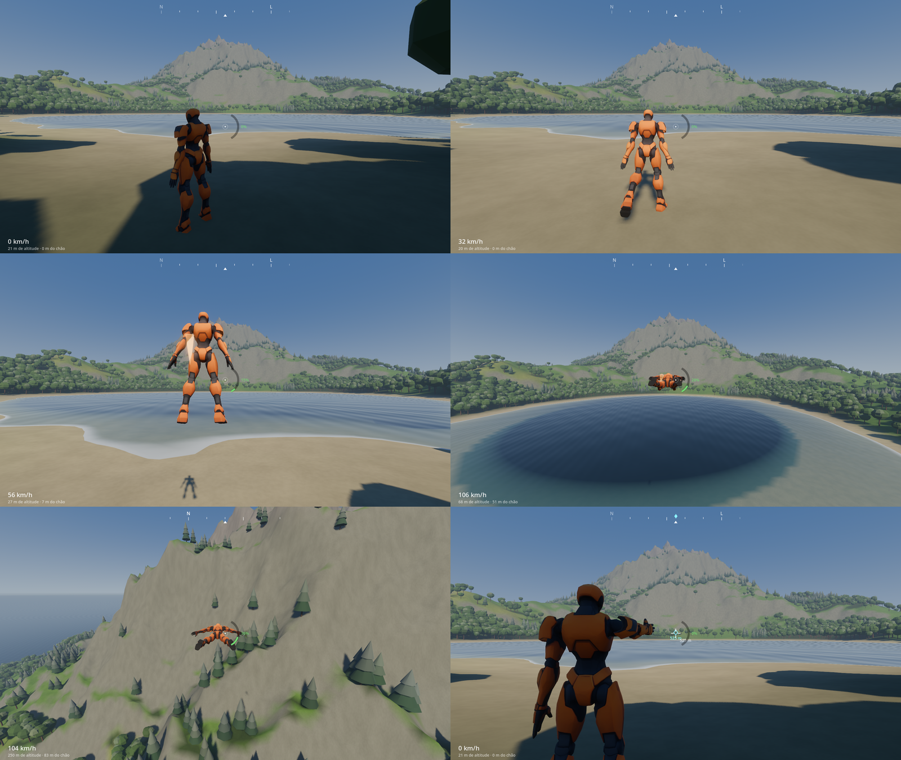

- `ArmaduraVisual` detecta o `Skeleton3D` e manda as mesmas poses para os ossos (`OSSOS`, `_aplicar_ossos`): a rotação de cada junta é acumulada de pai para filho no referencial do modelo e convertida para a pose local do osso; os braços descem 78° do T antes da pose.
- O modelo é escalado para 2,6 m.
- Tem duas chamas simples presas à espinha.
- Não tem aletas nem o brilho do calor no corpo.
- Qualquer modelo com esqueleto Mixamo entra trocando só a constante `MODELO`.

## 16. Maquete do mapa (2026-11-14, esperando aprovação)

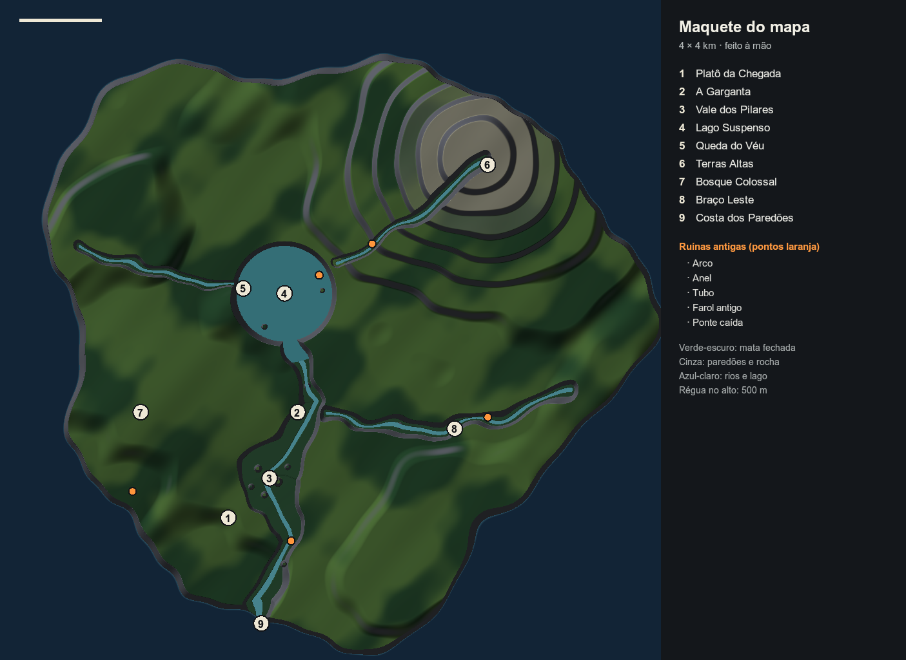

Ilha de 4 × 4 km feita à mão (`tools/mapa/mapa.py`: contorno, cânions por linhas, lago, terras altas e pilares postos à mão; o script grava também `docs/mapa/mapa_alturas.npy`, um ponto a cada 4 m, que vira a base do relevo no jogo).

| # | Lugar | O que é |
|---|---|---|
| 1 | Platô da Chegada | Começo do jogo, na borda oeste da Garganta |
| 2 | A Garganta | Cânion principal, do lago até o mar; o cânion de teste atual é um trecho dele |
| 3 | Vale dos Pilares | Alargamento da Garganta com 5 pilares de 64 a 110 m |
| 4 | Lago Suspenso | Lago a 62 m de altitude, onde três cursos d'água se encontram |
| 5 | Queda do Véu | Cachoeira da Fenda do Oeste caindo no lago |
| 6 | Terras Altas | Morro de ~360 m a nordeste, nascente do rio alto |
| 7 | Bosque Colossal | Morro a oeste com as árvores gigantes |
| 8 | Braço Leste | Cânion lateral que encontra a Garganta |
| 9 | Costa dos Paredões | Foz da Garganta no mar, entre paredões |

Ruínas antigas (pontos de interesse, estilo a definir): Arco sobre a Garganta, Anel junto ao lago, Tubo no Braço Leste, Farol antigo a oeste e Ponte caída no rio alto.

Ordem de construção proposta: 1 → 2 → 3 (o que já existe no teste), depois 4 e 5, e o resto em volta.

**Exploração, primeiro passo (2026-11-14):**
- `scripts/locais.gd` (classe `Locais`, agente Haiku): lugares com nome, raio e "já visto"; o sinal `chegou` faz a tela mostrar o nome grande e "lugar descoberto · N de M".
- No cânion já existem Platô da Chegada, Queda do Véu, Vale dos Pilares e Ponte de Pedra.
- A bússola ganhou fundo escuro, e o losango do marcador fica abaixo das letras.
- Rio (`rio.gdshader`): cor por profundidade em faixas e beira limpa. O brilho por face de onda virava um pontilhado branco e foi tirado na revisão.
- Ninguém viu ainda o aviso de lugar na tela com o jogo aberto.

## 17. O mundo no jogo, primeira versão (2026-11-14)

O usuário mandou seguir depois da maquete, e a ilha de 4 km virou o mapa de entrada do jogo.


- **Dados:** `JOGO=assets/mundo blender ... tools/mapa/mapa.py` grava `alturas.bin` e `agua.bin` (1025 × 1025, 4 m por ponto, linha 0 = norte) e `dados.json` (lugares, lago, quedas, pilares, bosque, ruínas). A maquete mudou um pouco: lago a 40 m, platô a ~126 m, cânions com curvas, e os dois rios altos caem ~55 m no lago.
- **Jogo** (`scripts/mundo.gd`, classe `Mundo`, herda `Ilha`):
  - relevo em 256 blocos com o shader pintado, e colisão por mapa de alturas;
  - água lida do `agua.bin` (um quadrado por célula molhada) com o shader do rio, mais o mar e duas cachoeiras com névoa;
  - 650 pedras talhadas enterradas nos paredões, com colisão;
  - ~50 mil árvores em blocos de 256 m (modelo completo até 420 m, modelo leve de 170 triângulos depois);
  - 16 árvores colossais no Bosque e o Arco sobre a Garganta;
  - os 9 lugares com nome.
- **Desempenho no Mac:** 43 a 75 fps, com 0,5 a 2,3 milhões de triângulos.
- **Rodar:** `godot --path .` abre o mundo; `-- --mundo-captura` tira 8 fotos; `--canion-b`, `--canion` e `--ilha` abrem os mapas antigos. A build inclui `*.bin` e `*.json` (`include_filter`).
- **Falta:**
  - testes automáticos do mundo;
  - grama e moitas;
  - as outras quatro ruínas;
  - a parede dos cânions é lisa (4 m por ponto) e pede mais pedras e saliências;
  - a névoa de longe ainda apaga a ilha vista do alto;
  - ninguém voou nele de verdade ainda.

**Mundo v2: passada de composição (2026-11-14).** O usuário achou o mundo distante do vídeo de referência. Diagnóstico do líder: faltavam verticalidade, água por todo lado, selva variada e névoa nos vales.


- **Relevo** (`tools/mapa/mapa.py`): platô em andares de 55 m (de ~90 a ~230 m), terras altas até ~500 m, cânions com parede de 6,5:1 e largura variada, bacia do lago com paredão de ~200 m, 10 pilares de até 185 m, costa mais alta.
- **Água** (`Mundo._agua_mundo`, `_queda`): além das duas quedas no lago (~95 m), 22 cachoeiras finas escorrem dos paredões para os rios. O jogo acha os lugares andando do rio até um paredão 85 m mais alto.
- **Selva:**
  - 2.200 cortinas de cipó e musgo nos paredões (`_cipos`, shader `cipo_estilo`);
  - manchas largas de cor na mata, pelo shader (oliva e azul-petróleo);
  - clareiras;
  - árvores maiores no platô, e menores e mais raras no fundo dos cânions;
  - 1.300 pedras talhadas.
- **Ar:** névoa deitada no fundo dos vales (FogVolume a cada ~170 m de rio), nuvens pintadas no céu, sol mais baixo.
- **Chão vivo** (agente Haiku, `scripts/chao_vivo.gd`): grama, samambaias e flores só em células de 32 m num raio de ~100 m do jogador.
- **Erro corrigido:** paletas por bloco deixavam quadrados amarelos de 256 m na mata; a variação passou para o shader.
- **Ainda longe da referência:** as árvores são todas do mesmo tipo (copa larga), falta arquitetura antiga gigante, e as paredes têm pouca saliência grande (arcos, saliências, cavernas).
- Testes do mundo (agente Haiku): `-- --teste-mundo`, 10 pontos, "MUNDO OK" (lugares, lago, mar, todas as cachoeiras esfriando, voo alto, quedas sem atravessar o chão).

## 18. Novo rumo (2026-11-14, em discussão; nada implementado)

O usuário avaliou que superestimamos a capacidade de construção e que perseguir a escala e o visual do Anthem não estava dando certo. As seções 12 a 17 ficam como registro. O que ele quer:

- **Jogo:** para se entreter sem objetivos — voar, caminhar, correr, observar. "Cozy, mas adulto."
- **Mundo:** pequeno e caprichado (um vale de ~800 m a 1 km feito à mão, crescendo um canto por vez). Floresta temperada com campos.
- **Tempo:** dia e noite passando sozinhos, com chuva às vezes.
- **Vida:** bichos naturais pacíficos. O combate é um tempero, contra máquinas agressivas.
- **Personagem:** um robô pequeno (~1,2 m) no jeito do Faísca da Ilha Cafuné, em tom sério (metal gasto, visor de uma luz só, movimentos contidos).
- **Propulsores:** jatos nos pés e nas mãos. No voo, os dos pés são os fortes (empurram) e os das mãos são mais fracos (equilibram e guiam). Os das mãos também são a arma. Atirar esquenta o mesmo motor do voo.
- **Estilo:** técnica do Breath of the Wild (luz em faixas, borda clara, muito capim ao vento, cores limpas, distância azulada, céu pintado), sem copiar arte nem personagens.
- **Primeiro passo proposto:** um quadro só, uma clareira de ~100 m com capim, árvores, pedras, riacho, o robô novo e um bicho pastando, até o visual ser aprovado.
- **Reaproveita:** movimento, câmera, calor, chão vivo, lugares com nome, sons, testes e o caminho de build.

## 19. Primeiro quadro do novo rumo: a clareira (2026-11-14)

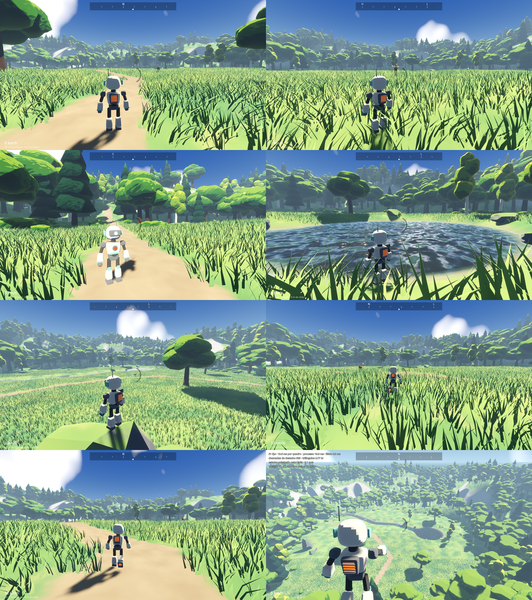

- **Mapa** (`scripts/vale/clareira.gd`, classe `Clareira`, herda `Ilha`): 320 × 320 m feitos à mão, um ponto por metro. Campo de capim, trilha de terra, riacho até uma lagoa, pedra-mirante, carvalhos e bétulas postos à mão, e ~1.500 árvores fechando o quadro nas colinas. É o mapa de entrada do jogo; a pausa troca para os antigos.
- **Estilo** (`scripts/shaders/vale_*.gdshader` e `vale_comum.gdshaderinc`): luz em duas faixas (`luz_faixas`), borda clara, copas em três tons, e o capim com a mesma cor do chão (`cor_capim`), com rajadas de vento atravessando o campo. São 140 mil touceiras em blocos de 32 m. Ambiente em `Main._ambiente_vale`: céu azul com nuvens, sombra azulada, sem luz global.
- **Robô v1** (`tools/vale/robo.py` → `assets/vale/robo_v1.glb`, folha em `docs/vale/robo_v1.png`): 1,2 m, cabeça grande com visor de um olho só, botas e antebraços largos com as brasas dos jatos (pés fortes, mãos fracas). Usa as mesmas juntas da armadura, então a animação é a mesma. `Armadura.porte = 0.48` encolhe a cápsula e aproxima a câmera.
- **Natureza** (`tools/vale/natureza.py` → `assets/vale/`): dois carvalhos, bétula e pinheiro (cada um com versão leve de longe), arbusto, três pedras e o cervo em peças.
- **Cervo** (agente Haiku, `scripts/vale/cervo.gd`): pasta, anda, fica alerta e foge. Chegando devagar, ele se acalma. Há três na clareira. O teste do agente cobriu os estados e o chão; ninguém viu a animação de perto ainda, e o focinho não chega ao chão ao pastar.
- **Desempenho no Mac:** 47 a 100 fps.
- **Rodar:** `godot --path .`; fotos com `-- --vale-captura`.
- **Falta neste quadro:** tiro pelas mãos, dia e noite, chuva, som do lugar, testes automáticos da clareira e a pose de voo com as mãos guiando.

**Retorno do usuário sobre o quadro (2026-11-14):** "ficou muito lindo o ambiente".
- **Feito:** a decolagem (segurar X) sobe ~24 m (`DECOLAGEM_IMPULSO` 21, `DECOLAGEM_TEMPO` 0,85). Por 1,6 s depois de decolar, o nariz não aponta abaixo do horizonte (`DECOLAGEM_GRACA`), para o voo não bater no chão com a câmera olhando para baixo. Teste novo na bateria (70 pontos).
- **Lista de implementação** (pedidos do usuário):
  - física da água melhor (ondas e respingo ao tocar, rastro no rasante, entrar e sair d'água);
  - partículas ao atravessar a copa das árvores (folhas soltando).
- **Ainda da lista do quadro:** tiro pelas mãos, dia e noite, chuva, som do lugar, testes da clareira, pose de voo com as mãos guiando, tom mais sóbrio, cervo visto de perto.

**Decisões e pedidos de 2026-11-14 (noite):**
- **Tom:** o dia tem momentos com tons diferentes — amanhecer, manhã, tardezinha e noite — e chuva às vezes. Os estudos estão em `docs/vale/tons.png` (`-- --clima tarde` e `-- --clima nublado`); o fim de tarde precisa de sombra menos escura.
- **Jogabilidade, para fazer:**
  - Superaquecer no voo: o robô cai (hoje ele plana). Se o jogador não recuperar o voo antes do chão, pousa "estilo herói" (impacto forte, agachado, poeira).
  - Desligar o voo perto do chão: cai com estilo também, mas mais leve, porque a altura era pequena.
  - A força do pouso segue a altura da queda.
- **Lista de implementação:** física da água; partículas ao atravessar as copas; tiro pelas mãos; ciclo do dia com os tons; chuva; som do lugar; testes da clareira; pose de voo com as mãos guiando; cervo visto de perto.


## 20. A clareira ganha vida (2026-11-14, noite)

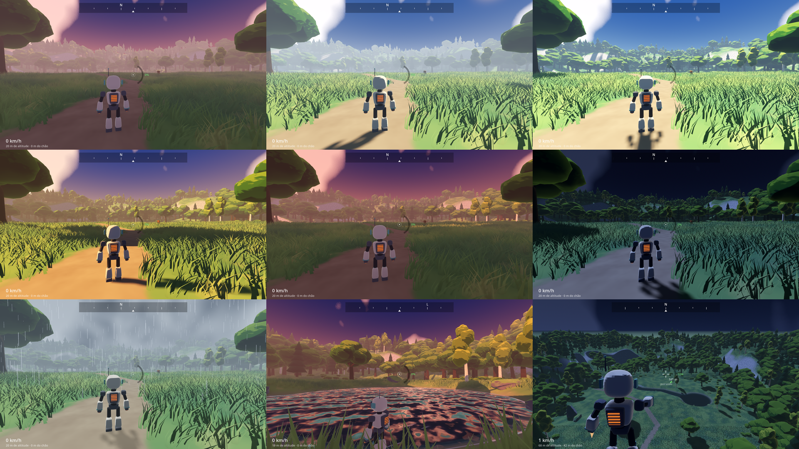


Tudo da lista de implementação da §19 foi feito, menos o cervo visto de perto.

- **Calor (pedido do usuário):** 25 s de voo até superaquecer (`CALOR_VOO` 4,0). Superaquecido, esfria em 12 s no ar (`ESFRIA_SUPER_AR`) e em 5 s no chão (`ESFRIA_SUPER_CHAO`); água e chuva (`ESFRIA_CHUVA`) ajudam. Religa quando o calor chega a `RELIGA_EM`.
- **Queda e pouso:** superaquecer no voo derruba o robô (estado AR, sem pulo duplo). Queda acima de `QUEDA_HEROI` (12 m) dá o pouso de herói (`pouso_forca` 1,0: um joelho, punho no chão, 0,95 s); acima de `QUEDA_LEVE` (3 m), o pouso leve (0,5). `queda_altura` guarda os metros.
- **Ciclo do dia** (`scripts/vale/ciclo.gd`, `CicloDia`): um dia leva 60 minutos (pedido: nada de ciclo rápido). Tabela `CHAVES` com os tons por hora: noite azul com lua, amanhecer rosado, manhã com névoa, dia limpo, tardezinha dourada, pôr do sol. Chuva a cada 7–16 min, por 2,5–5 min, com céu fechado e gotas em volta da câmera. Outros sistemas leem `CicloDia.atual.hora` e `.chuva`. O medidor mostra o momento e a hora. Para fotos: `-- --hora N`, `-- --chuva`, `-- --dia-rapido`.
- **Tiro pelas mãos** (agente Haiku, `scripts/vale/tiro.gd`, `Tiro`): mirando (L2) e segurando R2, um disparo a cada 0,28 s, 3,5 de calor por tiro, projétil de luz da mão direita, estrela e faísca no impacto. Os bichos do grupo `bichos` fogem do disparo e do impacto (`Cervo.assustar`). No chão o motor esfria mais rápido do que os tiros esquentam; o calor do tiro só pesa pairando.
- **Folhas e poeira** (agente Haiku, `scripts/vale/efeitos_mato.gd`, `EfeitosMato`): folhas ao entrar numa copa e enquanto passa por dentro; anel de poeira no pouso (tamanho conforme `pouso_forca`), sopro na decolagem e risco na esquiva.
- **Água** (agente Haiku, `scripts/vale/efeitos_agua.gd`, `EfeitosAgua`): respingo e anel ao cair na água, anéis ao andar no raso, rastro de borrifo e anéis no rasante, anéis lentos ao pairar baixo.
- **Som do lugar** (agente Haiku, `scripts/vale/som_ambiente.gd`, `SomAmbiente`; WAVs novos em `tools/gerar_sons.py`): mata de dia (brisa e pássaros), mata de noite (grilos e coruja), riacho em quatro pontos, chuva e trovão. Segue a hora e a chuva do ciclo. **Ninguém ouviu ainda.**
- **Pose de voo:** braços abertos como lemes; na curva um fecha e o outro abre. Os jatos das mãos brilham 40% dos pés e acendem no tiro.
- **Partículas:** fumaça e estrela do Kenney Particle Pack (CC0, cópia local em `Projects/others/kenney-particle-pack`), em `assets/fx/kenney/`.
- **Testes:** `-- --teste-vale` (agente Haiku, `scripts/vale/testes_vale.gd`): "VALE OK (11 pontos)". A bateria antiga segue em "VOO OK (75 pontos)".
- **Fotos:** `-- --vale-captura --curta --hora N --pasta nome` (três fotos por hora) e `-- --vale-captura --efeitos` (tiro, pouso, copa, voo, água).
- **Não verificado:** o som (só volumes calculados); o respingo do mergulho em foto (o rasante foi visto); o jogo no PC com o DualSense.
- **Depois:** máquinas agressivas, crescer o vale, cervo de perto, estrelas no céu da noite, luzes do robô acesas à noite.

**Pedido do usuário (2026-11-14, noite): sem estradas.** Não faz sentido ter estradas abertas, como se alguém passasse sempre ali. Clareiras naturais em alguns pontos fazem sentido; estradas, não. A trilha de terra da clareira (`Clareira.TRILHA`) deve sair, e o vale novo não ganha caminhos batidos. Ainda não feito.

## 21. Sem trilha, noite viva e cervo de perto (2026-11-14, madrugada)

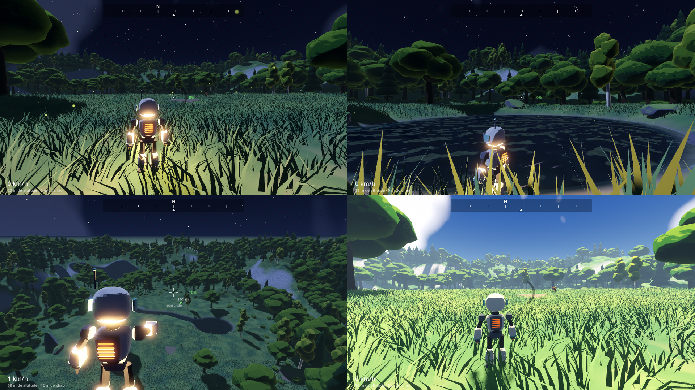
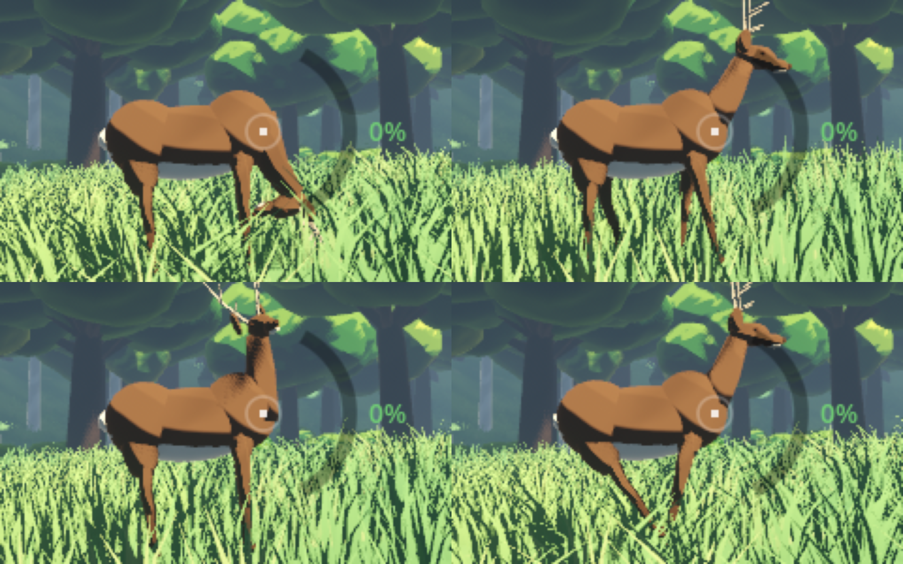

- **Sem estradas (feito):** a trilha de terra saiu. No lugar há quatro claros naturais de terra e capim ralo, de borda torta (`Clareira.CLAROS`, função `_claro`).
- **Noite** (`scripts/vale/noite.gd`, classe `Noite`): 1.500 estrelas que somem com a chuva, vaga-lumes sobre o capim do anoitecer à madrugada, e a luz do próprio robô (as barras do peito e o visor acendem mais, e ele ilumina uns 5 m em volta como uma lanterna).
- **Cervo v2** (`tools/vale/natureza.py`): corpo mais liso, coxas e ombros, barriga e garupa claras, olhos, nariz, canelas escuras, cor menos laranja. Fotos de perto com `-- --vale-captura --cervo` (o cervo tem `pose_foto` para ficar parado num estado).
- **Não verificado:** a animação do cervo em movimento (só poses paradas em foto).

## 22. Mais bichos e maquetes das máquinas (2026-11-15)


- **Pássaros** (agente Haiku, `scripts/vale/passaros.gd`, `Passaros`): três bandos de 5 a 7. Ciscam no chão de asas fechadas, levantam voo juntos quando o robô chega perto (9 m, ou 16 m se ele vem rápido) ou com um tiro, dão voltas a 12–20 m e pousam em outro lugar.
- **Coelhos** (agente Haiku, `scripts/vale/coelho.gd`, `Coelho`): cinco, perto dos claros. Sentam, comem, andam em pulinhos e fogem em ziguezague.
- **Peixes** (agente Haiku, `scripts/vale/peixes.gd`, `Peixes`): cardume de nove na lagoa. Nadam rasos (a água é pouco transparente), fogem de respingos e do robô, e um salta de vez em quando, com anéis na água.
- **Modelos** em `tools/vale/natureza.py` (`passaro`, `coelho`, `peixe`). No jogo ficam maiores que o real (1,7×, 1,55× e 1,5×), senão somem no capim.
- Todos estão no grupo `bichos` e reagem a `assustar(ponto)` (o tiro chama).
- **Máquinas agressivas (só maquete, esperando a escolha do usuário):** `tools/vale/maquinas.py` → `docs/vale/maquinas_v1.png`. Três conceitos de metal gasto com musgo e lente vermelha: **Zangão** (voador de 0,9 m, em dupla, rajadas lentas), **Sentinela** (torre andante de 3,2 m, lenta, tiro forte com aviso) e **Carrapato** (rasteiro de 0,6 m, em trio, investe com aríete).
- **Fotos:** `-- --vale-captura --bichos`.
- **Não verificado:** os bichos em movimento contínuo (só fotos); o salto do peixe; o bater de asas no ritmo certo (9 Hz pode ser rápido demais).

## 23. Sentinela e a pane (2026-11-15)


**Regra do usuário:** ninguém é destruído. Nosso robô e as máquinas desligam por excesso de calor e voltam a funcionar depois.

- **Pane do nosso robô** (`Armadura.levar_golpe`, `scripts/vale/pane.gd`): cada acerto de máquina empurra e soma `GOLPE_CALOR` (35). Com `PANE_GOLPES` (3) acertos acumulados ele entra em pane: ajoelha apagado, a tela escurece, o dia avança `PANE_HORAS` (3 h) e ele religa no mesmo lugar, frio, depois de `PANE_TEMPO` (5 s reais). Um acerto sara a cada `AVARIA_SARA` (25 s) sem levar golpe. Por `PANE_GRACA` (12 s) depois de religar as máquinas não o enxergam.
- **Sentinela** (agente Haiku, `scripts/vale/sentinela.gd`; modelo em peças por `tools/vale/sentinela.py`): torre de três pernas com IK, pés plantados e um passo por vez (~0,8 m/s). Patrulha em volta da casa (rio acima, a ~130 m do começo). Vê o robô a 55 m com linha de visão; avisa 1,6 s com a lente piscando e um feixe vermelho que trava a mira nos últimos 0,35 s; dispara um projétil lento (38 m/s) que dá para desviar; recarrega 3,2 s.
- **Calor do Sentinela:** cada tiro nosso na cabeça soma 17; esfria 5 por segundo depois de 2,5 s sem levar tiro. Com 100 ele desliga: arria no lugar com a lente apagada. Religa ali mesmo depois de 3.600 s reais (um dia inteiro do jogo; pedido do usuário, para haver paz depois da batalha vencida). A pane do jogador desconta 3 h desse tempo (`avancar_tempo`).
- **Ganchos:** o tiro do robô chama `levar_tiro(ponto)` no grupo `maquinas`; a cabeça tem colisão na camada 2.
- **Testes:** `-- --teste-vale` agora tem 13 pontos (pane e Sentinela entraram). Fotos: `-- --vale-captura --sentinela`.
- **Não verificado:** o Sentinela andando em movimento contínuo (só fotos), o som dele (não tem), e o combate jogado de verdade com o controle.
- **Faltam das maquetes:** Zangão e Carrapato.

**Decisão do usuário (2026-11-15):** Zangão e Carrapato ficam para depois da expansão do mapa; a clareira atual só tem o Sentinela. Ele vai testar o tempo de paz de 60 minutos da máquina desligada e dar retorno.

## 24. Peso no movimento (2026-11-15, retorno do teste no PC)

O usuário achou que: ao desligar os propulsores no voo o robô continuava planando; faltava atirar sem mirar; andar e correr deslizavam, sem peso; e a esquiva não parecia física.

- **Desligar o voo (O no voo):** sobra 60% da velocidade de lado (`SOLTAR_CORTE`), o ar tira o resto (`ARRASTO_QUEDA`) e a gravidade vale 1,3× (`QUEDA_PESADA`) até pousar ou religar. O mesmo quando o motor trava por calor. Medido: de 28 m/s de lado para 6 em 1 s, caindo a 33 m/s.
- **Tiro sem mirar:** R2 atira no chão, caindo, pairando ou voando, para onde a câmera aponta. No chão o robô vira para a câmera e ergue o braço (`Armadura.atirando`).
- **Andar e correr:** o robô pequeno anda a 2,1 m/s e corre a 6,3 m/s (`Armadura.vel_chao` 0,7; antes 3 e 9, rápido demais para pernas de 0,45 m). A passada da animação segue a distância andada (ciclo de 2,0 a 4,0 × porte), para o pé não escorregar. Ganhar velocidade leva um instante (`ACEL_CHAO` 20) e parar é mais firme (`FREIO_CHAO` 34).
- **Esquiva → arranque de jato:** um empurrão só, com um salto curto (`ESQUIVA_SALTO`), que o chão e o ar vão freando; acabou a velocidade forçada por 0,28 s.
- **Testes:** `-- --teste-vale` com 15 pontos (queda pesada e tiro sem mirar entraram).
- **Não verificado:** a sensação com o controle; a animação da passada em movimento.

**Mais retorno do usuário (2026-11-15):**
- **Pouso sempre animado:** toda chegada de voo, de voo parado ou de queda acima de `QUEDA_TOQUE` (2,2 m) passa pelo estado POUSO, em três graus: toque (`pouso_forca` 0,25; 0,24 s), médio (0,5; acima de 3 m) e herói (1,0; acima de 12 m). Chegando perto do chão (`Armadura.chegando_ao_chao`), o robô já arma as pernas e abre os braços.
- **Voo parado:** L2 no ar liga e ele continua parado mesmo soltando o L2. X volta a voar para a frente; O desliga o propulsor e ele cai pesado. A esquiva no voo parado saiu (o O agora desliga).
- Testes: `--teste` com 76 pontos, `--teste-vale` com 15. Fotos da chegada: `-- --vale-captura --pouso`.

**Passada refeita (2026-11-15, pedido: "robô muito avançado, a movimentação deve ser fluida"):** 
- Defeitos achados: o joelho dobrava na fase errada (com a perna indo para trás) e a suavização das juntas (12/s) comia quase metade do movimento na corrida.
- Agora (`ArmaduraVisual`, bloco do chão): cada perna vai à frente dobrando o joelho, estica para pisar, cede com o peso e empurra com o pé (`_pulso`); a bacia gira com as pernas e o tronco e os braços ao contrário; a cabeça fica firme; o corpo sobe e desce em curva suave; o tronco inclina ao arrancar e ao frear (`_acel`) e o corpo deita para dentro da curva. Parar e andar se misturam sem estalo (`w`). Andando, as juntas seguem a 34/s.
- Fotos quadro a quadro: `-- --vale-captura --passada` (esconde o capim).
- **Não verificado:** a corrida quadro a quadro (a câmera da foto perdeu o robô) e tudo em movimento.
- **Correção (2026-11-15):** o tiro acendia todos os jatos (usava `impulso`); agora usa `Armadura.clarao_tiro` e só o jato da mão direita acende. O tiro ainda não tem som próprio.
- **Regra do tiro (2026-11-15):** no chão atira mirando ou não; no ar, só no voo parado (voando ou caindo, não). Som do tiro fica para depois.
- **Andar atirando ou mirando (2026-11-15):** as pernas viram para onde o robô anda (até 65° da mira) e o tronco torce para a mira (`_torcao`); indo para trás ele recua de costas, com a passada ao contrário (`_re`). Fotos: `-- --vale-captura --mirando`.

## 25. O vale maior (maquete, 2026-11-15, esperando aprovação)


O usuário aprovou seguir para a expansão ("a ambientação tá linda, jogar com ele está divertido") e pediu: uma parte alta com vista da paisagem, um campo de flores em platô perto da praia, uma mata fechada com cachoeira e ruínas antigas tomadas pelo mato.

- **Maquete** (`tools/vale/mapa_vale.py` → `docs/vale/mapa_v1.png`): 1 km × 1 km, a clareira atual no meio. Serra do Mirante a noroeste (~170 m); o riacho nasce nela, cai na cachoeira dentro da mata fechada ao norte, cruza a clareira e deságua na praia ao sul; platô das flores a leste, acima do mar; ruínas a oeste, na mata. Sem estradas.
- **Plano:** aprovar a maquete, depois construir um canto por vez.
- **Antes de construir:** criar o repositório git local (o projeto não tem controle de versão) e escolher o nome do jogo; o usuário pediu para pensarmos num nome.
- **Para depois:** som do tiro e do Sentinela; Zangão e Carrapato no mapa grande.

**Maquete v2 (2026-11-15):** o usuário achou 1 km pouco (a clareira de 320 m já não parece grande e seria um terço do total). Nova maquete com **2 km × 2 km** em `docs/vale/mapa_v2.png` (`E = 2.0` m por pixel em `tools/vale/mapa_vale.py`): mesmos lugares em escala dobrada, mais os Campos do sul (capim aberto até o mar). A clareira fica no meio, do tamanho que tem. Esperando aprovação e o nome do jogo.

## 26. Nome, repositório e plano da expansão (2026-11-15)

- **Nome do jogo:** "Faísca 2: Em Busca do Sossego" (escolha do usuário; já em `project.godot`). **Repositório:** `faisca-2`, git local criado em 2026-11-15 com o estado aprovado da clareira (a pasta continua `jogo-voo`; nada foi enviado para a internet). Fora do git: `.godot/`, `build/`, `tools/capturas/`, `vendor/polyhaven/`.
- **Maquete v2 aprovada** (2 km × 2 km, `docs/vale/mapa_v2.png`).
- **Pedido para o fim das tarefas importantes:** se o jogador tentar cruzar o mar, depois de certa distância o robô entra em pane e volta para a praia.
- **Ordem de construção proposta** (um canto por vez, cada um no capricho da clareira):
  1. **Base do vale inteiro:** terreno de 2 km em blocos, mar, e a clareira atual encaixada no meio sem mudar. Tudo fora da clareira ainda simples (relevo, cor do chão, mata de longe), mas já dá para voar por cima de tudo.
  2. **Campos do sul e praia:** capim até o mar, areia, ondas; e a pane ao cruzar o mar.
  3. **Platô das flores.**
  4. **Mata fechada e cachoeira.**
  5. **Serra do Mirante.**
  6. **Ruínas**, com o Zangão e o Carrapato.
- **Pendências menores:** som do tiro e do Sentinela.

## 27. A base do vale de 2 km (2026-11-15)

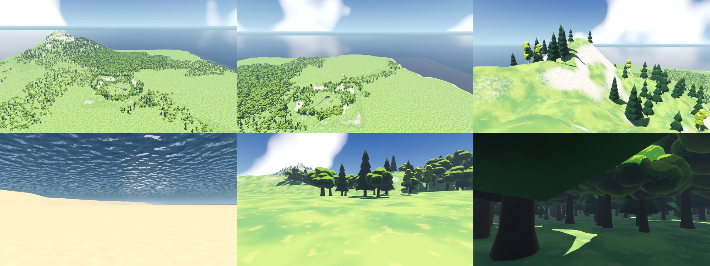

- **Classe `Vale`** (`scripts/vale/vale.gd`, herda `Clareira`): é o mapa de entrada agora (`-- --so-clareira` abre só a clareira antiga). O relevo e a cobertura de fora vêm da maquete (`tools/vale/mapa_vale.py -- <png> assets/vale/mapa` grava `alturas.bin` e `cobertura.bin`, 501 × 501, um ponto a cada 4 m).
- **Emenda:** de 108 a 156 m do centro o chão da clareira se mistura ao de fora (`_alt`); na linha dos 160 m os dois são iguais (degrau medido: 1,3 cm). A malha de fora tem um furo no quadrado da clareira. Na colisão, o relevo de fora fica 1 m abaixo do chão da clareira dentro dela (senão virava um teto invisível: foi o defeito achado pelos testes).
- **Fora da clareira, por enquanto só a base:** chão com a cor do capim, areia nas praias (`COLOR.b` no `vale_chao`), mar (plano de 40 km no nível 0, fundo a no máximo 14 m) e 12.600 árvores pela cobertura do mapa (completas até 170 m, leves até 1.300 m), com colisão e folhas como as da clareira. Sem capim, sem flores, sem riacho fora da clareira, sem ruínas ainda.
- **Clareira:** as árvores ficaram onde estavam; só os cantos do quadrado da mata saíram (`_arvore_cabe`), para o quadrado não aparecer do alto.
- **Névoa:** no vale grande é por distância (`CicloDia.nevoa_longe`): embaça perto como antes, deixa ver longe, e pesa menos do alto.
- **Desempenho no Mac:** 95 a 150 fps nas fotos.
- **Testes:** `--teste-vale` com 17 pontos (o novo confere a emenda, pisar fora e o mar); `--teste` com 76. Fotos: `-- --vale-captura --largo`.
- **Não verificado:** jogar de verdade pelo vale (voar de ponta a ponta), a névoa nas outras horas do dia e na chuva, e o que acontece andando para dentro do mar (o fundo vai até 14 m).
- **Próximo:** Campos do sul e praia (capim, ondas, o riacho até o mar) e a pane ao cruzar o mar.

## 28. Campos do sul, rio até o mar, platô das flores e o limite do mar (2026-11-15, madrugada, sem o usuário)

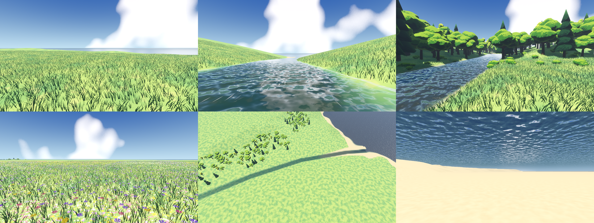

O usuário foi dormir e autorizou seguir sozinho. Nada foi commitado.

- **Capim fora da clareira** (agente Haiku, `scripts/vale/capim_vivo.gd`, `CapimVivo`): nasce em blocos de 32 m em volta do robô (raio 104 m, um bloco por quadro, no máximo 60), com a mesma touceira e o mesmo material da clareira (`Clareira.capim_malha`). Densidade pela cobertura do mapa: campo e flores 100%, mata 35%, mata fechada 12%, areia nada. A mais de 70 m do chão não cria blocos novos. Tempo médio por bloco no teste do agente: 10,9 ms.
- **Flores do platô** (mesmo arquivo + `scripts/shaders/vale_flor.gdshader`): flores de 0,6 m com cinco pétalas em taça, em rosa, amarelo, lilás e branco, em manchas; balançam com o capim. De longe e do alto, o chão do platô tem manchas pintadas (`1 - COLOR.a` no `vale_chao`).
- **Rio da lagoa até o mar** (`Vale.RIO`, `_cavar_rio`, `_fita_rio`, `nivel_rio`): a lagoa ganhou saída. Dentro da clareira a água é a lâmina dela; da borda em diante uma fita desce de 19,4 m até o mar em ~1 km. Como os campos do sul são mais altos que a lagoa, o rio corre num vale largo de encostas suaves (rampa de 1 para 4), não num cânion. Isso abriu um vão na borda sudeste da clareira (mudança visível de dentro dela).
- **Limite do mar** (`scripts/vale/limite_mar.gd`, `Vale.distancia_da_costa`, `Vale.praia_perto`, `Armadura.pane_forcada`): a 150 m da costa aparece o aviso "sinal fraco"; a 260 m o robô entra em pane, a tela escurece, o dia avança e ele reaparece em terra firme na praia mais perto.
- **Testes:** `--teste-vale` com 18 pontos (o novo confere o rio e a pane no mar); `--teste` com 76.
- **Desempenho no Mac:** 56 a 71 fps na clareira; 32 a 53 fps nos campos com capim (2 a 3 milhões de triângulos).
- **Não verificado:** jogar de verdade (a sensação de atravessar o vale, o capim nascendo em volta ao correr e ao pousar), as flores em outras horas do dia, o aviso de sinal fraco na tela, peixes e respingos no rio novo, e o desempenho no PC.
- **Defeitos conhecidos:** do alto (mais de 70 m) os campos ficam sem capim, só com a cor do chão; no mar aparece uma linha reta fraca na borda do mapa (a 1 km do centro); a pedra das encostas sai clara demais, parecendo neve.
- **Próximo:** mata fechada com a cachoeira e a nascente na serra.

## 29. Mata fechada, cachoeira e nomes dos lugares (2026-11-15, madrugada, sem o usuário)


- **Cursos d'água** (`Vale.Curso`): os rios viraram uma classe só (linha com o nível da água em cada ponto, leito, vale suave em volta e fita d'água). Há dois: o do sul (lagoa → mar) e o do norte (poço da cachoeira → riacho da clareira, 108 m → 19,4 m em ~500 m, por dentro da mata fechada).
- **Cachoeira:** a água brota numa nascente pequena no alto do paredão (`Vale.NASCENTE`) e cai ~28 m num poço (`Vale.POCO`, nível 108 m), dentro de um anfiteatro de pedra cavado no relevo. Cortina d'água com o shader `cachoeira.gdshader`, névoa de respingo no pé e o som de cachoeira que já existia (`Sons.cachoeira_em`). A ideia de um rio descendo a serra foi descartada: numa encosta de 30% a fita parecia uma rampa.
- **Árvores** não nascem mais dentro d'água nem na beira dos rios e do poço (`_perto_dagua`).
- **Rocha:** a pedra das encostas ficou cinza (era clara demais e parecia neve). Isso muda também as manchas claras dos morros da clareira.
- **Nomes dos lugares** (`Locais`, na tela ao chegar): Clareira, Cachoeira, Mata Fechada, Serra do Mirante, Platô das Flores, Campos do Sul e Foz do Riacho. As ruínas entram quando existirem.
- **Testes:** `--teste-vale` 18 pontos, `--teste` 76. Fotos: `-- --vale-captura --largo --norte`.
- **Não verificado:** tudo jogando (a queda vista do chão andando, o som da cachoeira, pousar no poço, os nomes aparecendo na tela), a mata fechada em outras horas do dia, e o desempenho no PC.
- **Defeitos conhecidos:** o riacho do norte é íngreme (18%) e a fita d'água chata parece uma rampa vista de baixo, na entrada da clareira; o paredão tem riscos verticais (a grade do relevo é de 4 m).
- **O que falta da maquete:** a Serra do Mirante só tem relevo e pinheiros (falta um ponto de vista marcante no cume); as Ruínas não existem ainda (pedem desenho e escolha do usuário); Zangão e Carrapato.

## 30. Cume da serra, maquete das ruínas e resumo da madrugada (2026-11-15)


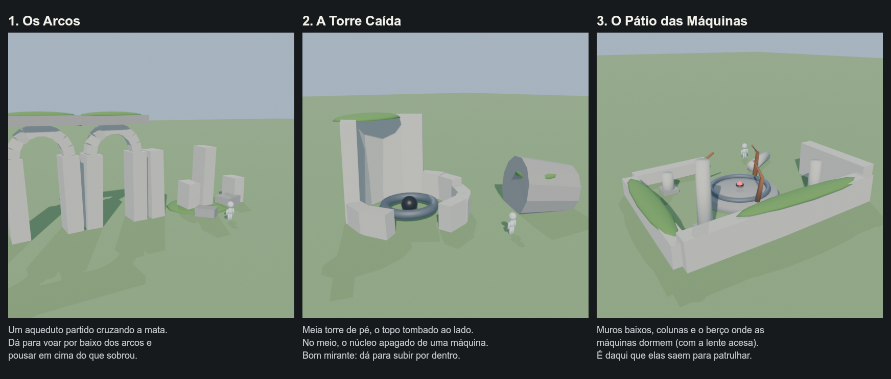

- **Cume** (`Vale._cume`, `Vale.cume`): marco de cinco pedras em pé no ponto mais alto do vale; o nome "Serra do Mirante" aparece ali. Do cume se vê a clareira, o rio e o mar.
- **Ruínas (só maquete, esperando a escolha do usuário):** `tools/vale/ruinas.py` → `docs/vale/ruinas_v1.png`. Três ideias: **Os Arcos** (aqueduto partido), **A Torre Caída** (meia torre com um núcleo de máquina apagado) e **O Pátio das Máquinas** (muros, colunas e o berço de onde as máquinas saem).

**O que foi feito sem o usuário nesta madrugada (§28 a §30):** capim e flores fora da clareira; rio da lagoa até o mar; pane ao cruzar o mar; riacho do norte com cachoeira e poço; árvores fora d'água; rocha cinza; nomes dos lugares na tela; marco no cume; maquete das ruínas. Baterias: `--teste-vale` 18 pontos, `--teste` 76. Build exportada no Mac (`build/linux/JogoVoo.x86_64`), não enviada (PC desligado). **Nada commitado.**

**Para o usuário decidir de manhã:**
1. Commit do que foi feito (base do vale e a madrugada).
2. Qual ruína construir (ou as três, espalhadas).
3. Se a rocha cinza e o vão que o rio abriu na borda sudeste da clareira estão aprovados (mudaram um pouco a clareira).

## 31. Rio com curvas, paredões de pedra e as três ruínas (2026-11-15)

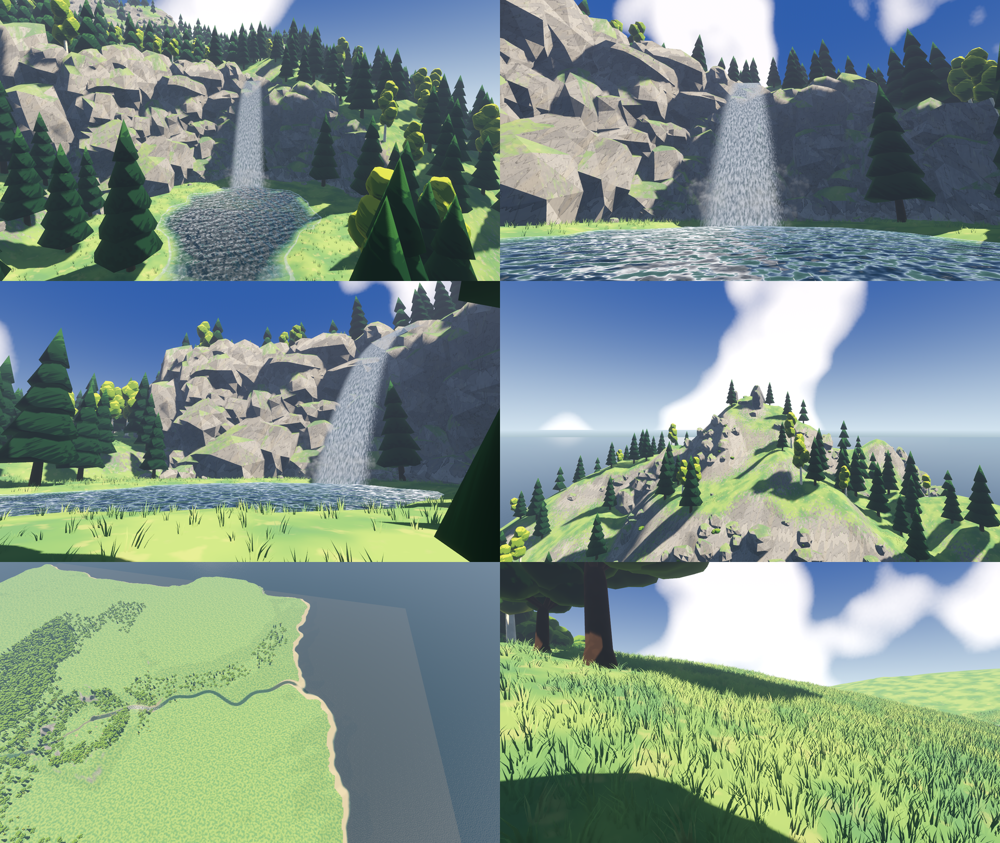


Retorno do usuário sobre a madrugada: commit liberado (feito, `284dd29`); construir as **três ruínas espalhadas**; **o rio precisa de curvas**, em estilo natural; **os paredões perto da cachoeira, e qualquer lugar com ângulo perto de 90°, estavam artificiais**: faltavam imperfeições na parede e rochas.

- **Rio com curvas** (`Vale._linha_curva`): os pontos de `RIO` e `RIO_BAIXO` viraram só o rumo. A linha passa por eles em curva suave (Catmull-Rom) e serpenteia para os lados com três voltas de tamanhos que não casam (46 m de saída e voltas de 280 m no rio do sul; 16 m e 150 m no riacho do norte). Nas pontas a linha fica presa (na lagoa, no poço e na entrada da clareira). O rio do sul anda 1,17 vez a reta. `Curso.perto` ficou mais rápido (passada larga e depois a vizinhança), porque a linha agora tem um ponto a cada 8 m.
- **Foz:** o leito se desfaz no fundo do mar (`Curso.cava_ate`). Antes as margens seguiam mar adentro como dois diques.
- **Paredões** (`scripts/vale/paredoes.gd`, `Paredoes.montar`): o relevo é uma grade de 4 m, então parede em pé saía lisa. Agora cada ponto íngreme (normal.y < 0,66) ganha de um a cinco blocos de pedra encaixados (pedregulhos de faces chatas feitos por código, `Paredoes.rocha`), pedras caídas no pé e arbustos na beira. Uns 1.560 blocos e 250 pedras no vale; os maiores têm colisão. Vale para a cachoeira, a serra e qualquer encosta.
- **Pedra com camadas** (`cor_rocha` em `vale_comum.gdshaderinc`, usada pelo chão e pelas rochas): faixas deitadas e tortas, frestas, escorridos, líquen, e um tom por face para o volume aparecer na sombra. As rochas soltas (`vale_rocha.gdshader`) ganham mato nas faces de cima.
- **Anfiteatro da cachoeira:** o contorno deixou de ser um círculo de compasso: a parede avança e recua, e o poço também ficou irregular.
- **Ruínas** (`scripts/vale/ruinas.gd`, `Ruinas.montar`): montadas pedra por pedra por código, cada bloco com colisão própria (481 formas). Cada uma fica num claro pequeno da mata (`Ruinas.livre` tira as árvores de perto), a uns 270 m uma da outra:
  - **Os Arcos** (−730, 30): aqueduto de seis pilares; três arcos inteiros com o leito por cima (dá para pousar a 15 m do chão), um arco partido e dois pilares em toco, com as lajes caídas.
  - **A Torre Caída** (−640, 440): meia torre de 18 m com porta, janelas e restos de dois pisos; o topo tombado é um tubo deitado que dá para atravessar voando; no meio, o núcleo apagado de uma máquina.
  - **O Pátio das Máquinas** (−680, 170): muro baixo em volta, seis colunas (duas ainda seguram a viga, uma tombou), o estrado de pedra e o berço de metal com a lente vermelha fraca.
  - A pedra (`vale_ruina.gdshader`) é mais clara e quente que a dos paredões, com musgo em cima e em manchas.
- **Nomes na tela:** Os Arcos, A Torre Caída, O Pátio das Máquinas.
- **Fotos:** `--vale-captura --largo` com `--rio`, `--paredes` ou `--ruinas`.
- **Testes:** `--teste-vale` 19 pontos (o 17º confere as curvas do rio, as rochas, as ruínas e o pouso no aqueduto); `--teste` 76.

**Não verificado / defeitos conhecidos:** nada disso foi jogado; o musgo das ruínas sai em manchas meio riscadas; a torre vista de lado parece fina (só metade da parede está de pé); o riacho do norte continua íngreme na entrada da clareira; não há máquinas no Pátio (os inimigos novos ficaram para depois).

### 31.1 Paredões no jeito da referência (2026-11-15)


O usuário mandou uma foto de referência para paredões e montanhas (só a técnica; nada de copiar arte): rocha em **massas grandes e lisas**, cinza claro **pintado em manchas macias**, fendas escuras entre uma massa e outra e **capim no topo** com a beira marcada. A primeira versão (blocos pequenos de faces chatas) parecia entulho.

- `Paredoes.rocha`: agora uma forma entre a bola e o cubo (lados quase em pé, topo quase chato), com calombos largos, poucas faces aparadas e normais suaves. 432 triângulos cada.
- Posição: poucas e grandes (uns 450 no vale, de 4 a 12 m de largura e até o dobro de altura), de pé, encostadas na parede; todas com colisão.
- `cor_rocha`: pinceladas compridas de cima para baixo e manchas redondas, sem linha dura; as faces viradas para baixo escurecem. Saiu o tom por face (com normais suaves virava faixa).
- `vale_rocha.gdshader`: capim só no topo chato (normal.y > 0,9).
- Árvore colada em paredão não nasce mais (sumia dentro da rocha). Isso mudou o sorteio: a mata de fora ficou com as árvores em outros lugares.
- Baterias: `--teste-vale` 19, `--teste` 76.

## 32. X no voo, freada e abaixar/sentar (2026-11-15)


Pedido do usuário: o X no voo desligava os propulsores e o robô parecia planar; ao desligar os jatos faltava uma freada; e faltava abaixar (L3), sentando ao segurar, para descansar olhando a paisagem.

- **X no voo:** não faz mais nada, o robô segue voando. O estado `PLANAR` continua no código (fotos e testes chegam nele por `teleportar`), mas nenhum botão leva a ele. Para esfriar no ar sobram o mergulho, a água e a chuva.
- **Freada** (`Estado.FREAR`, `Armadura._frear`): o O no voo joga o corpo para trás, com pernas e braços esticados à frente e os jatos dos pés e das mãos acesos. Dura de 0,25 s (devagar) a 0,5 s (a 30 m/s ou mais) e tira ~75% do embalo; depois o motor desliga e ele cai pesado, como antes. O X durante a freada volta a voar. Números em `Ajustes.FREAR_*`.
- **Abaixar e sentar** (`Armadura.postura`: 0 de pé, 1 abaixado, 2 sentado; ação `abaixar` = L3 ou Ctrl): um toque com o robô parado abaixa; outro toque levanta; segurar 0,6 s senta. Abaixado ele anda a 1,6 m/s. Sentado fica até mexer o analógico, apertar o X ou o L3. Correr, pular, esquivar e sair do chão levantam. O L3 com o robô andando continua sendo correr, e no voo, arrancada. A câmera desce junto.
- **Fotos:** `--vale-captura --posturas`.
- **Testes:** `--teste` 84 pontos (X no voo, freada, abaixar, sentar, L3 andando); `--teste-vale` 19 (o 14º mede a queda depois da freada).

**Não verificado:** nada disso foi jogado no controle; abaixar não muda a colisão nem o que o Sentinela enxerga; sentado em ladeira o robô não acompanha a inclinação do chão.

### 32.1 Sentado, chuva no voo e a bolinha na pausa (2026-11-15)

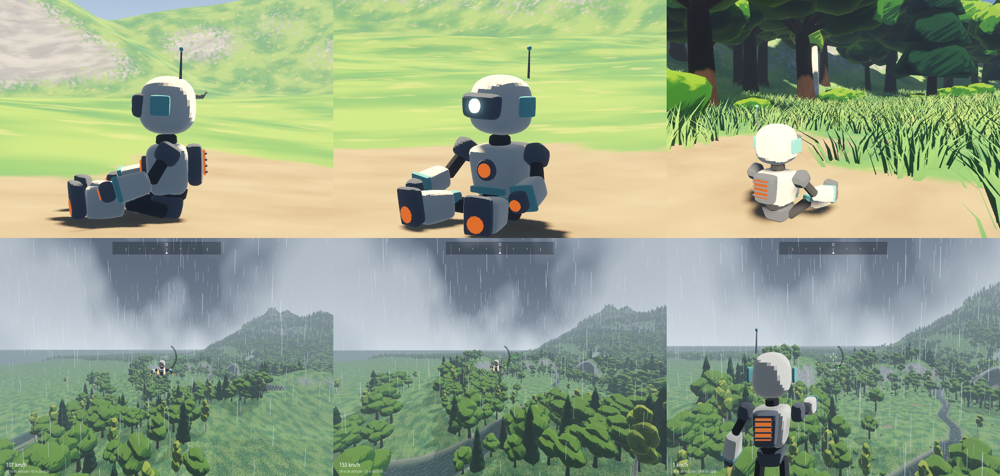

Retorno do usuário: sentado, as pernas entravam no chão; voando na chuva, a chuva sumia e só voltava parando no ar; sair da pausa com a bolinha desligava o voo.

- **Sentado:** a pose passou a ser de pernas esticadas à frente e mãos nas coxas (o robô tem coxa curta e bota comprida; de joelhos para cima a bota afundava). Além disso `ArmaduraVisual` mede a peça mais baixa do corpo a cada quadro e sobe a bacia até ela encostar no chão (`_levanta`).
- **Chuva no voo** (`CicloDia`): as gotas nascem 9 m acima da câmera e levam meio segundo para chegar à altura do olho; a 30 m/s o robô saía de baixo do bloco. Agora o bloco nasce adiantado meio segundo na direção em que a câmera anda, é um pouco maior (40 × 40 m) e tem 3.400 gotas (eram 2.600).
- **Pausa:** fechar o menu esconde a tela, mas o jogo só volta quando os botões do menu (bolinha, X) forem soltos. Antes o mesmo aperto fechava a pausa e chegava ao robô como "desligar o voo" (ou pulo, no X do Continuar).
- **Testes:** `--teste` 85 pontos (sair da pausa com a bolinha segue voando); `--teste-vale` 19.

**Não verificado:** nada jogado no controle; a chuva em mergulho rápido (70 m/s) só foi conferida em voo reto e arrancada.

### 32.2 Voo bem mais longo (2026-11-15)

Pedido do usuário: como há pouco o que fazer no chão, aumentar bastante o tempo de voo; atividades no ar vêm depois.

| | antes | agora |
|---|---|---|
| Voo reto até superaquecer | ~25 s (4 %/s) | ~90 s (1,1 %/s) |
| Arrancada | ~8 s | ~30 s |
| Parado no ar | 25 s (4 %/s) | ~66 s (1,5 %/s) |
| Decolagem | +15% | +6% |

Subir segue custando até 3× e a chuva (−6 %/s) agora esfria mais do que o voo reto esquenta: na chuva dá para voar sem parar. Testes: `--teste` 85, `--teste-vale` 19.

O usuário também trouxe a descrição da movimentação de um jogo de armadura voadora como referência (só a mecânica). O que já temos igual: voo guiado pela câmera, pairar com o L2, calor com mergulho/água/chuva, superaquecer e cair, esquiva no chão e no ar, pouso já correndo. O que é diferente e fica para ele escolher: ligar o voo com o L3 no ar (hoje é segurar o X), acelerador no analógico esquerdo, pulo mais alto segurando o botão, impulsos de jato na corrida, mergulho com impacto no chão, e nadar com os jatos.

### 32.3 Acelerador e inclinação no analógico esquerdo (2026-11-15)

Primeiro item adotado da referência de movimentação (só a mecânica). No voo, o analógico esquerdo passou a ser:

- **Frente:** acelera do cruzeiro (30 m/s) até 38 m/s e esquenta até 1,6×. A arrancada (L3, 45 m/s) continua acima disso.
- **Trás:** segura até 18 m/s, agora com freio de jato de 10 m/s² (antes só cortava o motor e esperava o arrasto).
- **Lado:** além do deslize de antes, o corpo e a câmera inclinam, e inclinar para o lado em que a câmera está virando fecha a curva até 1,7× mais rápido.

Números em `Ajustes` (`VOO_RAPIDO`, `FREIO_AR`, `CALOR_ACELERADOR`, `CURVA_INCLINADA`). Testes: `--teste` 88, `--teste-vale` 19. Não jogado no controle.

## 33. Controles no jeito da referência e voo mais lento (2026-11-15)

O usuário mandou a descrição da movimentação de um jogo de armadura voadora (inclusive as cinco formas de parar o voo) e pediu para adaptar os nossos controles a ela. Só a mecânica; nomes, personagens e arte não entram. Depois pediu velocidade de voo menor, porque o vale é pequeno.

**Controles**

- **Sem decolagem do chão.** Segurar o X só estende o pulo (os jatos empurram por até 0,32 s; o pulo vai de ~1,7 m para ~4 m). O estado `DECOLAGEM` ficou no código sem botão.
- **Ligar o voo: L3 no ar** (ação `voar`, Shift no teclado), depois do pulo ou do pulo duplo. Há uma pausa de ignição de 0,16 s, o robô deita e leva um empurrão para onde a câmera aponta; apontar para cima sobe. Ligar custa 4% de calor. Perto do chão, o nariz não desce abaixo do horizonte por 1,6 s.
- **Desligar: L3 de novo** corta os jatos na hora; ele fica de pé e cai com a gravidade comum, levando o embalo e com controle leve, e o L3 religa a qualquer momento. **O** continua sendo a freada com os jatos à frente (§32).
- **X no voo não faz nada.** Na referência o pulo também desliga os jatos; ficou de fora porque o usuário pediu nesta mesma data que o X no voo não desligasse.
- **Acelerador único no analógico esquerdo:** neutro é o cruzeiro, todo para a frente é a arrancada (3× o calor), para trás segura. A arrancada saiu do L3.
- **Parar no ar: L2 ou R3** (ação `pairar`, F no teclado). R3 de novo cancela e ele cai.
- **Mergulho com impacto: triângulo** (ação `golpe`, V) no voo, parado no ar ou caindo, acima de 2,5 m: corta os jatos, desce reto a 42 m/s e bate em pouso de herói, com tremor e o sinal `Armadura.golpe_chao`. Ainda não afeta nada em volta (o Sentinela não reage).
- **Superaquecer:** cai e não religa nem paira até tocar o chão, mesmo que esfrie no ar (`caido`); no chão leva 1,4 s para se recompor.
- **Pouso:** já era como na referência (raso e rápido emenda na corrida; devagar, planta os pés).

**Não adotado:** impulsos de jato na corrida e nadar com os jatos.

**Velocidade** (o vale tem 2 km)

| | antes | agora |
|---|---|---|
| Cruzeiro | 30 m/s (108 km/h) | 18 m/s (65 km/h) |
| Arrancada | 45 m/s (162 km/h) | 28 m/s (100 km/h) |
| Segurando | 18 m/s | 10 m/s |
| Mergulho | ~70 m/s | ~47 m/s |
| Atravessar o vale no cruzeiro | ~65 s | ~110 s |

A câmera (campo de visão, distância, tremor), o giro, a sustentação e os limites de batida e de pouso forte passaram a seguir esses números.

**Testes:** `--teste` 92 pontos, `--teste-vale` 19. **Não verificado:** nada jogado no controle; a pose do mergulho não ficou enquadrada nas fotos (só o impacto com a poeira); os outros mapas (ilha de 8 km, cânion) usam os mesmos números e ficaram mais lentos também.

## 34. A base (2026-11-15)

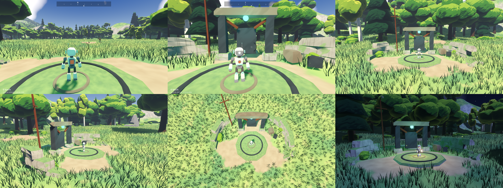

Primeiro item da lista do que falta (base, mais vida, mais inimigos, cavernas, sons; a diversão no ar fica para o fim, a pedido do usuário).

- **Onde:** no ponto de nascimento da clareira (`Ruinas.BASE`, montada por `Ruinas._base` com as mesmas peças das ruínas). Um claro de chão batido novo em `Clareira.CLAROS` tira o capim dali.
- **O que tem:** estrado baixo de pedra com dois aros de metal, o berço de recarga atrás (dois pilares, a viga e uma lâmpada verde-água que ilumina o estrado à noite), um resto de muro em meia-lua, a antena e duas caixas.
- **Curto:** depois da pane (por golpes ou por ir longe no mar) o robô reaparece na base, com a tela já escura, olhando o campo (`Armadura.base`). Antes ele religava onde tinha caído. O aviso na tela virou "curto no motor · voltando à base".
- **Depois:** aqui entram a troca de robô e as melhorias.
- **Fotos:** `--vale-captura --base`. **Testes:** `--teste-vale` 19 (o 13º confere o reaparecimento na base; o 17º conta quatro obras), `--teste` 95.

Também nesta data: o toque no L3 para abaixar ganhou folga, porque clicar o analógico costuma empurrá-lo e o toque virava "correr" (o usuário relatou que abaixar não funcionava no PC). **Não verificado:** a base não foi jogada; o topo do estrado saiu todo coberto de musgo; a borda do estrado pode ficar até uns 20 cm acima do chão do lado mais baixo.

**Correção (2026-11-15):** o usuário tinha dito L3 por engano; abaixar e sentar são no **R3** (no chão; no ar o R3 continua sendo parar no ar). O L3 no chão voltou a ser só correr, e a folga do clique saiu. O que as seções 32 e 33 dizem sobre "L3 parado" vale para o R3.

## 35. Vida espalhada pelo vale (2026-11-15)


Segundo item da lista. Até aqui os bichos só existiam na clareira.

- **Gerente** (`scripts/vale/vida.gd`, `VidaVale`): sorteia uma vez, sempre igual, os lugares fora da clareira: **14 manadas** de 2 a 4 cervos, **34 tocas** de 1 a 3 coelhos, **18 bandos** de 4 a 8 pássaros e o **cardume do poço** da cachoeira. São os mesmos bichos da clareira (`Cervo`, `Coelho`, `Passaros`, `Peixes`), com o mesmo comportamento.
- **Onde:** só em chão firme e pouco inclinado, fora d'água, acima do mar, longe de beira de paredão e das ruínas (`VidaVale.chao_bom`), com distância mínima entre lugares do mesmo tipo (110, 60 e 85 m).
- **Desempenho:** os bichos de um lugar só existem com o robô a menos de 240 m e somem a mais de 320 m; o gerente olha seis lugares a cada décimo de segundo e cria no máximo um por vez.
- **Fotos:** `--vale-captura --vida`. **Testes:** `--teste-vale` 20 pontos (o 18º confere o chão dos lugares, os quatro quadrantes e o nascer e sumir de uma manada); `--teste` 95.

**Não verificado:** nada jogado; o cardume do poço não apareceu na foto (pode estar fundo demais ou tapado pela espuma); os bichos atravessam troncos de árvore, como já faziam na clareira; não há bicho novo, só os quatro que já existiam.

## 36. Zangão, Carrapato e mais Sentinelas (2026-11-15)

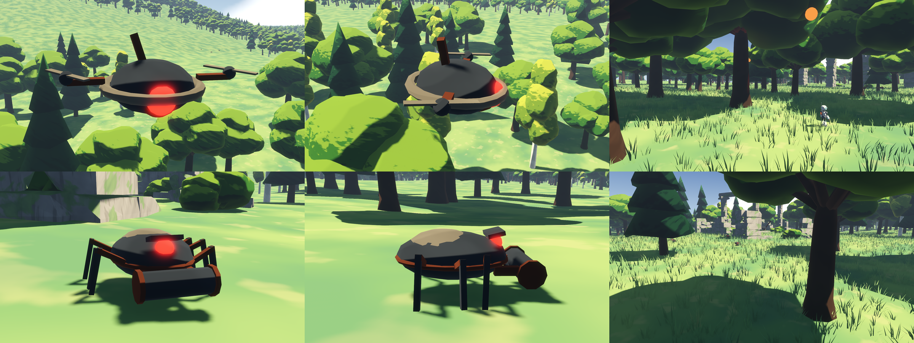

Terceiro item da lista. Até aqui só havia um Sentinela, na clareira.

- **Base comum** (`scripts/vale/maquina_pequena.gd`, `MaquinaPequena`): corpo montado por código com os materiais de metal do vale, lente vermelha, calor que sobe a cada tiro do robô, fumaça de desligada e 15 minutos reais até religar no mesmo lugar. Ninguém é destruído.
- **Zangão** (`zangao.gd`): voador de 0,9 m, em dupla. Ronda a 15 m do chão, acima das copas. Vê o robô a 45 m, rodeia a uns 15 m e solta um tiro lento por vez (15 m/s, com 0,7 s de lente acesa antes), que dá para desviar. Voa a 12 m/s, menos que o cruzeiro do robô (18), então dá para fugir; desiste a 80 m. Dois tiros do robô desligam: cai e fica no chão.
- **Carrapato** (`carrapato.gd`): rasteiro de 0,6 m, em trio, com um rolo de ferro na frente. Vê o robô a 30 m se ele estiver a menos de 7 m do chão; para, treme 0,75 s e investe em linha reta a 11 m/s por até 2 s. Sair de lado escapa; depois ele fica 2,6 s cansado, parado. Não entra na água nem sobe barranco. Dois tiros desligam.
- **Mergulho com impacto:** agora serve para alguma coisa. Zangão e Carrapato a menos de 8 m desligam na hora; o Sentinela a menos de 9 m ganha 60 de calor (dois impactos desligam).
- **Onde** (`inimigos.gd`, `InimigosVale`): 6 duplas de Zangões e 6 trios de Carrapatos (nas três ruínas e em pontos espalhados) e mais 3 Sentinelas; 33 máquinas fora da clareira, que continua só com o Sentinela dela. Ficam sempre criadas, para guardar quem está desligado, mas só pensam com o robô a menos de 230 m.
- **Fotos:** `--vale-captura --inimigos`. **Testes:** `--teste-vale` 21 pontos (o 19º confere a investida, o golpe, o mergulho que desliga, o religar, a caça e o tiro do Zangão e a queda dele); `--teste` 95.

**Não verificado:** nada jogado, e o equilíbrio (dano, distância, quantidade) é chute; três golpes de qualquer máquina ainda dão o curto, então um trio de Carrapatos pode derrubar o robô numa passada; as máquinas não têm som; o Zangão atravessa troncos e copas quando desce para caçar; as posições foram escolhidas no mapa sem olhar uma a uma.

## 37. Cavernas (2026-11-15)


Quarto item da lista. O relevo é uma grade de alturas e não aceita teto, então cada caverna é um **rasgo cavado na grade** (o chão e as paredes) coberto por um **teto feito à parte**: o arco de rocha por baixo e o chão de antes refeito por cima, com capim (`scripts/vale/cavernas.gd`, `Cavernas`; `vale_teto.gdshader`).

- **Lugares achados no próprio relevo** (`Cavernas.cavar`, antes de o chão ser montado): linhas sorteadas, sempre as mesmas, longe da clareira, da água e das ruínas.
  - **Túnel:** 70 a 150 m com as duas pontas baixas e um morro de pelo menos 11,5 m no meio. O relevo é suave e só um lugar serviu: a **Passagem da Serra** (126 m, a 232 m de altitude, com 40 m de morro por cima).
  - **Gruta sem saída:** 45 a 80 m entrando numa encosta, de chão plano. São cinco: Gruta do Eco, Gruta dos Cristais, Toca Funda, Gruta da Lua e Boca Verde.
- **Medidas:** chão de 14 m de largura, parede subindo em 5 m, arco de 7,5 m de altura.
- **Teto** (`Cavernas.montar`): só onde o morro passa pelo menos 3 m acima do arco; nas pontas fica o rasgo aberto, que faz a boca. Tem colisão dos dois lados e faz sombra.
- **Cristais:** grupos de prismas acesos ao pé das paredes, alternando os lados, com uma luz cada. Cada caverna tem uma cor.
- **Vizinhança:** não nasce árvore, rocha de paredão nem bicho dentro do rasgo. As seis têm nome na tela.
- **Fotos:** `--vale-captura --cavernas`. **Testes:** `--teste-vale` 22 pontos (o 20º confere o chão cavado, o teto com colisão e um voo de uma boca à outra do túnel); `--teste` 95.

**Não verificado:** nada jogado; visto de cima o teto aparece como um retângulo de capim onde a serra em volta é pedra; a parede sobe quase a pique e é só o chão esticado, sem rochas; as grutas não têm nada dentro além dos cristais; não conferi as seis por dentro (só quatro nas fotos).

**Reparo de passagem:** com o cruzeiro a 18 m/s o voo só fica nivelado com o nariz uns 12° acima do horizonte (a 30 m/s eram 7°). Não mexi; fica para o usuário dizer se incomoda.

## 38. Sons de gravação (2026-11-15)

Quinto item da lista: o usuário pediu sons melhores, "não apenas sintetizadores simples". Até aqui os 18 sons saíam de `tools/gerar_sons.py` (síntese). Agora quase tudo vem de **gravações livres** do OpenGameArt, 17 pacotes aprovados por ele (35 MB; 12 CC0 e 5 CC-BY). Autores e licenças em [CREDITOS.md](../CREDITOS.md).

- **Caminho:** os downloads ficam em `tools/sons_brutos/` (fora do git); `tools/decodificar_sons.gd` abre ogg, mp3 e wav pelo Godot e grava WAV (os .flac vão com `afconvert`); `tools/montar_sons.py` (com `tools/audio_util.py`, só biblioteca padrão) corta, mistura, nivela pelo volume médio e fecha os laços com crossfade. Saída: 45 WAV em `assets/sons/` (56 MB no git, 11 MB na build, porque o Godot importa em QOA).
- **Vale:** pássaros gravados (29 s) sobre um fundo de floresta (43 s) que toca dia e noite; os dois laços têm durações diferentes e a soma demora a se repetir. Grilos à noite, chuva de 43 s, dois trovões (um de 15 s), riacho, cachoeira, e o **rio do vale** com um som a cada 110 m (`Vale.pontos_do_rio`, `SomAmbiente.rio_em`), que antes era mudo.
- **Cavernas:** debaixo do teto entra um laço de vento grave e goteira, e a mata e a chuva caem 14 dB (`SomAmbiente._peso_caverna`).
- **Armadura:** motor e arrancada misturam um foguete gravado com propulsores do Kenney; vento de verdade (47 s); decolagem com turbina de jato; pousos de metal no capim. **Novos:** pisadas (uma a cada 0,75 m andando, 1,25 m correndo, mais baixas abaixado), tiro da mão (3 variações), golpe no chão do mergulho e folhagem ao atravessar copas.
- **Máquinas** (`scripts/som.gd`, classe `Som`, toques e laços 3D): Zangão, Carrapato e Sentinela têm ronco próprio, som de tiro, de lataria ao serem acertados e de desligar; o Sentinela tem pisada.
- **Continuam sintetizados:** alarme de calor, marcador e religar (`python3 tools/gerar_sons.py`; com `--tudo` ele volta a gerar a versão sintetizada inteira e cobre as gravações).
- **Testes:** `--teste-vale` 23 pontos (o 21º confere os arquivos, as pisadas, o tiro e o eco dentro do túnel); `--teste` 95.

**Não verificado:** ninguém ouviu nada. Os sons foram escolhidos pela descrição e por medidas (duração, volume médio, pico), então timbre, emenda dos laços e equilíbrio de volumes são chute até o usuário jogar. Bichos (cervo, coelho, pássaros de perto) e o respingo na água seguem sem som: não achei gravação livre.

## 39. Limpeza e teste do Faísca (2026-11-15)


**Limpeza:** saíram os modelos `armadura_v1.glb` e `armadura_v2.glb` (sem uso), três funções e três constantes órfãs, e o carregamento de som duplicado (`Sons` e `SomAmbiente` agora usam a classe `Som`). **Mapas antigos apagados (a pedido):** a ilha de 4 km (`Mundo`), o cânion realista (`Canion`, 195 MB em `assets/teste_visual`) e o cânion pintado (`CanionEstilo`), com as fotos, testes, shaders, modelos e geradores só deles (`tools/mapa`, `previa`, `estilo`, `teste_visual`, `maquete`) e o botão "Próximo mapa" da pausa. Tudo volta pelo git (commit 4e3d5f0). Ficam o vale, que é o jogo, e a ilha pequena, onde roda a bateria do voo. As seções antigas desta doc que falam deles são registro. No disco, fora do git, continuam `vendor/` (downloads do Poly Haven) e `tools/capturas/`.

**Faísca (só teste):** o corpo do Faísca da Ilha Cafuné no lugar do robô, com as cores de lá.
- Na Ilha ele não é um arquivo: é montado por código (`scripts/faisca/robo.gd`) sobre o esqueleto Rig_Medium do KayKit. `tools/faisca/exportar_faisca.gd` roda dentro do projeto da Ilha (`godot --headless --path ../ilha-cafune -s "$PWD/tools/faisca/exportar_faisca.gd" -- <saida.scn>`), monta o boneco e grava uma cena do Godot com tudo embutido: `assets/faisca/faisca.scn` (7,4 MB). Em .glb os ossos viravam nós soltos, sem esqueleto.
- `ArmaduraVisual` já levava as poses do jogo para um esqueleto Mixamo; ganhou os nomes dos ossos do KayKit, a altura medida pelas peças (o capacete passa muito do osso da cabeça) e a escala pelo porte do mapa. As poses são as mesmas do robô: andar, abaixar, sentar, voo, freada, mergulho.
- A tela do rosto recebe de volta o shader dos olhos de LED (cópia em `scripts/shaders/faisca_rosto.gdshader`); ele pisca, fecha os olhos na pane e faz cara de dor superaquecido. Os jatos dele acendem como as chamas do voo.
- **Pausa:** botão "Trocar de robô", que troca o corpo na hora, sem sair do lugar (`Armadura.trocar_visual`). `-- --faisca` já abre com ele.
- **Ficou de fora:** o contorno de luz azulada da Ilha, as expressões além de piscar e dor, os dedos e as animações próprias dele (giro, soco, espera).
- **Testes:** `--teste-vale` 24 pontos (o 22º troca, anda e destroca); `--teste` 95.

**Não verificado:** nada jogado; as fotos mostram as poses paradas, não o movimento; ele é branco e a luz do vale o deixa azulado.

## 40. O Sumidouro, a caverna vertical (2026-11-15)

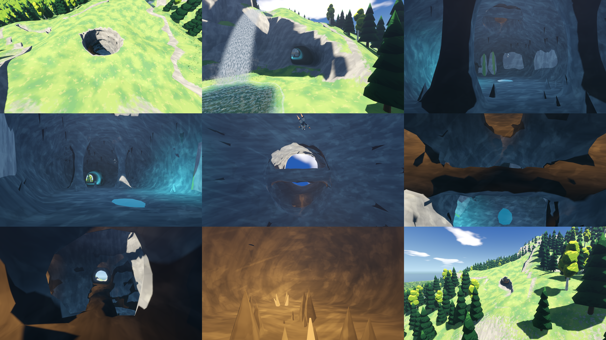

O usuário pediu uma caverna "mais trabalhada e verticalizada". A grade de alturas do vale só guarda um chão por ponto (por isso as seis cavernas da §37 são corredores de um andar), então esta é uma **peça própria**, a única assim no mapa.

- **Onde:** num morro da Mata Fechada, ao lado da cachoeira; eixo em (-312, -600), 50 m de fundura. `Sumidouro._achar_lugar` procura sempre o mesmo morro (alto largo e uma encosta que desce 46 m em até 130 m).
- **O desenho** (`scripts/vale/sumidouro.gd`, `Sumidouro.vazio`): um poço de 9 m de raio aberto no alto do morro desce até um salão de 56 × 42 m e 24 m de altura, com uma lagoa rasa debaixo do poço e dois pilares; do salão sai um túnel de 11 m de largura até a encosta, perto do poço da cachoeira; a 30 m do piso há uma galeria em anel com três janelas para o poço, uma ponte de pedra que cruza o poço e uma varanda que fura o morro para fora; ao lado do salão, uma câmara menor com cristais âmbar.
- **Como é feita:** a rocha é descrita por distâncias (o morro de antes, menos os vazios, mais a ponte e os pilares), com ruído nas paredes e piso quase chato. `Sumidouro.assar` transforma isso em malha por *surface nets* (células de 1,6 m, 61 mil triângulos) e grava em `assets/vale/sumidouro.res`; leva uns 6 s, por isso só roda a pedido (`-- --assar-sumidouro`, depois de mudar o desenho). No jogo a malha é carregada e ganha colisão dos dois lados.
- **Encaixe no vale:** debaixo da peça a grade é rebaixada até 3,5 m abaixo do piso mais fundo (`_rebaixar`), para a câmera e a altura do chão não acharem que ali ainda é o alto do morro; a peça refaz a superfície do morro por cima, com capim (`vale_gruta.gdshader`: a cor do vértice diz o que é capim e o que é fundo). Não nasce árvore, rocha de paredão, capim nem bicho na área.
- **Luz e som:** o sol entra pelo poço; lá dentro a luz do céu quase não chega (o shader corta) e sobram dez grupos de cristais com luz e uma luz fria fraca no salão. Estalactites e estalagmites em MultiMesh. O eco de caverna do som ambiente vale aqui também. Tem nome na tela.
- **Fotos:** `--vale-captura --sumidouro`. **Testes:** `--teste-vale` 25 pontos (o 23º confere o poço aberto até o piso, a ponte, o túnel livre e o robô caindo pelo poço e pousando no salão); `--teste` 95.

**Não verificado:** nada jogado, e o principal é o voo lá dentro (largura do poço, câmera perto das paredes, entrar pelas janelas). A grade rebaixada some debaixo da peça, mas a emenda na boca do túnel e na varanda só foi vista de longe. Os inimigos e os bichos não entram. A lagoa é só uma lâmina, sem física de água. Sem caminho a pé até a galeria: é para chegar voando.

**Nuvens (mesmo dia):** o usuário reparou que as nuvens se juntavam num ponto. A textura delas era enrolada no céu como um mapa-múndi e fechava no zênite. O céu do vale agora é `vale_ceu.gdshader`: o mesmo degradê e o mesmo sol, com as nuvens num teto plano que anda devagar com o vento; `CicloDia` passa as cores e a cobertura por parâmetros.

## 41. Lista do que falta (2026-11-15)

Feitos da lista do usuário: base, vida espalhada, mais inimigos, cavernas, sons de gravação. O que sobra, sem ordem fechada:

1. **Vibração no controle** (pedido em 2026-11-15): feita na §42; falta o usuário sentir e ajustar as forças. Candidatas: decolagem, arrancada, pouso (forte no pesado), golpe no chão do mergulho, levar tiro ou investida, tiro da mão, superaquecer e a pane. A ideia antiga de vibrar cada propulsor de um lado fica como extra.
2. **Diversão no ar:** atividades de voo. O usuário pediu para deixar por último, com o resto terminado.
3. **A base:** troca de robô, melhorias e incrementos (o teste do Faísca saiu do jogo em 2026-11-16).
4. **Sons que faltam:** bichos e respingo na água (sem gravação livre achada); trocar o que ele não gostar ao ouvir.
5. **Pendências pequenas já anotadas:** o Zangão atravessa troncos e copas ao descer; o equilíbrio dos inimigos é chute; o cardume do poço não apareceu em foto; o teto das seis grutas simples aparece como retângulo de capim visto de cima; o voo nivelado pede o nariz 12° acima do horizonte.
6. **Sumidouro:** lagoa sem física de água; inimigos e bichos não entram; conferir a emenda das bocas de perto.
7. **Esperando o usuário jogar:** tudo desde os inimigos (§36 a §40) e os sons.

## 42. Vibração, Zangão sobre as copas, grutas refeitas e vida no Sumidouro (2026-11-15)

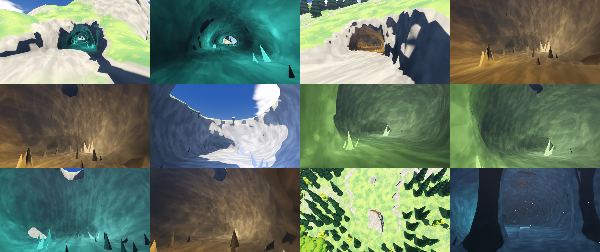

Itens 1 a 4 combinados com o usuário enquanto ele não podia testar.

- **Vibração do controle** (`scripts/vibra.gd`, classe `Vibra`): um tranco próprio para decolagem, pulo duplo, esquiva, pouso leve e pesado, golpe no chão, levar golpe (sinal novo `Armadura.levou_golpe`), tiro, superaquecer, pane e religar; zumbido contínuo do motor leve na arrancada e na freada. As forças estão na tabela `Vibra.AJUSTE` ([motor leve, motor pesado, segundos]). A pausa tem o botão "Vibração do controle" e cala o controle enquanto está aberta. É a vibração comum do Godot (dois motores); os efeitos finos do DualSense ficam para depois.
- **Zangão não atravessa mais árvore:** `MaquinaPequena.topo_copas` dá o topo da copa mais alta em volta; perto de árvore ele voa acima dela (inclusive caçando), e segura o avanço para subir antes de uma copa mais alta. Desligado, continua caindo por entre os galhos.
- **Grutas refeitas:** o gerador do Sumidouro virou `scripts/vale/rocha_malha.gd` (`RochaMalha`: rebaixar a grade, malha por *surface nets*, colisão, material, cristais e pingentes) e as seis grutas da §37 passaram a usá-lo (`Cavernas.vazio_de`). Os lugares são os mesmos. Agora o corredor serpenteia, muda de largura e de altura, tem parede e boca de pedra; onde o morro é fino ele vira rasgo aberto; e as cinco sem saída terminam num salão redondo com claraboia. Saíram o retângulo de capim visto de cima e as paredes de chão esticado. Malhas em `assets/vale/gruta_0.res` a `gruta_5.res` (10 a 18 mil triângulos, menos de 1 s cada para gerar). **`-- --assar-rochas`** gera as sete de novo (substitui o `--assar-sumidouro`).
- **Grade debaixo das peças:** fica 2,2 m abaixo do piso, e cada nó desce até o mais fundo dos vizinhos (na beira dos salões a grade aparecia por dentro). Capim, árvores, rochas de paredão e bichos não nascem onde a grade foi rebaixada (`RochaMalha.dentro`).
- **Sumidouro com vida:** 16 morcegos (`scripts/vale/morcegos.gd`) em círculos no poço, abaixo e acima da ponte, que se agitam com o robô por perto; vaga-lumes no salão e na câmara; e a lagoa passou a ser água de verdade para o jogo (`Sumidouro.agua`, consultada por `Vale.agua`): respinga e esfria como o resto da água.
- **Testes:** `--teste-vale` 26 pontos (o 24º confere os trancos, o Zangão posto dentro de uma copa, o nível da lagoa e os morcegos); `--teste` 95.

**Não verificado:** nada jogado. A força de cada vibração é chute até o usuário sentir no controle, e não sei como o Godot entrega os dois motores no DualSense pelo Steam no Bazzite. Os morcegos são formas simples e não aparecem nas fotos. Inimigos continuam sem entrar nas cavernas (andam e voam pela altura da grade).


## 43. Primeiro teste do usuário: seis ajustes (2026-11-16)

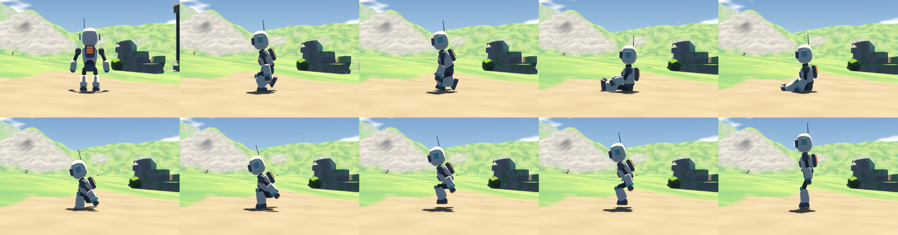

O usuário jogou (no Mac, em modo debug) e apontou seis coisas.

- **Trancos no voo:** não era mapa carregando. A física anda a 60 passos por segundo e a tela em outro ritmo (o monitor dele é de 75 Hz), então o robô andava em degraus e a câmera, que segue macio, mostrava ele indo e voltando. Agora `Armadura.pos_suave()` dá a posição entre os dois últimos passos da física; o corpo (`visual.position`) e a câmera usam ela. Teleporte corta a suavização (`_corte`).
- **Buraco que mostrava o Sumidouro por fora:** a caixa da peça parava 14 m acima do morro no eixo do poço (176 m), mas a oeste, sobre a câmara, o morro passa disso. Ali a grade tinha sido rebaixada e a peça não tinha tampa: 313 pontos abertos. A caixa agora cobre o ponto mais alto do morro (`RochaMalha.alto_da_caixa`), nas grutas também (a Passagem da Serra tinha 2 pontos). `RochaMalha.furos` procura esses furos (raio do céu até a grade) e entra no teste 22; `-- --vale-captura --furos` fotografa. Malhas assadas de novo.
- **Faísca removido:** saíram `assets/faisca/`, `tools/faisca/`, o shader do rosto, o botão da pausa, `--faisca` e `Armadura.trocar_visual`. A §39 fica como registro.
- **Abaixado, os pés entravam no chão:** a bacia descia mais do que as pernas dobravam. A medida da peça mais baixa (que já existia para o sentado) agora vale abaixado e levantando, e usa pontos reais de cada peça (os mais salientes em 60 direções) em vez da caixa em volta, que exagerava com a perna dobrada.
- **Levantar de sentado:** antes esticava tudo de uma vez e parecia saltar sem impulso. Agora são três tempos em 0,95 s (`ArmaduraVisual.ERGUER`, `Ajustes.ERGUER_TEMPO`): encolhe as pernas e apoia as mãos, sobe agachado com o peso à frente, estica. Nesse tempo ele não anda nem pula (`Armadura.erguendo`).
- **Jogo mudo:** não era o modo debug. Um dos sons do rio caía num ponto sem água no eixo, `agua()` devolvia -INF e o tocador 3D ia para uma posição infinita, o que zera a mistura inteira (27 sons tocando, pico de -200 dB). A build do PC estava muda pelo mesmo motivo. Corrigido em `Vale.pontos_do_rio`, com guarda em `Som.toque3d` e `SomAmbiente.rio_em`; o teste 21 conta tocadores em posição inválida. `-- --vale-captura --sonda-som` mede o pico da saída (depois da correção: -11 dB andando).
- **Decolagem segurando o pulo:** segurar o X por 0,4 s (no pulo do chão ou no pulo duplo) decola: de pé, sobe reto 10 m a 13 m/s (ou até bater num teto) e então deita e sai voando para onde a câmera aponta (`Ajustes.DECOLAR_SEGURAR`, `DECOLAGEM_SUBIDA`, `DECOLAGEM_VEL`). Toque curto continua sendo só pulo. O L3 no ar segue ligando o voo direto.
- **Testes:** `--teste-vale` 26 pontos (o 22º agora é decolagem, levantar e furos); `--teste` 95.

**Não verificado:** a suavização só se confirma jogando (não dá para medir tranco sem tela); o levantar e a decolagem foram vistos em fotos paradas; o som foi medido, não ouvido.


## 44. Mira com trava, águas fundas e nado (2026-11-16)


Pedidos depois do segundo teste (o usuário achou o Zangão difícil demais de acertar).

- **Mira com trava (`Tiro`):** mirando (L2), a máquina ligada mais perto do centro da mira fica travada se estiver a menos de 6,5° dele (`TRAVA_ANGULO`; de perto o cone abre), até 130 m e com a vista livre. A travada só solta a 1,6× o ângulo, para não ficar trocando. O tiro travado é guiado: o destino acompanha a máquina até chegar (`ponto_de_trava()` em `MaquinaPequena` e na `Sentinela`, que trava na cabeça). A tela desenha quatro cantos laranja no alvo. Sem mirar não há trava.
- **Águas fundas:** o mar já tinha 14 m. O poço da cachoeira ganhou uma bacia de 11 m no meio (`Vale.POCO_FUNDO`) e a lagoa da clareira, 5 m (`Clareira.LAGOA_FUNDO`). Os rios continuam rasos.
- **Nado (`Armadura.Estado.NADO`):** em água mais funda que 1,5 altura do robô, com o corpo já debaixo da lâmina, ele passa a nadar (andando para o fundo, caindo ou mergulhando do voo). O analógico esquerdo leva para onde a câmera aponta (olhando para baixo, desce), X sobe, O desce, L3 abre os jatos (6,5 → 13 m/s). Parado, boia no lugar. Na tona, X pula para fora (segurando, decola); chegando de baixo a mais de 7 m/s, rompe a lâmina e sai voando. No raso volta a andar. A água tira 30 de calor por segundo. Não atira nem mira nadando.
- **Visual:** pose deitada com pernas batendo (boiando, de pé), véu azulado na tela quando a câmera está debaixo d'água e bolhas dos jatos (`EfeitosAgua`). A lâmina já era desenhada dos dois lados.
- **Testes:** `--teste-vale` 27 pontos (o 25º: trava a 3°, não trava a 16°, tiro travado acerta; no poço nada, desce, esfria, para na tona, pula para fora e sai voando); `--teste` 95. Fotos: `-- --vale-captura --nado`.

**Não verificado:** nada disso foi jogado. O tamanho do cone da trava, as velocidades do nado e a força do véu são chute. Faltam som abafado debaixo d'água, peixes no poço e inimigos reagindo ao robô na água.

**Stylized Nature MegaKit (Quaternius, CC0), só análise:** 68 modelos em `others/Stylized Nature MegaKit[Standard]` (versão grátis de 116): 5 árvores comuns, 5 pinheiros, 5 retorcidas, 5 mortas, arbustos, samambaia, capins, flores, cogumelos, pedras e seixos. glTF com texturas (folhas em recorte, casca com mapa de relevo), de 100 a 10 mil triângulos (média 2,2 mil). Serve para enriquecer o chão (samambaia, flores, cogumelos, pedras, árvores mortas e retorcidas). As árvores são mais pesadas que as do vale (4 a 10 mil triângulos contra as nossas, feitas para 12 mil cópias) e usam folha em cartão com textura, outro jeito de desenhar: precisariam do nosso shader de faixas e de versão de longe. As "RockPath" são pedras de caminho e ficam de fora (o vale não tem estrada). Nada foi importado.


## 45. Correnteza dos rios e avaliação de pacotes do Quaternius (2026-11-16)

- **Correnteza:** o shader do rio empurrava a espuma sempre para o mesmo lado do mapa (`fluxo` fixo), então no trecho que sai da cachoeira a água parecia subir. Nas fitas dos cursos o desenho agora anda pelo UV da fita (`pela_fita`): de margem a margem e ao longo do curso, rio abaixo. As ondas, que andavam ao contrário das riscas, foram acertadas. O teste 25 confere que o nível só desce no sentido da correnteza. O mar, o poço e o riacho da clareira seguem com o sentido fixo.
- **Pacotes avaliados (todos CC0, pastas em `others/`, nada importado):**
  - *Textured Stylized Trees (2020):* 45 árvores em FBX/OBJ/Blend (sem glTF): 10 comuns, 10 bétulas, 5 pinheiros, 10 mortas, 10 bétulas mortas, com variações de cor (verde, amarela, vinho). 450 a 2.500 triângulos: leves, do porte das nossas. Folha em cartão com textura.
  - *Ultimate Animated Animals (2021):* 12 bichos em glTF com esqueleto e 12 a 13 animações (andar, galope, comer, parado, susto): cervo, veado de galhada, raposa, lobo, cavalo (2), burro, vaca, touro, alpaca, husky, shiba. Cerca de 2 mil triângulos cada.
  - *Easy Animated Enemy Pack (2019):* aranha, rato, vespa, cobra (2) e sapo, só FBX/OBJ/Blend, 1,6 a 4,9 mil triângulos.
  - *Animated Mech Pack (2021):* 4 robôs (George, Leela, Mike, Stan) em glTF, versão com textura (ferrugem) e de cor lisa, 2,4 a 7,9 mil triângulos, 17 a 20 animações (andar, correr, atirar, levar golpe, desligar, soco, chute). Nenhum voa.


## 46. Árvores e plantas dos pacotes do Quaternius (2026-11-16)


- **Conversão (`tools/vale/pacotes.py`, Blender):** 13 árvores do *Textured Stylized Trees* (4 comuns, 3 bétulas, 3 pinheiros, 3 mortas), postas na altura das nossas (8,5 a 14,5 m), cada uma com versão de longe (22% dos triângulos), e 18 peças do *MegaKit* (samambaia, plantas, flores, cogumelo, moitas, trevo, pedras, seixos). Saem em `assets/vale/q/*.glb` sem textura; as 14 texturas ficam na mesma pasta (as do MegaKit reduzidas a 1024). Tudo: 9 MB.
- **Visual (`vale_tex.gdshader`):** a cor vem da textura do modelo (folha em recorte por `discard`), puxada para a paleta do vale por uma tinta, com a mesma luz em faixas, o vento das copas e a borda clara. Materiais `q_*` em `Clareira._materiais`.
- **Mata:** as posições não mudaram. `Clareira.tipo_variado` troca cerca de 60% das árvores pelas dos pacotes conforme o lugar (`sorte_do_lugar`, sem gastar o sorteio da mata): pinheiros e bétulas novos, bétulas amarelas, 3% de árvores vinho, 3% laranja e 4% de mortas (`Q_CORES` são a mesma malha com outra folhagem). As postas à mão na clareira ficaram.
- **De longe:** as dos pacotes de folha verde usam os vultos de longe do vale (`longe_de`); só as coloridas e as mortas têm o delas. Sem isso o custo era o dobro.
- **Chão (`Vale._plantas_do_chao`):** 41 mil peças pelo mapa todo, visíveis até 120 m (pedras e moitas até 260 m): flores em canteiros nos campos (manchas por ruído, uma espécie por mancha), samambaias, cogumelos e moitas debaixo da mata, seixos e 433 pedras soltas com colisão.
- **Custo no Mac (1600×900):** de 45/55/44 quadros por segundo para 40/49/38 nas três fotos de sempre (cerca de 10%). `-- --sem-pacotes` desliga tudo para comparar.
- **Ficou de fora:** as "RockPath" (o vale não tem estrada), as árvores do MegaKit (pesadas), capins do kit (o vale tem o dele) e o cogumelo de tronco.

**Não verificado:** visto só em fotos; o salto entre a árvore de folha recortada e o vulto de longe (aos 170 m) não foi visto em movimento; o custo no PC não foi medido.


## 47. Máquinas com os robôs do Animated Mech Pack (2026-11-16)


As máquinas inimigas trocaram de corpo pelos quatro robôs do pacote (CC0), com as animações deles, e **todas andam no chão** (pedido do usuário: nenhum robô voador; a Leela é a Sentinela, escolha dele).

| Máquina | Modelo | Altura | O que faz | Tiros para desligar |
|---|---|---|---|---|
| Sentinela | Leela (casulo de uma lente, duas pernas) | 3,1 m | a mesma torre lenta: vê de longe, avisa com o feixe e dá um tiro forte | 6 na cabeça |
| Carrapato | Mike (atarracado, braços grandes) | 0,9 m | o mesmo: arma e investe correndo | 2 |
| Batedor (novo, no lugar do Zangão) | Stan (magro e alto) | 1,5 m | em dupla; corre em volta do robô a 14 m, para, avisa e atira | 2 |
| Vigia (novo) | George (de antenas) | 1,7 m | ronda a pé; vendo o robô chega a 16 m, fica de frente e atira; perto demais, recua | 3 |

- **`MechVisual`** (`scripts/vale/mech_visual.gd`): carrega `assets/vale/mech/<nome>.gltf` (cópia do pacote, 17 MB os quatro), põe na altura pedida, troca o material pelo `vale_tex` (a textura do robô com a luz em faixas) e dá `tocar(animação)`, `olho` (luz vermelha na cabeça: o aviso de ataque), `clarao` (pisca ao levar tiro) e `apagar` (escurece desligado). Desligar toca `Death`; religar volta ao `Idle`.
- **`Vigia`** é a máquina de chão que atira; **`Batedor`** herda dela e muda os números e o modelo. O tiro lento laranja saiu do Zangão para `MaquinaPequena.atirar_em` / `atualizar_tiros`.
- **Sentinela:** a lógica é a mesma (as pernas de três pontos seguem só na conta, escondidas); o corpo novo vira para onde a cabeça olhava, anda, atira e cai conforme o estado. A lente e o feixe saem da altura da cabeça antiga.
- **Zangão:** `zangao.gd` apagado. No vale: 12 batedores (6 duplas), 18 carrapatos, 6 vigias, 3 sentinelas mais a da clareira.
- **Testes:** `--teste-vale` 27 pontos (o 19º agora é batedor e carrapato; a parte do voador por cima das copas saiu do 24º); `--teste` 95.

**Não verificado:** nada jogado. As animações de andar não foram casadas com a velocidade (o pé pode escorregar); o equilíbrio do Vigia e do Batedor é chute; a Sentinela não inclina a cabeça para mirar para cima (só o corpo gira); o som do Batedor ainda é o laço do Zangão.


## 48. Sentinela que anda, e os bichos do Ultimate Animated Animals (2026-11-16)


- **Sentinela presa no lugar:** ela só andava quando as três pernas antigas (agora escondidas) estavam perto do repouso, então o corpo novo dava um passo e parava. Agora anda sem parar (22 m em 25 s de patrulha, medido). **Caída, entrava no chão:** `MechVisual` mede o osso mais baixo durante a animação `Death` e ergue o corpo até `margem_caido` × altura (os ossos "Pole" são alvos de apoio e ficam fora da conta). Vale para as quatro máquinas.
- **Bichos (`BichoVisual`, `scripts/vale/bicho_visual.gd`):** os modelos animados do pacote (CC0) em `assets/vale/bichos/` (13 MB os quatro), com as cores do modelo no `vale_solido` e as animações `Eating`, `Idle`, `Idle_2`, `Walk` e `Gallop`.
  - **Cervo:** o jeito de ser é o mesmo (`cervo.gd`: pasta, anda, alerta, foge); as peças antigas ficam escondidas só para a conta e quem aparece é a cerva (1,3 m) ou, um em cada três, o veado de galhada (1,55 m).
  - **Raposa (`Raposa`) e lobo (`Lobo`):** herdam o cervo e trocam o corpo (0,55 m e 0,85 m). São ariscos: farejam, ficam alerta e fogem; nenhum bicho ataca. No vale: 12 raposas sozinhas e 5 alcateias de 2 ou 3, em `VidaVale`.
- **Fora:** cavalo, burro, vaca, touro, alpaca e os cachorros (bichos de fazenda) e o pacote de inimigos pequenos (aranha, vespa, rato, cobra, sapo).
- **Testes:** `--teste-vale` 27 pontos; `--teste` 95.

**Não verificado:** a raposa e o lobo só foram vistos de longe, no meio do capim; o passo das animações não foi casado com a velocidade; coelhos, pássaros e peixes continuam os de antes.


## 49. Sentinela que avança, mais tempo de voo e corpos de mech para o jogador (2026-11-16)

- **Sentinela "se mexe mas não anda":** ela só andava na patrulha; com o robô à vista ficava plantada, alternando alerta, aviso, tiro e recarga (era o desenho da torre de três pernas). Agora, no alerta e na recarga, ela anda na direção do robô a 2,2 m/s até ficar a 22 m (`Sentinela._avancar`); para só para avisar e atirar.
- **Tempo de voo:** `CALOR_VOO` de 1,1 para 0,55 por segundo (uns 3 minutos de voo reto, eram 90 s) e `CALOR_PAIRAR` de 1,5 para 0,8. A arrancada e a subida seguem multiplicando.
- **Corpos para testar (pausa, botão "Corpo do robô"):** o robô do vale, George, Mike e Stan (`ArmaduraVisual.CORPOS`; `-- --corpo=george` já abre com ele). A física, o tamanho da colisão e os comandos são os mesmos; só o corpo muda. Com mech, `ArmaduraVisual._atualizar_mech` escolhe a animação do pacote pelo estado: parado, andar, correr, pulo no ar, tiro, caído na pane. O pacote não tem animação de voo, de abaixar nem de sentar: no voo e no nado o corpo deita na direção do nariz (gira pelo meio do corpo), e abaixado ou sentado ele só desce. O tiro sai da cabeça.
- **Testes:** `--teste` 95 (quatro medidas de calor acompanharam os números novos); `--teste-vale` 27.

**Não verificado:** nada jogado. Os mechs no jogador não têm chamas de jato nem as poses próprias do robô (freada, mergulho, pouso de herói).


**2026-11-16, depois:** o usuário testou os três mechs como corpo do jogador e não gostou; a opção saiu do jogo (botão da pausa, `ArmaduraVisual.CORPOS`, `_atualizar_mech`, `Armadura.trocar_visual`, `--corpo=`). O robô do vale continua sendo o único corpo do jogador; os mechs ficam só nas máquinas.

**waterfall_tu (só análise, nada copiado):** projeto de tutorial do Godot 3 em `others/waterfall_tu`, sem arquivo de licença. Uma fita curva de 27 faces com um shader de cachoeira em desenho: ruído que desce pela fita cortado em 4 degraus entre duas cores (azul e branco), um mapa que entorta o ruído, a fita balançando por seno e o recorte pelo alfa de uma textura de riscas; mais uma névoa de 32 partículas no pé. A técnica dos degraus casa com a luz em faixas do vale e cabe no `cachoeira.gdshader` escrita de novo, com o ruído do próprio jogo. Os arquivos dele (texturas e malha) não dão para copiar sem saber a licença, e nem precisam.


## 50. Cachoeira em degraus (2026-11-16)


`cachoeira.gdshader` reescrito com a técnica vista no tutorial `waterfall_tu` (só a ideia; nenhum arquivo de lá): riscas compridas de ruído descendo pela fita, cortadas em 4 degraus de cor (azul fundo, azul claro, espuma), um ruído largo entortando as riscas, bordas recortadas em dentes (sem degradê), espuma cheia no pé e a fita ondulando para fora da pedra. Usa o mesmo ruído que já era gerado em `Vale._cachoeira`; a malha e a névoa do pé não mudaram. Parâmetros: `velocidade`, `degraus`, `fundo`, `meio`, `espuma`.

**Não verificado:** visto em fotos paradas; o movimento (velocidade das riscas e a ondulação) só jogando.

- **Depois do teste dele ("de frente bonita, de lado parece folha de papel"):** a fita chata virou um meio-cano: em cada altura a seção é um arco de 10 colunas que sai da pedra (0,9 m de fundura no topo, 2,1 m no pé), com as normais para fora. De lado a queda tem corpo. As riscas foram afinadas para a largura nova.

**2026-11-16, robô v2 (tentativa desfeita):** o usuário mandou a imagem de um robô de poucas faces e pediu para construir. Foi modelado por código no Blender com as juntas do v1 e posto no jogo, mas ele não gostou e pediu para voltar: o modelo, o gerador e a foto foram apagados e o robô do vale continua sendo o `robo_v1.glb`.

**Mech_00 (jimmys7777, itch.io), só análise, nada importado (2026-11-16):** em `~/Downloads/Mech_00` (30 MB), `Mech_00(A)` (expansão) e `Mech_00 2` (pacote do Unity, não serve aqui). Um mech modular com um esqueleto só (87 ossos) e 27 animações (parado, andar, correr, agachar, pulo em três partes, três ataques por mão, tiro por mão, tiro de ombro, levar golpe, cair). Corpo em 8 lugares trocáveis (braço, antebraço E/D, perna, coxa, pelve, ombro, tronco) com 3 conjuntos na base (S, M, L) e mais 3 na expansão, braço-canhão no lugar da mão, e peças comuns (cabeça, juntas, pés, mãos). Extras presos em ossos de encaixe (costas, ombro, cotovelo, antebraço, mão): espada, martelo, 3 armas de mão, 1 ou 2 canhões de costas, 2 lança-mísseis, mochila a jato, 3 placas de armadura, 3 módulos. Cor por uma textura de paleta (47 paletas). Um mech montado fica em 4 a 5 mil triângulos. **Licença:** uso livre em jogos, inclusive comercial; proibido redistribuir os arquivos como pacote. O repositório do jogo é público: os arquivos crus não podem ir para ele.


## 52. Mechas sorteados (Mech_00) (2026-11-16)

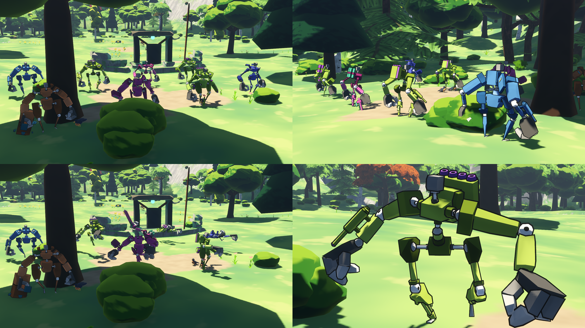

Pedido do usuário: usar o Mech_00 com um sorteio de armas e equipamentos para nascerem robôs inimigos pelo vale, poucos (ele planeja muitos em outro lugar, mais adiante). **O repositório do GitHub passou a privado** (decisão dele), porque a licença do pacote proíbe redistribuir os arquivos.

- **Arquivos:** os FBX do pacote entram direto em `assets/vale/mech00/` (a Godot importa): `mech00_corpo.fbx`, `mech00_corpo_a.fbx` (expansão), `mech00_anim.fbx` (25 MB), `extras/*.fbx` (17) e `paletas/` (47 texturas de 80 px). Cada FBX guarda o esqueleto numa orientação diferente e só o das animações bate com elas; por isso ele é a base, e as peças dos outros dois são penduradas no esqueleto dele (as peças se prendem aos ossos pelo nome). Passar o corpo pelo Blender deixava os robôs deitados.
- **`Mech00Visual.montar(semente, altura, ruido)`** (herda `MechVisual`): sorteia um conjunto (S, M, L da base ou da expansão) para cada um dos 8 lugares do corpo, 30% de chance de braço-canhão, uma paleta, a arma (35% espada ou martelo na mão; senão uma das 3 armas no antebraço), 55% de equipamento nas costas (canhão simples ou duplo, dois lança-mísseis, mochila a jato), placas de armadura nos ombros e módulos nas coxas. Os extras vão no osso de encaixe do tamanho da peça onde ficam. A mesma semente dá sempre o mesmo robô. O resultado fica em `ficha`.
- **`Mecha`** (herda `Vigia`): o jeito de lutar sai da ficha. Espada ou martelo: chega junto e bate (`Vigia.corpo_a_corpo`). Arma de mão ou canhão: atirador a 15 m. Equipamento de tiro nas costas: atira de 24 m, mais devagar. Cada placa de armadura faz aguentar um tiro a mais (3, 4 ou 5 tiros) e corpo grande anda mais devagar. Desliga e religa como as outras máquinas.
- **No vale:** 8 mechas, um por lugar (`InimigosVale.MECHAS`), ao lado das máquinas que já existiam (47 ao todo).
- **Testes:** `--teste-vale` 27 pontos (o 19º conta os 8, confere as fichas e põe um de espada ou martelo para acertar o robô). Fotos: `-- --vale-captura --mechas`.

**Não verificado:** nada jogado. Algumas paletas são bem vivas (rosa, azul claro) e podem destoar; a mochila a jato é só enfeite; o passo não foi casado com a velocidade; a mistura de peças de conjuntos diferentes pode deixar frestas em alguma combinação.


## 53. Só mechas, e projéteis por tipo de arma (2026-11-16)

- **Máquinas antigas fora (pedido do usuário, que não achava os 8 mechas):** Carrapato, Batedor, Vigia de pacote e Sentinela saíram do jogo com o código, os modelos do Animated Mech Pack e o `sentinela.glb`. Todos os lugares de máquina agora têm mecha: 35 no vale (duplas nos 6 lugares dos antigos Zangões, um nos demais, e 3 **grandes** de 3 m nos lugares das Sentinelas: `Mecha.chefe`, aguentam o dobro) e um na clareira, rio acima do começo. Ficam `MaquinaPequena` (base: calor, desligar, religar, projéteis), `Vigia` (a máquina de chão que ronda, caça e ataca), `MechVisual` (base do corpo animado), `Mech00Visual` e `Mecha`.
- **Projéteis por tipo de arma (`MaquinaPequena.TIROS`):** o tiro lento laranja de 15 m/s saiu.
  - **bala** (fuzil e metralha de mão): 95 m/s, risco claro; cada uma vale um terço de acerto.
  - **pesado** (arma grossa, braço-canhão, canhões das costas): 62 m/s, caroço laranja; vale dois terços.
  - **míssil** (lança-mísseis das costas): 27 m/s, sai para cima, vira para o robô aos poucos (1,5 rad/s) e estoura num raio de 3,2 m; vale um acerto inteiro. Dá para escapar correndo de lado ou voando.
  - A arte é simples de propósito (passam depressa). O projétil rápido conta o ponto mais perto do trecho andado no quadro, para não atravessar o robô.
- **Armas dos mechas:** fuzil (um tiro certeiro a cada 1,6 s), metralha (rajada de 3), arma grossa e braço-canhão (um pesado), canhão simples ou duplo nas costas (1 ou 2 pesados), lança-mísseis (1 ou 2 mísseis a cada 5 s). Cada arma tem o erro de mira dela (`Vigia.espalha`), e o aviso vermelho antes de atirar continua.
- **Equilíbrio do jogador:** `Armadura.levar_golpe` ganhou `dano` (fração de acerto); três acertos inteiros ainda desligam o robô. O tiro do robô passou de 85 para 130 m/s.
- **Testes:** `--teste-vale` 28 pontos (o 19º virou dois: mechas e projéteis); `--teste` 95.

**Não verificado:** nada jogado; o equilíbrio (dano das balas, erro de mira, míssil) é chute; os projéteis não foram vistos em foto.


## 54. Ataque no braço certo, queda no lugar e menos mechas (2026-11-16)


Do teste do usuário: um mecha atirava "do peito" esticando o braço sem arma, um caído ficou flutuando sobre o rio e outro não assentou no terreno; e 35 era demais.

- **Braço e origem do tiro:** o tiro saía da cabeça e a animação era sempre a do braço direito, mesmo com o braço-canhão no esquerdo. Agora `Mech00Visual` guarda o braço que ataca (`ficha.lado`) e a boca da arma (`boca`: a arma do antebraço, a mão do braço-canhão ou o equipamento das costas); `ponto_tiro()` é de onde o projétil sai. Animações: `Mech_Shoot_L/R` pelo braço, `Mech_ShoulderShoot1` para as costas e um de três golpes (`Mech_Attack1..3_R`) para espada e martelo.
- **Tempo:** a animação começa dentro do aviso, para o projétil sair com o braço estendido (`tempo_do_tiro()`: 0,45 s no tiro de mão, 0,4 no de ombro, 0,58 no golpe; medido nas animações).
- **Queda:** a animação `Mech_Die` arrastava o corpo uns 4,5 m para trás pelo osso de trajeto (`c_traj`); a trilha foi tirada e ele cai onde está. Caído, `MechVisual` mede cada osso contra o terreno debaixo dele (`chao`) e sobe ou desce o corpo até encostar, e `Vigia._deitar_no_terreno` inclina o corpo com a ladeira.
- **Quantos:** de 35 para 12 no vale (duas duplas, seis sozinhos, dois grandes), mais o da clareira. `InimigosVale.LUGARES`. O vale é para ter muita paz e uma briga de vez em quando; a ação em quantidade fica para o outro lugar que o usuário planeja.
- **Testes:** `--teste-vale` 28; `--teste` 95. Fotos: `-- --vale-captura --mechas-tiro`.

**Não verificado:** visto em fotos paradas; o encaixe do tiro com o braço em movimento e a queda em terreno muito inclinado só jogando.


## 55. Efeitos dos tiros com o Kenney Particle Pack (2026-11-16)

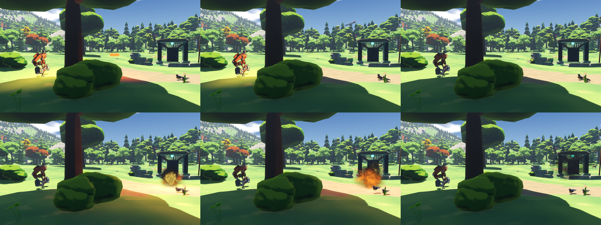

O usuário perguntou se o pixelfx ajudava nos tiros e lembrou do pacote de partículas que o projeto já usa; ficou o do Kenney (CC0), que não é pixel art e casa melhor com o vale. Mais dez imagens foram para `assets/fx/kenney/` (reduzidas a 256 px).

- **`EfeitosTiro`** (`scripts/vale/efeitos_tiro.gd`): `clarao` (língua de fogo na boca da arma e um brilho de 0,09 s), `cruzado` (dois quadros cruzados para rastro e chama, vistos de qualquer lado), `impacto` (estalo, nove faíscas que caem e um fio de fumaça), `explosao` (clarão, bola de fogo em duas imagens, faíscas, anel de calor e fumaça escura subindo) e `rastro_fumaca` (atrás do míssil).
- **Onde entra:** todo tiro de mecha acende o clarão na arma; a bala e o tiro pesado ganharam rastro; bala no chão ou no robô faz o impacto; o míssil solta fumaça e estoura com a explosão. O tiro do robô do jogador ganhou o clarão na mão.
- **Duas lições:** a posição da leva de partículas tem de ser dada antes de entrar na cena (posta depois, nasciam no centro do mapa); e fogo somado à luz quase some de dia sobre o capim claro, então fogo e clarões cobrem (mistura normal) e só as faíscas somam.
- **Testes:** `--teste-vale` 28; `--teste` 95. Fotos: `-- --vale-captura --efeitos-tiro`.

**Não verificado:** visto em fotos paradas, de dia; de noite e em movimento, só jogando. O rastro da bala não apareceu em nenhuma foto (ela passa em dois quadros).


## 56. Saem as seis grutas pequenas (2026-11-16)


O usuário achou mais um defeito de parede numa caverna, perto do Platô das Flores, e propôs tirar as cavernas ou achar um jeito melhor. Era a Gruta da Lua, sorteada no meio do platô: de cima aparecia um retângulo de chão refeito sem flores, com lajes de pedra na beira, e a boca era um buraco no campo.

- **Decisão:** as seis grutas sorteadas (§37 e §42) saíram. Cavar debaixo de uma grade de alturas pede rebaixar a grade e refazer o morro por cima como peça, e cada emenda entre as duas é um lugar para defeito; em seis lugares escolhidos por sorteio ninguém conferia todos. **Fica o Sumidouro** (§40), que é um lugar só, desenhado e conferido.
- **Código:** `Cavernas` ficou só com o chão original (`chao_antes`, `dentro`, `cavar`); saíram o gerador, `gruta_0..5.res`, os nomes na tela e o eco das grutas. O Sumidouro desviava das grutas ao escolher o morro: a lista dos lugares antigos ficou em `Sumidouro.ANTIGAS` só para ele não mudar de lugar.
- **Testes:** `--teste-vale` 28 (o 20º agora confere que nada fora do Sumidouro foi cavado e que o platô é o chão original; o eco do 21º é medido no Sumidouro); `--teste` 95. Fotos: `-- --vale-captura --cavernas` mostra os seis lugares antigos.
- **Se voltarem:** como rocha posta em cima do chão (um afloramento com o vão dentro, sem mexer na grade), de preferência com modelo de pacote.

**Não verificado:** nada jogado. Numa foto de cima do Sumidouro há uma faixa clara na encosta ao lado da boca que pode ser a mesma laje de beira de peça; não conferi de perto.


## 57. Troca das árvores por distância, árvore a árvore (2026-11-16)

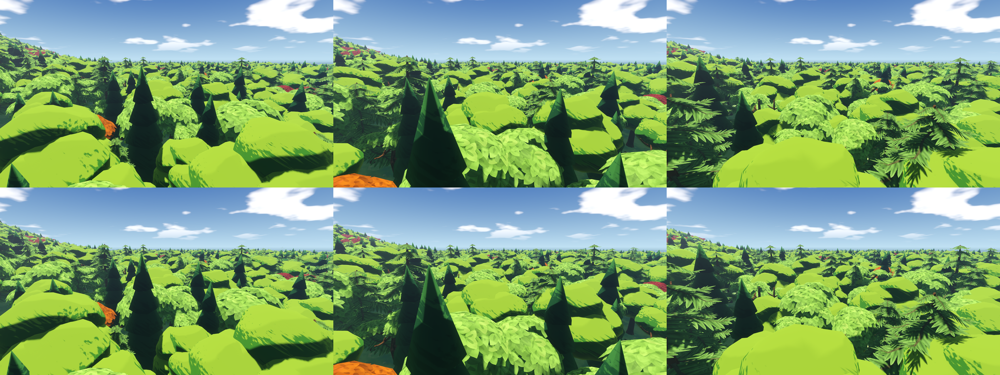

O usuário via árvores piscando e aparecendo. A mata era desenhada em blocos de 160 m, e o bloco inteiro trocava o modelo completo pelo vulto de uma vez quando o centro dele passava de 170 m: uma árvore na beira do bloco trocava a menos de 60 m do jogador. As plantas de chão sumiam do mesmo jeito (bloco a 120 m).

- **Por peça:** cada árvore, planta e pedra carrega as distâncias dela no MultiMesh (`INSTANCE_CUSTOM`: some até x, surge a partir de y) e o shader mede a distância da peça até a câmera do jogo (`presenca` em `vale_comum.gdshaderinc`, usada por `vale_solido`, `vale_folha` e `vale_tex`). Fora da faixa a peça vira um ponto no vértice e não custa pixel.
- **Transição:** nos últimos 34 m o modelo de perto some em pontilhado e o de longe aparece com a trama do avesso, no mesmo lugar. A sombra acompanha (usa a câmera do jogo também na passada de sombra).
- **Distâncias:** árvore completa até 190 m (`Clareira.TROCA_ARVORE`), plantas pequenas até 140 m, moitas e pedras até 280 m. Os blocos de perto da mata passaram a 100 m; o bloco só some quando nenhuma peça dele pode aparecer (`Clareira._multi`).
- **Custo no Mac, três pontos da mata:** de 14,8 / 16,6 / 16,3 ms para 15,6 / 17,1 / 17,0 ms por quadro (uns 13% a mais de triângulos).
- **Lição:** parâmetro de shader por instância (`instance uniform`) estoura o limite do Godot com milhares de blocos; o dado por peça do MultiMesh não tem limite.
- **Testes:** `--teste-vale` 28; `--teste` 95. Fotos: `-- --vale-captura --troca`.

**Não verificado:** visto em fotos paradas; o pontilhado em movimento e o custo no PC só jogando. As rochas dos paredões (520 m) e o fim dos vultos (1.300 m) continuam trocando por bloco.


## 58. Falésia na borda do mapa (2026-11-16)


O usuário saiu voando pelo Platô das Flores, olhou para trás e viu o chão por baixo, sem parede. A grade do vale acaba em x e z = ±1.000 m, e em três lados a terra chega lá acima do mar: o norte inteiro (até 88 m), o oeste inteiro (até 69 m) e 250 m do leste, no platô (25 m). Ali o chão terminava no ar.

- **`Vale._falesia_da_borda`:** de cada nó da borda desce uma parede de pedra até o fundo do mar (-15 m), em dois lances, com o pé de 3 a uns 50 m para fora conforme a altura e um ruído; nos cantos os dois lados saem na diagonal e se encontram. Material dos paredões (`vale_rocha`), sombreamento por face, colisão dos dois lados.
- **Testes:** `--teste-vale` 28. Fotos: `-- --vale-captura --largo --borda`.

**Não verificado:** nada jogado. A falésia é reta como a borda do mapa e clara ao sol, sem rochas soltas nem musgo; de longe lê como um corte. O `--teste` de voo não foi rodado depois desta mudança (ela só mexe no vale).

**Enfeite da falésia (mesmo dia, a pedido):**

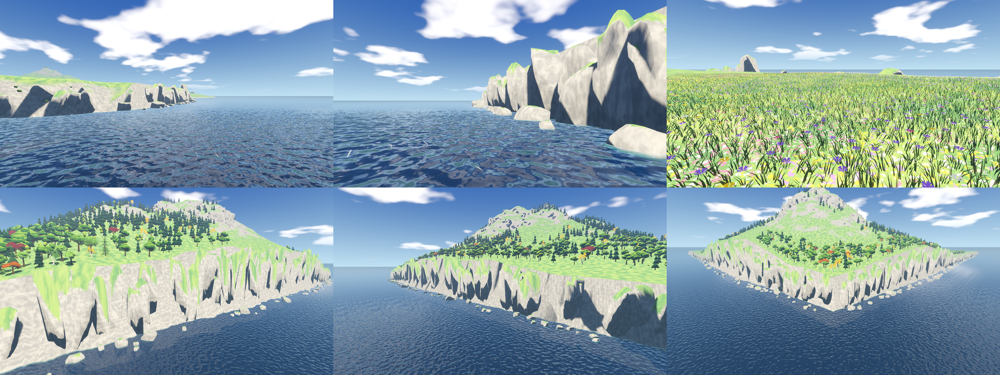

`Paredoes.montar` ganhou uma passada pela borda do mapa: 746 rochas das mesmas quatro variantes dos paredões. Colunas encostadas na parede (42% dos nós com mais de 5 m, alturas de 45% a 80% da falésia, capim no topo de cada uma) quebram a linha reta e fazem fendas de sombra; no pé, pedras de 1,5 a 4,5 m meio dentro d'água. Todas com colisão. `--teste-vale` 28. Não verificado: nada jogado; o custo das 746 colisões a mais não foi medido.


## 59. A base nova: hangar em ruínas, cilindro, Faísca caído e o drone colega (2026-11-16)

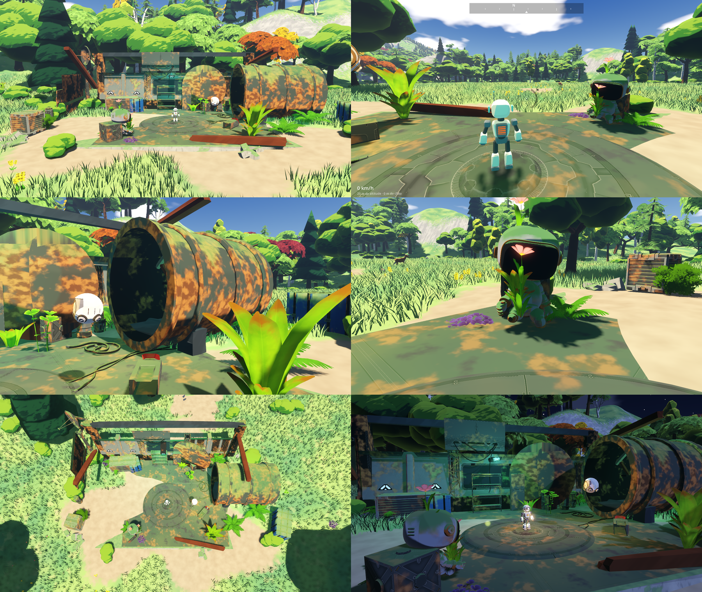

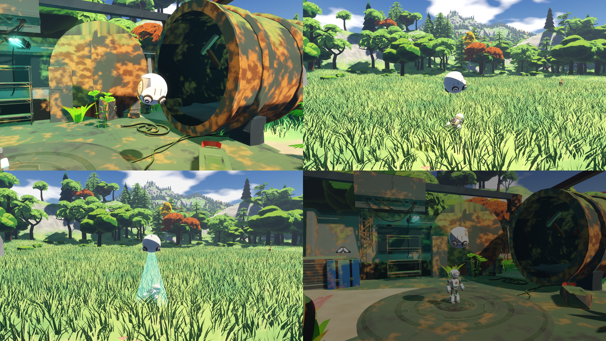

O usuário mandou duas imagens de ideia (um robô grande caído e tomado pelo mato num galpão em ruínas; um cilindro enferrujado de porta redonda com um drone ao lado) e apontou dois kits do Quaternius que ele baixou: **Sci-Fi Essentials Kit** e **Modular SciFi MegaKit** (CC0). Pediu o Faísca caído, sem funcionar, coberto de mato; o drone como colega do robô, parado junto do cilindro onde o robô vai receber melhorias (futuro); e o drone vindo buscar o robô caído em combate.

- **`BaseVale`** (`scripts/vale/base_vale.gd`, chamado por `Ruinas._base`): laje, piso de chapas (13 de 4 m), estrado redondo do nascimento, três panos de parede (um quebrado, um com janela), colunas, viga e duas vigas caídas, cabos pendurados, lâmpada verde-água, caixas, tambores, armário, prateleira e a antena parabólica. 40 peças dos kits em `assets/vale/base/` (os `.gltf` copiados sem as texturas embutidas; 12 texturas de cor à parte, 14 MB).
- **`vale_base.gdshader`:** a cor da textura do kit com a luz em faixas do vale, mais **ferrugem** (placas largas por ruído, lidas no plano da face para não riscar) e **musgo** (faces viradas para cima). Cada peça escolhe quanto de cada.
- **Cilindro de melhorias:** feito por código (tubo de 4,6 m de diâmetro por 6,4 m, aros, porta redonda aberta com raios, berços, estrado, dois braços e um painel por dentro, luz acesa). Dá para entrar andando. Ainda não faz nada.
- **Faísca caído:** `assets/faisca/faisca.scn` voltou do histórico do git (o modelo da Ilha Cafuné). Sentado no chão contra uma caixa, na frente do estrado à direita, no **tamanho original** (1,5 m; o usuário pediu no meio do trabalho, eu tinha feito o dobro). Sem luz no rosto, pintura desbotada, ferrugem e musgo, uma flor na cabeça. Pose por ossos (`_dobrar`, giros nos eixos do esqueleto).
- **`DroneColega`** (`scripts/vale/drone_colega.gd`, modelo `Enemy_EyeDrone`, 0,72 m): paira no posto ao lado da boca do cilindro e vira para o robô quando ele chega a menos de 22 m. Na pane (`entrou_pane`) aparece no alto, desce em 2 s até 2,3 m sobre o robô e acende um facho; com a tela escura os dois reaparecem na base (`voltou_base`, sinal novo do `Armadura`); quando o robô religa, ele volta ao posto.
- **Tempos da pane:** a tela começa a escurecer aos 2,6 s (era 0,5), a volta à base é aos 4,4 s (era 2,3) e a pane dura 7,2 s (era 5), para dar tempo de ver o drone chegar (`Ajustes.PANE_ESCURECE`, `PANE_VOLTA`, `PANE_TEMPO`).
- **Testes:** `--teste-vale` 28 (o 16º confere o drone chegar e voltar ao posto, as peças, o Faísca e o cilindro; o 2º anda para o campo, porque atrás agora há parede); `--teste` 95. Fotos: `-- --vale-captura --base` e `--resgate`.

**Não verificado:** nada jogado. O drone não tem som. A frente do modelo do drone foi suposta em +Z (ele pode estar olhando de costas). A colisão das peças é uma caixa por peça. O capim do chão some num raio de 12,5 m em volta da base.


## 60. Conferência da física: copas, degraus e tiros (2026-11-16)

O usuário pediu uma passada geral: colisão com a copa das árvores, desníveis baixos que o robô deveria subir levantando a perna, e tiros atravessando árvores e outras coisas sólidas. Achei e corrigi quatro coisas.

- **Colisão das árvores pelo modelo de cada uma.** Todas usavam a mesma medida (a das árvores antigas): tronco de 5 m e uma copa sólida de 3 m de raio centrada a 6,8 m, vezes a escala. Com os 18 modelos de hoje isso errava para os dois lados: na `q_arvore_b` a folhagem começa a 6 m e havia "copa" sólida invisível desde 3,7 m; no `carvalho_b` e no pinheiro o topo (até 14 m) atravessava; os pinheiros novos têm galhos ralos desde o chão. Agora `Clareira.forma_da_arvore` mede cada modelo uma vez (raio em 24 faixas de altura) e `Ilha._medidas_colisao` usa isso: tronco fino até a folhagem, copa sólida só no miolo (55% do raio médio nas folhosas, 30% nos pinheiros, onde ela começa acima de 2,6 m), do começo da folhagem até 40 cm do topo. As pontas dos galhos continuam atravessáveis, e por baixo da copa passa-se livre. `arv_nome` guarda o modelo de cada árvore.
- **Degraus.** O robô parava em qualquer quina acima de uns 9 cm (a beira do estrado da base, de 19 cm, já barrava). `Armadura._subir_degrau`: andando no chão contra um desnível de até 48 cm (`Ajustes.DEGRAU`), ele sobe sozinho, se couber por cima e houver piso firme lá; o corpo desenhado e a câmera alcançam o degrau aos poucos (`_degrau_y` em `pos_suave`). Parede, tronco e rampa íngreme continuam barrando.
- **Projéteis dos mechas.** Só paravam no terreno e no robô: atravessavam troncos, copas, rochas, ruínas e a base. Agora cada trecho andado é conferido por raio e o projétil para (com impacto, ou explosão no caso do míssil) no que encontrar; o robô atrás do obstáculo não é atingido.
- **Vista dos mechas.** `alvo_visivel` só olhava o terreno. Rocha, ruína e parede no caminho agora tapam a vista (as árvores não: o mecha atira, e o tronco é que segura o tiro).
- **Tiro do robô.** O tiro travado ia até a máquina mesmo com algo no meio. Agora, travado ou não, se há tronco, copa, rocha ou parede entre a mão e o ponto, o tiro para ali.
- **Testes:** `--teste-vale` 29 (o ponto novo sobe um degrau de 36 cm, barra num de 95 cm, confere a colisão de uma árvore isolada contra o modelo, e põe uma parede entre um mecha e o robô); os pontos de projétil e de mira travada passaram a medir sem árvores no caminho. `--teste` 95.

**Não verificado / fica como está:** nada jogado. Só as árvores a até 70 m do robô têm colisão (limite antigo): um tiro de mecha longe do robô ainda atravessa árvores. Os mechas e os bichos continuam andando pela altura do terreno, sem colidir com árvores, rochas ou a base. As folhas que voam ao cruzar a copa (`EfeitosMato`) e a altura das copas para os inimigos ainda usam a medida genérica. A câmera não foi conferida contra as peças novas da base.


## 61. Mechas e bichos desviam dos obstáculos (2026-11-16)

Pendência da §60: mechas e bichos andam pela altura do terreno, sem física, e atravessavam troncos, pedras, ruínas e a base. O usuário pediu que colidam e sejam espertos para desviar ou destravar.

- **`Obstaculos`** (`scripts/vale/obstaculos.gd`): um mapa de círculos no chão, numa grade de 8 m. Quem cria colisão registra a forma (`registrar_forma`): pedras soltas, blocos dos paredões, peças das ruínas e da base. Só entra o que fica de pé na altura do corpo: laje até 0,5 m (dá para pisar) e viga acima de 3,2 m (passa-se por baixo) ficam de fora. Caixas compridas viram uma fila de círculos. Os troncos saem da grade de árvores, com o raio do modelo. 4.807 obstáculos registrados, fora as 12 mil árvores.
- **Não depende da física:** vale no mapa todo, não só perto do robô.
- **Mechas** (`Vigia`): antes de cada passo procuram o rumo livre mais perto do que queriam (`Obstaculos.rumo_livre`): o direto, depois de 30 em 30 graus por um lado só, e só então pelo outro. Guardam o lado em que começaram a volta, para contornar sem ir e voltar, e largam a volta assim que o rumo direto abre. Na caça continuam de frente para o robô, andando de lado se for preciso. **Destravar:** se querem andar e não saem de meio metro em 1,2 s, trocam o lado da volta; em ronda escolhem outro destino. Os pontos de ronda não caem mais dentro de obstáculo.
- **Cervos, raposas e lobos** (`Cervo._passo`): a mesma regra de um lado só e o mesmo destravar; não escolhem ponto de pasto dentro de obstáculo. **Coelhos:** o pulo confere o caminho.
- **Quem nasceu dentro de um obstáculo** pode sair (o caminho só é barrado para quem está fora).
- **Testes:** `--teste-vale` 30 (o novo põe uma fila de pedras entre um mecha em ronda e o destino, e um cervo fugindo contra ela: os dois dão a volta sem atravessar; cercado por um anel, o mecha nota que travou). `--teste` 95.

**Não verificado:** nada jogado. Mechas e bichos não desviam uns dos outros nem do robô. O Sumidouro e a falésia da borda não estão no mapa de obstáculos (lá vale a regra antiga de inclinação e água). Em bolsão fechado de três lados o bicho pode demorar uns segundos para achar a saída.


## 62. Do teste no Mac: Faísca, drone amigo, passos e pausa (2026-11-17)

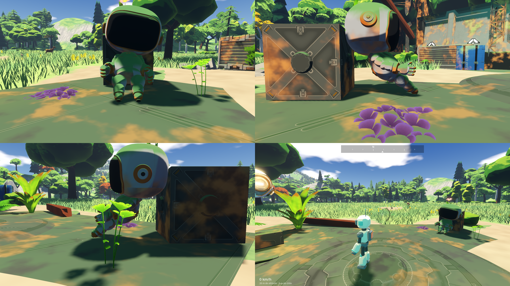


O usuário jogou no Mac e mandou cinco pontos.

- **Faísca:** estava grande e flutuando. Agora tem o tamanho do robô do jogador (1,2 m de pé; `ESCALA_FAISCA` 0,8) e está caído de verdade: o corpo inteiro reclinado 50° para trás, pés no chão e costas na caixa, braços soltos e a cabeça caída. A pose por ossos das pernas saiu (elas ficavam penduradas e a mão virava o ponto mais baixo). No quadro seguinte à montagem o ponto mais baixo das peças é medido de verdade e encostado no chão.
- **Não atirar no colega:** com o drone na linha da mira, antes de qualquer obstáculo, o tiro não sai e a tela avisa "colega na mira" (`Tiro._amigo_na_mira`, grupo `amigos`).
- **Fala do drone:** seis frases de bipes e assobios feitas por síntese (`tools/sons_sinteticos.py`, `drone_1..6.wav`). Fala quando o robô chega a menos de 7,5 m, de novo a cada 8 a 16 s enquanto ele fica por ali, e ao chegar no resgate.
- **Passos:** as pisadas gravadas de metal soavam como salto alto (estalo agudo e seco). As seis novas são de síntese: o zumbido curto do motor da junta, um baque grave que cai de tom, um toque de metal abafado e um chiado de capim, tudo cortado acima de 3,2 kHz.
- **Pausa:** refeita (`scripts/pausa.gd`). Cartão no meio com cinco botões grandes (Continuar, Voltar à base, Comandos, Vibração, Sair), o escolhido aceso em laranja e uma linha embaixo dizendo o que ele faz; uma dica diferente a cada abertura; sair pede um segundo toque; os comandos viraram uma página em tabela, com aba para o controle e para o teclado.
- **Testes:** `--teste-vale` 31 (o novo confere a fala do drone, o tiro que não sai e os arquivos de som); `--teste` 95. Fotos: `--vale-captura --base` e `--pausa`.

**Não verificado:** os sons novos não foram ouvidos por ninguém (são de síntese, eu só confiro que existem e tocam). A pausa não foi testada com o controle na mão.


**Faísca, terceira versão (2026-11-17):** o usuário achou a pose reclinada estranha e o tamanho ainda grande.

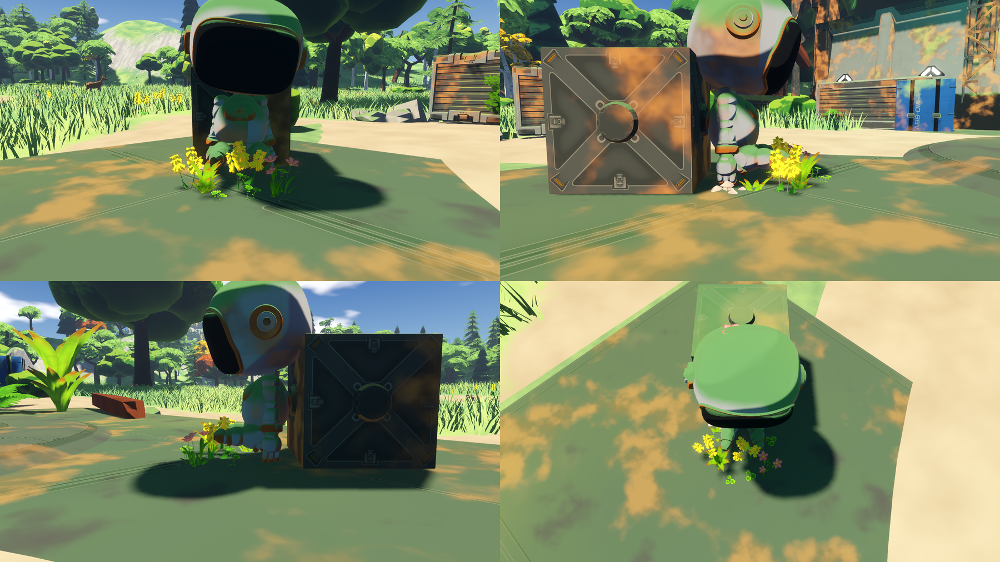

Agora ele está sentado: tronco quase de pé (10° para trás, costas na caixa), as duas pernas esticadas para a frente, os braços caídos ao lado do corpo e a cabeça baixa. Voltou a pose por ossos (`_dobrar`), que funciona; o que falhava antes era assentar pela conta dos ossos, e isso já é medido nas peças. Escala 0,66 (perto de 1 m de pé, uns 18% menor que o robô do jogador). A caixa de encosto ficou em 80%. Onze plantas pequenas (trevos, flores, um cogumelo, de 12 a 16% do tamanho normal) em volta e entre as pernas, e a flor da cabeça menor.


## 63. Análise de desempenho e o primeiro pacote de melhorias (2026-11-17)


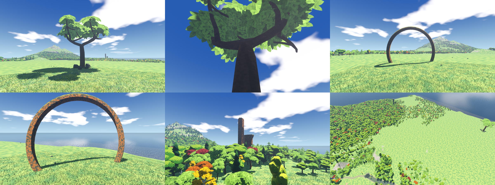


O usuário pediu uma análise de jogo ("como um designer/dev sênior") e, das propostas, mandou fazer: o capim em duas densidades e a opção de qualidade; salvamento; marcas de dano na mira; ajustes básicos; todas as do mapa; o vulto da própria árvore "se não pesar muito"; e o drone com mais vida. As melhorias do robô ficaram para escolher (lista no fim).

**Medição** (`-- --vale-captura --perf`, sem limite de quadros, Mac, 1600×900): o pior ponto era onde o jogador nasce.

| Ponto | Antes | Alta | Média | Baixa |
|---|---|---|---|---|
| Base, olhando o campo | 27 | 34 | 45 | 65 |
| Campos do sul | 35 | 52 | 65 | 103 |
| Mata fechada, no chão | 55 | 54 | 65 | 91 |
| Do cume | 66 | 64 | | |
| No alto, mapa inteiro | 69 | 62 | | |

(quadros por segundo). Desligando uma coisa de cada vez: o capim era o maior custo (na base, 27 → 59 sem o capim fixo; nos campos, 35 → 128 sem o capim em volta do robô), depois a suavização 4x sobre ele e as sombras (um terço do quadro na mata). Bichos, mechas e as peças da base não aparecem na conta. Baixar a resolução quase não ajuda.

- **Capim em duas densidades** (`Qualidade`, `vale_capim.gdshader`): 30% das touceiras, 45% maiores, vão até 95 m; as outras só existem perto do robô e encolhem até sumir entre 70% e 100% de `perto_ate` (por touceira, no vértice). Vale para o capim fixo da clareira e para o que nasce em volta do robô.
- **Qualidade do desenho** (baixa, média, alta; ajuste da pausa): capim cheio até 16 / 34 / 60 m, suavização desligada com FXAA / 2x / 4x, sombras em 2 faixas até 130 m / 4 até 220 m / 4 até 380 m, e as distâncias de troca de árvores, plantas e pedras em 60% / 80% / 100% (`troca_fator`, parâmetro global de shader). O padrão é a média. Nas fotos e nos testes vale a alta.
- **Vulto da própria árvore:** de 190 a 450 m cada árvore é a versão leve dela mesma (já existia no pacote, 176 a 550 triângulos); além de 450 m, o vulto genérico barato. Levar a versão própria até o horizonte custava uns 20% nas vistas altas (cume 66 → 53), por isso o meio-termo.
- **Salvamento** (`Guardado`, `user://faisca2.json`): ajustes e progresso (lugares visitados, hora do dia; peças e melhorias já têm lugar). Grava ao achar um lugar, de minuto em minuto e ao sair. Testes e fotos não leem nem gravam.
- **Ajustes na pausa:** qualidade, sensibilidade da câmera (5 passos, de 0,5 a 1,8), eixo vertical invertido, vibração, e apagar o progresso (pede segundo toque).
- **Marcas de dano:** três traços à esquerda da mira (`Hud`). Cada acerto de máquina deixa um laranja; a bala enche aos poucos; no último ele pisca. Só aparecem com dano.
- **Drone com mais vida:** sozinho, olha em volta de tempos em tempos; com o robô a menos de 10 m, chega até 2,4 m para o lado dele; leva um susto e reclama quando vira alvo; dá uma cambalhota quando o robô religa depois do resgate.
- **Ilha** (`Vale._borda_ilha`): perto das quatro bordas a terra desce até o fundo do mar por uma faixa de 105 a 345 m (mais comprida onde a terra é alta), com a largura ondulando ao longo da costa; o que fica perto do nível do mar vira areia. A falésia da §58 não acha mais nada para fechar (0 rochas). As árvores de fora caíram de 12.211 para 10.786 e os blocos de paredão subiram de 405 para 1.492 (as encostas novas).
- **Marcos altos** (`Marcos`): a **Árvore-Mãe** (70 m, no Platô das Flores, com pedras em roda), **O Anel** (62 m de diâmetro, de pé, meio enterrado, dá para voar por dentro; Campos do Sul) e **As Colunas** (três de 65 m num morro do nordeste). Os três têm nome na tela, colisão e entram no mapa de obstáculos. São 13 lugares com nome mais o Sumidouro.
- **Testes:** `--teste-vale` 31; `--teste` 95.

**Não verificado:** nada jogado. O salvamento não tem teste automático (os testes o desligam). A qualidade baixa e a média só foram medidas, não olhadas com calma. A ilha continua quadrada vista do alto. Interiores novos (cavernas de rocha sobre o chão) não foram feitos.

**Propostas de melhorias do robô** (aguardando escolha do usuário; nenhuma mexe em arma):

| Peça | Efeito no jogo | O que muda no robô |
|---|---|---|
| Radiador de aletas | voa mais tempo antes de aquecer (60 s → 100 → 160 s) | aletas nas costas que abrem no voo e ficam rubras com o calor |
| Bocais largos | mais velocidade de cruzeiro e de arrancada | bocais maiores nos pés, chama mais comprida e azulada |
| Asas de planar | plana mais longe e fecha mais a curva | duas asas curtas que abrem ao planar |
| Barbatanas | nada mais rápido e esfria mais na água | barbatanas nas canelas |
| Amortecedores | cai de alto sem tranco, pulo mais alto | pistões nas pernas |
| Ombreiras | aguenta um acerto a mais (até dois) | placas nos ombros |
| Antena de busca | a bússola aponta peças e lugares não visitados | antena maior com luz piscando |
| Farol de peito | luz forte à noite e no Sumidouro | farol no peito |
| Células de reserva | esfria mais depressa no chão | células acesas na mochila |


## 64. Melhorias do robô: peças pela ilha (2026-11-17)

O robô começa básico e ganha cada melhoria achando uma peça na ilha e levando ao cilindro da base. Nenhuma
mexe em arma (o usuário tem outra ideia para isso). As ombreiras (vida) ficaram para a etapa de combate.

**Como funciona.** Cada peça é uma caixinha que flutua, com um facho de luz verde-água (`PecasMundo`,
`scripts/vale/pecas_mundo.gd`). Chegando a 2,4 m o robô pega (sem botão); a peça só vale quando ele entra
na boca do cilindro, que instala tudo o que ele carrega (aro de luz subindo, aviso na tela, o drone
comemora). O estado fica em `Melhorias` (`scripts/melhorias.gd`): `achadas`, `instaladas`, e as funções
com os números. No arquivo de progresso são as chaves `pecas` e `melhorias`. Nos testes e nas fotos o robô
tem tudo (`Melhorias.tudo`); `--basico` mostra o do começo.

| Peça | Onde fica | Básico | Com a peça |
|---|---|---|---|
| Antena de busca | na Clareira, perto da base | bússola só com norte e marcador | triângulo verde: peça mais perto, depois lugar novo; carregando peça, a base |
| Radiador de aletas | Campos do Sul | voo aquece em ~60 s (1,65 %/s), pairar 2,4 %/s | ~3 min (0,55 %/s), pairar 0,8 %/s |
| Bocais largos | O Anel | arrancada 22 m/s | arrancada 28 m/s, cruzeiro +1,5 m/s |
| Asas de planar | Serra do Mirante | planar como antes | arrasto ×0,45 planando, estol 8 m/s, giro ×1,35 |
| Barbatanas | Cachoeira | só o nado normal | nado rápido |
| Molas | As Colunas | pulo e pouso como antes | pulo ×1,118 (25% mais alto), pouso forte ou leve dura metade |
| Luz do peito | boca do Sumidouro | sem luz | farol ligado por seta para cima / L |
| Células de reserva | Árvore-Mãe | esfria 15 %/s no chão | 30 %/s |
| Scanner | (a fazer) | | visão de câmera com zoom e ficha do bicho ou inimigo |

**Visual** (`MelhoriasVisual`, `scripts/melhorias_visual.gd`): versão minimalista aprovada pelo usuário
depois de quatro rodadas na vitrine (`tools/vitrine_melhorias.gd`, folhas em `docs/vale/melhorias_*`).
O robô básico tem a mochila lisa (o painel laranja e as grades do modelo ficam escondidos); o radiador são
só quatro aletas verticais cujo fio segue o calor; os bocais ficam embaixo dos pés no lugar da brasa, com
chama azulada; as asas são grandes e saem da mochila só planando (motor desligado e sem cair a pique);
as molas ficam atrás das coxas; as barbatanas, nos antebraços e por fora das botas; a luz é um aro com
grade sobre o núcleo do peito. As peças são postas em relação à pose de descanso guardada na criação do
robô (`preparar`), então podem ser vestidas com ele em qualquer pose. `--cheio` na vitrine mostra a
versão maior, que ficou de registro.

**Falta:** o scanner (aparelho modelado, visão não desenhada; rascunho da tela antes), animação de entrar
no cilindro, lista das melhorias na pausa, e afinar os números com o usuário jogando.


## 65. Bússola, oficina e scanner (2026-11-17)

Três pedidos do usuário depois de ver a §64 funcionando.

**Bússola.** A base aparece sempre, como uma casinha (some a menos de 14 m). A antena de busca não aponta
mais a peça mais perto de qualquer distância: só capta peças a menos de 300 m (`PecasMundo.RADAR`, sai do
radar a 345 m), um triângulo verde por peça, sem distância escrita. Quando uma peça entra no alcance toca
um bipe e aparece "Sinal captado". A base nunca vira objetivo: instalar é no tempo do jogador.

**Oficina** (`scripts/vale/oficina.gd`). A instalação automática ao passar na boca do cilindro saiu. Perto
da boca aparece o convite (quadrado / E, ação `agir`); o robô é travado (`Armadura.travado`), entra
andando, três braços de dois segmentos descem do teto (cotovelo pela conta dos dois comprimentos) e abre a
tela: câmera própria na boca, o robô à esquerda e o cartão à direita com a energia da base e as nove peças
(instalada, pronta para instalar, ou "peça ainda não encontrada"). A peça em foco aparece no corpo como
prévia (`vestir_melhorias(extra)`, `previa` abre as asas e acende a luz) e o robô vira para o lado em que
ela se vê. Instalar (X / Enter) leva 1,9 s com os braços trabalhando; O / Esc sai.
**Energia da base:** 0 a 100, cada instalação gasta a carga inteira (`Melhorias.CUSTO`) e a base recarrega
em 5 min de jogo (`RECARGA`), a pedido do usuário. Começa cheia: a primeira peça sai na hora, as outras
esperam 5 min cada. O robô fica em cima do estrado do cilindro, e uma rampa na boca sobe do chão até ele. Quando volta a dar para instalar e o robô carrega peça, aviso "Base recarregada" e um toque. Fica no
progresso como `energia_base`.

**Scanner** (`scripts/vale/scanner.gd`, nona peça, na Torre Caída). Seta para a direita / T, só no chão: a
câmera vai para os olhos do robô (`CameraVoo.primeira`), com moldura de visor e um círculo no meio; R2 aproxima
e L2 afasta, até 4,9×, e o zoom fica onde foi solto (a mira anda mais devagar com zoom); o círculo tem 110 px. Com o círculo em cima de um alvo a até 170 m, sem morro
na frente, a leitura enche em 1,7 s e sai a ficha: bichos (jeito deles), o drone, o Faísca caído, e nas
mechas o equipamento, o ataque, a distância e com quantos tiros desligam, lidos do que ela carrega. O que
já foi lido fica em `escaneados`. Escaneando não atira; pular, voar ou pane fecham o scanner.

Fotos: `--vale-captura --oficina --basico` e `--vale-captura --scanner`. Testes: pontos 32 (melhorias e
oficina) e 33 (scanner), 42 no total.

**Falta:** o usuário jogar; lista do que já foi escaneado (um caderno); som próprio para o radar e para a
oficina (hoje reaproveitam toques existentes); morcegos e a Sentinela não entram no scanner.

**Ajustes do mesmo dia (pedidos do usuário):** o robô fica em cima do estrado do cilindro (antes afundava no
fundo curvo) e uma rampa na boca sobe do chão até ele; a luz do peito apontava para as costas e foi virada;
no scanner R2 aproxima, L2 afasta e o zoom fica onde foi solto. **Muro na saída da clareira:** o vale do
riacho de baixo parava de uma vez no fim da linha do curso e cortava o morro da clareira num muro reto de
10 m, atravessado no riacho, perto de (-80, -78). Em `_cavar_rio` só o começo da linha deixa de abrir o vale
(para proteger o paredão da cachoeira); depois do fim ele se abre em volta da ponta, em encosta.
`--vale-captura --muro` fotografa o lugar e `--ingreme` imprime o mapa do que é íngreme em volta da clareira.
**Luz do robô à noite:** a lanterna de `Noite` (0,9 de força, 5,5 m) iluminava o caminho e, presa à posição
da física dentro do corpo, piscava por baixo da cabeça no voo. Virou só o brilho dos leds: 0,22 de força,
2,4 m, um palmo à frente do peito, seguindo a posição suavizada. Iluminar o caminho é da luz do peito
(melhoria). `--vale-captura --luzes --hora 23` fotografa.

**Planar pelo botão (mesmo dia):** nenhum comando levava ao estado de planar (o `PLANAR` só era alcançado por
teleporte nos testes), então as asas não tinham como ser usadas. Regra pedida pelo usuário, igual para
L3 / Shift e para o X: no voo, **um toque corta tudo e o robô cai**, esteja com o jato ou planando;
**segurar** 0,35 s (`Ajustes.PLANAR_SEGURAR`) troca um pelo outro: do jato para o planador (asas abertas,
motor desligado) e do planador de volta para o jato. Com as asas, o corte do toque acontece ao soltar o
botão (é quando dá para saber que não era uma segurada); sem as asas, corta ao apertar. O X no voo não fazia
nada antes. O / C freia e cai, como sempre.
**Peças (mesmo dia):** a da luz do peito ficava enterrada: no Sumidouro a grade de alturas guarda o fundo da
caverna, e `_assentar` pôs a caixa a 109 m, dentro da rocha. Agora, com teto a menos de 9 m, `_assentar`
usa o chão de verdade achado por um raio vindo de cima; e a peça da luz, a pedido do usuário, fica no piso
do salão do Sumidouro (`_no_salao`, fora da lagoa do meio e com vão livre por cima). Pegar passou a
exigir encostar na caixa (1,15 m do meio do robô ao meio dela): o facho de luz é só sinal.
